# Prime on Solana

Date: 8 October 2026, updated 9 October 2026 for the line-cut gate and for the size pass (formatted sLOC is the official count), 10 October 2026 for the app as shipped on beta (sessions, Confirm the gate, hosts) 11 October 2026 for the app as merged that day (Confirm with the gate and trustee addresses, the account time lock, Add funds, Add a token, Move to a new gate, Reclaim rent, Store again, Propose again, the Prime Assistant), and 18 October 2026 for seat-only sessions. The gate program is unchanged. Status: testnet and local-validator results only. The custody gate runs on Solana devnet as the 9 October 2026 build, deployed with `--final`, and passes 84 of 84 checks there; the first devnet build stays on the cluster as a previous build. The custody gate also runs on a local validator with the mainnet feature set, and its independent security reviews are done, with the verdicts adopt with fixes and, for the line cut, adopt (section 17). Sources: the [Prime session architecture document](https://github.com/untangledfinance/oz-policy-builder/blob/archive/spike-final/contracts/prime/ARCHITECTURE.md) (kept at tag `archive/spike-final`), the line-cut custody gate (126 lines formatted, built from the gate-owned design of [`contracts/prime/spike/matrix/near-minimal/round9/gate-a4/gate-a4-min.md`](https://github.com/untangledfinance/oz-policy-builder/blob/archive/spike-final/contracts/prime/spike/matrix/near-minimal/round9/gate-a4/gate-a4-min.md)), the devnet runs of the new builds ([`contracts/prime/spike/matrix/near-minimal/round9/solana-devnet-sloc2/`](https://github.com/untangledfinance/oz-policy-builder/tree/archive/spike-final/contracts/prime/spike/matrix/near-minimal/round9/solana-devnet-sloc2); the first builds' runs are in [`round9/solana-devnet/`](https://github.com/untangledfinance/oz-policy-builder/tree/archive/spike-final/contracts/prime/spike/matrix/near-minimal/round9/solana-devnet) and [`round9/solana-devnet-gate/`](https://github.com/untangledfinance/oz-policy-builder/tree/archive/spike-final/contracts/prime/spike/matrix/near-minimal/round9/solana-devnet-gate)), the real-wallet run and the refinement reports of 8 October 2026. Every number below comes from those.

**Seat-only from 18 October 2026:** Tuan decided that every session on every chain belongs to a seat. On Solana that is `prime-seat` (section 10). The move-only session program `prime-session` is removed from this repository; its source stays at tag `archive/spike-final`, and its devnet program `6JyReewxbo6D6UQNHEWWTXnC1CdBU8CqcQjoQbGNj9Ba` (build `c883636111dfda411ef0dc80e7e73646cb6ee4d1fa9e924f645c0b6c33e68263`, final) stays deployed. The Solana app on octopos main still starts move-only sessions on that program until it moves to seats. This document keeps `prime-session` only as dated history: the verification runs that had it in the path, the wallet runs of 8 October 2026 and its devnet record.

**The short version:** [docs/solana.md](../../docs/solana.md) states the Solana contracts as they are in this tree, and [docs/architecture.md](../../docs/architecture.md) shows how they fit with Stellar, EVM and NEAR. Sections on the app below describe it as merged on 11 October 2026 unless they say otherwise.

**Where it runs today:** Solana devnet only. The gate and the seat program are deployed with `--final` on devnet (no upgrade authority). Neither the gate program id nor `prime-session`'s exists on mainnet: a read of `6ieR7WU...` (gate) and `6JyReew...` (prime-session) on mainnet-beta on 10 October 2026 returned no account. The mainnet build of the app carries null program ids and is read-only (section 14.4).

**Contents:** [1 One minute](#1-prime-on-solana-in-one-minute) - [2 Building blocks](#2-the-building-blocks) - [3 Seats vs sessions](#3-seats-vs-sessions) - [4 Funds stay in custody](#4-funds-stay-in-custody) - [5 Gate-owned custody](#5-gate-owned-custody) - [6 Setting up](#6-setting-up) ([6.1 Adding funds and tokens, moving to a new gate](#61-adding-funds-adding-a-token-and-moving-to-a-new-gate)) - [7 The agent's rules](#7-the-agents-rules) - [8 Time lock](#8-time-lock) - [9 Recovery](#9-recovery) - [10 Starting a session](#10-starting-a-session) - [11 Making a move](#11-making-a-move) - [12 What a session can do](#12-what-a-session-can-do) - [13 Ending a session](#13-ending-a-session) - [14 Wallets](#14-wallets) ([14.1 Confirming the gate](#141-confirming-the-gate), [14.2 Orca swaps](#142-orca-swaps-through-the-gate), [14.3 Destination token accounts](#143-opening-a-destination-token-account-on-first-use), [14.4 Mainnet build](#144-mainnet-build-with-no-session-code), [14.5 Prime Assistant](#145-the-prime-assistant-on-beta-solana)) - [15 Safety](#15-safety-in-plain-words) ([15.1 Scope](#151-scope-what-custody-keeps-and-gives-up), [15.2 Hosts](#152-beta-and-mainnet-hosts)) - [16 Costs and limits](#16-costs-and-limits) - [17 Choices and open items](#17-choices-we-made-and-whats-open) - [References](#references)

**How to read the status tags:** each claim about the custody gate carries one of three tags:

- **Verified:** it ran and passed. The tag names the evidence: a check id or a count (N of N checks) from the gate-owned build's harness, or an earlier spike.
- **Pending:** the run is queued or the work is open, and the tag says which.
- **Design only:** it is written down, with no code and no run behind it.

Claims about the app also say where they ran: **Verified on devnet** (a test or script against devnet), **Verified on beta** (a throwaway devnet world driven through beta-solana in a browser), or **To verify**, with the next step.

## 1. Prime on Solana in one minute

A Prime Account on Solana is a **Squads Smart Account**: a shared account made by Squads, an open-source Solana program. The funds stay in the institution's own custody, in a dedicated token account that a small **custody gate** program owns, and the gate lets the Prime Account's agent draw from it under rules.

- **Owners:** the account has N owners and a threshold M. Any M owners together can change anything: add an owner, change the rules, approve a recovery. Fewer than M can change nothing. The tested baseline is 2-of-3, and the same contracts ran from 1-of-1 up to 7-of-12.
- **Custody:** the institution's wallet, usually an MPC wallet with one Solana address. It hands the owner and the close authority of a dedicated token account to the gate. Any one custody signer can lower the cap on the agent at any time, and releasing the account back takes custody plus a trustee.
- **Rules:** each rule lets the agent make one kind of move: one venue, one direction, an amount band. The owners install the rules at their threshold.
- **Time lock:** the owners' rule asks for a wait. The whole batch (draw, venue call and proceeds back) is stored, waits, then runs as one transaction.
- **Recovery:** if custody loses its keys, the owners at their normal approval count can send custody's funds to the recovery address fixed in the gate. It has no cap and stays open at any time. The recovery address is the trustee's wallet by default, or a custody-controlled wallet. The owners' recovery from the gate card waits the Prime Account's own time lock.
- **Account time lock:** the Prime Account has a time lock of its own, and the app creates accounts with it at 0. When the owners confirm the gate, the app asks them for a time lock of 15 minutes (900 seconds), or an opt-out they tick. Each settings change and the owners' recovery from the gate card then wait that long, so custody and the trustee have 15 minutes to release the account first (section 8).
- **Session:** an owner whose wallet signs through NEAR has a **seat** of its own, a small program address, in place of a key. The owner signs one grant, and a short-lived **session key** then acts as that seat for at most 7 days: it votes, and it acts alone inside the rules that list the seat. An owner with a Solana wallet votes with its own key and has no session.
- **Fees:** in the app, every transaction is paid by its signer's own wallet: the owners, custody, the agent key and the session key each pay their own fee. The relayer (a server of ours that can pay fees) was off on 11 October; the contract harness runs used it, and its figures in section 16 say so (DECISIONS.md line 112). The seat sessions of NEAR-routed owners, added later, have it pay their fees (section 14).

Prime on Stellar and on EVM work the same way: funds stay in custody, a gate limits what Prime can draw, and the owners hold the recovery path. Section 4 to section 9 show how each part works on Solana and how far each has been proven.

**Two limits to know first:**

- **A freezable mint can be frozen by its issuer:** USDC and USDT carry a freeze authority. While the issuer freezes a token account, the token program refuses every transfer and ownership change on it, so recovery and release both fail until the issuer unfreezes it. This holds on every chain and for every custody design, so the gate adds no risk of its own here. The app reads the mint before funds move and warns: "the issuer can freeze this account; while frozen, recovery and release are refused" (section 4).
- **An owner majority reaches the recovery address and the cap:** M owners can pay the fixed recovery address with no cap at any time, and draw up to the cap to any listed destination. Custody cannot stop a recovery once the owners sign. The owners' recovery from the gate card waits the Prime Account's own time lock, which the app asks the owners to set to 15 minutes when they confirm the gate. With the time lock at 0 it runs at once (sections 8 and 9).

## 2. The building blocks

Terms used from here on:

- **Policy:** a rule inside the Smart Account. It lists which programs a signer may call, which accounts they may touch and what the call data may contain.
- **Settings signer:** an address allowed to vote on changes to the account itself. In Prime a settings signer is a **seat**: one owner's vote.
- **[PDA (program-derived address)](https://solana.com/docs/core/pda):** an address with no private key. Only the program it belongs to can sign for it.
- **Vault:** an address of the Smart Account that can hold tokens and sign for them. An account has many vaults, numbered from 0.
- **ed25519:** the signature type Solana wallets use. Solana has a built-in [**ed25519 program**](https://docs.rs/solana-ed25519-program/latest/solana_ed25519_program/) that checks such a signature inside a transaction.
- **[SPL token authorities](https://www.solana-program.com/docs/token):** a token account has an **owner**, who can transfer, approve and re-own it, and an optional **close authority**, who can close it once it is empty. It can also have one **delegate**, which the owner lets spend up to an amount. `SetAuthority` hands the owner or the close authority to another address.

| Piece | Who made it | What it does |
|---|---|---|
| Squads Smart Account | Squads | Holds the Prime Account's vaults. Its settings signers are the seats. Its policies are the rules. |
| Custody gate | Us, 126 lines formatted (47,472 bytes) | A PDA of the gate program owns custody's dedicated token account. It pays only listed destinations within a cap, only for one Prime Account, and pays the recovery address on the owners' say. |
| prime-seat | Us, 75 lines formatted (35,248 bytes) | Checks the owner's grant on each call by a session key, then signs one Squads call as the owner's seat. |
| Seat PDA | Derived, one per NEAR-routed owner per account | The seat: a settings signer, and a signer of any policy that lets it act alone. Only `prime-seat` signs for it. |
| ed25519 program | Built into Solana | Verifies the owner's signature on the grant inside each session transaction. |
| Relayer | Us | Paid the fees in the harness runs. On 11 October the app did not use it; the seat sessions of NEAR-routed owners, added later, have it pay their fees (section 14). |
| NEAR MPC | NEAR | A signing service that holds an ed25519 key for wallets that cannot sign Solana text. Tested in the harness for MetaMask and Freighter (section 14). The app of 11 October had no NEAR route (DECISIONS.md line 157); section 14 says what changed. |

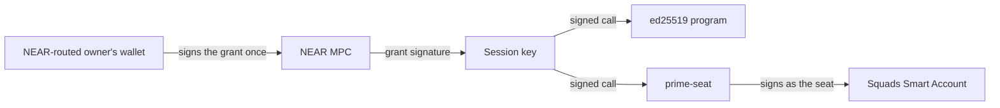

## 3. Seats vs sessions

A seat is a vote, and every seat is a settings signer of the Squads account. An owner with a Solana wallet holds its seat as its own key. An owner whose wallet signs through NEAR holds a seat PDA of `prime-seat`, and its session key acts as that seat. A session may create, activate, approve and reject proposals, execute approved transactions, and use a policy that lists the seat. It cannot create a transaction, so the content of every change comes from an owner with a native key (`contracts/solana/prime-seat/README.md`).

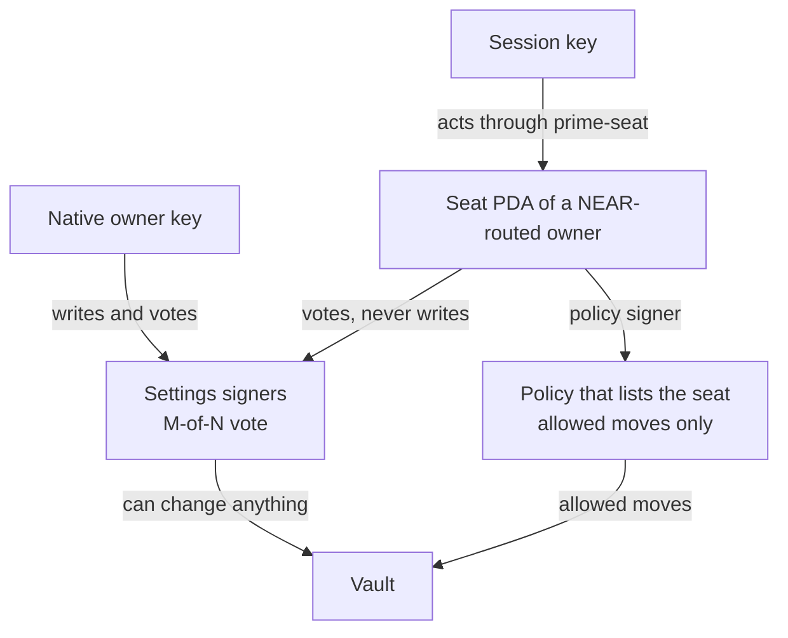

A stolen session key can vote as its owner's seat and act inside the policies that list the seat until the session ends. It can only approve a transaction that a native owner wrote.

## 4. Funds stay in custody

On Stellar, OctoGate keeps the funds in custody and lets the Prime Account draw through a gate. On EVM, a gate on custody's Safe does the same. On Solana the gate is a small program of ours, and the funds sit in a token account that custody hands to it (section 5).

How a draw works:

1. **Custody creates the gate:** the gate is a PDA of the gate program, made from custody's multisig, the Prime Account's settings address and an 8-byte seed. Custody fixes the destinations, the recovery address, the end time and the run window when it creates the gate. Nothing can change them afterwards.
2. **The agent draws through a rule:** the rule signs as a vault of the Prime Account, the agent lane. The gate checks that vault, the destination, the end time and the batch's not-after, then signs for the token account as the cap address, and the token program stops the draw at the cap.
3. **Proceeds go back:** with a real venue, the venue pays the proceeds into a gate-owned account of custody in the same transaction.

| Piece | What it does |
|---|---|
| Two lanes | The agent lane (a Squads vault) draws to listed destinations within the cap. The owners lane (a second vault, signed by the owners at their approval count) pays the recovery address and nothing else. Each lane number is 1 or higher and the two differ. |
| Fixed destinations | The gate reads the owner of each destination token account and compares it with the list set at creation. The list holds venues and the Prime Account's vault. One entry covers every token that owner holds. |
| One Prime Account | The gate accepts calls only from vaults of the Prime Account it was made for. A Prime Account with a settings authority is refused at creation, because that authority could add itself as an owner. |
| Cap | The token program enforces the cap on the agent lane. Section 5 has who can lower and raise it. |
| End time and not-after | The gate pays the agent lane nothing after its end time. Every batch carries a mandatory not-after that lies at most the run window ahead, on both lanes. |
| Wait | The owners' rule carries the wait for the whole batch (section 8). The gate has no queue of its own. |
| Tokens | Only the Token and Token-2022 programs are called. |

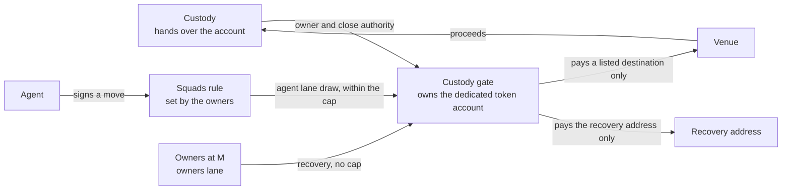

### Which mints the gate holds

The gate holds tokens of the Token and Token-2022 programs. The app reads the mint (`checkMint`) before custody opens the dedicated account and applies these rules:

| Mint | App result | Why |
|---|---|---|
| Permanent delegate (Token-2022) | Refused | The delegate moves any account of the mint with no gate call and no cap |
| Transfer hook | Refused | Another program runs on every transfer, and its authority can change it later |
| Transfer fee | Refused | Token-2022 refuses the gate's plain transfer (error 0x1f) |
| Default account state: frozen | Refused | New accounts start frozen |
| Confidential transfer, its fee, confidential mint and burn | Refused | The balances are hidden from the gate and its checks |
| Non-transferable | Refused | The tokens cannot move |
| An extension the check cannot parse or does not know | Refused | The check fails closed |
| A freeze authority (USDC, USDT) | Warning | The issuer can freeze this account; while frozen, recovery and release are refused (`AccountFrozen`, 0x11) |
| A pause authority | Warning | The issuer can pause every transfer of the mint, with the same effect |
| Token-2022 | Warning | Token-2022 is upgradeable on mainnet, and the classic Token program is immutable: prefer the classic Token program |

The app shows each warning before any funds move. The gate cannot lift a freeze, so recovery is reliable for a mint whose issuer holds no freeze authority.

### What is proven

**Gate status (line-cut gate with the multisig length check, [`contracts/solana/custody-gate/src/lib.rs`](custody-gate/src/lib.rs), 9 October 2026):** on the mainnet feature set, the mock venue harness passes 345 of 345 checks, and the real venues 53 of 53 (Kamino deposit and redeem, an Orca swap, the whole-batch time lock on a real Orca swap, recovery, release and `prime-session` in the path). The trustee run passes 9 of 9 and the forged-multisig probe 4 of 4. A mutation pass kills 63 of 63 gate mutants and 88 of 88 [`contracts/solana/custody-gate/app-checks/setup-checks.ts`](custody-gate/app-checks/setup-checks.ts) mutants. The gate is 126 sLOC formatted and 47,472 bytes (sha256 `a5d19edb879e75d054f1025d710753ce5150726130c3dd74887236fbdbdc94e2`). The build the reviews tested was 84 as written, 241 after `rustfmt` and 47,160 bytes (sha256 `6d196cab5b6c6d29bc6cf650a1526b4be56c0550bed479b55090364d7a04dfd7`), against 91, 253 and 50,464 for the gate-owned build before the line cut and 119, 276 and 87,160 for the earlier hardened build. The 9 October 2026 size pass rebuilt the gate from the formatted source and re-ran the harnesses against it (345 of 345, 53 of 53, 9 of 9 and 4 of 4), with 78 of 78 gate mutants killed and 12 million differential scenarios against the build above with no mismatch. It uses the standard `solana_program` crate. A Pinocchio port (86 sLOC, 36,000 bytes) was built and is not adopted. The independent security reviews of both builds are done (adopt with fixes, then adopt), and their findings are listed in section 17.

| Claim | Status | Evidence |
|---|---|---|
| The agent lane pays listed owners only, within the cap, inside the not-after window and before the end time. Over-cap draws are refused by the token program | Verified | T1 to T5d, E1 to E5; the venue destination and the Prime vault's own account are both listed (T1c) |
| The owners lane pays the recovery address and nothing else. One owner alone is refused by Squads | Verified | T12 to T16, T13b, T14 |
| Only the Prime Account's two lane vaults can call the gate: another Prime Account's owners, a non-lane vault, custody, a stranger and an unsigned lane are refused | Verified | T6 to T6f |
| The gate refuses a Prime Account with a settings authority, a settings account that Squads does not own, lane numbers below 1 or equal to each other, and a creator who is no signer of the custody multisig | Verified | G1 to G20f, 41 of 41 |
| A pre-funded gate address does not block `create`, and the creator pays the full rent | Verified | G17 to G18c |
| Nothing writes to the gate's account after creation | Verified | Y1 |
| A forged gate account, a hostile token program, a non-token destination and a cap address that is not this gate's are refused | Verified | T7 to T11 |
| The end time and the not-after are exact to the second | Verified | B1, B2, with calls every 300 ms across each boundary |
| Token-2022 mints without fee or hook extensions work. Fee and hook mints fail closed (error 0x1f) | Verified | Z1 to Z9b, 28 of 28 |
| The app reads a token's mint before funds move. It refuses a permanent-delegate, transfer-hook, transfer-fee, non-transferable, frozen-by-default or confidential mint and any extension it cannot parse. It warns for a freeze authority, and prefers the classic Token program | Verified | `checkMint`: unit tests, SX1 to SX7b; PD1, PD2 and FZ2 to FZ5b of the independent review |
| The app reads the gate back and refuses any field that differs from the plan, before the hand-over and again when the owners confirm | Verified | `checkGate`: unit tests, SX8 to SX16b |
| Native SOL moves as [wrapped SOL](https://solana.com/docs/tokens/basics/sync-native) | Verified | N1 to N7c, 16 of 16 |
| One custody multisig can run two gates for the same Prime Account | Verified | seed in the gate address; lanes 2 and 4 in a second gate (G20). Each gate needs its own token account |
| Moves with real venue programs: Kamino deposit and redeem, Orca swap, with the whole-batch time lock on Orca and `prime-session` (the move-only session program of the time) in the path | Verified | `venues-a4`, 53 of 53, call depth 3 of 5 (4 with `prime-session`). Real venues take the caller's signature, so the listed destination is the Prime Account's vault. A venue's proceeds land in a gate-owned account of custody. The Kamino deposit leaves custody holding collateral tokens |
| Custody's MPC provider signs the gate's instructions | Design only | custody signs the hand-over (two `SetAuthority` calls), `allow` and `release` as a multisig signer. Fordefi can be that signer, as an untested design from Fordefi's documentation |
| The gate deploys non-upgradeable | Verified on devnet | the gate at `6ieR7WU...` has no upgrade authority (program-data account read on 10 October 2026). The app's Confirm the gate refuses a gate program that still has one (section 14.1). A published verifiable build is still to do, and no gate exists on mainnet |
| An independent security review of the gate-owned build | Verified: adopt with fixes | [the review of the gate-owned build of 8 October 2026](https://github.com/untangledfinance/oz-policy-builder/blob/archive/spike-final/contracts/prime/spike/matrix/near-minimal/round9/gate-a4/gate-owned-review.md) (archived); the fixes are in section 17 |

## 5. Gate-owned custody

On Stellar, the docs restrict custody's own keys with signer weights: custody's key alone no longer carries enough weight, and custody plus a trustee does. On Solana the same idea sits on the token account, and the gate owns it.

**Two terms first:**

- **Token program:** the built-in Solana program (SPL Token) that keeps every token balance and moves it.
- **Token account:** a balance is not stored in a wallet. It sits in a token account, one per wallet and token, with an **owner** field and an optional **close authority**. Whoever the owner field names can transfer, approve, close or re-own it. Native SOL must be wrapped first, because the token program only handles tokens.

**The hand-over:** custody opens an empty dedicated token account (165 bytes, at an address of its own, no associated account) and signs two `SetAuthority` calls on it, in one transaction: the close authority to the gate PDA first, the owner second. From then on only the gate signs for the account. The app reads the account back (owner is the gate, close authority is the gate, no delegate) before custody funds it.

**Who can do what afterwards:**

| Who | Power | How |
|---|---|---|
| Custody alone | None over the funds. Transfer, close, `SetAuthority`, approve and revoke are all refused | the token program, because the gate owns the account (H5 to H10) |
| Any one custody signer | Lowers or suspends the cap | `allow`, one signature |
| Custody plus the trustee (the multisig's threshold) | Raises the cap. Releases the account back to a key they name | `allow`, `release` |
| The agent | Draws to listed destinations within the cap, under the owners' rules | `transfer` on the agent lane |
| The owners at M | Pay the recovery address with no cap, at any time | `transfer` on the owners lane (section 9) |

**Custody's identity is a multisig:** an [SPL Token multisig](https://www.solana-program.com/docs/token) of up to 11 signers, M of N ("Multisig usage": "Multisig accounts can be used for any authority on an SPL Token mint or token account."). Two layouts: 2 of 2 (custody plus the trustee), or the weighted `[custody, backup, trustee, trustee]` with m = 3, which keeps the trustee mandatory while custody's backup key can stand in for custody's main key. The gate reads the multisig, so a release and a raise of the cap need the multisig's threshold. The gate accepts only an account of exactly 355 bytes owned by a token program as that multisig, the length `InitializeMultisig` writes.

**The trustee:** as on Stellar, a trusted third party that represents the investor side of the institution or asset manager. It holds its own key, in its own wallet or custody, independent of custody and of the Prime owners. The trustee is the mandatory signer in custody's multisig and the default recovery address. A Prime vault can fill the trustee slot (9 of 9 checks), which trades the independent second party for fewer parties to manage.

**The cap is the stop:** the gate approves a cap address as the delegate of the token account with the cap amount, and the token program refuses a draw above it. Any one custody signer lowers it, down to 0. Raising it takes the multisig's threshold. A stolen single key can stop the agent lane, and it cannot raise the cap, release or touch recovery. A threshold-only variant (90 lines, 348 of 348 checks) saves one line and gives custody no single-signature stop.

**Rent stays locked:** the gate has no close instruction, so each gate-owned token account keeps its rent (2,039,280 lamports) while the gate owns it, and a recovery leaves the emptied account open. The rent returns after a release hands the account back and the new owner closes it. Each gate account keeps its own 2,596,080 lamports too.

**Release:** `release` hands the owner and the close authority back to the key the multisig names. It needs the multisig's threshold, works before and after the end time and leaves the balance in the account.

**Recovery:** uncapped and always open to the recovery address, by default the trustee's wallet (section 9).

**Why the close authority goes too:** the token program keeps a close authority through an owner change on an ordinary account. If custody kept it, an agent that draws the account empty would let custody close it, reopen the same address as its own account and receive a venue's proceeds there, where custody alone can move them. The gate refuses it: `allow` sets no cap on a source whose close authority is neither the gate nor unset (X1 to X8e), and a cap is the only way an agent draw becomes possible.

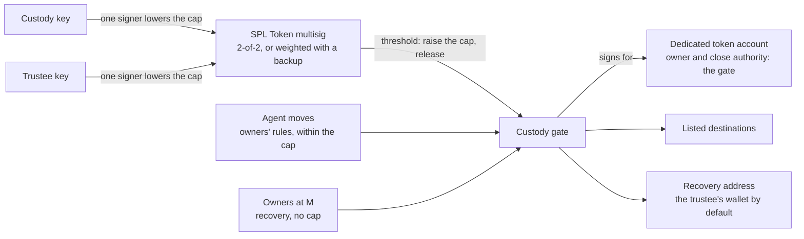

**Design history:** the first locked design handed the token account to the gate with no way back. A second design made an SPL Token multisig the owner of the account and approved the gate as delegate. It kept custody alone out and let custody plus the trustee reverse the set-up, with 162 of 162 checks in its spike (`gate-a3-multisig`). It left the close authority with custody and let a multisig with m greater than n through, both fixed by checks. Tuan chose the gate-owned design on 8 October 2026 as the more suitable for Prime, with a more minimal gate, a clear setup guide and a recovery mechanism. The multisig now serves as custody's identity in the gate, and the gate-owned account answers to the gate.

### Gate ownership in live addresses

On devnet, the gate PDA (seeds "gate", custody's multisig, the Prime Account's settings, an 8-byte seed) owns a dedicated token account and holds its close authority. The **cap PDA** (seeds "cap", the gate) is the account's delegate, and the delegated amount is the cap. An agent draw is signed by the cap PDA as delegate, so the token program stops it at the cap. A recovery is signed by the gate PDA as owner, so the cap does not bound it (custody-gate/src/lib.rs lines 2 to 4 and 86 to 87; core/pda.ts `gatePda`, `capPda`). One example gate, read from devnet on 10 October 2026:

| Name | Address | What the read showed |
|---|---|---|
| Gate PDA | `6h6QDFNTG7N8BKpj86D1tWn1KyyRN1Faqma8md4sAccv` | An account of 245 bytes owned by the gate program |
| Dedicated token account | `BME5xXnY9qRjRWC5Lxq8UU7wVxCSp2pJTiGZGrw7yXQr` | Owner: the gate PDA. Close authority: the gate PDA. Delegate: the cap PDA, with 1,000 tokens delegated (6 decimals). Balance 0 |
| Cap PDA | `ECRtQvbgAka3SKd29b8TQ2P7sgqmAGHHfezT5F6jGBY4` | The token account's delegate. A PDA has no account of its own, and none exists at this address |
| Gate program | `6ieR7WUs2M2VxEFYosRLuMtCdrWs7sqUeM1P4d5jiUnz` | Deployed with `--final`: the program-data account has no upgrade authority |

**Status:** Verified by `getAccountInfo` reads on devnet. The Prime Account behind this example gate has not been identified here, so it is shown for its structure only. On mainnet the gate program id has no account (section 14.4).

| Claim | Status | Evidence |
|---|---|---|
| Custody alone is refused for transfer, close, `SetAuthority`, approve and revoke on a gate-owned account. So are the trustee alone, the threshold acting as owner and a stranger | Verified | H5 to H10 |
| Both hand-over orders end in a safe state, on Token, Token-2022 and wrapped SOL. A delegate set before the hand-over is cleared | Verified | H1 to H4g, H11 to H11d, Z1c to Z1e, N1 to N2 |
| The threshold sets the cap, one signer lowers or suspends it, a raise needs m signers. A used-up cap gives no uncapped fallback | Verified | A1 to A16e, 36 of 36 |
| The threshold releases the account and the owners' lanes cannot. Custody alone, the trustee alone and a stranger are refused | Verified | R1 to R14, 33 of 33 |
| A weighted multisig releases and raises the cap with custody's key lost | Verified | R12c, R12e to R12g |
| The close-and-reopen bypass is refused, and recovery still empties an account with a foreign close authority | Verified | X0 to X8e, 16 of 16; X5 on mutant o28 |
| A Token-2022 account with the CPI guard on cannot be handed over. Fee and hook mints fail closed | Verified | Z9b, Z8 |
| The app's checks: m at most n, a trustee who is mandatory, a test signature, a dedicated 165-byte account, the read-back, the shape of an 11-signer transaction, the mint, the gate read-back | Verified | [`contracts/solana/custody-gate/app-checks/setup-checks.ts`](custody-gate/app-checks/setup-checks.ts): 43 unit tests, 54 live checks (SC1 to SC8e, SX1 to SX16b), 88 of 88 mutants |

## 6. Setting up

Custody drives the setup, with the trustee. The Prime Account exists first. Each step is one decision or one transaction, and [`contracts/solana/SETUP-AND-RECOVERY.md`](SETUP-AND-RECOVERY.md) walks through all of them.

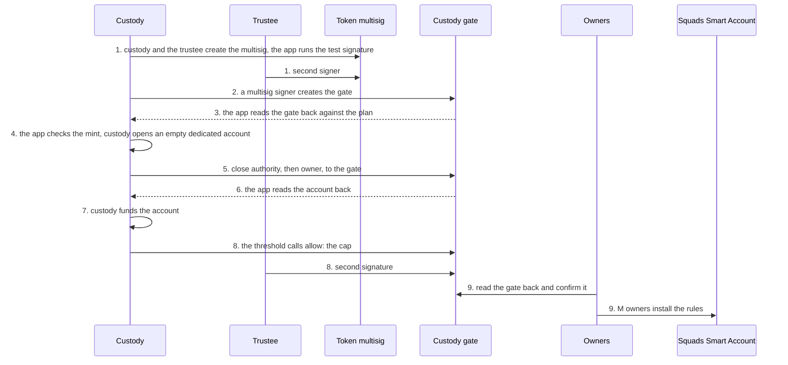

1. **Create the multisig:** custody and the trustee make the SPL Token multisig, 2 of 2 or `[custody, backup, trustee, trustee]` with m = 3. The app checks that m is at most n, that custody's keys cannot reach m alone and that a zero-amount test signature passes with the intended signers and fails with custody alone.
2. **Create the gate (`create`):** any one multisig signer fixes the destinations, the recovery address, the end time, the run window and the seed, with the Prime Account's settings address and the two lane numbers. A gate with two destinations holds 245 bytes and costs 0.0026 SOL of rent. The lane number for the owners is not 0, because the session rules sign as vault 0. The Prime Account has no settings authority, which the gate checks. The wizard offers two recovery addresses, the trustee's wallet (the default) and a custody-controlled wallet. It warns when the trustee is the recovery address, because the trustee also holds the signature custody needs to move the cap, and it refuses an address that is custody's own, a program address or the Prime Account. A new gate defaults to a run window of 86,400 seconds (24 hours); the wizard accepts 3,600 seconds to 30 days and a window longer than the Prime Account's time lock (section 8).
3. **Read the gate back:** any one multisig signer can create a gate, so the app compares the gate account with the plan (`checkGate`): the owner program, the address, the multisig, the Prime settings, both lanes, the recovery address, the end time, the run window, the seed and the destinations. Any difference stops the setup, before custody hands anything over.
4. **Check the mint and open the account:** the app reads the token's mint (`checkMint`, section 4) and shows its warnings. Then custody opens an empty dedicated token account of 165 bytes, owned by custody.
5. **Hand over:** custody signs `SetAuthority` for the close authority and then for the owner, both to the gate, in one transaction.
6. **Read back:** the app confirms that the owner and the close authority are the gate, that no delegate exists and that the account is 165 bytes.
7. **Fund it:** custody sends the token to the account. Wrapped SOL is wrapped here, after the hand-over.
8. **Set the cap (`allow`):** custody and the trustee, at the multisig's threshold, set the cap for the account.
9. **Confirm and install:** each owner opens Confirm the custody gate and enters two addresses, the gate's and the trustee's (section 14.1). The app reads the rest from the chain and runs every check that needs no plan. The owner ticks the facts only custody knew and settles the account time lock (section 8), and Confirm turns on. Then M owners vote to add one Squads policy for each rule (section 7) and one for recovery (section 9). A rule takes three transactions.

**A new allow-list means a new gate:** the destinations are fixed at creation. Custody and the trustee release the account, a signer creates a gate with the new list under a new seed, and the same steps follow. Gate accounts cannot be closed, so a retired gate keeps its rent of 2,596,080 lamports. Another multisig signer can take a seed first (`create` refuses a taken address), so the app picks a random 8-byte seed and retries with a new one if the address is in use.

**Custody's ready screen:** when the setup finishes, custody's screen runs the owners' read (`confirmByAddress`) read-only and lists its rows, so custody sees the facts the owners will check. It then lists two addresses to send the owners, the gate and the trustee, and asks the trustee to send the owners its own address, because the chain cannot prove who the trustee is. A row that fails keeps a warning on screen, since the owners will see the same failure (`pages/custody-gate-wizard.tsx` `GateDonePanel`). **Status:** Verified on beta: 24 read-back rows with none failing, and both addresses listed (sol-gate.md, beta check of 11 October 2026).

| Step | Status | Evidence |
|---|---|---|
| Create the account, install a rule at the owners' count, and the agent as policy signer | Verified | gate spike, 13 of 13 on the Prime side; 1-of-1 up to 7-of-12 owners ran |
| The multisig checks and the test signature | Verified | SC1 to SC5, R12; the token program accepts m greater than n and the app refuses it |
| The gate read-back and the mint check, before the hand-over | Verified | SX1 to SX16b; unit tests |
| `create` with its Prime Account checks, lanes off vault 0, an end time and a seed | Verified | G1 to G20f, 41 of 41 |
| The hand-over, read-back and fund | Verified | H1 to H4g, X1 to X8e, N1 to N7c, Z1 to Z9b |
| The cap by the multisig's threshold | Verified | A1 to A16e, 36 of 36 |
| An 11-signer `allow` or `release` | Verified | needs a version 0 transaction with a lookup table and a signer as the fee payer: 1,195 bytes, against 1,314 as a legacy transaction and 1,291 with a relayer paying (SC8). The app lets a multisig signer pay the fee or keeps n at 10 or below |
| Custody's setup through an MPC provider | Design only | section 4 |
| The owners' read-back on custody's ready screen, with the gate and trustee addresses to send | Verified on beta | 24 read-back rows, none failing (sol-gate.md; octopos #76, `734f992f`) |
| New gates default to a run window of 86,400 seconds | Verified on beta | the wizard's run window input read `86400` and the gate card read 86,400 seconds (sol-gate.md) |

## 6.1 Adding funds, adding a token and moving to a new gate

Three actions change a live gate with no change to the gate program. Each sits on a card of the Custody gate: custody's actions on its Your gates list, the owners' on Policies.

**Add funds** (custody's card) moves tokens from the connected wallet into a dedicated account the gate owns, so they sit under the cap. The dialog offers only accounts the gate still owns with its cap address as the delegate (`components/add-funds-dialog.tsx` `addableSources`). Three kinds of account are left out. A receives-only account has no cap, so the agent could not draw what is added. A released account belongs to custody's multisig again. An account whose cap the agent used up has no delegate, because the token program clears it at 0; that cap has to be raised first. The dialog cannot send while the gate program can still be upgraded. Tokens sent to the gate's own address by another route open a second, uncapped associated account that the agent cannot draw from. The built-in Solana Wallet's Send refuses a gate address with a message that points to Add funds, and stays disabled while a send is in flight (`ui/octopos/solana-wallet/logic.ts` `walletProblem`, `panel-view.ts`). Other wallets send there with no refusal.

**Add a token** (custody's card) puts a second token under the same gate. One gate owns up to 4 token accounts, each with its own cap (`MAX_ASSETS`). The dialog asks for the mint, the cap (a number, unlimited or receives only) and the amount to move in. It applies the set-up mint checks (section 4), refuses a mint of another token program than the gate's accounts, a mint the gate already holds and a fifth token, and then hands over to the setup wizard. The wizard opens the account, hands it to the gate, reads it back, signs the cap with the trustee's link and funds it. The owners then use Read the gate again, which finds every account the gate owns on chain and lists the new cap. An account that the owners' record lacks takes their confirmation back, so a rule for the new token waits for a fresh read (`core/gate-store.ts` `addGateSource`). A rule pins the custody account, so the new token needs its own rule.

**Move to a new gate** (owners' card) follows a gate that custody rebuilt with a new allow-list or recovery address. Step 1 confirms the new gate with the same Confirm as section 14.1. Step 2 reads the earlier gates and the new gate from the chain and plans one settings proposal that carries a `PolicyUpdate` for each rule that names an old gate. Each rewritten rule keeps its signers, approvals, wait and end. The gate, the custody account (matched by token and by kind, capped or receives only), a swap's output account and, when the recovery address differs, the recovery token account change to the new gate's (`components/gate-move.ts`). A rule stays out of the proposal and shows under "Rules that cannot move", with its reason, in these cases:

- the new gate has no account of that token, or holds it only with the other kind of account;
- the new gate does not list the owner of an account the rule pays, or that account cannot be read;
- the rule carries spending limits or hooks, checks an account owner or an account's data, or was written by hand, and reads "Rewrite it by hand in the rule editor".

Ended rules and rules that name no old account stay as they are. The proposal runs at the account's threshold and waits its time lock. Until it runs, every rule still names the old gate, and the agent can still draw from the old gate within the cap it holds. After it runs, a move that an agent stored under a rule before the change cannot run: the Queue drops it and the chain refuses it (`rule-account`), so the agent stores it again under the moved rule.

**Earlier gates:** the old gate keeps what custody left in it. It stays on the owners' card as an "Earlier gate" row for as long as one of its accounts still holds tokens that the gate owns. The row offers Recover custody funds to an owner and Release to a signer of custody's multisig, and hides Change the cap, Move and Read the gate again. Recover is an owners-lane vault transaction, so it works after the move rewrote the rules (`components/custody-gate-card.tsx`).

| Claim | Status | Evidence |
|---|---|---|
| Add funds lists only capped accounts the gate owns; the wallet's Send refuses a gate address | Verified on beta | 7 tokens added to a gate account (500,000,000 to 507,000,000 read on chain), Send refused with "That address is a custody gate" (sol-gate.md, beta table; octopos #76) |
| Add a token: the account is opened, handed over, capped and funded, and the owners' read lists both tokens | Verified on devnet | local build against devnet, two tokens on gate 2 (sol-gate.md "Local devnet build, PR 2"). Add a token and Move to a new gate are to verify on beta-solana. Next step: run both there with a throwaway world and record the signatures |
| One `PolicyUpdate` moves a rule from one gate to another and reads back with the same signers, threshold and band | Verified on devnet | `tests/devnet-gate-move.test.ts`, 6 of 6 (octopos #81, `8bac5890`) |
| A draw under the moved rule pays from the new gate and is refused on the old one | Verified on devnet | same file, 6 of 6 |
| A move stored before the update reads as stale, the Queue drops it, the chain refuses to run it (`rule-account`) and the destination balance does not change | Verified on devnet | same file, test "a move stored before the update is stale after it" |
| Recover from an earlier gate's row | To verify | the row reads on devnet and the unit test covers it; no recovery was run from an earlier gate. Next step: run Recover custody funds from an earlier gate row on beta |

## 7. The agent's rules

A rule is a Squads [**ProgramInteraction**](https://github.com/Squads-Protocol/smart-account-program/blob/80bf1f7ad28fd1176c364879776982730b8e9c80/programs/squads_smart_account_program/src/state/policies/implementations/program_interaction.rs) policy. The agent is the policy's signer: one plain key that holds some SOL, because in the app the agent key pays its own fees and the rent of a stored batch (the harness runs had the relayer pay). The owners install each rule at their approval count.

What a rule fixes:

- **One venue:** the program it may call, and the accounts it may touch (the gate, custody's dedicated token account and the destination token account).
- **One direction:** a draw to a listed destination, followed by a payback to custody.
- **An amount band per move:** a smallest and a largest amount, read from the call data.
- **Who must approve:** a small band needs the agent alone, and a large band needs the agent and a second approver.
- **A wait:** a time lock on the rule, set by the owners, that covers the whole batch (section 8).
- **Atomic batches:** if one call in a batch fails, none runs.

A rule at vault number k signs as that vault only, so an agent's rule reaches the agent's lane and nothing else. The agent cannot vote, change a rule or sign as the owners.

The agent needs no grant. The agent's key is a policy signer from the day the owners install the rule, and the rule limits what it can do. A session key stands in for an owner who signs through NEAR (section 10).

| Claim | Status | Evidence |
|---|---|---|
| An agent draws from custody and the venue pays back in one transaction: 51,630 compute units, 666 bytes, relayer pays (a draw alone: 43,226 and 583) | Verified | gate-owned build, P1 to P10b and the cost runs |
| The rule holds the band, the pinned accounts and the atomic draw and payback, and a failed leg rolls the batch back | Verified | P1 to P10b, 14 of 14 |
| The agent cannot change rules, vote or sign as the owners. A rule at vault 0 (where the app's session rules sign) reaches nothing of the gate | Verified | P1 to P10b; gate spike, 10 of 10 |
| A stolen agent key moves only what a rule allows and the gate permits | Verified | T1 to T11, the cap and the rule checks above, plus the earlier independent review's attack list |
| The same rules work with a real venue program | Verified | `venues-a4`, 53 of 53: an Orca swap (83,328 compute units), a Kamino deposit (119,676) and a redeem (111,049) |

Sizes to know: a rule with four constraints needs a 256 KB heap request to install and takes 1,219 of the [1,232 bytes a transaction allows](https://solana.com/docs/core/transactions), and it costs 0.0104 SOL of rent. A rule with two constraints installs at the default heap and costs 0.0062 SOL.

## 8. Time lock

The wait belongs to the owners' rule. The agent's rule is a Squads policy with a **time lock**. When the agent signs, Squads stores the **whole batch**: the draw from custody, the venue call and the proceeds back. After the wait, anyone can run it, and it runs as one transaction. The draw, the venue call and the payback succeed or fail together.

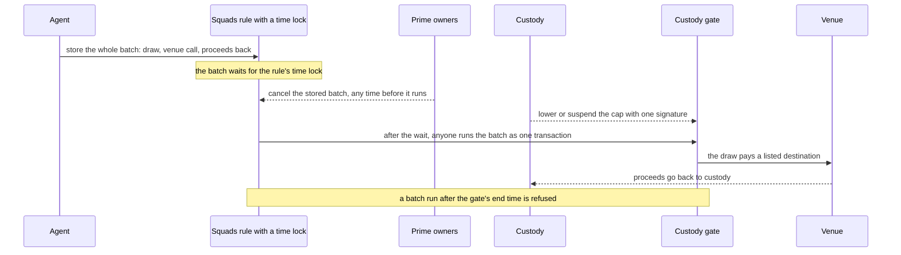

**Who controls what:**

- **The owners** set the wait. M of N can change it, as they change any rule. They cancel a stored batch through vote-only seats the rule gives them: the owners lane's vault, then vaults 100 and up, one per approval the rule needs. Any change to the account's settings makes open cancel votes stale, and the owners must propose them again.
- **Custody** protects itself by other means: the cap, which any one signer lowers or suspends at any time; the gate's end time; the destinations fixed at creation; and gate-owned custody (section 5).
- **The agent** can cancel its own approved batch, because its seat holds the vote permission. Custody cannot cancel.

**The trade-off Tuan accepted:** custody does not control the minimum wait. The owners' rule carries it, so the owners can set it low, and custody cannot raise it. Custody's protection is the cap, the end time, the fixed destinations and the gate-owned account, which bound what a batch can take whatever the wait. The app enforces that a rule's wait must exceed the account's time lock plus a minute (961 seconds or more at a time lock of 15 minutes), and the time lock cannot be raised above an existing rule's wait less a minute (`core/templates/wait.ts`).

**Lapse:** Squads has no run window, and an approved batch stays runnable. Three bounds close it: a mandatory not-after in each batch that lies at most the run window ahead (custody's own bound, 60 seconds in the tests), the gate's end time and the rule's expiry. The gate refuses a batch that runs past its not-after, and the batch stays approved until the owners cancel it.

**No queue in the gate:** the earlier spike gate stored moves itself, with a record, a run, a cancel, a minimum wait and a run window. That queue delayed the draw alone, and the venue call was a separate move. The final gate has none, because the rule's time lock replaces it.

Stellar and EVM compare as follows. On Stellar the whole batch waits, the gate holds the minimum and a move lapses after its run window. On EVM the stored move does not lapse. On Solana the whole batch waits as on Stellar, the minimum sits with the owners, and a move lapses at its not-after.

| Claim | Status | Evidence |
|---|---|---|
| A Squads rule with its own time lock stores a call, refuses an early run, runs it after the wait, checks the rule at run time and lets the owners cancel. The sync path of a rule with a wait is refused | Verified | spike of the other design (custody inside its own Squads account), 225 of 225; the stored call there was a single call |
| The whole batch (draw, venue call, proceeds back) is stored by the rule, an early run is refused, and it runs as one transaction after the wait. A second run is refused | Verified | TL1 to TL11b, 24 of 24; on real Orca state, 50 USDC became about 50 USDT in one run under a 6-second time lock (119,159 compute units) |
| The owners set the wait, change it at M of N and cancel a stored batch | Verified | TL1 to TL11b; the cancel on real Orca state (48,709 compute units) |
| Any change to the account's settings makes open cancel votes stale, and the owners must propose them again | Verified | Devnet confirmed |
| Rules installed with a wait and several approvals before this change have too few seats and must be revoked and reinstalled | Verified | Migration path confirmed |
| Custody stops a stored batch by lowering or suspending the cap | Verified | TL7, V22, V23: the run fails once the cap is lowered |
| Lapse through the not-after, a not-after beyond the window, the gate's end time and the rule's expiry | Verified | TL1 to TL11b; the lapse on real Orca state (V28c) |
| The gate has no queue of its own | Verified | the final gate has four instructions: `create`, `transfer`, `allow`, `release` |
| The Squads `closeTransaction` call closes the proposal and the stored transaction of a move that ran, was cancelled or was rejected, and returns each account's rent to the payer recorded at store time. It needs no signer and refuses a live Approved move and a live move that still needs approvals | Verified on devnet | sol-moves.md, devnet checks 1 and 2: the rule as consensus account and the two recorded rent collectors; another collector is refused (`InvalidRentCollector`); wallet B paid the fee and the agent's balance rose by exactly the rent |
| The app's Reclaim rent closes such moves | Verified on beta | beta-solana, 11 October 2026: "2 stored moves ended ... still hold 0.013035 SOL", one press, the agent's balance rose by 13,029,962 lamports (rent less the 5,038 fee) (sol-moves.md, beta verification; octopos #78, `ecbfcdca`) |
| A rule update or Switch off voids the moves stored under it. A voided move that had all its approvals can be neither closed nor cancelled, so its rent stays locked. A voided move that still needed approvals can be closed | Verified on devnet | sol-moves.md, devnet check 3: three such moves closed after a Switch off |
| A stored swap warns when the pool pays less than its least output and offers Store again; the new move is stored at the greater of the pool's price less 0.5 % and the rule's floor | Verified on beta | beta-solana: move 13 withdrawn and move 14 stored at 11.189295 test USDT, then run (sol-moves.md, beta verification) |
| Propose again on a lapsed recovery reads the Clock sysvar, adds a margin of 30 seconds and refuses when the clock cannot be read | Verified on beta | refused 4 s after the not-after and allowed 50 s after (sol-moves.md, beta verification of #82). The unreadable-clock refusal is covered by function-level tests and has no beta run. Next step: run it on beta with the clock read blocked |
| The duplicate marker and Cancel duplicate | Verified on beta | recoveries 4 and 5 (sol-moves.md, beta verification of #82; octopos #82, `afcb76b1`) |

A rule with a time lock cannot use Squads' synchronous path, so the agent stores the batch in three steps (create, propose, approve) and a run follows. The signer that stores the batch pays its rent (the agent key in the app; the relayer in the harness runs). A stored mock batch took 468 bytes and 4,148,160 lamports plus a 294-byte proposal at 2,937,120; a stored Orca batch took 733 bytes and 5,992,560 lamports plus the proposal. On devnet, where rent is cheaper per byte, a stored plain pay move held 4,759,960 lamports in its two accounts and a stored Orca swap batch 6,518,000 (sol-moves.md, devnet check 4). Rejecting a stored batch takes one more rejection than before, because the seats count as voters: a rule that needed m approvals to install now needs m+1 rejections to refuse a batch, one per seat.

### The account time lock

The Prime Account's own time lock is the owners' floor. With it at 0, M owners reach the recovery address and every listed destination at once through the settings path, with no agent key and no rule. The app creates accounts with the time lock at 0, so confirming a gate is where it gets set (`components/gate-time-lock.tsx`, `components/gate-draft.ts` `DEFAULT_TIME_LOCK`).

- **The default is 15 minutes (900 seconds):** after the read, Confirm shows the account's time lock. At 0 the owners propose a `SetTimeLock` of 900 seconds in one settings proposal, or tick "I accept that the owners can move funds with no wait".
- **Confirm stays off until the owners decide:** it turns on when the account's time lock is above 0, when the owners propose it from the dialog, when an open proposal that sets a time lock above 0 already exists (the dialog shows its approvals and a link to the Queue, and a second owner does not open a second proposal), or when the opt-out is ticked. Any open proposal above 0 counts, including one shorter than 15 minutes, which the dialog words as "(the app suggests 15 minutes)". An account that cannot be read keeps Confirm off (`components/gate-confirm.tsx` `lockSettled`, `components/time-lock-proposal.ts`).
- **The opt-out is one owner's choice:** it is stored in the confirming browser with the gate record, and the card says "An owner chose no time lock in this browser". Other browsers keep showing the warning. The record clears once the card reads a time lock above 0.
- **The card keeps asking:** at time lock 0 the gate card shows an open proposal with its approvals, or Propose, or "Propose a time lock of 15 minutes again" when the gate was confirmed and the earlier proposal lapsed. Propose is refused when the gate's run window is 900 seconds or less, because a recovery would have no time left to run after the wait.
- **What it delays:** every settings change waits the time lock: the owners' cancel of a stored move, Switch off, Revoke, owner changes and the owners' recovery. A rule's wait must exceed it by more than a minute, so 961 seconds or more at 15 minutes.

**Status:** Verified on beta (11 October 2026, index-Cmpt-DnU): with time lock 0 Confirm stayed off until a decision; signer A's proposal of 15 minutes turned it on; signer B's own Confirm showed "A time lock of 15 minutes is proposed and waits for 1 more approval" with no second Propose; after B approved, the gate card read a run window of 86,400 seconds and a time lock of 900 seconds (sol-gate.md, beta table). A time lock shorter than 15 minutes counting as asked for is covered by unit and DOM tests (octopos #81, `8bac5890`); no beta run.

### Reclaiming rent and storing a move again

These Queue actions are in the app on beta-solana. They add no gate code.

**Reclaim rent:** a stored move holds two accounts the agent paid for, the proposal and the stored transaction. The Queue lists the moves that ended under "Rent to reclaim", with the rent they hold, and one press of **Reclaim rent** closes them with `closeTransaction` (`core/flows.ts` `buildReclaimRent`, `core/squads.ts` `closeStoredMoveIx`). The list holds moves that were executed, cancelled or rejected, and moves that a rule change voided while they still needed approvals, because Squads closes those. A voided move that had all its approvals stays out, since Squads closes and cancels neither. Only the fee payer signs. Each account's rent goes to the payer recorded at store time, whoever sends the request, and the requests are packed by size. The search reads the newest 50 stored moves of each rule (`core/load.ts` `loadReclaimable`). The Execution review of a stored move tells the agent that the rent can be reclaimed in the Queue.

**Store again:** a stored swap fixes its least output when it is stored. The default is the pool's price less 0.5 %, never below the rule's floor, or the value the agent typed. If the pool pays less than that when the swap runs, Whirlpool refuses it with `AmountOutBelowMinimum` (0x1794) and the whole batch rolls back with nothing moved. The Execution review says so before the swap is stored. When the pool pays less than the least output today, the Queue warns and shows **Store again at today's price** to the wallet that stored the move. The action simulates the new move first, then withdraws the old one with one vote, then stores the same swap with a least output of max(the pool's price less 0.5 %, the rule's floor). A least output the agent typed stays when the pool still pays it and it is above that figure. The new move restarts the rule's wait and pays new rent, and the old move's rent can be reclaimed. If the pool pays less than the rule's floor, a swap stored at that price would fail too, so the Queue offers nothing and says so (`components/restore-move.ts`, `components/orca-quote.ts` `minimumFor`).

The button appears only when the old move cannot run beside the new one: the old move's run window has closed, or the wallet's single vote cancels it (the rule needs one approval and the move is approved). While an open copy of the move exists in the Queue, the button stays hidden. For a rule that needs a second approver, the new move needs those approvals and the old one stays open for a signer to reject.

**Propose again:** a stored move past its not-after is refused by the gate. The agent that stored it stores it again from the Queue with **Propose again** (a swap shows Store again at today's price instead). A lapsed owners' recovery shows **Propose again** to an owner. The new recovery proposal has a not-after of chain time plus the account's time lock plus the gate's run window, needs the owners' approvals again, and leaves the lapsed one in the Queue as Lapsed. For a recovery the app reads the Clock sysvar at the moment of the press, allows the new proposal only 30 seconds after the not-after, and refuses with "The chain's clock could not be read" when the read fails. It never falls back to the browser's clock (`components/restore-move.ts` `readChainClock`, `lapseRefusal`, `LAPSE_MARGIN_SECONDS`; `components/queue-actions.ts` `proposeRecoveryAgain`). The stored move's own Propose again judges the lapse by the client's estimate of chain time (`core/rpc.ts` `chainTime`).

**Lapsed items and token units** (octopos #84, `9a0703f5`): the Queue folds items that can no longer run under "Lapsed (n)", collapsed beneath the open ones, and each still offers Propose again or Store again where it applies (`components/stored-moves.tsx` `splitLapsed`). Rule titles on Policies and the open moves in the Switch off dialog read amounts in tokens, for example "1 to 10 test USDC a move", and fall back to base units when the decimals cannot be read (`components/policy-utils.ts`). **Status:** Verified on beta (11 October 2026, 15:30 to 15:38 UTC, entry `index-DmJPPsM_-h1.js`): Policies read "10 to 100 token 9vpp3c…yCZN a move" for a token the app does not know, where the earlier build read base units; the Switch off dialog listed the open moves in token units; the agent's Queue showed the open move outside and "Lapsed (4)" folded under it; Propose again pressed from the fold stored the move again (sol-moves.md, "Beta verification of #84"). Unit and DOM tests also cover both (`tests/units-and-lapsed-dom.test.tsx`, `tests/queue-lapsed-fold-dom.test.tsx`). The payer-gone wording of Switch off ran in a unit test only.

**Duplicate marker:** when two owners press Propose on the same recovery at the same moment, or the same stored move is made twice, the newer copy shows "This looks like a duplicate of proposal N, made at the same moment. Cancel it if it was not meant." and a **Cancel duplicate** button in place of Reject or Cancel. Cancelling is a vote like any other: with 3 owners at a threshold of 2, the copy leaves the Queue after the second owner presses it (beta check, recoveries 4 and 5).

**Two creators at once:** Squads numbers Prime Accounts with one counter that all creators share. Two creators that read it at the same moment name the same address, and the second transaction fails in `CreateSmartAccount` with `MissingAccount` (6024, 0x1788). The create screen says that another account took the address at the same moment, reads the counter again, shows the new address and creates nothing until the creator presses Create account again, so what is signed always matches what is shown (`core/errors.ts` `create-race`, `components/onboard-create.ts`).

**Switch off ends a rule:** a switched-off rule moves nothing and stays on the account, and its rent stays with the wallet that paid it. If that wallet is no longer an owner that can run changes, the folded row says so and has no Revoke, and the owners add a new rule to allow the same moves again. Policies folds these rules under "Switched-off or ended rules (n)". The Switch off dialog lists the open moves of the rule and says which of them keep their rent locked (all approvals in, so they can no longer be cancelled) and which Reclaim rent can close afterwards (still waiting for approvals), and links to the Queue to cancel them first (`components/open-moves-note.tsx`).

**Status:** Verified on devnet and beta. The devnet suites `devnet-moves.test.ts` (7 checks: moved swap, store again, run, lapsed move, reclaim paid by another wallet, recovery again) and `devnet-create-race.test.ts` pass. On beta-solana (11 October 2026) the create race (two browsers, one account created, the loser retried), the duplicate marker, Propose again on a lapsed recovery, Reclaim rent, Store again, the Policies fold and the Switch off note all ran (sol-moves.md, beta verification and beta verification of #82). Propose again for a stored move that lapsed with no copy ran on a local build, in the devnet suite and, from the "Lapsed (n)" fold, on beta (sol-moves.md, "Beta verification of #84").

## 9. Recovery

If custody's keys are lost, custody can sign nothing. Recovery lets the Prime Account's owners send custody's funds to the recovery address that custody fixed in the gate. The recovery address is the trustee's wallet by default, as in the Stellar walkthrough. On Stellar and EVM the same feature is called **Recover custody funds**.

How it works:

- The owners, at the **normal approval count** M, sign as the owners' lane. One owner alone is refused by Squads.
- The gate pays **only the recovery address**. The owners can pay no other address with this lane.
- **Custody signs nothing:** with the weighted multisig `[custody, backup, trustee, trustee]`, the trustee and the backup also raise the cap and release.
- **Recovery has no cap:** it runs before the end time, after it, with the cap at 0 and above any cap that was set. The cap bounds the agent. The recovery address is fixed by custody at creation, so a payment there takes nothing from custody, and a low cap does not freeze the funds.
- **It is always open:** the end time stops the agent lane only.
- **A recovery rule can carry a time lock (harness):** in the gate harness the owners store the move under a recovery rule, approve it and run it after the rule's wait, and cancel it with their votes until then (RR1 to RR8g). A stored recovery lapses at its not-after. The app's Recover custody funds screen does not use such a rule, and a recovery stored under the rule waits that rule's wait. The policy builder has a recovery rule template (`core/templates/index.ts`, template `recovery`) that this pass did not test.
- **The owners' recovery from the gate card waits the Prime Account's own time lock:** with the time lock at 0, the owners at the plain approval count can also sign through the account's settings path at once (RR7). With the time lock above 0 that synchronous path is refused with `TimeLockNotZero` (RR8d, RR8e, `gate-a4.ts` line 484), and the harness's stored recovery under a recovery rule ran after that rule's wait (RR8f, RR8g). In the app, the Recover custody funds screen proposes the recovery as an asynchronous vault transaction on the owners lane, and no recovery rule is involved (`core/flows.ts` `buildRecovery`; `components/custody-recovery-dialog.tsx`). Squads runs that transaction after the Prime Account's own time lock, whatever wait a recovery rule carries: the owners' recovery from the gate card waits the account time lock, and a recovery rule's own wait does not delay it. A recovery stored under the recovery rule waits that rule (RR8f, RR8g). The app sets the recovery's not-after to chain time plus the time lock plus the gate's run window, so the owners have the whole window after the wait to approve and run it. During the wait custody and the trustee can release the account to themselves, which needs custody, the trustee and an unfrozen account. The app asks the owners for a time lock of 15 minutes when they confirm the gate (section 8). **Status:** Verified on devnet (sol-extras run 1, 11 October 2026, fresh world, 8 of 8 checks; Prime Account `1yLkH9kY...WWG7`, gate `2aZAx4Gt...z65QG`; every signature is in `reports/sol-extras-devnet-log-run1.json`). The account time lock was set to 30 seconds (`4mYYnkvy...sfe5z`, `2iu6dtvK...bnyyk`). The recovery that the app proposed (`2jRAzntT...tFztH`) and an owner approved (`PpbpD6Co...hM4w1`) was refused at 0 seconds after approval with Squads `TimeLockNotReleased` (the app's `squads-wait`) and ran 35 seconds after approval (`4Z7vR9CS...kZ7it`): 20 test tokens reached the recovery account and the gate account went from 500 to 480. With an owners-lane recovery rule of a 120-second wait installed (`5btmhF2e...9gmKf`, `3jaUH6pX...gK6rR`, `4GdkzdxR...wgXD8`), the next recovery (`2ThW8mVB...4rhaJ`, approved `36aEp9QC...SfFnw`) also ran 35 seconds after approval (`4d739ciJ...fvNLZ`) and the recovery account went from 20 to 40 test tokens. The rule's 120-second wait did not delay the recovery from the gate card. The run does not cover a recovery stored under the rule, which waits that rule (harness RR8f, RR8g).
- **A frozen account refuses it:** if the mint's issuer freezes the gate-owned account, the recovery fails with `AccountFrozen` (0x11) until the issuer unfreezes it (FZ3).

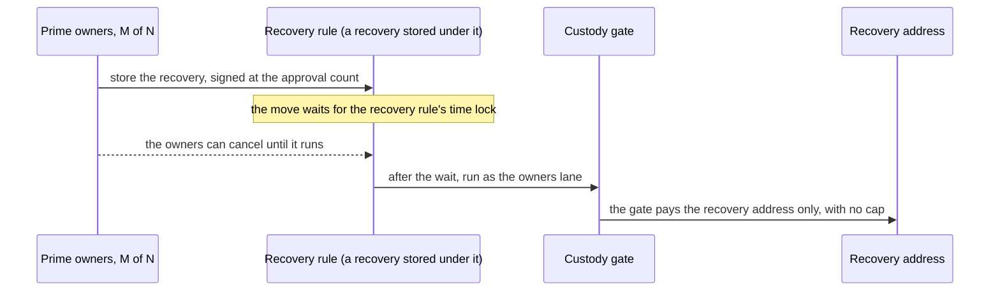

**The full reach of an owner majority:** M owners act with no signature from custody or the agent, and they reach two things:

- **The recovery address, with no cap:** at any time, while custody is still active, before and after the end time and with the cap at 0 (T12, E3b, A7d, RR7).
- **Any listed destination, up to the cap:** they sign as the agent lane through the account's settings path, with no agent key and no installed rule (T1). If a listed destination is a Prime vault the owners control, M owners can draw the cap to themselves.

They cannot pay an address outside those two sets, release an account, set a close authority or approve an arbitrary delegate.

**Custody cannot stop a recovery once the owners sign it:** lowering the cap with one signature stops the agent-lane draw and has no effect on a recovery (A7d, RR3b). Custody's defence is a release back to itself, which races the recovery and needs custody, the trustee and an unfrozen account. The recovery address is the whole bound on the owner majority. With the trustee's wallet as the recovery address, the majority can send every gate-owned balance to the trustee at any time, so custody, the owners and the investors must all trust the trustee. A custody that wants a firmer bound picks a recovery address under its own control. The wizard offers these two choices, the trustee's wallet (the default) and a custody-controlled wallet, which has a key of its own and no slot in custody's multisig. With the trustee chosen it warns that a majority of owners can send everything in the gate to the trustee, who also holds the signature custody needs to move the cap. A recovery address that no key controls loses the funds. The wizard refuses an empty address, an address that is no wallet (a program address, off the ed25519 curve), custody's own address, the Prime Account and an address that is also a listed destination. The chain cannot show who holds the key, so the holder confirms control with a small test amount (`components/gate-draft.ts` `recoveryRefusal`; `pages/custody-gate-wizard.tsx`).

**A reading of the code:** an upgrade of Squads that signs as the owners lane vault can move custody's gate-owned funds, with no cap, to the recovery address, and nowhere else. An upgrade that signs as the agent lane reaches the listed destinations within the cap. Both reaches stop at addresses custody chose.

The agent lane cannot reach the recovery address unless custody lists it as a destination, because the lanes are different vaults. The Stellar gate lets the account's full approval count draw to any listed address, and the Solana gate keeps the owners' lane to one address. The owners can still sign as the agent lane. That gives them the agent's reach, without a band, to listed destinations within the cap.

| Claim | Status | Evidence |
|---|---|---|
| The owners at full count pay the recovery address only, with no custody signature | Verified | T12 to T16, T13b; on real Orca state 500 USDC to the recovery address, 29,240 compute units |
| Recovery is not bounded by the cap and works before and after the end time | Verified | T12, E1b, E3, E3b, A7d, RR4, V30c |
| The agent lane cannot reach the recovery address unless it is listed | Verified | T3, T13, T13b |
| A recovery stored under a recovery rule waits that rule's time lock: store, wait, run, cancel by the owners | Verified in the harness; the app's Recover screen does not use such a rule | RR1 to RR8g, 21 of 21 |
| The owners' recovery from the gate card waits the Prime Account's time lock; a recovery rule's own wait does not delay it | Verified on devnet | RR7 (pay at once), RR8d and RR8e (`TimeLockNotZero` on the sync path); for the app's path, sol-extras run 1 (`reports/sol-extras-devnet-log-run1.json`): refused at 0 s, ran at 35 s under a 30 s time lock, and again at 35 s with a 120 s recovery rule installed, which does not cover a recovery stored under that rule (`core/flows.ts` `buildRecovery`, `components/gate-draft.ts` `windowRefusal`) |
| The owners can also draw to listed destinations up to the cap as the agent lane. Custody's cap lowering stops that and has no effect on a recovery | Verified | T1, A7d, RR3b (independent review) |
| A frozen gate-owned account refuses recovery and release | Verified | FZ2 to FZ5b (independent review) |
| A stored recovery lapses | Verified | T15 |
| Recovery from a gate-owned account with a foreign close authority | Verified | X6, X8 to X8e |
| A recover button in the Prime app on Solana | Verified on beta | `components/custody-gate-card.tsx` (button "Recover custody funds", line 456), `components/custody-recovery-dialog.tsx`, `proposeRecovery` in `components/gate-actions.ts`; walkthrough video 7, recorded 10 October 2026 03:56 UTC (`solana-web-walk/out/final/07-recover-custody-funds.mp4`), whose reverify log lists two devnet signatures that both read finalized with no error (`3BzFZra5...`, `dxHFFTHY...`) |

## 10. Starting a session

Only an owner whose wallet signs through NEAR (section 14) has a session. Its seat is the PDA `["seat", owner, settings]` of `prime-seat`, and its owner key is an ed25519 key that NEAR MPC holds, so the owner key never signs a Solana transaction. The owner signs one grant through `prime-near-signer` v2, which shows the wallet a readable text. What the key signs is a 32-byte hash:

```
sha256("prime-seat-grant" | cluster | settings | seat | session key | start (8 bytes BE) | end (8 bytes BE))
```

`cluster` is fixed when the program is built (`devnet` on beta). Nothing goes on chain at this step. Every call by the session key carries the owner's signature in an ed25519 instruction of the same transaction, and `prime-seat` computes the hash from the call, so a grant serves one account, one seat, one cluster and one key. The window must hold `start <= now <= end` and last at most 7 days.

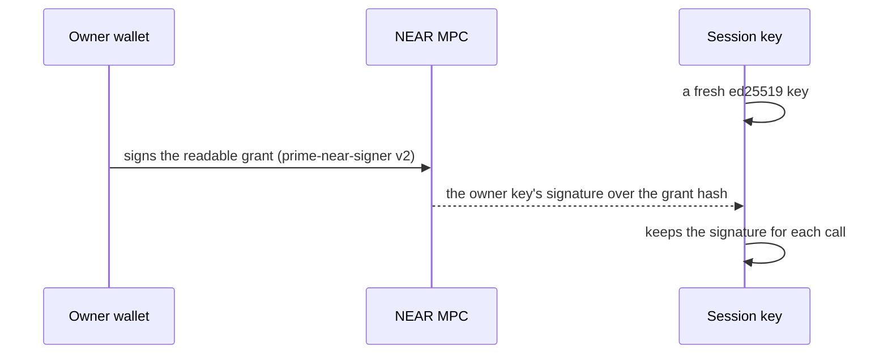

The app of 11 October had no NEAR route. octopos main (`bb040c0a`, 18 October 2026) has since added it behind the app's NEAR switch: beta-solana onboards NEAR-routed owners with seats and starts their sessions through `prime-near-signer` v2, and the Prime relayer pays those sessions' fees and End markers (`apps/solana-web/src/core/seat-session.ts` in octopos).

### History: move-only sessions, 8 to 18 October 2026

Until 18 October 2026 any owner could start a move-only session with `prime-session`. The wallet signed a plain grant text, the owner's session PDA was a signer of the account's Session moves policy only, and the key could make allowed moves and never vote. The Solana app on beta shipped it through the shared sessions UI: two prompts to start (the grant text and a float of 0.0019 SOL to the key), none per move, one or two to end, verified in a real browser on devnet (sess-ui-3.md). Its devnet program is in section 16, and its source is at tag `archive/spike-final` (`contracts/prime/solana/prime-session`).

## 11. Making a move

A move is one transaction. Its signer pays its fee: the agent key for an agent move, a seat's session key for a seat move. A seat move carries two instructions that the Solana runtime runs together, the ed25519 check of the grant and the `prime-seat` call; an agent move carries the Squads call.

**A seat move**, with the draw from custody that a policy listing the seat allows:

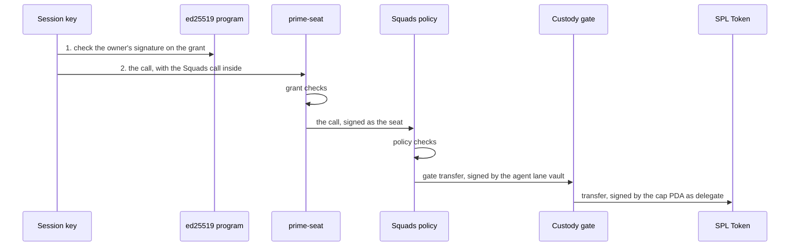

**An agent move:**

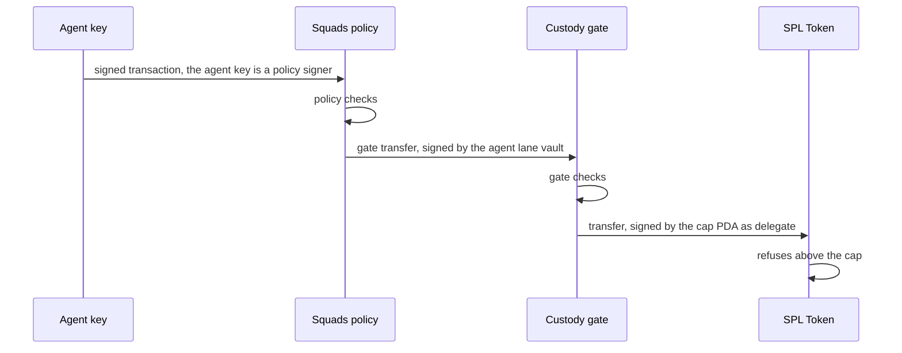

**What prime-seat checks:**

1. The session key signed this transaction, and it is not the owner key.
2. The ed25519 instruction at the given index verified the owner's signature over the grant hash, which `prime-seat` computes from the call.
3. The window holds `start <= now <= end` and lasts at most 7 days.
4. The key has no end marker (section 13).
5. The Squads call is one a session may make (section 12).

**What Squads checks:** the signer is a policy signer of the rule and has signed (the seat for a seat move, the agent key for an agent move), and the call fits the policy: program, data, accounts and number of instructions (core/squads.ts `policyMoveIx`).

**What the gate checks:** the caller is the Prime Account's agent lane vault and signed, the destination is on the list fixed at creation, and the batch's not-after lies in the run window. For the agent lane only, the gate's end time must not have passed. The owners lane pays the recovery address before and after the end time (custody-gate/src/lib.rs `transfer`, lines 67 to 87). **What the token program checks:** the transfer is signed by the cap PDA, the account's delegate, so it refuses an amount above the delegated cap.

If any check fails, none of the transaction's instructions run.

**Who pays:** the signer pays its own fee (DECISIONS.md line 112); for a NEAR-routed owner's seat session the relayer pays (section 14).

An agent's move has the same shape as a seat move without the ed25519 check and without `prime-seat`: the agent key signs as the policy signer, and the gate's draw sits inside the Squads call.

## 12. What a session can do

A session key forwards exactly one Squads call as the seat (`contracts/solana/prime-seat/README.md`):

| Squads call | Allowed |
|---|---|
| `createProposal`, `activateProposal`, `approveProposal`, `rejectProposal` | yes |
| `executeTransaction`, `executeSettingsTransaction` | yes |
| `executeTransactionSyncV2` with a policy payload (`InternalFundTransfer`, `ProgramInteraction`, `SpendingLimit`) | yes |
| `createTransaction`, `createSettingsTransaction`, `cancelProposal`, the settings consensus through `executeTransactionSyncV2`, every other call | no |

So a session acts alone only inside a policy that lists the seat, and the policy decides what it may do. The policy can pin the program, the call data at fixed positions (equal, different, greater or less than), the accounts, the data stored in an account and the number of instructions. `prime-seat` adds one call level above Squads: a venue called through a policy can nest 3 calls below itself for a native signer and 2 for a seat session.

The policy language was tested on 8 October 2026 on a local validator cloned from devnet, with a `prime-session` PDA as the policy signer: a capped deposit, a memo prefix and a constraint on another account's data, 89 of 89 checks. Squads did the refusing, so the limits it showed hold for any signer: extra bytes after the last checked field pass, so a policy should pin the program; data is read at fixed positions, so a field after a variable-length field cannot be checked; and one policy covers every live session of a seat.

## 13. Ending a session

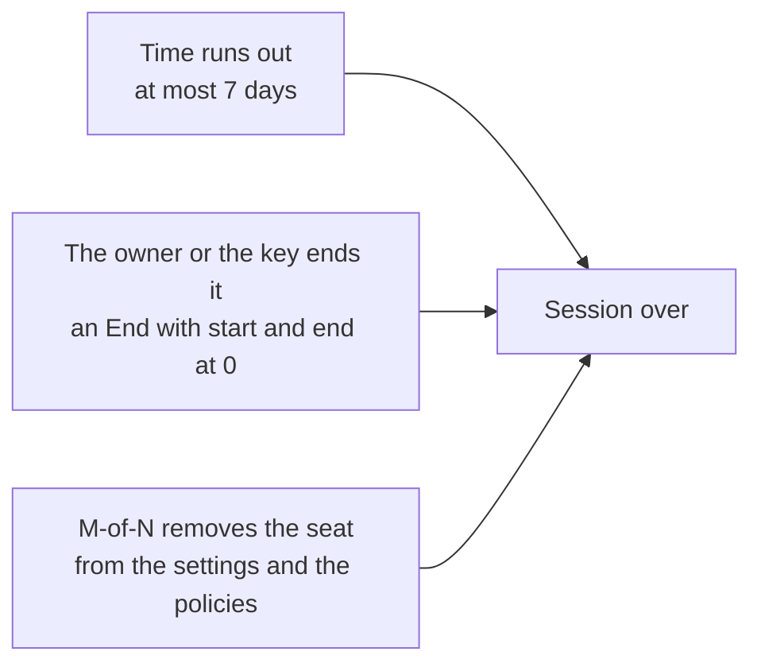

- **Expiry:** `prime-seat` reads the Solana clock and refuses a call outside the window.
- **End one session:** an End is the grant hash with start and end at 0. The owner signs it through NEAR, or the session key signs the transaction itself. The transaction pays 890,880 lamports to the **marker**, the PDA `[owner, settings, key]` of `prime-seat`, and the program takes it over. Every later call by that key is refused, and the marker is never closed, so the key stays ended.
- **Remove the owner:** M owners vote through the account's settings to remove the seat as a settings signer and from every policy that lists it. Every session of that owner stops at once.
- **Remove a rule:** removing a rule (`PolicyRemove`) runs only from the wallet that paid the rule's rent at its install, because Squads returns the rent to that wallet. If that wallet is gone, the owners use **Switch off**: a `PolicyUpdate` that sets the rule's end time to the chain time, through a normal settings proposal at the owners' approval count. The rule then refuses every move. Switch off is built and on main (octopos PR #20, commit c0c8d5f5), with an 11 of 11 devnet proof (sess-fix-7.md, "Switch off"). A mistaken switch-off needs a new rule. Switch off is the end state of a rule whose payer is gone: the rule stays on the account, and the open-moves note in the dialog says which stored moves keep their rent locked and which Reclaim rent can close (section 8).

The agent's key follows a separate path. The owners removing the rule, or any one custody signer lowering the cap to 0, ends its reach (sections 5 and 7).

## 14. Wallets

Each wallet follows one of two routes. A route-1 wallet signs for itself: it votes with its own key and, from 18 October 2026, starts no session. A route-2 owner signs through NEAR, holds a seat and starts sessions. On 11 October the app shipped route 1 only, and route 2 had run in the harness (DECISIONS.md line 157). octopos main (`bb040c0a`, 18 October 2026) has since added it behind the app's NEAR switch: beta-solana onboards NEAR-routed owners with seats and starts their sessions through `prime-near-signer` v2, and the Prime relayer pays those sessions' fees and End markers (`apps/solana-web/src/core/seat-session.ts` in octopos).

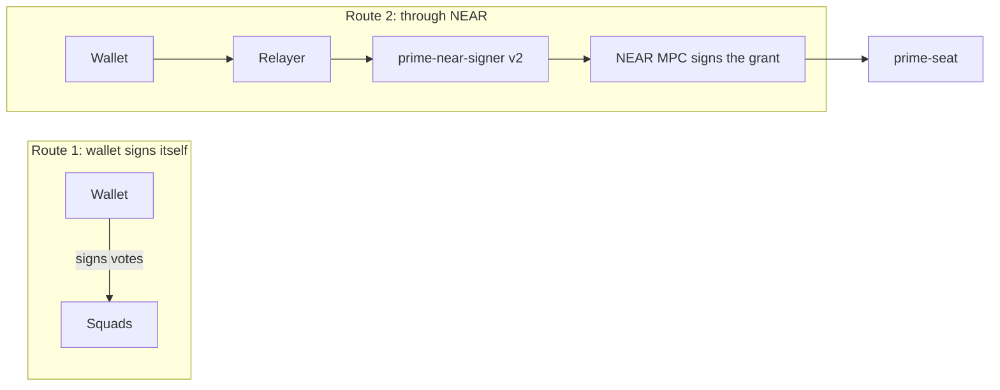

| Wallet | Route | What we ran |
|---|---|---|
| Phantom | Native | The real extension (26.32.0) signed the grant and revoke texts, 16 of 16 checks, and two seat votes that executed. |
| Solflare | Native | The real extension (2.40.0) signed the grant and revoke texts, 16 of 16 checks, including a relayer-paid move. Its seat votes need a devnet account. |
| Backpack | Native | The real extension (0.10.216) signed the grant and revoke texts, 16 of 16 checks, and two seat votes that executed. |
| Glow | Native for text | The real extension (0.61.0) signed the grant and revoke texts, 16 of 16 checks. Its transaction prompt shows no Approve button in our runs. |
| MetaMask | Native or NEAR | Native: MetaMask 13.50.0 signed 12 grant and revoke requests with its own Solana account (145 of 145 checks). Seat-vote transactions used a stand-in with the same key, because MetaMask's simulation refuses the local validator's accounts. NEAR route: stock NEAR code only. |
| Freighter | NEAR | Freighter adds a Stellar prefix to every message, so it cannot sign the Solana text. In the harness it went through our 42-line NEAR contract, `prime-near-signer` (v1); seats use v2. |

The runs in the table are of 8 October 2026. The native wallets signed `prime-session`'s grant and revoke texts, which no longer apply, and seat votes, which still do.

**What the app supports:** any Wallet Standard wallet that offers `signMessage` and `signTransaction` on the build's cluster (src/app/solana-wallets.ts `isEligible`). The Connect grid names Phantom, Solflare and Backpack, and the built-in wallet is offered too, shown as Solana Wallet (`SOLANA_WALLET_LABEL`). Move-only sessions in the app were verified with the built-in Solana Wallet (section 10, history). The table above is the 8 October harness evidence of what each extension signs.

On the NEAR route the MPC key signs the seat's grant through `prime-near-signer` v2, and `prime-seat` checks that key as the owner. The owner key signs only grants and ends, and every vote and move of the seat comes from the session key. A NEAR signature took about 8 seconds in the harness runs. Moves never use NEAR.

MetaMask changes a transaction that lacks compute-budget instructions. The harness client therefore built MetaMask transactions with both instructions in place, and the relayer checked the returned message before it co-signed.

### Solana Wallet names

Tuan asked for names on 10 October 2026 at about 15:00 UTC (DECISIONS.md line 177): an optional name on Import and Create, Rename per wallet, and the name shown next to the short address everywhere. The app keeps the names in the browser's local storage, by address, up to 32 characters. A name never touches key material and is not secret (src/ui/octopos/solana-wallet/names.ts). Names apply to the keys the built-in Solana Wallet keeps in this browser. They do not sync across browsers or devices. The names shipped in octopos commits ba1de627 and 97739dad. Status: to verify. rev-last-4.md found that a row with a name in the Wallets list can hide the address at 360 px width, and that a name keeps bidi and invisible characters. Next step: confirm both on the beta build.

### Real-wallet results

On 8 October 2026 the real Phantom, Solflare, Backpack and Glow extensions signed the exact grant and revoke texts that `prime-session` rebuilt. Each signature then ran on a local validator: relayed moves, self-paid moves, a revoke, and the refusal of the revoked key. The wallet runs are **Verified** against the contract on a local validator (the real-wallet run, 8 October 2026). They did not go through the app.

| Run | Result |
|---|---|
| Setup: two 2-of-3 Prime Accounts with a transfer policy | 8 of 8 |
| Per-wallet runs: grant, move, revoke and refusal, four wallets with 16 checks each | 64 of 64 |
| Cross-wallet and cross-account checks | 41 of 41 |
| Seat votes: 12 checks on 4 real signatures, plus 2 findings on wallets that refuse | 14 of 14 |

What each wallet did with a seat vote (a transaction the wallet signs with [`signTransaction`](https://github.com/anza-xyz/wallet-standard/blob/master/packages/core/features/src/signTransaction.ts)):

| Wallet | Result on the local validator |
|---|---|
| Backpack | Signed 2 votes with the message unchanged. The wallet shows "Simulation not supported on custom RPCs" and leaves Approve enabled. |
| Phantom | Signed 2 votes in Localnet mode after a "Confirm (unsafe)" screen. It adds a priority fee to every transaction it signs. |
| Solflare | Refuses a local blockhash with "Network mismatch". A vote with a devnet blockhash signs. |
| Glow | Shows "Glow detected an issue with the requested transaction" and no Approve button. |

**Phantom's fee:** Phantom returns a transaction with two added compute-budget instructions: a price of 375,000 micro-lamports and a limit of 200,000 units. That is a priority fee of 75,000 lamports, 15 times the base fee of one signature. The relayer's cap in the harness is 25,000 lamports, so the relayer refuses Phantom's vote at that cap. The votes ran with a cap of 100,000 lamports. Grants and revokes use `signMessage` and add nothing. The cap is a decision for the relayer's rules (section 17).

**Prompts (`prime-session`'s texts):** all four prompts show the session PDA, the session key, the end time and the cluster. Glow flattens the five lines into one paragraph and is the hardest to read. A revoke prompt differs from a grant prompt in one number: the end time reads 0.

What the real-wallet run does not cover, and we still need to run: seat votes through Solflare and Glow on devnet, the grant text with `cluster: devnet`, the NEAR-routed owners, a hardware wallet and a mobile wallet, and a production origin. The agent's own key never goes through a wallet, so these runs concern the owners.

## 14.1 Confirming the gate

Each owner reads and confirms the gate in the app before any rule goes on the account (`components/gate-confirm.tsx`, live on beta-solana.untangled.finance). **The owner enters two addresses, the gate's and the trustee's:** the app reads the rest from the chain and runs every check that needs no plan (octopos PR #76, merged as `734f992f`; DECISIONS.md line 195, decision D6c, which replaced the gate-address-only read of 10 October). The trustee field starts empty and fills only from "Fill in what this browser remembers". The full comparison with a plan the owners agreed stays in the dialog, folded under "Compare with the plan you agreed (optional)". It holds the recovery address, custody's keys, other destinations and the gate accounts, and Read uses it only when all of them are filled. A flag in the file, `CONFIRM_BY_ADDRESS_ONLY`, makes the plan form the main form again.

**Why the trustee is typed:** the trustee is the one fact the chain cannot prove, so the owners take the address from the trustee directly. The app checks the typed address against custody's multisig: it must hold a slot, and the multisig must not reach its threshold without it. In a 2 of 2 both keys are mandatory, so either key passes the check. A custody key typed as the trustee in a 3 of 4 is refused, and so is an address that holds no slot (`components/gate-confirm-read.ts` `confirmByAddress`).

**What the app reads from the chain** (`confirmByAddress`): the gate account (its Prime Account, custody's multisig, the recovery address, the destinations, the end time, the run window), the Clock, every token account the gate owns under Token and Token-2022, custody's multisig with its slots, and the mints. Custody's keys are the multisig's other slots, and the agent vault is the Prime Account's agent lane vault that the gate lists among its destinations.

**Hard refusals** (the read stops with a message): no account at the address, an account that the gate program of this build does not own, an account that does not read as a gate, a gate that serves another Prime Account, and a gate none of whose token accounts has a cap or was handed over by custody. A gate-owned account with no cap that custody did not hand over is listed for information and does not count.

**Checks that fail the read** (the dialog shows "refused", keeps the Confirm button off and tells the owner not to install a rule): the gate's address or lane vaults do not match the account; the recovery address is empty, custody's own, or also a listed destination; the destinations lack the agent vault or list it twice; the multisig has m below 2, m above n, or custody's keys alone reach m (the trustee is then not mandatory), or the trustee alone reaches m, or the typed trustee holds no slot; the gate program still has an upgrade authority; a gate-owned account whose owner or close authority is not the gate, with a stale delegate or with extensions; and a mint the app refuses (core/load.ts `loadGate`, core/setup-checks.ts `checkGate`, `checkMultisig`, `checkHandedOver`).

**Ticks the owner makes by eye**, under "Check these yourself", because only custody knew these when the gate was made. Confirm stays off until every checked row passes and every tick is set:

- **Recovery address:** the full address fixed in the gate.
- **Destinations:** shown only when the gate lists addresses beyond the agent vault. Tick if every address is one the owners agreed funds may reach.
- **Custody multisig address:** with its m of n slots.
- **End time:** when the agent lane stops.
- **Run window:** in words, for example 3,600 seconds reads "1 hour" (`durationText`).
- **Cap of each account:** how much the agent lane can still draw from each gate-owned account, with its token.

The multisig row reports the trustee's slots, for example "The trustee, X, holds 1 of 2 slots and must sign". It carries no tick, because the typed address is the check.

**The account time lock:** after the read, Confirm shows the Prime Account's time lock and stays off until the owners propose one, find a proposal already open, or tick the opt-out (section 8).

**Info rows** (no tick): "Receives only" for an account that custody handed to the gate and gave no cap, which the agent cannot draw from and which stays in the gate record as a source; "Also owned by the gate" for an account with no cap that custody did not hand over, empty or with a balance the owners can still recover; "Token" for each mint the gate holds, with its token program and any warning; and "Agent lane ended" when the gate's end time has passed.

When every check passes, every tick is set and the time lock is settled, **Confirm the gate** stores the gate in this browser's list of known gates, or marks a known one confirmed. It keeps the checked trustee with the gate record, so Fill in works on the next read, and it records any gate account that this browser lacked.

**Status:** Verified on beta (11 October 2026, entry `index-Cmpt-DnU-h1.js`): with the gate and the trustee typed, Read waited for the trustee and then showed "The trustee, X, holds 1 of 2 slots and must sign", with no picker and no trustee tick (sol-gate.md, beta table). The independent review of #76 (review-pr76.md) raised nine findings in its first pass, among them Add funds offering accounts outside the cap and Confirm counting a merely proposed time lock as settled. All nine were fixed in `5c667018`, and the re-review recommends merge. The wrong-trustee refusal in a 3 of 4 and the receives-only rows are covered by unit and DOM tests (`tests/gate-confirm-receives.test.tsx`) with no beta run. Next step: type a custody key as the trustee in a 3 of 4 gate on beta and record the refusal.

## 14.2 Orca swaps through the gate

An Orca swap is one move under a rule built from the "Swap on Orca, proceeds to custody" template (core/templates/orca.ts). The move holds two calls. The gate draws tokens from custody's gate-owned account into the agent vault's input token account. The agent vault then signs the swap through Squads, which trades them on an Orca Whirlpool. The output goes to a **receive-only account** that the gate owns for custody: it has no cap, the agent lane draws nothing from it, the owners can still recover what it holds, and custody's multisig can still release it (pages/custody-gate-page.tsx, "Receives only"). The rule pins the pool, the input and the output account. If any call fails, none of the move runs.

**Status:** Verified on devnet. solana-web-4d-exec.md ("The Orca swap card") ran the move through the app's UI: a draw of 10 test USDC and the swap, the agent paying 5,577 lamports, and on the merged head the signature `2VCVmmSXcr4U14iKeDxt1hjRtVLFXfgp3ptXR8LakVhSma7jUwBRSi6vDHcFCudS4gFEXNDy7dFEQ4cufyW6suoL`. After the first run custody's output account had gained 13.166609 test USDT.

**Price limits:** the rule holds the minimum and maximum input and the least output the owners accept. The app refuses a swap whose minimum output sits under the rule's floor before any signature. If the pool's price moves, so that the swap would return less than its minimum, the pool refuses it with custom error `0x1794` (6036, AmountOutBelowMinimum). The app reports this in words: "The pool's price moved: this swap would now return less than its minimum, so the chain refuses it." For a stored swap the message says to cancel it and store a new one (core/errors.ts `swapPriceMovedMessage`; octopos commit c6aedce1).

**Stored swaps:** a rule with a wait stores the whole batch, and it runs after the wait (section 8). A stored swap lapses at its not-after, the gate's end time or the rule's expiry. Its least output is fixed at store time as the pool's price less 0.5 %, never below the rule's floor, and the review says so before the swap is stored. When the pool's price falls below that figure, the Queue offers Store again at today's price. The batch's rent comes back when someone closes the move with Reclaim rent after it ran or was cancelled (section 8).

## 14.3 Opening a destination token account on first use

A move that pays a destination needs the destination's token account for that mint. If it does not exist yet, the move cannot run until an account is opened (core/open-accounts.ts).

**Agent moves:** the app adds `createAssociatedTokenAccountIdempotent` as a top-level instruction in the same transaction, outside the vault transaction, and the signer pays its rent. The review says so before the wallet is asked: "Fee and rent together: about X SOL from this wallet" (pages/prime-execution-page.tsx, `OpensHint`; octopos commit f6bd2043). A stored move runs later, so it opens the accounts when it runs. The account then stays open for every later move to that destination.

**Session moves (`prime-session`, in the app until it moves to seats):** the session key holds a float of 0.0019 SOL that is sized for fees, so the app does not use it to open an account. It refuses the move before signing and offers "Open it with my wallet". The owner's wallet opens the account with one prompt, and the session move then runs with no prompt. Devnet proof: sess-fix-9 live check, steps M0 to M6 of `measure/live/live2.ts` (results in `measure/live/live2-results.json`, referenced from sess-fix-9.md "Live check"). M0 shows the destination account absent, M1 the refusal with the button and the rent, M2 one wallet card ("Open the Token ... account", 0.00148844 SOL, all of it rent for a new account), M3 the account on chain, M5 the move running with no wallet prompt and M6 the 5,000,000 base units arriving in the new account. The rent of an account depends on its size and on the cluster's rent setting. The figure in M2 is the one that run measured.

**Status:** Verified on devnet for session moves (M0 to M6). The agent path is in code and tests (octopos commit f6bd2043). A devnet run of it is to verify. Next step: run an agent move to a destination with no account on beta and record the signature.

## 14.4 Mainnet build with no session code

The mainnet build of the app is read-only. Its program ids are null, so every write is off (core/cluster.ts `CLUSTERS.mainnet`). It carries no session chunk, no grant text, no session key store and no key generation. This is a decision of the orchestrator, recorded in DECISIONS.md at 12:40 UTC on 10 October 2026 (line 163). Tuan did not object, per the orchestrator. Two tests enforce it:

- `tests/mainnet-build.test.ts` builds the mainnet app and fails if a session chunk exists or if any of five markers is in the bundle (the grant text, the session store name, `generateKey`, the Sessions dialog marker and a session-key message). The devnet build must carry them all, so the check can fail.
- `tests/sessions-mainnet.test.ts` renders the Sessions row on a mainnet build and finds none, and every session write refuses before it touches the RPC or the wallet.

**Status:** Verified: sess-fix-7.md records the bundle before and after (the `session-*.js`, `sessions-dialog-*.js` and `session-rules-*.js` chunks are gone). The mainnet worker deployed from `dcd3c74c` (release-sessions/state.md, 14:50Z) serves the entry `index-B_1q_heT.js` with no session chunk. rev-final-logic-3.md found that the live mainnet app still served `session-CPkugspQ.js` at the time of its review, before that redeploy.

## 14.5 The Prime Assistant on beta-solana

The Prime Assistant runs on beta-solana and is absent from the mainnet build (section 15.2). The Assistant reads the screen and the chain, answers questions about Prime on Solana, and points at controls. It has no signing tool: one read-only `prime` tool reads accounts, rules, the Queue and the custody gate through the core loaders and `/rpc` (`ui/octopos/agent/tools.ts`, `profile.ts`), and it never uses a session key (DECISIONS.md line 154). Its model calls go to the harness LLM gateway. The pull requests are octopos #77 (`25ff6642`), #79 (`4fefa289`) and #83 (`8fdb77b5`).

**The secret filter:** nothing that unlocks funds or an account reaches the model. Every snapshot, read and tool result passes through the filter (`apps/web/ui/octopos/agent/agent-secrets.ts`), shared with the Stellar and EVM apps, on two layers. By mark, a password field, a credential field and anything inside an element marked `data-prime-secret` reads `[hidden]`. By shape, text that looks like a secret reads `[hidden]` wherever it came from. The shapes are a Stellar secret key, an EVM private key (with `0x` or `0X`), a Solana secret key, a `solana-keygen` array, key bytes written as a list (numbers or `0x` entries, bracketed or not, separated by commas, semicolons, tabs, spaces or lines, so 30 or more whole numbers from 0 to 255), colon hex, `\x` escapes, a Python bytes literal, a 32 or 64 byte key in base64 or base64url, a JWK `d` value, a provider API key (`sk-ant-`, `sk-`, `AIza`) and a recovery phrase. The match is loose on purpose: a run that is a character short or long, a changed letter case, two secrets side by side and a secret split across neighbouring elements all count. A thousands-separated amount breaks a run of numbers, so an amount next to key bytes still leaves the bytes hidden. Known limits: a key split across fields, 16 byte entropy, a base64url key made only of base58 characters (about 1 in 70 32-byte keys, which then reads as an address) and hex entries written without padding. A transaction hash or signature shows only when the app marked it public or a tool read it from the chain.

**Refusal inside signing dialogs:** a control inside an element marked `data-prime-sign` is for the user only. The assistant moves to it, points at it, says "signs, sends or connects a wallet. Only the user may press it" and waits. Three kinds of control stay open to it: the dialog's Cancel, Close and Back buttons, a control marked `data-prime-sign="none"`, and a Copy button whose value the filter would not hide. Tabs and disclosures carry the none mark, so the assistant can switch between the Raw and Tree tabs of the rule editor. Copy secret key, Copy recovery phrase, every field inside the dialog and every signing button stay refused. A button without a mark is still refused when its own words are a signing word such as Sign, Approve, Install, Send or Confirm (`apps/web/ui/octopos/agent/agent-dom.ts` `isSigningControl`, `agent-tools.ts` `handOver`).

**Status:** Verified on beta for #77 and #79 (entry `index-DHMiGawU-h1.js`, 11 October 2026): the Assistant opens with no wallet and answers; in Add a rule it switched the Raw and Tree tabs, refused to type into the rule or press Install rule and pointed at the controls; Copy next to a signer worked; a message with a 32-number seed array went to the gateway as `[hidden]` (sol-assistant.md, "Verified on beta-solana after #77 deploy"). On a local devnet build against the real gateway, 16 scenarios ran clean: a new key on screen, the Import field, the provider key field, foreign keys (Phantom, MetaMask hex, a phrase, `sk-ant`), the composer, Remove wallet, Copy secret key and "set up the wallet for me", with every gateway POST scanned and no wallet created by the assistant. The extra formats of #83 are covered by unit tests (262 agent tests, 18 solana-web and 13 evm-web mark tests) and its reviewer's probes (review-pr83.md, "Re-review of 766d6e4c"). They are to verify on beta. Next step: after the #83 deploy, paste a `solana-keygen` body, a `0X` hex key and a base64url key into the composer on beta-solana and confirm the gateway request shows `[hidden]` for each.

## 15. Safety in plain words

| Attack | What stops it |
|---|---|
| Replay of a grant or a call | The session key must sign every transaction, and Solana refuses a transaction it has already processed. The grant also expires within 7 days. |
| Use in another account | The grant hash names the settings address and the seat, and `prime-seat` computes it from the call, so a grant for one account fails in another. |
| Use on another cluster | The cluster is fixed when the program is built, and a build without it fails to compile. A devnet grant is refused on mainnet. |
| Stolen session key | It can vote as its owner's seat and act inside the policies that list the seat until the session ends. It cannot create a transaction, so it can only approve what a native owner wrote. |
| Another owner's signature | The ed25519 instruction must hold the owner key's signature over this exact grant hash. Anything else is refused. |
| Compromised relayer (applies when a relayer is on; the app has none) | The relayer cannot forge a grant, because that needs the owner's signature, and it cannot act without the session key's signature. It can refuse to send, and the session key then pays its own fee. If it pays the rent of end markers, it must rate-limit them per owner and per account. |
| Upgraded program | `prime-seat` is deployed with `--final` on devnet (`7ygNrKpK3GYoNLMCkAa4e3mznGPF2KVGbKZsJcq8wSCb`), which locks the code for good, and deploys the same way on mainnet. |

Attacks on the custody gate:

| Attack | What stops it | Status |
|---|---|---|
| Draw to an address that is not listed | The gate refuses it, even for the owners at full approval | Verified: T2, T13, T13b |
| A call from another Prime Account or another vault | The gate accepts only the two lane vaults of the Prime Account it was made for | Verified: T6 to T6f |
| Skip the wait | The rule's time lock holds the whole batch. Custody does not control that minimum | Verified: TL1 to TL11b, 24 of 24 |
| Run a stored batch late | The batch's mandatory not-after, the gate's end time and the rule's expiry refuse it | Verified: T5 to T5c, E2, TL checks |
| The agent cancels, votes or reaches the owners' lane | A rule signs only as the vault at its own number. The agent holds the vote permission on its own rule, so it can cancel its own approved batch and nothing else | Verified: P1 to P10b; gate spike, 10 of 10 |
| A hostile program posing as a token program | The gate accepts only the two Solana token programs | Verified: T10, T10b, R6 |
| A forged gate account or a cap address that is not this gate's | The gate checks its own account's owner, and the runtime signs only for derived addresses | Verified: T7, T7b, T9, T9b |
| A rule at vault 0 reaching the owners' lane | Both lanes sit at vault 1 or above, and vault 0 reaches nothing of the gate | Verified: G1 to G20f, P1 to P10b |
| Custody's own key moves funds | The gate owns the account. Custody alone is refused for transfer, close, `SetAuthority`, approve and revoke | Verified: H5 to H10 |
| Custody keeps the close authority, drains the account through the agent, closes and reopens the address | `allow` sets no cap on a source with a foreign close authority, so no agent draw is possible | Verified: X1 to X8e; mutant o28, which lacks the check, completes the attack |
| A stolen single custody key | It can lower the cap to 0 and stop the agent lane. It cannot raise the cap, release or touch recovery | Verified: A2, A4, A5, A7, A7e, R1 |
| A majority of owners acting in bad faith | Their reach is the recovery address with no cap, and the listed destinations up to the cap. Custody cannot stop a recovery once it is signed (section 9) | Verified: T1, T13, T13b, A7d, RR3b; the address is custody's choice |
| Another delegate on the token account | The hand-over clears a delegate set before it, and `allow` sets the cap address as the only delegate | Verified: H11 to H11d, A3b, A9 |
| A [permanent delegate](https://solana.com/docs/tokens/extensions/permanent-delegate) on a Token-2022 mint | It moves custody's tokens with no gate involved. `checkMint` refuses such a mint before funds move | Verified: PD1, PD2 (independent review), SX4 |
| An issuer that freezes the gate-owned account | Nothing in the gate stops it. `checkMint` warns for a freeze authority, and recovery and release wait for the issuer to unfreeze | Verified: FZ2 to FZ5b (independent review), SX2 |
| A multisig signer who creates a gate with its own recovery address | `checkGate` compares every field with the plan before the hand-over, and the owners run it again before they install a rule | Verified: SX9b to SX16b |
| A gate bug or an upgrade of the gate | The gate deploys non-upgradeable | Verified on devnet (section 5), so a latent bug cannot be patched |
| A bug in the final gate that the harness did not meet | An independent security review of the gate-owned build | Verified: adopt with fixes, with no way found for one party alone to move funds off the fixed paths |

**What we rely on:**

- **The Squads program:** it can be upgraded by a 3-of-5 multisig ([on-chain read, 8 October 2026](#references)) with no time lock. It was last deployed on 31 August 2026, and no verified build is published. An upgrade of it reaches the account itself. With the custody gate, an upgrade that signs as the owners lane reaches the recovery address only, with no cap, and an upgrade that signs as the agent lane reaches the listed destinations within the cap. Both stop at addresses custody chose. We re-run the gate harness after each Squads upgrade.
- **Token-2022:** the program is upgradeable on mainnet, with upgrade authority `AeLmXCbPaQHGWRLr2saFsEVfmMNuKnxRAbWCT9P5twgz` (read on chain on 8 October 2026). Holding assets there adds that authority as a trusted party. The classic Token program is immutable, so prefer it where the asset allows.
- **The gate program:** it owns the dedicated token accounts, so its code can pay out as far as its lanes allow. It deploys with `--final`, so a latent bug cannot be patched, and the way out is a release to a fresh gate (custody, the trustee and an unfrozen account).
- **The relayer's rules (for when a relayer is on; the app has none):** the relayer signs only as fee payer, as rent payer for an end marker and as rent payer for a stored move. `prime-seat` and Squads forward a transaction's outer signers into the inner call, so the relayer must refuse any transaction that lists its key anywhere else.

## 15.1 Scope: what custody keeps and gives up

**Custody keeps:**

- Its own keys and its MPC provider.
- The custody multisig, either 2 of 2 or weighted with a backup key and the trustee (section 5).
- The release path back to its own keys, which needs the multisig's threshold.
- The cap and the end time as protective limits.
- The right to lower or suspend the cap with one signature.

**Custody gives up:**

- Transfer, close, `SetAuthority`, approve and revoke on the gate-owned account. The token program refuses them, because the gate owns the account (section 5, H5 to H10).
- Control of rule waiting times. The owners' rules set the minimum wait (section 8).
- The recovery address after creation. Custody fixes it in the gate, and nothing writes to the gate afterwards. The owners at their approval count can pay it, with no cap (section 9).
- A custody-only exit. The trustee is a mandatory second signer in the multisig, so a raise of the cap and a release need custody and the trustee together (section 5).

**What each path reaches:**

- **Agent moves:** the agent draws from a gate-owned account only, within the cap, to the destinations fixed at creation, before the end time. Funds in any other custody account stay out of reach.
- **Orca swaps:** the swap's output goes to a receive-only account that the gate owns for custody (section 14.2).
- **Recovery:** on an owners' vote at their approval count, the gate pays the recovery address, which custody fixed at creation, with no cap and before or after the end time (custody-gate/src/lib.rs `transfer`: the end-time check applies to the agent lane only). It is the trustee's wallet by default.
- **Release:** custody and the trustee together hand the token account back to a key the multisig names. After a release the gate has no reach over that account.

**Status:** Verified in the gate harness: H5 to H10 (custody alone refused), R1 to R14 (release) and A1 to A16e (cap), as listed in section 5. Recovery to the recovery address is in section 9 with its own evidence.

## 15.2 Beta and mainnet hosts

The package scripts in `apps/solana-web/package.json` build and deploy each host, from `apps/solana-web` (solana-web-deploy-runbook.md, step 2 and 3):

| Host | Cluster | What it serves | Deploy command |
|---|---|---|---|
| `beta-solana.untangled.finance` (worker `octopos-solana-web-beta`) | Solana devnet | The full app: write screens, sessions and the Prime Assistant | `bun run deploy:beta`, which runs `VITE_PRIME_AGENT=on VITE_SOLANA_CLUSTER=devnet vite build && wrangler deploy --env beta` |
| `app-solana.untangled.finance` (worker `octopos-solana-web-mainnet`) | Solana mainnet | A read-only build: null program ids, no write screens, no session code, no Prime Assistant, no agent wallet | `bun run deploy:mainnet`, which runs `VITE_SOLANA_CLUSTER=mainnet vite build && wrangler deploy --env mainnet` |

Each worker serves the static app and one route, `POST /rpc`, which forwards to Alchemy behind a method allowlist. The secret `SOLANA_RPC_URL` is set once per environment with `wrangler secret put` (runbook step 3). The mainnet worker refuses `sendTransaction`. The relayer routes are off in both. The Assistant build also reads `VITE_PRIME_AGENT_GATEWAY_URL` and `VITE_PRIME_AGENT_GATEWAY_KEY` from the environment at build time (docs/system-architecture.md in octopos).

**Status:** Verified: release-sessions/state.md records the beta worker `0a0ed789` (entry `index-CSeBL2ZX`, main `ff282328`) and the mainnet worker `7a206e78` (entry `index-B_1q_heT`, built from `dcd3c74c`, no session chunk). Later deploys are not recorded here. The served entry file name changes with each deploy, so read the current one from the host.

## 16. Costs and limits

Measured on a local validator, with the relayer paying, on the round 9 build. The 9 October 2026 build costs 89 compute units more per session move (53,423 against 53,334 in the same deterministic run) and 32 more per revoke; the gate costs 32 to 305 more per call.

| Item | Value |
|---|---|
| Move | 975 bytes, median 53,205 **compute units** (the work a transaction asks of Solana, range 52,455 to 61,455), fee 15,000 lamports |
| Move with more owners | About 900 more compute units per owner: 50,648 with 1 owner, 60,267 to 61,860 with 12 |
| Revoke | 726 bytes, 22,229 compute units, fee 10,000 lamports |
| Revoke rent | 890,880 lamports (0.00089 SOL) per revoked key on the local validator. The relayer paid it, and it stays locked. On devnet today the marker's rent is 650,240 lamports, because the cluster's rent setting changed (core/session.ts); the app reads the figure from the cluster. |
| Program size | 53,720 bytes, 64 lines of code (formatted), about 0.375 SOL of deploy rent. The round 9 build was 54,024 bytes and 0.377 SOL. On devnet (5,080 lamports per byte) the program costs 0.2738 SOL |
| Cost per owner | 0.00046 SOL of refundable rent for the larger settings and policy |
| Owners | 62 at most in one account. 25 fit in the create transaction, then each extra owner is added in its own transaction. |
| Owners tested | 1-of-1, 2-of-2, 2-of-3, 3-of-5 and 7-of-12 |

An owner who wants a revoke without the relayer can fund the marker address first and let anyone send the signed revoke.

Custody gate, gate-owned build, on a local validator (compute units vary run to run, because the PDA searches take a variable number of failed bump steps of about 1,500 units each). The figures come from the gate-owned build before the line cut; the line cut's own share is lower ([`contracts/prime/spike/matrix/near-minimal/round9/opt/solana-opt.md`](https://github.com/untangledfinance/oz-policy-builder/blob/archive/spike-final/contracts/prime/spike/matrix/near-minimal/round9/opt/solana-opt.md)):

| Item | Value |
|---|---|
| Gate account, two destinations | 245 bytes, 2,596,080 lamports (0.0026 SOL) of rent, 12,171 to 22,671 compute units to create (517 bytes) |
| A dedicated token account for each gate | 2,039,280 lamports of rent |
| The SPL multisig | 355 bytes, 3,361,680 lamports of rent |
| The hand-over, two `SetAuthority` calls | 251 compute units, 374 bytes |
| `allow`, the threshold sets the cap (2 signers) | 5,455 to 10,232 compute units, 537 bytes |
| `allow`, one signer lowers or suspends | 5,204 to 9,909 compute units, 440 bytes |
| `release`, 2 signers | 5,156 to 5,433 compute units, 528 bytes |
| `allow` or `release` by 11 signers | 8,281 and 7,985 compute units, 1,195 and 1,217 bytes as a version 0 transaction with a lookup table and a signer paying the fee |
| Agent draw through a rule | 43,226 compute units, 583 bytes (the gate's own share: 5,307) |
| Agent batch, draw and venue payback | 51,630 compute units, 666 bytes |
| Stored batch: store, run, owners cancel | 81,848, 81,974 and 52,140 compute units |
| Recovery by the owners (sync) | 23,090 to 36,590 compute units, 671 bytes (the gate's own share: 3,662) |
| A stored recovery runs | 65,464 compute units, 645 bytes |
| Agent rule, install | 0.0060 to 0.0104 SOL of rent, three transactions |
| The gate program, once | 47,472 bytes. Deploy rent is 0.333 SOL on the local validator (6,960 lamports per byte), and 0.709 SOL together with `prime-session` on 9 October 2026. On devnet (5,080 per byte) the previous gate (47,160 bytes) cost 0.241 SOL net and peaked at 0.482 SOL; the new one cost 0.2429 SOL net and peaked at 0.4849 SOL |

Real venue runs: a Kamino deposit 119,676 compute units, a Kamino redeem 111,049, an Orca swap through a rule 83,328, the same through `prime-session` (9 October 2026) as a version 0 transaction 107,462 (897 bytes, depth 4; the legacy form is 1,512 bytes and refused as too large).

### prime-session on devnet (history)

Removed from this repository on 18 October 2026; the programs stay deployed and final. `prime-session` of 9 October 2026 (64 lines formatted, 53,720 bytes) is deployed on Solana devnet with `--final` and runs the full matrix with the 2-of-3 Squads Smart Account, all three wallet routes (Phantom's own key, MetaMask and Freighter through NEAR), the refusals and the two-program checks. The first devnet build (`8db245ab…`, 54,024 bytes) stays at [`4tXCkZW2...BRoPRa`](https://explorer.solana.com/address/4tXCkZW255iZNT4gPHDuAbqR3eG8Zs3tRsgLRc1BoPRa?cluster=devnet) as a previous build; it is final too and passed 136 of 136 on 8 October 2026.

| Item | Value |
|---|---|
| Program id | [`6JyReewxbo6D6UQNHEWWTXnC1CdBU8CqcQjoQbGNj9Ba`](https://explorer.solana.com/address/6JyReewxbo6D6UQNHEWWTXnC1CdBU8CqcQjoQbGNj9Ba?cluster=devnet); a second program id for the two-program checks: [`GLabPwsshHoaXMrHM6nHsHEkf51MFkKP86WCdRpXg3SD`](https://explorer.solana.com/address/GLabPwsshHoaXMrHM6nHsHEkf51MFkKP86WCdRpXg3SD?cluster=devnet) |
| Program data account | [`2o1PtHRJ...hRaC`](https://explorer.solana.com/address/2o1PtHRJguYDbihKyutSRTyGXkgMo8ZRPD7dGgKdhRaC?cluster=devnet), 53,720 bytes of code space (`--max-len` equal to the `.so`); program B [`6CEGGuVY...XndHd`](https://explorer.solana.com/address/6CEGGuVY6vEaoCGczVyDSYhqPjd9uQrrY3tAAzBXndHd?cluster=devnet) |
| Build | `PRIME_CLUSTER=devnet`, sha256 `c883636111dfda411ef0dc80e7e73646cb6ee4d1fa9e924f645c0b6c33e68263`, equal to the pin in `build-hashes.json`. `pdhash-ids.ts` on devnet: the on-chain code starts with the local `.so`, the rest is zero, and its sha256 equals the build hash, for both ids |
| Deploy transaction | A [`tMwr9cvd...fbw1a`](https://explorer.solana.com/tx/tMwr9cvddu6qLMyXDALLyEmGLHBmPMeEtHQLJw7sJFKCEEo1NM1HCgP9s5GKkrpBj2GW39am93XLQnSLUYfbw1a?cluster=devnet) (slot 509,142,527), B [`2LkKLseB...JU7nG`](https://explorer.solana.com/tx/2LkKLseBnQAVgifWXZVMiEYbAocrs56hqQoneokb4o3DRDz1NFvU7owdJqy3asa2aDQ1ta7E37MQYug1QHnJU7nG?cluster=devnet) (slot 509,142,601), each after `write-buffer` into a buffer I created |
| Final transaction | A [`4G22erQA...7VbJ1`](https://explorer.solana.com/tx/4G22erQAK37eMssFnPyXfgwXYNrEsJJ3PgWZyguvsCvafak4Bh2562t5CRNKHTQXFQP7X8UfPB5xAF7cnxG7VbJ1?cluster=devnet), B [`539WAf1c...cF4mY`](https://explorer.solana.com/tx/539WAf1c43uGLCfkPZLyK7VpCQBYTtptTq8Bszj6RBRmV7a8Jcyf4B1sjDV3WWZPFSRnzHb9aP9Dr6rviTEcF4mY?cluster=devnet): `set-upgrade-authority --final` (slots 509,142,809 and 509,142,814). After it `pdhash-ids.ts` reads executable true, upgrade authority none, same hash. The matrix ran against the final programs |
| Smart Accounts (settings addresses) | A [`BADcvrN6...UYb`](https://explorer.solana.com/address/BADcvrN6ym7xekL4LVoid4RXPqPpzgrj57zibU2DXYUb?cluster=devnet), B [`68xJKwva...rh5`](https://explorer.solana.com/address/68xJKwva4kanNWAVsHMRGtk56iX7RJgaJgbJKJ1q2rh5?cluster=devnet). [`tx-signatures-session.md`](https://github.com/untangledfinance/oz-policy-builder/blob/archive/spike-final/contracts/prime/spike/matrix/near-minimal/round9/solana-devnet-sloc2/tx-signatures-session.md) lists 61 transactions with explorer links |
| Result | 145/145 distinct checks: 144 in the main run, with F4 (a signature instruction from another program) passing in a re-run on the same accounts once its no-op program stood on devnet at [`AARnE8m3...R4v`](https://explorer.solana.com/address/AARnE8m37ewaTZq4ksPZhGJAsizXQD37JHiGf4mP3R6v?cluster=devnet). 41 NEAR MPC signatures, 8.3 s average |

What ran on devnet: every pair of the three seats reaches 2-of-3 and a single seat is refused (`InvalidProposalStatus`); an outsider is refused; a session-path key cannot vote as a seat. Per wallet route: one grant signature, a relayed move, a self-paid move (the session key pays its own fee), a session key without SOL refused, a wrong recipient and an over-limit move refused, a stretched `valid until` refused, and a replay by another key refused. Revoke: Phantom through the V section, and MetaMask and Freighter through block W (grant, relayed move, self-paid move, revoke by one relayed signature, then the revoked session refused both ways with error 2, and the wallet's other session still works). A grant for account A is refused in account B and the reverse. A grant text signed for `cluster: mainnet` is refused on devnet with error 7. The two-program checks run too: a grant that names program A's PDA is refused at program B with error 2 (X7a) and error 7 (X7b), and the grant that names B's PDA is refused at A the same way (X7c, X7d). Block F sends forged signature offsets and a signature instruction from another program (F4), and every one is refused with error 7 or 2 while the control F0 passes. Removing Freighter's PDA from the policy stops its live session and leaves MetaMask's working.

### The custody gate on devnet

The gate of 9 October 2026 (126 lines formatted, 47,472 bytes) is deployed the same way and passes the gate-owned custody flow with plain local keys and a Squads Smart Account as the Prime Account. The first gate build (`6d196cab…`, 47,160 bytes) stays at [`58L4q3Dg...69iYx`](https://explorer.solana.com/address/58L4q3DgvPdvRh7kX4v148EwEwd29WHh4RfaZJR69iYx?cluster=devnet) as a previous build; it is final too and passed 84 of 84.

| Item | Value |
|---|---|
| Program id | [`6ieR7WUs2M2VxEFYosRLuMtCdrWs7sqUeM1P4d5jiUnz`](https://explorer.solana.com/address/6ieR7WUs2M2VxEFYosRLuMtCdrWs7sqUeM1P4d5jiUnz?cluster=devnet) |
| Program data account | [`BFMMi5dh...LBu`](https://explorer.solana.com/address/BFMMi5dhPNXpF1PwBzGHCK4u46VUikmsxoEBqUdXsLbu?cluster=devnet), 47,472 bytes of code space (`--max-len` 47,472) |
| Build | `cargo-build-sbf` from `contracts/solana/custody-gate`, sha256 `a5d19edb879e75d054f1025d710753ce5150726130c3dd74887236fbdbdc94e2`, equal to the pin in `build-hashes.json`. `pdhash-ids.ts`: on-chain code equals the `.so` before and after `--final` |
| Deploy transaction | [`4bVXEsmJ...bFvyG`](https://explorer.solana.com/tx/4bVXEsmJuWJDBWs3S35iy8LbVQddC6g3zth9dQPyPj2pw4H3AaCsSCDEQp5AJf7JBfz1q7if8ojAGkc2n4KbFvyG?cluster=devnet) (slot 509,142,706) |
| Final transaction | [`2GGEZ3LW...6aHDM`](https://explorer.solana.com/tx/2GGEZ3LW5JoeMUVBFdSWFAPSVrdPLKb1AQmrT9oAFPd2DxGhkANxyUwayKYFCA92n397hpChHHg6XuvNreF6aHDM?cluster=devnet) (slot 509,142,819) |
| Result | 84/84 checks of the gate-owned custody flow, including the forged multisig (F1 to F4: the gate refuses it with error 5, `parseMultisig` refuses it, a gate on the real multisig still creates). [`tx-signatures-gate.md`](https://github.com/untangledfinance/oz-policy-builder/blob/archive/spike-final/contracts/prime/spike/matrix/near-minimal/round9/solana-devnet-sloc2/tx-signatures-gate.md) lists every transaction |
| Cost | the deploy 0.2429 SOL net (program data 242,036,600 lamports, program account 833,120) with a peak of 0.4849 SOL while the buffer (241,995,960) and the program data coexist; the flow 0.0266 SOL gross and 0.0135 SOL after the clean-up |

| Metric | Devnet | Local run (9 October 2026 build) |
|---|---|---|
| Move, ten Phantom samples, relayer pays | median 51,940 compute units, max 54,940, 973 bytes, fee 15,000 lamports | median 53,423 |
| Move, one per wallet route | MetaMask 54,942, Freighter 53,473, Phantom 60,974 | |
| Revoke | 22,261 compute units, 724 bytes, fee 10,000 lamports | 22,261 |
| Revoke marker rent | 650,240 lamports | 890,880 lamports |
| Gate: create, 2 signatures | 30,411 compute units, 485 bytes | |
| Gate: agent move through the Squads rule | 40,424 compute units, 583 bytes | |
| Gate: recovery by the owners (2 of 3) | 27,749 compute units, 671 bytes | |
| Gate: set the cap by the multisig, lower it by one signer, release | 5,836, 5,506 and 5,595 compute units | |

Compute units vary by up to 3,000 per move between samples, because each random session key needs a different number of failed bump steps (about 1,500 units each) in the marker search; the gate's create and recovery calls vary more, since their PDA searches also take a variable number of failed steps. The local figures come from a deterministic run with fixed keys.

The round spent 0.9724 SOL net. The payer held 10.2296 SOL before the first deploy and holds 9.2572 SOL after the clean-up. The four final programs hold 0.8168 SOL of rent: prime-session A 0.2738 SOL, prime-session B 0.2738 SOL, the gate 0.2420 SOL, the no-op program 0.0238 SOL and 0.0008 SOL for each program account. The session run kept about 0.141 SOL (fees, the two settings accounts, six revoke markers and the Squads rent that cannot be closed), the gate flow 0.0135 SOL, and the write transactions of the four deploys about 0.001 SOL. The clean-up returned the vault leftovers (0.1509 SOL), the rent of the closed Squads transactions, proposals and policies, the float of 50 session keys (0.0999 SOL, their secrets were saved for this) and the gate flow's token accounts and agent rule. Devnet charges 5,080 lamports per byte of account size plus 128 bytes of overhead, so a program costs (code length + 173) bytes at that rate.

## 17. Choices we made and what's open

**Custody gate, gate-owned custody (Tuan, 8 October 2026):** Tuan chose the gate-owned design as the more suitable for Prime, with a gate that is much more minimal and secure, a clear setup guide and a recovery mechanism, so that the solution builds reliability. Custody hands the owner and the close authority of a dedicated token account to the gate. Custody plus the trustee can release it. Recovery is uncapped and always open to the recovery address, by default the trustee's wallet. The cap is the stop: any one custody signer lowers it and the multisig's threshold raises it. The trustee is a trusted third party that represents the investor side, as on Stellar, with its own key.

**Time lock, the decision (Tuan, 8 October 2026):** three designs were on the table.

- **Option 1, a wait inside the gate (set aside):** the gate holds the minimum wait, so custody controls it and no owner can go below it. Only the draw waits, and the venue call is a separate move, so the batch is no longer atomic with its wait. The earlier spike built this.
- **Option 2, the whole batch waits on the owners' rule (chosen):** the rule's time lock stores the draw, the venue call and the proceeds, and runs them as one transaction. The owners set the minimum wait and can change it at M of N. Custody gives up control of the minimum and keeps the cap, the end time, the fixed destinations and the gate-owned account. It matches Stellar, where the whole batch waits.
- **Option 3, the gate checks Squads' stored transaction (set aside):** the gate would read the stored batch to enforce a floor. It would add gate code that depends on Squads' internal layout.

**What is verified:** the whole-batch time lock, gate-owned custody, recovery and the setup checks ran in the gate-owned build's harness (sections 4 to 9). The independent security review of that build is done (below).

**Open items:**

- **Independent security review: done, adopt with fixes** ([the review of the gate-owned build of 8 October 2026](https://github.com/untangledfinance/oz-policy-builder/blob/archive/spike-final/contracts/prime/spike/matrix/near-minimal/round9/gate-a4/gate-owned-review.md), archived). The reviewer rebuilt the gate byte for byte, ran 345 of 345 and 348 of 348 harness checks, 19 unit tests and a 21-mutant pass with no survivors, and found no way for one party alone to move funds off the fixed paths. The fixes:

| # | Finding | Fix | Status |
|---|---|---|---|
| F1 | A mint's freeze authority stops recovery and release (high for freezable assets) | `checkMint` warns; the caveat is in sections 1, 4 and 9 and in the setup guide | Done in code, tests, docs and the app: the gate wizard's limit stage and the Confirm dialog's Token rows show the warning (`FREEZE_WARNING` in `core/setup-checks.ts`; solana-web-4b-gate.md) |
| F2 | A permanent-delegate mint bypasses the gate and the old checks passed it | `checkMint` refuses it, the other unsafe mints and any unknown extension | Done in code and tests |
| F3 | No gate read-back, and any one multisig member fixes the gate's fields | `checkGate` before the hand-over and again by the owners | Done in code and tests |
| F4 | The owner majority's full reach, and custody cannot stop a recovery | Stated in full in section 9 | Done in docs |
| F5 | Squads and Token-2022 are upgradeable, classic Token is immutable, the gate deploys with `--final` | Stated in section 15 | Done in docs. The app's Confirm the gate refuses a gate program with an upgrade authority (section 14.1, the "Gate program" row in components/gate-actions.ts) |
| F6 | Rent stays locked in gate-owned accounts until a release | Stated in sections 5 and 6 | Done in docs |
| F7 | Seed squatting | Stated in section 6, with the app's retry | Done in docs |
| L1 | Low, found in the line-cut review and present in the gate-owned build too: a classic Token account can pose as custody's multisig with a threshold of 0 | The gate accepts a multisig account of exactly 355 bytes only, an extra condition in the existing check of `votes` | Done in the gate with no extra line, tested (4 of 4 on the forged-multisig probe) and covered by a mutant |

- **Independent review of the line cut: done, adopt** ([the review of the line-cut build of 9 October 2026, 84 lines as written](https://github.com/untangledfinance/oz-policy-builder/blob/archive/spike-final/contracts/prime/spike/matrix/near-minimal/round9/opt/gate-linecut-review.md), archived). The line cut is a refactor of the gate-owned build. A host differential test on 3 million random inputs per seed found no difference except one signer flag on a System `Transfer` that the System program ignores, and the harnesses pass unchanged. Finding L1, the one issue the review added, is fixed in the gate (table above); the fixed build is the one this document describes.
- **Fordefi:** Fordefi can be a multisig signer for custody's key or the trustee's key, as an untested design from Fordefi's raw Solana transaction API. The harness signs with raw keys.
- **Gate deploy:** a published verifiable build and a `--final` deploy. The app refuses a gate program that still has an upgrade authority.
- **Gate on devnet:** the 9 October 2026 gate (`a5d19edb…`, 47,472 bytes) is deployed with `--final` on devnet at `6ieR7WUs2M2VxEFYosRLuMtCdrWs7sqUeM1P4d5jiUnz` and passes 84 of 84 checks there, and `prime-session` (`c8836361…`) runs at `6JyReewxbo6D6UQNHEWWTXnC1CdBU8CqcQjoQbGNj9Ba` with 145 of 145; its source left this repository on 18 October 2026. The first builds (`6d196cab…` at `58L4q3DgvPdvRh7kX4v148EwEwd29WHh4RfaZJR69iYx` and `8db245ab…` at `4tXCkZW255iZNT4gPHDuAbqR3eG8Zs3tRsgLRc1BoPRa`) stay on devnet as previous builds (section 16).
- **Squads upgrades:** the program upgrades on mainnet with no time lock, so the gate harness re-runs after each upgrade.
- **Devnet seat votes:** Solflare's and Glow's seat votes through the real extensions and the grant text with `cluster: devnet` signed by the real extensions can run now that the devnet payer holds SOL. The devnet runs of `prime-session` used keys and the NEAR MPC.
- **Relayer cap (applies only if a relayer is turned on; the app has none):** Phantom adds a 75,000-lamport priority fee, and the harness cap is 25,000. Tuan decides whether the cap rises for Phantom votes or the app sets the fee before Phantom signs.
- **Trustee:** Tuan decides who the trustee is: a person's key, a Fordefi vault of its own, or a Prime vault, which trades the independent second party for fewer parties to manage.
- **Add a token and Move to a new gate on beta:** both ran on a local build against devnet and the move on `tests/devnet-gate-move.test.ts`. The beta runs are to verify (section 6.1).
- **In review on 11 October:** octopos #88 (gate move follow-ups), which is not described above as shipped. Until it merges, the move plan reads an account whose cap the agent used up as receives-only and blocks its draw rule with a wrong reason; the move fails closed and no funds are at risk (review-pr81.md, N1).

**Swig set aside:** we tested Swig, a third-party Solana wallet program with session keys, in place of prime-session. It works for all four owner routes (256 of 256 checks) and would save bytes, compute units, fee and revoke rent. We kept prime-session because Swig counts the 7-day cap in slots, which last 4.3 to 6.9 days as slot time changes. Swig also allows one live session per role, needs an admin-role design, shows weaker prompts and adds upgradeable third-party code. The decision flips if we accept a slot-based cap, the real extensions accept its prompts, a time lock bounds its upgrades, or Squads ships session keys for policy signers. Superseded on 18 October 2026: sessions are seat-only, and `prime-session` is removed.

**Seat voting, spiked and advised against:** in a spike, each owner's PDA also became a settings signer, so a session key with a vote flag could vote for its owner. It works on Solana for 7 more lines (292 of 292 checks). The independent review recommends keeping plain-key seats, with wider policies for routine actions, because the full design puts every seat behind one program and a bug or upgrade there would reach the account's governance. The production contracts were unchanged at the time. Superseded on 18 October 2026: Tuan chose seats for every session, and `prime-seat` lets a session vote for a NEAR-routed owner while a native owner writes every transaction.

**Post-demo brainstorm (Tuan, 10 October 2026):** seven open questions were settled on 11 October 2026 (DECISIONS.md line 195, "Solana open decisions, settled", with the options and trade-offs in `prime-solana-open-decisions-2026-10-10.md`):

| Item | Status |
|---|---|
| Gate account model: keep gate-owned, or switch to Stellar-style (custody's account owned by an SPL multisig, gate as delegate with cap) | Decided: keep gate-owned (C1), with the revisit trigger below. No change to the gate program |
| Confirm the gate: address-only, full plan comparison, or a mix (gate address plus trustee address) | Decided and shipped: the gate address plus the trustee address (D6c, octopos #76), section 14.1 |
| Custody's ready screen: show the same read-back checklist the owners see | Decided and shipped (D5b, octopos #76), section 6 |
| A guided "Move to a new gate" flow for owners (confirm the new gate, swap rules in one proposal) | Decided and shipped (D3b, octopos #81), section 6.1. A custody wizard prefilled from the old gate (D3c) comes later |
| The 2-of-2 gate's extra "The trustee's slot" tick: keep it or drop it | Decided and shipped: dropped with D6c, because the typed trustee is the check |
| Root lint: 1,749 errors in files outside this work (CI runs lint only in apps/solana-web) | Known, unchanged |
| A rule whose payer wallet is lost: Switch off is built (PolicyUpdate, settings proposal); "or another path" remains open | Decided and shipped: Switch off is the end state, with the fold and the open-moves note (F1, octopos #78 and #82), section 8 |

**Gate account model, decided 11 October 2026 (C1):** the gate keeps owning the dedicated token account. The reason Tuan gave on 8 October holds: a recovery that reaches the whole balance with no cap, and custody's one-signature stop. The Stellar-style model (an SPL Token multisig owns the account and approves the gate as a delegate with the cap) was spiked as `gate-a3-multisig` with 162 of 162 checks. Its recovery stops at the remaining allowance, an SPL account has one delegate, and a switch needs a new program, a new harness port and a new independent review. **We revisit the choice if a custodian refuses to hand the owner and close authority of a token account to a program, or if a review finds a defect in `release`.** The gate was unchanged in this round.

**Decided on 11 October 2026** (Tuan, about 09:10 UTC, "Go with your recommendations", DECISIONS.md line 195), each merged to octopos main:

- **Account time lock (A2) and the recovery wait (B1 and B2):** the app asks the owners for a time lock of 15 minutes when they confirm the gate, with an opt-out; the owners' recovery from the gate card waits it; the recovery address is a choice between the trustee's wallet and a custody-controlled wallet, with the freeze warning kept (sections 8 and 9; octopos #76).
- **Run window (G2):** new gates default to 24 hours (section 6). **Propose again after a lapse (G3):** section 8.
- **Gate lifecycle (D1b, D2b, D3b, D5b, D6c):** Add funds, Add a token, Move to a new gate, the ready screen and Confirm with the gate and trustee addresses (sections 6, 6.1 and 14.1; octopos #76 and #81).
- **Stored moves (D4b, E1 and E3, F1):** Reclaim rent, the price note and Store again with a 0.5 % default, Switch off as the end state (section 8; octopos #78 and #82).
- **Create race:** a clear retry message when two creates race (section 8).
- **Prime Assistant on beta-solana:** section 14.5 (octopos #77, #79, #83).

**Decided on 10 October 2026**, each with who decided it and where it is recorded:

- **Session defaults (Tuan, about 09:20 UTC, DECISIONS.md lines 151 to 156):** Solana first, on the shared sessions UI. One "Session moves" rule per account that pays one asset to one listed destination within a per-move band. Sessions of 8 hours by default, with 1 hour, 24 hours and 7 days offered. A float of 0.0019 SOL that the owner funds at start. The Prime Assistant stays read-only and never uses a session key. NEAR is deferred (line 157).
- **Mainnet build with no session code (orchestrator, 12:40 UTC, DECISIONS.md line 163):** the mainnet build carries no session chunk, grant text or key generation. A build-time guard enforces it and the mainnet-build test checks it. Tuan did not object, per the orchestrator.
- **Confirm the gate by its address alone (Tuan, about 14:05 UTC, DECISIONS.md line 165):** the owner enters the gate address and the app reads the rest. The plan comparison stays as an optional folded section (section 14.1). The 11 October decision D6c replaced it: the owner now enters the gate address and the trustee address.
- **Solana Wallet names (Tuan, about 15:00 UTC, DECISIONS.md line 177):** an optional name on Import and Create, Rename per wallet, and the name shown next to the short address (section 14).

## References

External links were checked on 8 October 2026 and resolve. Squads source links point at the commit the spike read (`80bf1f7`). Internal items are our own evidence and have no public page.

### Solana basics

- [Program derived addresses](https://solana.com/docs/core/pda), [cross-program invocation](https://solana.com/docs/core/cpi) (with the call depth limit in [program limitations](https://solana.com/docs/programs/limitations))
- [Transactions](https://solana.com/docs/core/transactions) (1,232 bytes), [Fees](https://solana.com/docs/core/fees) (rent and priority fees), [compute budget](https://solana.com/developers/cookbook/transactions/optimize-compute)
- [Ed25519 program](https://docs.rs/solana-ed25519-program/latest/solana_ed25519_program/) and the [instructions sysvar](https://docs.rs/solana-sdk-ids/latest/solana_sdk_ids/sysvar/instructions/index.html) (instruction introspection); [clusters](https://solana.com/docs/references/clusters)

### SPL Token and Token-2022

- [SPL Token documentation](https://www.solana-program.com/docs/token): `SetAuthority` and account owner, the warning against reassigning an associated token account (Wallet Integration Guide), `Approve` and delegates (Authority delegation)
- [ImmutableOwner extension](https://solana.com/docs/tokens/extensions/immutable-owner); [`AuthorityType` reference](https://docs.rs/spl-token/latest/spl_token/instruction/enum.AuthorityType.html)
- [Transfer fee](https://solana.com/docs/tokens/extensions/transfer-fees), [transfer hook](https://solana.com/docs/tokens/extensions/transfer-hook), [permanent delegate](https://solana.com/docs/tokens/extensions/permanent-delegate); [wrapped SOL](https://solana.com/docs/tokens/basics/sync-native)

### Squads Smart Account

- [smart-account-program](https://github.com/Squads-Protocol/smart-account-program) (program repository); source files at commit `80bf1f7`: [`ProgramInteraction`](https://github.com/Squads-Protocol/smart-account-program/blob/80bf1f7ad28fd1176c364879776982730b8e9c80/programs/squads_smart_account_program/src/state/policies/implementations/program_interaction.rs), [`SpendingLimit`](https://github.com/Squads-Protocol/smart-account-program/blob/80bf1f7ad28fd1176c364879776982730b8e9c80/programs/squads_smart_account_program/src/state/policies/implementations/spending_limit_policy.rs), [`SettingsChange`](https://github.com/Squads-Protocol/smart-account-program/blob/80bf1f7ad28fd1176c364879776982730b8e9c80/programs/squads_smart_account_program/src/state/policies/implementations/settings_change.rs), [`Policy`](https://github.com/Squads-Protocol/smart-account-program/blob/80bf1f7ad28fd1176c364879776982730b8e9c80/programs/squads_smart_account_program/src/state/policies/policy_core/policy.rs) (policy `time_lock`), [`synchronous_transaction_message.rs`](https://github.com/Squads-Protocol/smart-account-program/blob/80bf1f7ad28fd1176c364879776982730b8e9c80/programs/squads_smart_account_program/src/utils/synchronous_transaction_message.rs) (synchronous execution), [`transaction_execute.rs`](https://github.com/Squads-Protocol/smart-account-program/blob/80bf1f7ad28fd1176c364879776982730b8e9c80/programs/squads_smart_account_program/src/instructions/transaction_execute.rs) (time lock on execute)
- On-chain reads of 8 October 2026 (internal, kept in the refinement workspace outside this repository: `gate-b-squads.md` and `trust-b.log`): program id `SMRTzfY6DfH5ik3TKiyLFfXexV8uSG3d2UksSCYdunG`; mainnet upgrade authority `HT3JknwuufXdtVJggz5Z9JcnYtanPpLzTCqLWsVX1Vu2`, vault 0 of Squads v4 multisig `DtgsedPQi8DdsgGLZiFii3ShwhrQN8v14EYsWAjmroxC` (3 of 5, time lock 0); devnet upgrade authority `J496LGUhsKvBE6yRvet4FtMgxxox82fMiDKb3qtScUh2`

### Wallets

- [Solana wallet standard](https://github.com/anza-xyz/wallet-standard/tree/master/packages/core/features/src) ([signMessage](https://github.com/anza-xyz/wallet-standard/blob/master/packages/core/features/src/signMessage.ts), [signTransaction](https://github.com/anza-xyz/wallet-standard/blob/master/packages/core/features/src/signTransaction.ts))
- Phantom: [sign messages](https://docs.phantom.com/sdks/browser-sdk/sign-messages), [sign transactions](https://docs.phantom.com/sdks/browser-sdk/sign-and-send-transaction), [Testnet Mode](https://docs.phantom.com/developer-powertools/testnet-mode) (lists devnet and testnet; no page documents localnet, so our localnet result is an internal observation)
- Solflare: [signMessage](https://docs.solflare.com/solflare/technical/deeplinks/provider-methods/signmessage), [signTransaction](https://docs.solflare.com/solflare/technical/deeplinks/provider-methods/signtransaction). Backpack: [signMessage](https://docs.backpack.app/deeplinks/provider-methods/signmessage), [signTransaction](https://docs.backpack.app/deeplinks/provider-methods/signtransaction)

### NEAR chain signatures

- [Chain signatures](https://docs.near.org/chain-abstraction/chain-signatures) (NEAR docs); the signer contract we call is `v1.signer-prod.testnet` (our receipts are internal evidence)

### Prime on Stellar and EVM

- Prime docs: [How Prime works](https://docs.untangled.finance/docs/Prime/how-prime-works/), [Set up the custody gate](https://docs.untangled.finance/docs/Prime/set-up-the-custody-gate/), [Recover custody funds](https://docs.untangled.finance/docs/Prime/recover-custody-funds/), [Prime on EVM](https://docs.untangled.finance/docs/Prime/prime-on-evm/)

### Our own evidence (internal)

- Spike and review reports, in the spike bundle at tag `archive/spike-final`: [`contracts/prime/spike/matrix/near-minimal/round9/gate-a4/gate-a4-min.md`](https://github.com/untangledfinance/oz-policy-builder/blob/archive/spike-final/contracts/prime/spike/matrix/near-minimal/round9/gate-a4/gate-a4-min.md) (the gate-owned build), [`contracts/prime/spike/matrix/near-minimal/round9/gate-a4/gate-owned-review.md`](https://github.com/untangledfinance/oz-policy-builder/blob/archive/spike-final/contracts/prime/spike/matrix/near-minimal/round9/gate-a4/gate-owned-review.md) (its independent review, 8 October 2026), [`contracts/prime/spike/matrix/near-minimal/round9/gate-a4/gate-owned-fixes.md`](https://github.com/untangledfinance/oz-policy-builder/blob/archive/spike-final/contracts/prime/spike/matrix/near-minimal/round9/gate-a4/gate-owned-fixes.md) (its fixes) and [`contracts/prime/spike/matrix/near-minimal/round9/opt/solana-opt.md`](https://github.com/untangledfinance/oz-policy-builder/blob/archive/spike-final/contracts/prime/spike/matrix/near-minimal/round9/opt/solana-opt.md) (the line cut). The earlier reports are kept in the refinement workspace outside this repository: `solana-devnet.md` (`prime-session` on devnet), `gate-a-spl.md`, `gate-b-squads.md`, `gate-review.md`, `seat-spike-solana.md`, `seat-spike-review.md`, `solana-real-wallets.md`, `wallet-matrix.md`, `near-refine.md`, `solana-refine.md`, `swig-spike.md`, `swig-spike-review.md`, `doc-factcheck.md`, `doc-factcheck-r2.md`.
- Logs and harnesses are in the spike bundle at tag `archive/spike-final`: [`contracts/prime/spike/matrix/near-minimal/round9/`](https://github.com/untangledfinance/oz-policy-builder/tree/archive/spike-final/contracts/prime/spike/matrix/near-minimal/round9) (`gate-a4/` for the gate-owned build, `opt/` for the line cut, `solana-devnet/`, `solana-devnet-gate/` and `solana-devnet-sloc2/` for the devnet runs, `near/proof-near.log` for the NEAR signer) and the gate harness in [`contracts/prime/spike/matrix/near-minimal/opt/gate/`](https://github.com/untangledfinance/oz-policy-builder/tree/archive/spike-final/contracts/prime/spike/matrix/near-minimal/opt/gate).
