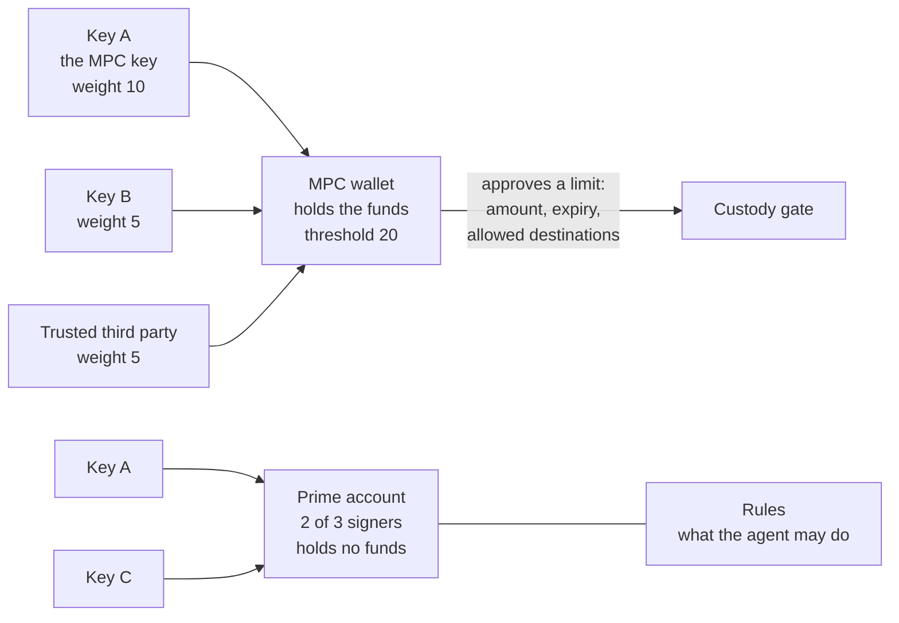
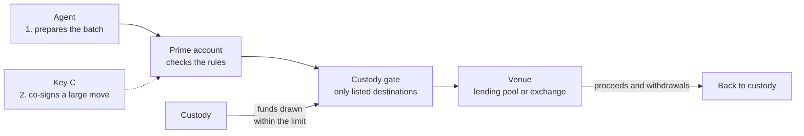
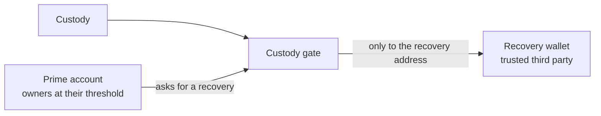
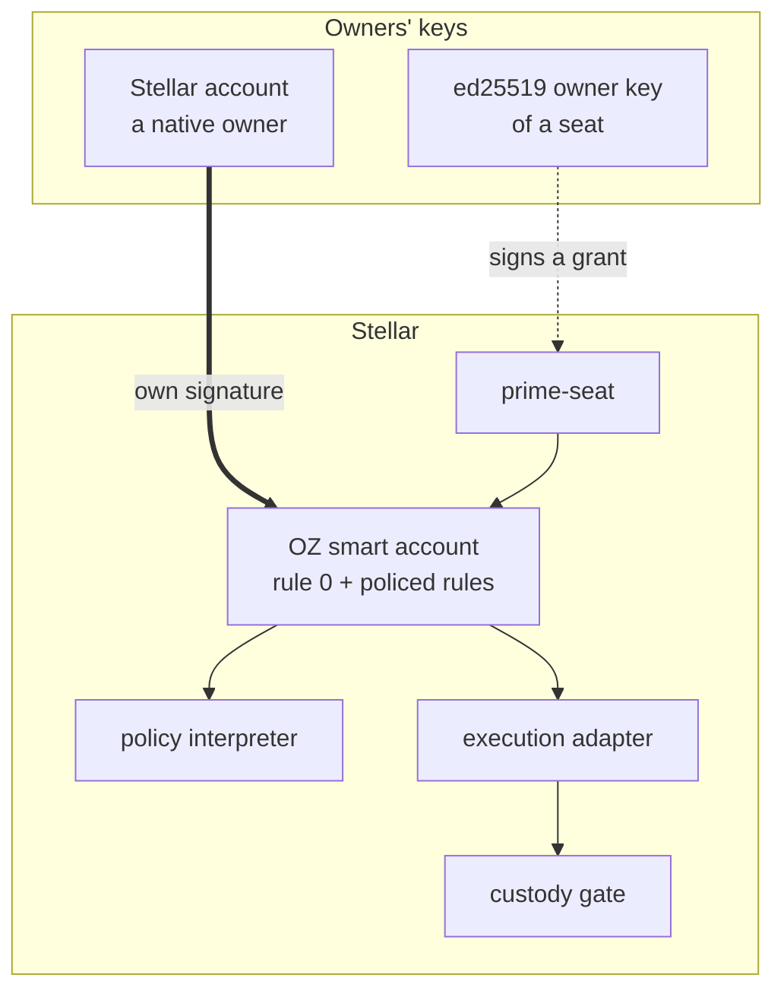
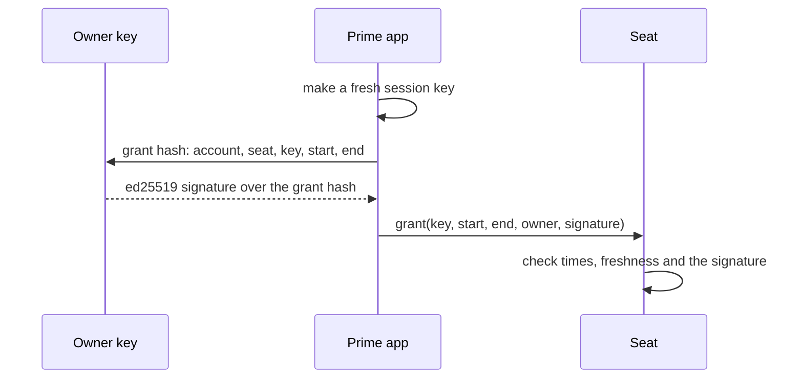
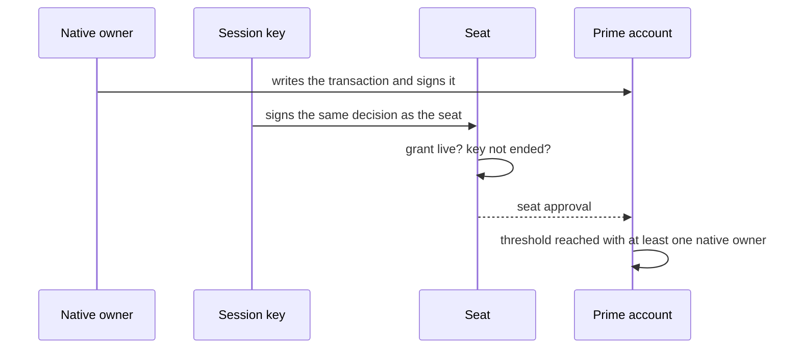

# Prime architecture

Untangled Prime lets an agent put part of a treasury to work while the funds
stay in the institution's own custody and can reach only the destinations the
institution listed. It runs on Stellar. This page covers the whole system;
[stellar.md](stellar.md) has the contracts and the numbers, and
[audit-overview.md](audit-overview.md) the audit scope.

| Prime account | Our contracts | Where it runs |
|---|---|---|
| OpenZeppelin smart account | policy interpreter, custody gate, execution adapter, `prime-seat` | Stellar testnet |

## The use case

An institution holds its treasury in an MPC wallet, such as a Fordefi vault. It
wants an agent to put part of it to work: swap it, supply it to a lending pool,
withdraw it again. It wants the treasury to stay where it is, with no way for
anyone, us included, to take it somewhere it did not agree to.

The setup gives two guarantees:

1. **The MPC wallet always controls the funds:** the money stays in custody.
   Nothing moves unless custody's own signers approved the limit it moves
   under, and they can stop it at any time.
2. **Only the destinations on the custody gate's list can receive funds:**
   custody grants its limit to a gate. The gate holds a list of the places money
   may go, and it refuses everything else.

## The setup

### Step 1: set up

The MPC wallet needs all of its signers to move anything. In the setup we
tested, key A (the MPC key) carries weight 10, key B weight 5 and a trusted
third party weight 5, against a threshold of 20. Any two keys reach 15 at most,
so no pair can act without the third.

The wallet approves one thing: a limit for its custody gate. The gate carries
the list of addresses the funds may go to. The Prime account is a separate
account with three signers, any two of which can approve. It holds no funds. The
mandate, meaning what the agent may do, how much per move and at which venue,
is installed on the Prime account as rules.

### Step 2: execution

A move is one transaction. The agent prepares a batch of calls that moves funds
from custody to a venue. The Prime account checks the batch against its rules.
Small moves need the agent alone; larger ones need a second Prime signer, key C
in the diagram, before they run. The gate draws the funds from custody within
the limit, the venue receives them, and whatever comes back goes to custody. If
any call in the batch fails, the whole transaction reverses.

A move can also wait. The execution adapter stores the batch, anyone can run it
once the wait is over, and custody or the Prime account can cancel it until
then. The stored batch runs under a rule with no signer, bound to the adapter,
whose predicate permits the adapter's `run` alone, so running it needs no key.

### Step 3: recovery

If custody's signers lose access, the funds still need a way out that does not
depend on them. A recovery address, such as a wallet held by the trusted third
party, is fixed when the gate is created. The Prime account's own signers at
their threshold can then move custody's funds to that address, and only to
that address. An agent's rules cannot reach it.

## How the contracts keep the two guarantees

| | Stellar |
|---|---|
| Custody | A classic Stellar account; the weights and threshold are enforced by the network |
| What custody approves | A token allowance to the gate, per asset, with an amount and an expiry of up to 180 days |
| The custody gate | Our contract, deployed by custody; no admin, no settings |
| Where results go | Straight to custody; a Blend position is held in the Prime account's name, and every withdrawal is pinned to custody |
| Per-move limits | Amount bands in policy-interpreter predicates |
| Stopping it | Custody sets the allowance to zero or lets it expire, and can cancel any stored move |
| Recovery | The Prime owners pull to the recovery address; the pull waits the adapter's minimum wait, and custody or the Prime account can cancel it until it runs |

## Components

| Component | Trusted for | Written by |
|---|---|---|
| Custody wallet and its signers | holding the funds and approving the limit | the institution (Fordefi or another MPC) |
| Custody gate | paying only listed destinations within the limit | us |
| Execution adapter | running a batch atomically; bound to a gate, naming only addresses the gate lists; with no gate, refusing a call to the Prime, any grant and any wait | us |
| Policy interpreter | evaluating a rule's predicate on every call the rule authorises, and holding a rule with no signer to its executor binding | us |
| Prime account | counting owners' approvals and selecting rules | OpenZeppelin |
| Seat | letting a session key stand in for one owner on one account | us |
| A seat's owner key | signing only the grants and ends its holder means | the holder: a NEAR-routed MPC in the reference integration, or any signer that raw-signs the grant hash |
| Policy builder | writing rules and returning them unsigned for the owners' wallets | us, in this repository |
| Prime app and relayer | building transactions and paying fees; they hold no authority over funds | us, in a separate repository |

## Trust boundaries

| Party | Can | Cannot |
|---|---|---|
| Custody's signers at their threshold | grant, lower and revoke the limit; cancel stored moves and recoveries | move funds past the gate without the Prime account; change a gate's list (a new gate is needed) |
| The Prime owners at their threshold | install and remove rules, add and remove owners, recover to the recovery address, draw within the limit to any address on the gate's list | pay an address the gate does not list; exceed custody's limit |
| The agent | move funds inside the rules that list it | act outside a rule, recover, cancel, change a rule |
| Anyone | run a stored batch once its wait is over and before its window closes | change what the batch does, or run it twice |
| A session key | vote for its seat's owner in rule 0, and act alone inside rules that list its seat, until its end or the owner's end | act on an account other than the one its seat is bound to on chain |
| The holder of a seat's owner key | grant and end sessions for that seat | act for any other owner or seat |
| The Prime app and the relayer | submit and pay for transactions, hold session keys in the browser | forge an owner's grant, a native signature or a custody signature |
| Us, the builders | run the tooling, the agent and the apps; deploy new code | change a deployed gate, adapter, interpreter or seat: none has an admin or an upgrade path |

The most money at risk at any moment is the limit custody granted, plus anything
supplied to a venue.

## Owners, seats and session keys

Each owner of a Prime account holds one vote, and casts it in one of two ways.

- **A native owner** is a Stellar account. It is a plain signer of rule 0 and
  signs every decision itself.
- **A seat owner** is an ed25519 key. Its holder must produce a raw ed25519
  signature over the 32-byte grant hash. In the reference integration a
  NEAR-routed MPC holds the key; any signer that can raw-sign that hash, such
  as a server-held keypair or a custody service configured for raw ed25519
  signing, can serve. Interactive wallets that sign only transactions or prefixed
  messages produce signatures the seat refuses. On the account the owner has a
  seat: a `prime-seat` contract that is the signer in its place. The seat checks
  only ed25519 signatures.

The owner key signs one grant that names the account, the seat, a session key
and a start and end at most 7 days apart. Until the end, the session key votes
for the owner in rule 0 and acts inside the rules that list the seat, with no
further prompt to the owner key.

In the Prime app's rule-0 layout every decision needs one native owner. Rule 0
carries a weighted threshold: each native account weighs K, each seat 1, and K
is the number of seats at creation plus one, so seats alone stay below the
threshold (a seat added later sits at weight 0). The seat serves rule 0 only
through `External` and other rules only through `Delegated`, so one session
cannot pass rule 0 alone through a duplicate entry.

Some checks that keep one key from counting twice live in the app: the owner
keys must differ, no seat may sit in two accounts, and no plain key may sit
beside its own seat. The second holds on chain, because a seat is bound to one
account at construction; the app enforces the first and the third.

### Starting a session

### A decision with a seat

### Ending a session

The session ends at its end time, when the owner key or the session key itself
signs an end, or when the owners remove the seat. An ended key never returns:
the seat stores an end of 0. Removing an owner of any kind must always be
possible; the app rewrites or switches off rules that would block it.

## Why it is built this way

**Custody stays put and the gate has no admin:** the institution keeps its
existing custody and approvals; Prime adds a limit and a list. The gate has no
admin, no setters and no upgrade path, so changing the list means a new gate
and a new approval by custody's full threshold. The gate also pins the build of
the one adapter that may call it, because a Soroban contract id commits only to
the deployer and salt.

**Our own contracts on Stellar:** Soroban allows one host-function call per
transaction, so a batch needs a contract that makes several calls atomically
(the execution adapter). The OpenZeppelin account checks each authorised call
against a rule, and the policy interpreter turns a rule into data: a new
mandate is a new predicate, with no new contract and no new audit. The same
adapter, created with no gate, lets a Prime bundle its own calls, such as a
check followed by transfers that happen only if the check passes. It then
checks no address, so the Prime's own rules are the only limit, and it runs
every batch at once ([stellar.md](stellar.md#no-gate)).

**A stored batch runs with no key:** whoever runs a stored batch only chooses
when, because the Prime approved the batch whole when it was stored. The rule
that answers the adapter's `run` therefore lists no signer. The interpreter
accepts it only while it is bound to the adapter, has the interpreter as its
only policy and pins `call_fn == run`, and it takes the adapter's own `run`
context as the adapter's consent. Every other context under a bound rule needs
a grant from the adapter. A rule signed by the adapter would do the same job,
and OpenZeppelin's 0.8.0 account refuses it (a delegated signer that is also a
contract called in the operation, error 3017).

**One signature format for seats:** a seat checks one format, an ed25519
signature over a 32-byte hash, and needs no other cryptography. The owner key
can live in whichever custodian signs that format.

**Session keys hold a vote, with a native owner beside them:** a session that
holds an owner's vote can do anything that owner's vote can, so the rule-0
layout keeps every decision behind one native signature, the grant names its
account and seat, and a seat is bound to its account on chain.

**A rule is never edited in place:** the interpreter pins the rule's signers,
so replacing a rule is the safe way to change who signs it.

## Known behaviours

- **A policed rule stops working when its signers change:** the interpreter
  stores a hash of the rule's signers and refuses every signer (error 204) once
  the set changes. Remove a signer by adding a new rule without it and removing
  the old one.
- **`remove_context_rule` can leave an interpreter entry behind:** the
  interpreter's `uninstall` needs the policy admins' own authorisation; when it
  fails, the account removes the rule anyway, and the entry stays until it
  archives. Nothing reads it again.
- **`uninstall` drops an executor binding:** it needs only the policy admins. A
  rule with no signer then refuses every call (error 210); a keyed rule
  installed again has no binding until the owners bind it again.
- **Seats join policed rules as `Delegated`:** the interpreter refuses
  `External` signers (error 212), `Default` scope and rules scoped to the
  account or to the interpreter (error 218).
- **An adapter with no gate checks no address:** a batch through it can do what
  the Prime's rules allow for each call that asks the Prime, and move anything
  the adapter holds. It must never hold funds or an allowance. It grants
  nothing, so no rule bound to it can pass, and every call through it needs the
  agent's own keyed rule. A bundle that failed can be submitted again by
  whoever holds its signed address-credential entry, until that entry's expiry
  ledger.
- **A seat cannot be a policy admin:** admins authorise by `require_auth`,
  which a seat satisfies only inside its own account's check.
- **Owner count:** an OpenZeppelin account takes 15 signers in rule 0 and
  refuses 16.
- **The last owner:** an OpenZeppelin account accepts removing its only rule-0
  signer and is then unreachable, so the app must refuse that step.

**Notes for rule writers:**

- Stellar amounts are signed integers, so an upper bound alone lets a negative
  amount through; give every amount a lower bound.
- A Stellar call that authorises two contexts (a Blend `submit` and its token
  `transfer`) needs a rule for each, because the interpreter sees one authorised
  call at a time.
