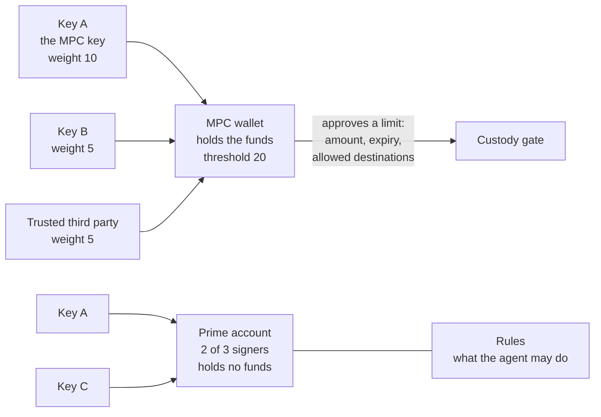
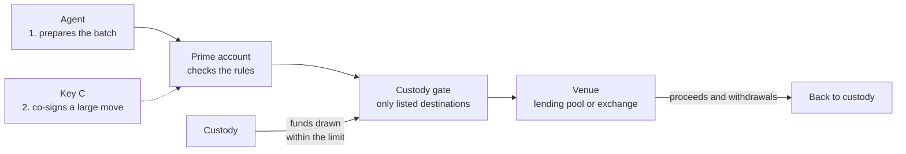
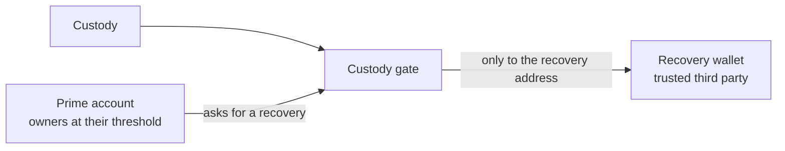
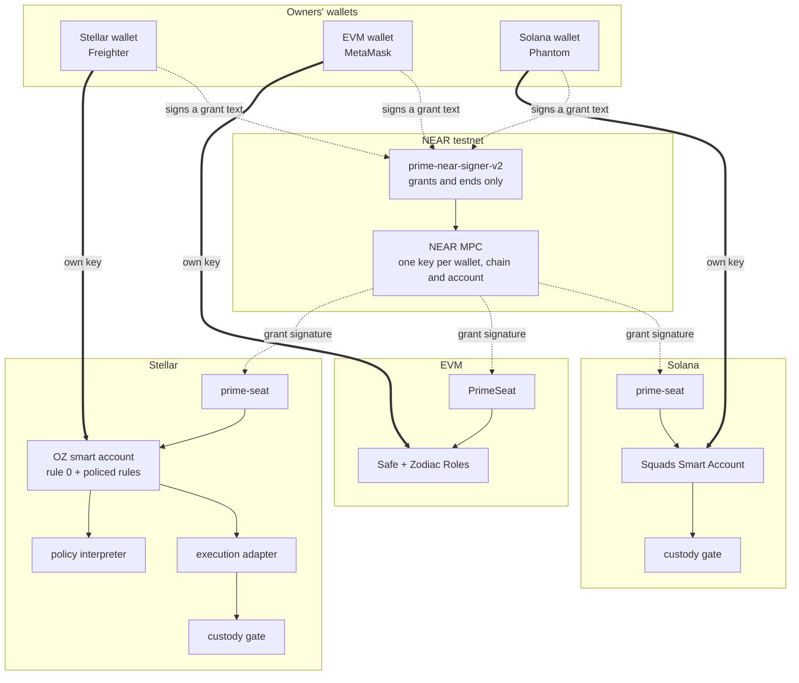
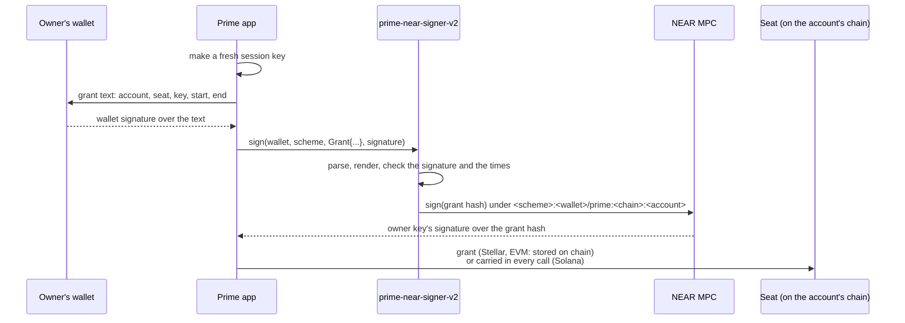
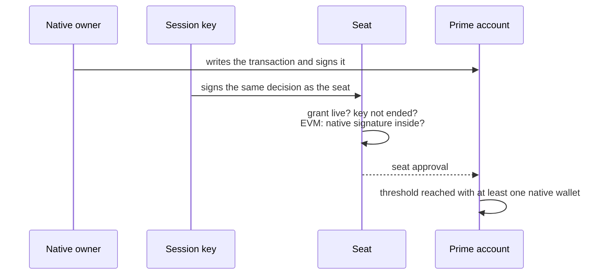

# Prime architecture

Untangled Prime lets an agent put part of a treasury to work while the funds
stay in the institution's own custody and can reach only the destinations the
institution listed. It runs on Stellar, EVM and Solana, and an owner whose
wallet lives on one chain can be an owner of a Prime account on another
through NEAR. This page covers the whole system; each chain has its own page
for the contracts and the numbers.

| Chain | Prime account | Our contracts | Where it runs |
|---|---|---|---|
| Stellar | OpenZeppelin smart account | custody gate, execution adapter, policy interpreter, `prime-seat` | mainnet since 1 October 2026 (custody contracts with the grammar-6 interpreter; older grammar-4 and grammar-5 interpreters the Prime app still uses; no seats), and testnet |
| EVM | Safe with Zodiac Roles | `PrimeSeat` | Base Sepolia |
| Solana | Squads Smart Account | custody gate, `prime-seat` | devnet |
| NEAR | none | `prime-near-signer-v2`. v1 is retired: its source left this tree and nothing in octopos calls it, but its testnet account still signs any payload until it is removed ([near.md](near.md#prime-near-signer-v1-retired)) | NEAR testnet |

Detail: [stellar.md](stellar.md), [evm.md](evm.md), [solana.md](solana.md),
[near.md](near.md). The list of what is where is in [README.md](README.md).

## The use case

An institution holds its treasury in an MPC wallet, such as a Fordefi vault. It
wants an agent to put part of it to work: swap it, supply it to a lending pool,
withdraw it again. It wants the treasury to stay where it is, with no way for
anyone, us included, to take it somewhere it did not agree to.

The setup gives two guarantees:

1. **The MPC wallet always controls the funds:** the money stays in custody.
   Nothing moves unless custody's own signers approved the limit it moves
   under, and they can stop it at any time.
2. **Only the destinations on the custody gate's list can receive funds:**
   custody grants its limit to a gate. The gate holds a list of the places money
   may go, and it refuses everything else.

## The setup

### Step 1: set up

The MPC wallet needs all of its signers to move anything. In the setup we
demonstrated, key A (the MPC key) carries weight 10, key B weight 5 and a
trusted third party weight 5, against a threshold of 20. Any two keys reach 15
at most, so no pair can act without the third.

The wallet approves one thing: a limit for its custody gate. The gate carries
the list of addresses the funds may go to. The Prime account is a separate
account with three signers, any two of which can approve. It holds no funds. The
mandate, meaning what the agent may do, how much per move and at which venue,
is installed on the Prime account as rules.

### Step 2: execution

A move is one transaction. The agent prepares a batch of calls that moves funds
from custody to a venue. The Prime account checks the batch against its rules.
Small moves need the agent alone; larger ones need a second Prime signer, key C
in the diagram, before they run. The gate draws the funds from custody within
the limit, the venue receives them, and whatever comes back goes to custody. If
any call in the batch fails, the whole transaction reverses.

A move can also wait. On Stellar the execution adapter stores the batch, anyone
can run it once the wait is over, and custody or the Prime account can cancel it
until then. On Solana the Squads rule's time lock stores the whole batch. On
EVM, moves run at once and recovery waits on a timelock.

### Step 3: recovery

If custody's signers lose access, the funds still need a way out that does not
depend on them. A recovery address, such as a wallet held by the trusted third
party, is fixed when the gate is created. The Prime account's own signers at
their threshold can then move custody's funds to that address, and only to
that address. An agent's rules cannot reach it.

## How each chain keeps the two guarantees

| | Stellar | EVM | Solana |
|---|---|---|---|
| Custody | A classic Stellar account; the weights and threshold are enforced by the network | A Fordefi address; the rule that all signers approve lives in the Fordefi policy, because EVM cannot put weights on an address | An SPL Token multisig of custody and a trustee, which hands the owner and close authority of a dedicated token account to the gate |
| What custody approves | A token allowance to the gate, per asset, with an amount and an expiry of up to 180 days | A token approval to the gate, per asset; the amount is the gate's total budget | The hand-over, then a cap the gate sets as the token account's delegated amount |
| The custody gate | Our contract, deployed by custody; no admin, no settings | A Safe that custody alone owns, with Zodiac Roles rules naming the only venues and addresses | Our program; owns the token account and pays only listed destinations |
| Where results go | Straight to custody; a Blend position is held in the Prime account's name, and every withdrawal is pinned to custody | Every result, the lending position included, goes to custody | The venue pays proceeds into a gate-owned custody account |
| Per-move limits | Amount bands in policy-interpreter predicates | Roles bands, a daily cap for the agent and a daily cap on everything leaving custody | Squads policies |
| Stopping it | Custody sets the allowance to zero or lets it expire, and can cancel any stored move | Custody turns off the gate's trading rules; recovery keeps working unless custody stops that too | Any one custody signer lowers the cap to 0 |
| Recovery | The Prime owners pull to the recovery address; the pull waits the adapter's minimum wait, and custody or the Prime account can cancel it until it runs | The Prime owners schedule it on an OpenZeppelin timelock; custody can cancel during the delay | The Prime owners pay the recovery address at any time with no cap; the only wait is the Prime account's own time lock |

## Components

| Component | Chain | Trusted for | Written by |
|---|---|---|---|
| Custody wallet and its signers | each | holding the funds and approving the limit | the institution (Fordefi or another MPC) |
| Custody gate | Stellar, Solana | paying only listed destinations within the limit | us |
| Custody gate | EVM | the same, as a Safe owned by custody with Roles rules | Safe, Zodiac (audited code, unmodified) |
| Execution adapter | Stellar | running a batch atomically; bound to a gate, naming only addresses the gate lists; with no gate (v5 build), refusing a call to the Prime, any grant and any wait | us |
| Policy interpreter | Stellar | evaluating a rule's predicate on every call the rule authorises | us |
| Prime account | each | counting owners' approvals and selecting rules | OpenZeppelin, Safe, Squads |
| Seat | each | letting a session key stand in for one NEAR-routed owner on one account | us |
| `prime-near-signer-v2` | NEAR | asking the MPC to sign only a grant or an End the wallet signed as readable text | us |
| NEAR MPC | NEAR | holding the keys of NEAR-routed owners and signing what the signer account asks | NEAR |
| Relayer and apps | off chain | building transactions and paying fees; they hold no authority over funds | us, in the octopos repository |

## Trust boundaries

| Party | Can | Cannot |
|---|---|---|
| Custody's signers at their threshold | grant, lower and revoke the limit; cancel stored moves (Stellar) and recoveries (Stellar, EVM); release the token account back (Solana) | move funds past the gate without the Prime account; change a gate's list (a new gate is needed) |
| One custody signer | lower the cap to 0 on Solana | raise a limit or move funds |
| The Prime owners at their threshold | install and remove rules, add and remove owners, recover to the recovery address; on Stellar and Solana, also draw within the limit to any address on the gate's list | pay an address the gate does not list; exceed custody's limit (except Solana recovery, which has no cap) |
| The agent | move funds inside the rules that list it | act outside a rule, recover, cancel (Stellar), change a rule |
| A session key | vote for its NEAR-routed owner beside a native owner's signature, and act alone inside rules that list its seat, until its end or the owner's End | act on an account whose owners never listed its seat (on Stellar and EVM the seat is bound to one account on chain; on Solana another account can list the seat, and onboarding refuses that), or decide alone; on Solana, create a transaction |
| `prime-near-signer-v2` and the NEAR MPC | sign a grant or an End that the owner's wallet signed as text | sign a vote or any other payload through v2's code. Until the full-access keys are deleted, their holder can call the MPC directly ([near.md](near.md#limits)) |
| The relayer and the apps | submit and pay for transactions, hold session keys in the browser | forge an owner's grant, a native signature or a custody signature. On Solana `prime-seat` passes the transaction's outer signers into the Squads call, so the relayer refuses any transaction that lists its own key except as fee payer or, for an End, rent payer |
| Us, the builders | run the tooling, the agent and the apps; deploy new code | change a deployed gate, adapter, interpreter, seat or Solana program: none has an admin or an upgrade path. Until the NEAR deploy keys are deleted, their holder can sign a grant for any NEAR-routed owner and replace the signers' code ([near.md](near.md#limits)) |

The most money at risk at any moment is the limit custody granted, plus anything
supplied to a venue. On Solana the Prime owners at their threshold also reach
the whole gate-owned balance, but only toward the fixed recovery address.

## Owners, seats and session keys

Each owner of a Prime account holds one vote. How the vote is cast depends on
whether the owner's wallet signs on the account's chain.

- **A native owner** signs on its own chain with its own key: Freighter on
  Stellar, MetaMask on EVM, Phantom on Solana. On the account it is a plain
  signer of rule 0, a Safe owner or a Squads settings signer, and it signs every
  decision in its wallet.
- **A NEAR-routed owner** has a wallet on another chain. On the account's chain
  it has a seat: a contract (Stellar, EVM) or a program address (Solana) that is
  the signer in its place. Its owner key is a key the NEAR MPC holds for that
  wallet, chain and account.

A session key exists only to stand in for a NEAR-routed owner: on Stellar and
EVM since 12 October 2026, and on Solana since 18 October 2026. The owner signs
one readable grant through `prime-near-signer-v2`, and for up to 7 days the
session key votes for the owner and acts inside the rules that list the seat,
with no further NEAR prompt. A native owner has no session key.

| Wallet family | EVM | Solana | Stellar |
|---|---|---|---|
| MetaMask (EVM) | own key | seat, grant through v2 (`personal_sign`) | seat, grant through v2 (`personal_sign`) |
| Freighter (Stellar) | seat, grant through v2 (SEP-53) | seat, grant through v2 (SEP-53) | own key |
| Phantom (Solana) | seat, grant through v2 (raw text) | own key | seat, grant through v2 (raw text) |

MetaMask's own Solana account and Phantom's own EVM account can also sign there
as native owners (section 5.6 of the round-9 record).

Some checks that keep one key from counting twice live in onboarding: the
owner keys must differ, no seat may sit in two accounts, no plain key may sit
beside its own seat, and on Solana only the canonical seat PDA is accepted
(section 14.6 of the round-9 record). No contract enforces the first and the
third; the second holds on chain on Stellar and EVM, and only through
onboarding on Solana.

Every decision needs one native wallet, on every chain:

| Chain | How the seat is held back |
|---|---|
| Stellar | Rule 0 carries a weighted threshold: each native account weighs K, each seat 1, and K is the number of seats at creation plus one, so seats alone stay below the threshold (a seat added later sits at weight 0). The seat serves rule 0 only through `External` and other rules only through `Delegated`, so one session cannot pass rule 0 alone through a duplicate entry |
| EVM | A seat's signature for the Safe holds two parts: the session key's and a Safe owner's own signature over the same transaction hash. A seat vote passes only with the native owner's approval of exactly that transaction |
| Solana | A seat cannot create a transaction (no Initiate, and `prime-seat` refuses the call), so a native owner writes every change and the seats approve |

`prime-near-signer-v2` renders a grant or an End as text, checks the wallet's
signature over that text, and asks the MPC to sign the grant hash it computed;
it refuses every vote. Through v2, a phishing page that gets a wallet signature
can at most start or end a session it describes in plain words. Until the
signer accounts' full-access keys are deleted, their holder can bypass v2 and
get a grant signed for any NEAR-routed owner ([near.md](near.md#limits)).

### Starting a session

### A decision with a seat

### Ending a session

The session ends at its end time, when the owner (through v2) or the key itself
signs an End, or when the owners remove the seat. An ended key never returns: the
Stellar seat stores an end of 0, the EVM seat stores the maximum end, and the
Solana program takes over a marker account at `[owner, settings, key]`.
Removing an owner of any kind must always be possible; the apps rewrite or
switch off rules that would block it.

## Why it is built this way

**Custody stays put and the gate has no admin:** the institution keeps its
existing custody and approvals; Prime adds a limit and a list. The gates have
no admin, no setters and no upgrade path, so changing the list means a new gate
and a new approval by custody's full threshold. On Stellar the gate also pins
the build of the one adapter that may call it, because a Soroban contract id
commits only to the deployer and salt.

**Stellar uses our own contracts:** Soroban allows one host-function call per
transaction, so a batch needs a contract that makes several calls atomically
(the execution adapter). The OpenZeppelin account checks each authorised call
against a rule, and the policy interpreter turns a rule into data: a new
mandate is a new predicate, with no new contract and no new audit. The same
adapter, created with no gate, lets a Prime bundle its own calls, such as a
check followed by transfers that happen only if the check passes. It then
checks no address, so the Prime's own rules are the only limit, and it runs
every batch at once
([stellar.md](stellar.md#no-gate)).

**EVM uses only audited code for custody:** Safe, Zodiac Roles and
OpenZeppelin's TimelockController express the gate, the bands and the recovery
delay without a contract of ours. The seat is the one exception, 72 lines.

**Solana's gate owns the token account:** custody hands the owner and the
close authority of one token account to the gate. Recovery then reaches the
whole balance with no cap, and any one custody signer can stop the agent by
lowering the cap. The alternative, an SPL multisig owning the account and
approving the gate as delegate, was spiked (162 of 162 checks) and set aside:
its recovery stops at the remaining allowance and an SPL account has one
delegate. Swig was tested as a session layer and set aside too: its 7-day cap
counts slots, it allows one live session per role, and its upgradeable program
did not match a verified build.

**NEAR instead of a signature checker per chain:** each wallet family refuses
some formats (MetaMask cannot sign ed25519, Freighter prefixes every message,
Phantom will not sign 32 raw hash bytes). Checking every format on every chain
needed 219 lines plus a 1,104-line vendored ed25519 library on EVM. With NEAR,
each seat checks one signature format and no chain needs extra cryptography.
The cost is about 8 seconds per NEAR signature, paid at grants and ends only;
votes and moves never wait on NEAR.

**Seats only, and NEAR for grants only:** a session that holds an owner's vote
can do anything that owner's vote can. The October spikes showed that a vote
session plus one other owner could change owners and thresholds, that two vote sessions could take a
2-of-3 account with no wallet prompt, and that NEAR-routed owners signing a hex
payload could not see what they granted
([section 14.6 of the round-9 record](https://github.com/untangledfinance/oz-policy-builder/blob/archive/spike-final/contracts/prime/ARCHITECTURE.md)).
The built seats answer each of these: a native wallet signs every decision, the
grant is readable text, v2 never asks the MPC for a vote (a guarantee that holds
fully once the signer accounts' deploy keys are deleted), and a seat is bound to
its account on Stellar and EVM, and by onboarding checks on Solana.
Merging the seat with a move-only session for native owners was considered and
rejected: a Phantom owner would sign a bare 32-byte hash, and a native owner's
seat could count as a second approval.

**Final programs, fresh rule ids:** the Solana programs deploy with `--final`
and NEAR v2 refuses any request it cannot parse, so behaviour changes only with
a new deployment and a new pin. On Stellar the interpreter is a new instance
for every grammar version, and a rule is never edited in place: replacing a
rule is the safe way to change who signs it.

## Known behaviours

- **A policed Stellar rule stops working when its signers change:** the
  interpreter stores a hash of the rule's signers and refuses every signer
  (error 204) once the set changes. This is true of every interpreter version.
  Remove a signer by adding a new rule without it and removing the old one.
- **`remove_context_rule` can leave an interpreter entry behind:** the
  interpreter's `uninstall` needs the policy admins' own authorisation; when it
  fails, the account removes the rule anyway, and the entry stays until it
  archives. True of every interpreter version. Nothing reads it again.
- **Seats join policed rules as `Delegated`:** the interpreter refuses
  `External` signers (error 212, every version) and `Default` scope (error 218,
  grammar 6 and 7); grammar 7 also refuses rules scoped to the account or to
  the interpreter.
- **A Stellar adapter with no gate checks no address:** a batch through it can
  do what the Prime's rules allow for each call that asks the Prime, and move
  anything the adapter holds. It must never hold funds or an allowance, and no
  rule on the Prime should list it as a signer: such a rule would let an agent
  move funds past its own caps, and only the tooling can refuse it. A bundle
  that failed can be submitted again by whoever holds its signed
  address-credential entry, until that entry's expiry ledger.
- **A seat cannot be a policy admin:** admins authorise by `require_auth`,
  which a seat satisfies only inside its own account's check.
- **Owner counts per chain:** Safe and Roles have no cap (12 owners measured in
  one setup transaction); Squads fits 25 signers in a create transaction and
  reached 62 signers one add at a time; an OpenZeppelin account takes 15
  signers in rule 0 and refuses 16 (October 2026 spike runs).
- **The last owner:** a Safe refuses to remove its only owner (`GS013`) and
  Squads refuses the matching proposal (`NoProposers`). An OpenZeppelin account
  accepts removing its only rule-0 signer and is then unreachable, so the apps
  must refuse that step.
- **NEAR availability:** while NEAR or its MPC is down, NEAR-routed owners
  cannot start or end sessions. Live sessions keep working. Whoever pays the MPC
  calls needs about 0.31 NEAR on hand, because each call prepays 300 Tgas at the
  current gas price.

**Notes for rule writers:**

- On EVM and Solana, bytes after the last checked argument pass the rule, and
  the venue reads the same call; pin targets that decode with a standard
  decoder.
- Stellar amounts are signed integers, so an upper bound alone lets a negative
  amount through; give every amount a lower bound.
- Solana policies read call data at fixed offsets, so a field after a
  variable-length field cannot be checked.
- A Stellar call that authorises two contexts (a Blend `submit` and its token
  `transfer`) needs a rule for each, because the interpreter sees one authorised
  call at a time.

## Sources

The rationale above carries over the parts of the round-9 design record that
still hold (the
[old ARCHITECTURE.md](https://github.com/untangledfinance/oz-policy-builder/blob/archive/spike-final/contracts/prime/ARCHITECTURE.md),
kept at tag `archive/spike-final`, sections 3, 4.1, 4.2, 5.1 to 5.4, 7.3, 13
and 14.6). Its descriptions of `prime-session` and of the seat-voting spikes are
history. The decisions of 12 and 18 October 2026 that made sessions seat-only
and NEAR grants-only are in the CHANGELOG and the chain pages.
