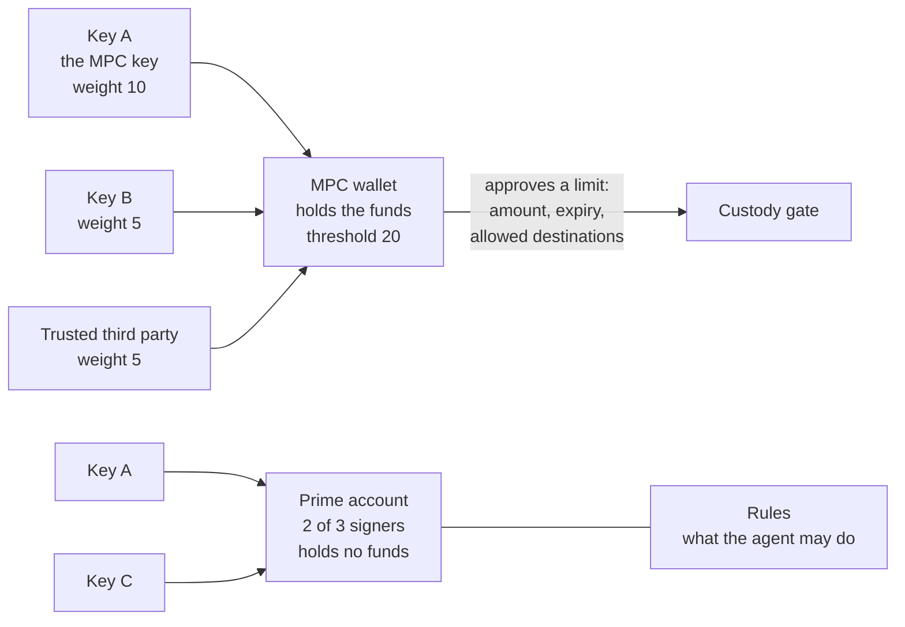
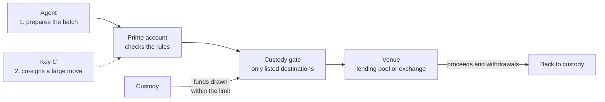
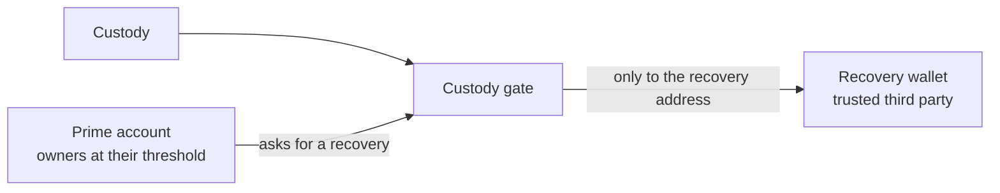
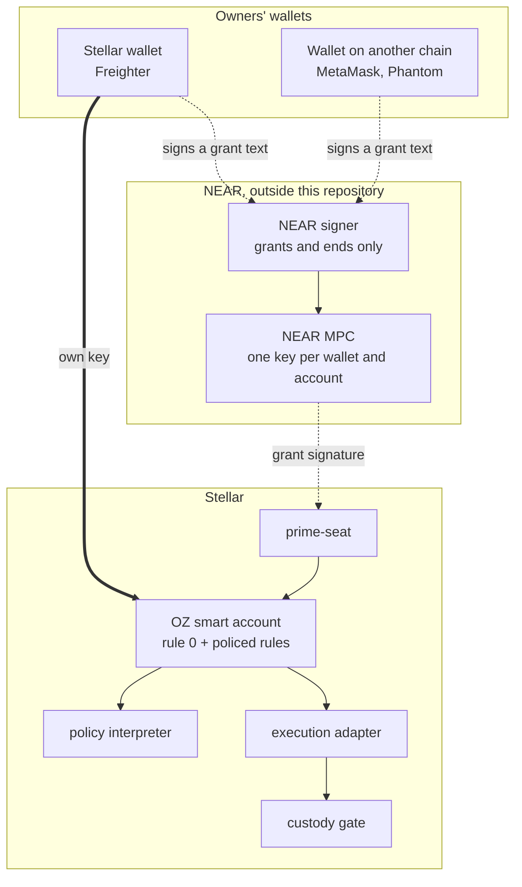
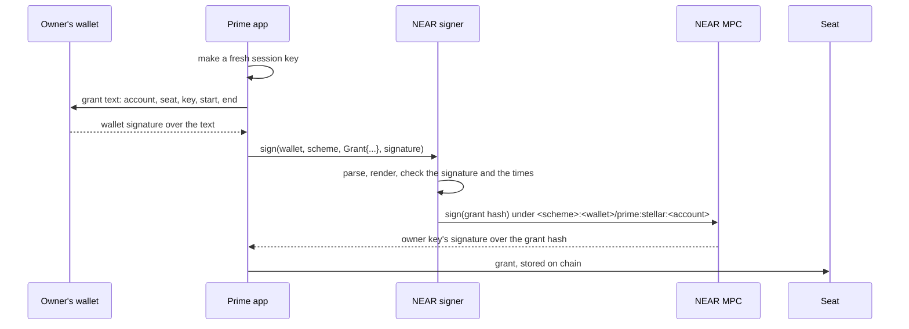
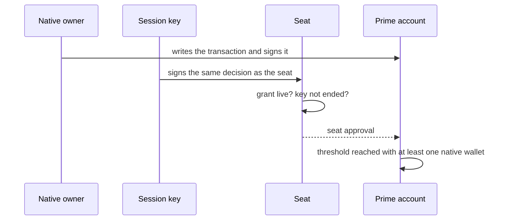

# Prime architecture

Untangled Prime lets an agent put part of a treasury to work while the funds
stay in the institution's own custody and can reach only the destinations the
institution listed. It runs on Stellar. An owner whose wallet does not sign on
Stellar takes part through a seat, whose owner key the NEAR MPC holds. This page
covers the whole system; [stellar.md](stellar.md) has the contracts and the
numbers.

| Prime account | Our contracts | Where it runs |
|---|---|---|
| OpenZeppelin smart account | custody gate, execution adapter, policy interpreter, `prime-seat` | mainnet since 1 October 2026 (custody contracts with the grammar-6 interpreter; older grammar-4 and grammar-5 interpreters the Prime app still uses; no seats), and testnet |

The list of what is where is in [README.md](README.md).

## The use case

An institution holds its treasury in an MPC wallet, such as a Fordefi vault. It
wants an agent to put part of it to work: swap it, supply it to a lending pool,
withdraw it again. It wants the treasury to stay where it is, with no way for
anyone, us included, to take it somewhere it did not agree to.

The setup gives two guarantees:

1. **The MPC wallet always controls the funds:** the money stays in custody.
   Nothing moves unless custody's own signers approved the limit it moves
   under, and they can stop it at any time.
2. **Only the destinations on the custody gate's list can receive funds:**
   custody grants its limit to a gate. The gate holds a list of the places money
   may go, and it refuses everything else.

## The setup

### Step 1: set up

The MPC wallet needs all of its signers to move anything. In the setup we
demonstrated, key A (the MPC key) carries weight 10, key B weight 5 and a
trusted third party weight 5, against a threshold of 20. Any two keys reach 15
at most, so no pair can act without the third.

The wallet approves one thing: a limit for its custody gate. The gate carries
the list of addresses the funds may go to. The Prime account is a separate
account with three signers, any two of which can approve. It holds no funds. The
mandate, meaning what the agent may do, how much per move and at which venue,
is installed on the Prime account as rules.

### Step 2: execution

A move is one transaction. The agent prepares a batch of calls that moves funds
from custody to a venue. The Prime account checks the batch against its rules.
Small moves need the agent alone; larger ones need a second Prime signer, key C
in the diagram, before they run. The gate draws the funds from custody within
the limit, the venue receives them, and whatever comes back goes to custody. If
any call in the batch fails, the whole transaction reverses.

A move can also wait. On Stellar the execution adapter stores the batch, anyone
can run it once the wait is over, and custody or the Prime account can cancel it
until then.

### Step 3: recovery

If custody's signers lose access, the funds still need a way out that does not
depend on them. A recovery address, such as a wallet held by the trusted third
party, is fixed when the gate is created. The Prime account's own signers at
their threshold can then move custody's funds to that address, and only to
that address. An agent's rules cannot reach it.

## How the contracts keep the two guarantees

| | Stellar |
|---|---|
| Custody | A classic Stellar account; the weights and threshold are enforced by the network |
| What custody approves | A token allowance to the gate, per asset, with an amount and an expiry of up to 180 days |
| The custody gate | Our contract, deployed by custody; no admin, no settings |
| Where results go | Straight to custody; a Blend position is held in the Prime account's name, and every withdrawal is pinned to custody |
| Per-move limits | Amount bands in policy-interpreter predicates |
| Stopping it | Custody sets the allowance to zero or lets it expire, and can cancel any stored move |
| Recovery | The Prime owners pull to the recovery address; the pull waits the adapter's minimum wait, and custody or the Prime account can cancel it until it runs |

## Components

| Component | Trusted for | Written by |
|---|---|---|
| Custody wallet and its signers | holding the funds and approving the limit | the institution (Fordefi or another MPC) |
| Custody gate | paying only listed destinations within the limit | us |
| Execution adapter | running a batch atomically; bound to a gate, naming only addresses the gate lists; with no gate (v5 build), refusing a call to the Prime, any grant and any wait | us |
| Policy interpreter | evaluating a rule's predicate on every call the rule authorises | us |
| Prime account | counting owners' approvals and selecting rules | OpenZeppelin |
| Seat | letting a session key stand in for one NEAR-routed owner on one account | us |
| NEAR signer | asking the MPC to sign only a grant or an End the wallet signed as readable text | us, outside this repository |
| NEAR MPC | holding the keys of NEAR-routed owners and signing what the signer account asks | NEAR |
| Relayer and apps | building transactions and paying fees; they hold no authority over funds | us, in the octopos repository |

## Trust boundaries

| Party | Can | Cannot |
|---|---|---|
| Custody's signers at their threshold | grant, lower and revoke the limit; cancel stored moves and recoveries | move funds past the gate without the Prime account; change a gate's list (a new gate is needed) |
| The Prime owners at their threshold | install and remove rules, add and remove owners, recover to the recovery address, draw within the limit to any address on the gate's list | pay an address the gate does not list; exceed custody's limit |
| The agent | move funds inside the rules that list it | act outside a rule, recover, cancel, change a rule |
| A session key | vote for its NEAR-routed owner beside a native owner's signature, and act alone inside rules that list its seat, until its end or the owner's End | act on an account whose owners never listed its seat (the seat is bound to one account on chain), or decide alone |
| The NEAR signer and the NEAR MPC | sign a grant or an End that the owner's wallet signed as text | sign a vote or any other payload through the signer's code. Until the signer account's full-access keys are deleted, their holder can call the MPC directly |
| The relayer and the apps | submit and pay for transactions, hold session keys in the browser | forge an owner's grant, a native signature or a custody signature |
| Us, the builders | run the tooling, the agent and the apps; deploy new code | change a deployed gate, adapter, interpreter or seat: none has an admin or an upgrade path. Until the NEAR deploy keys are deleted, their holder can sign a grant for any NEAR-routed owner and replace the signer's code |

The most money at risk at any moment is the limit custody granted, plus anything
supplied to a venue.

## Owners, seats and session keys

Each owner of a Prime account holds one vote. How the vote is cast depends on
whether the owner's wallet signs on Stellar.

- **A native owner** signs on Stellar with its own key, such as Freighter. On
  the account it is a plain signer of rule 0, and it signs every decision in its
  wallet.
- **A NEAR-routed owner** has a wallet on another chain, such as MetaMask or
  Phantom. On the account it has a seat: a contract that is the signer in its
  place. Its owner key is a key the NEAR MPC holds for that wallet and account.

A session key exists only to stand in for a NEAR-routed owner, since 12 October
2026. The owner signs one readable grant through the NEAR signer, and for up to
7 days the session key votes for the owner and acts inside the rules that list
the seat, with no further NEAR prompt. A native owner has no session key.

| Wallet | On a Prime account |
|---|---|
| Freighter | own key |
| MetaMask | seat, grant through the NEAR signer (`personal_sign`) |
| Phantom | seat, grant through the NEAR signer (raw text) |

Some checks that keep one key from counting twice live in onboarding: the
owner keys must differ, no seat may sit in two accounts, and no plain key may
sit beside its own seat (section 14.6 of the round-9 record). No contract
enforces the first and the third; the second holds on chain.

Every decision needs one native wallet. Rule 0 carries a weighted threshold:
each native account weighs K, each seat 1, and K is the number of seats at
creation plus one, so seats alone stay below the threshold (a seat added later
sits at weight 0). The seat serves rule 0 only through `External` and other
rules only through `Delegated`, so one session cannot pass rule 0 alone through
a duplicate entry.

The NEAR signer renders a grant or an End as text, checks the wallet's
signature over that text, and asks the MPC to sign the grant hash it computed;
it refuses every vote. Through it, a phishing page that gets a wallet signature
can at most start or end a session it describes in plain words. Until the
signer account's full-access keys are deleted, their holder can bypass it and
get a grant signed for any NEAR-routed owner.

### Starting a session

### A decision with a seat

### Ending a session

The session ends at its end time, when the owner (through the NEAR signer) or
the key itself signs an End, or when the owners remove the seat. An ended key
never returns: the seat stores an end of 0. Removing an owner of any kind must
always be possible; the apps rewrite or switch off rules that would block it.

## Why it is built this way

**Custody stays put and the gate has no admin:** the institution keeps its
existing custody and approvals; Prime adds a limit and a list. The gates have
no admin, no setters and no upgrade path, so changing the list means a new gate
and a new approval by custody's full threshold. On Stellar the gate also pins
the build of the one adapter that may call it, because a Soroban contract id
commits only to the deployer and salt.

**Stellar uses our own contracts:** Soroban allows one host-function call per
transaction, so a batch needs a contract that makes several calls atomically
(the execution adapter). The OpenZeppelin account checks each authorised call
against a rule, and the policy interpreter turns a rule into data: a new
mandate is a new predicate, with no new contract and no new audit. The same
adapter, created with no gate, lets a Prime bundle its own calls, such as a
check followed by transfers that happen only if the check passes. It then
checks no address, so the Prime's own rules are the only limit, and it runs
every batch at once
([stellar.md](stellar.md#no-gate)).

**NEAR instead of a signature checker per wallet:** each wallet family
refuses some formats (MetaMask cannot sign ed25519, Freighter prefixes every
message, Phantom will not sign 32 raw hash bytes). With NEAR, the seat checks
one signature format and needs no extra cryptography. The cost is about 8
seconds per NEAR signature, paid at grants and ends only; votes and moves never
wait on NEAR.

**Seats only, and NEAR for grants only:** a session that holds an owner's vote
can do anything that owner's vote can. The October spikes showed that a vote
session plus one other owner could change owners and thresholds, that two vote sessions could take a
2-of-3 account with no wallet prompt, and that NEAR-routed owners signing a hex
payload could not see what they granted
([section 14.6 of the round-9 record](https://github.com/untangledfinance/oz-policy-builder/blob/archive/spike-final/contracts/prime/ARCHITECTURE.md)).
The built seats answer each of these: a native wallet signs every decision, the
grant is readable text, the NEAR signer never asks the MPC for a vote (a guarantee that holds
fully once the signer account's deploy keys are deleted), and a seat is bound to
its account on chain.
Merging the seat with a move-only session for native owners was considered and
rejected: a Phantom owner would sign a bare 32-byte hash, and a native owner's
seat could count as a second approval.

**Fresh instances, fresh rule ids:** the interpreter is a new instance for
every grammar version, and a rule is never edited in place: replacing a rule is
the safe way to change who signs it.

## Known behaviours

- **A policed Stellar rule stops working when its signers change:** the
  interpreter stores a hash of the rule's signers and refuses every signer
  (error 204) once the set changes. This is true of every interpreter version.
  Remove a signer by adding a new rule without it and removing the old one.
- **`remove_context_rule` can leave an interpreter entry behind:** the
  interpreter's `uninstall` needs the policy admins' own authorisation; when it
  fails, the account removes the rule anyway, and the entry stays until it
  archives. True of every interpreter version. Nothing reads it again.
- **Seats join policed rules as `Delegated`:** the interpreter refuses
  `External` signers (error 212, every version) and `Default` scope (error 218,
  grammar 6 and 7); grammar 7 also refuses rules scoped to the account or to
  the interpreter.
- **A Stellar adapter with no gate checks no address:** a batch through it can
  do what the Prime's rules allow for each call that asks the Prime, and move
  anything the adapter holds. It must never hold funds or an allowance, and no
  rule on the Prime should list it as a signer: such a rule would let an agent
  move funds past its own caps, and only the tooling can refuse it. A bundle
  that failed can be submitted again by whoever holds its signed
  address-credential entry, until that entry's expiry ledger.
- **A seat cannot be a policy admin:** admins authorise by `require_auth`,
  which a seat satisfies only inside its own account's check.
- **Owner count:** an OpenZeppelin account takes 15 signers in rule 0 and
  refuses 16 (October 2026 spike runs).
- **The last owner:** an OpenZeppelin account accepts removing its only rule-0
  signer and is then unreachable, so the apps must refuse that step.
- **NEAR availability:** while NEAR or its MPC is down, NEAR-routed owners
  cannot start or end sessions. Live sessions keep working. Whoever pays the MPC
  calls needs about 0.31 NEAR on hand, because each call prepays 300 Tgas at the
  current gas price.

**Notes for rule writers:**

- Stellar amounts are signed integers, so an upper bound alone lets a negative
  amount through; give every amount a lower bound.
- A Stellar call that authorises two contexts (a Blend `submit` and its token
  `transfer`) needs a rule for each, because the interpreter sees one authorised
  call at a time.

## Sources

The rationale above carries over the parts of the round-9 design record that
still hold (the
[old ARCHITECTURE.md](https://github.com/untangledfinance/oz-policy-builder/blob/archive/spike-final/contracts/prime/ARCHITECTURE.md),
kept at tag `archive/spike-final`, sections 3, 4.1, 4.2, 5.1 to 5.4, 7.3, 13
and 14.6). Its descriptions of `prime-session` and of the seat-voting spikes are
history. The decisions of 12 and 18 October 2026 that made sessions seat-only
and NEAR grants-only are in the CHANGELOG.
