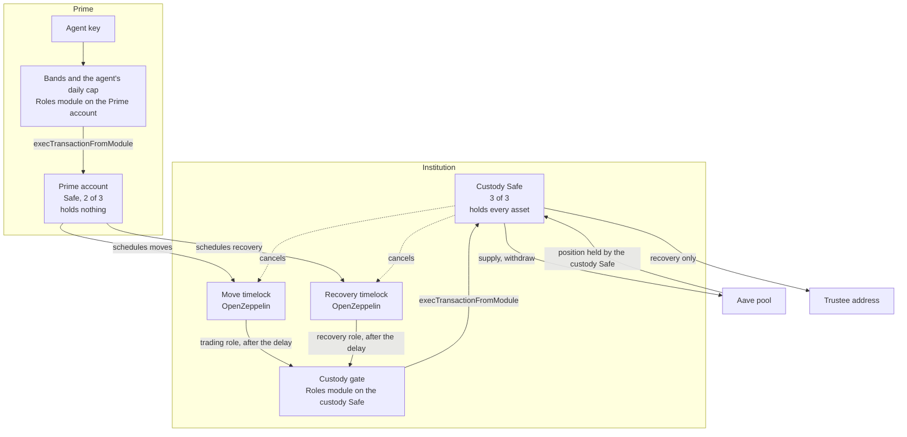

# Prime on EVM: technical detail

On EVM, Prime is configuration on existing contracts. It deploys no contract of
its own: a Safe holds custody's funds, a Zodiac Roles v2.1.1 module on that Safe
is the custody gate, a second Safe with its own Roles module is the Prime
account and holds the agent's bands, and two OpenZeppelin TimelockController
instances hold every move for a delay before it runs and delay recovery
longer. Off-chain helpers build the configuration and collect the
owners' signatures. Every part runs on Base Sepolia, a test network; there is
no mainnet version. [architecture.md](architecture.md) covers the use case and
how EVM fits with the other chains, and [audit-overview.md](audit-overview.md)
the audit scope, which covers the Stellar contracts.

Line references to Zodiac Roles are to
[gnosisguild/zodiac-modifier-roles](https://github.com/gnosisguild/zodiac-modifier-roles/tree/218a5164d739c107b132034436978e78cdd90c95/packages/evm/contracts)
at `218a5164` (v2.1.1), `packages/evm/contracts/`. Line references to Safe are
to [safe-global/safe-smart-account](https://github.com/safe-global/safe-smart-account/tree/v1.4.1/contracts)
at tag `v1.4.1`, `contracts/`.

## The use case and the setup

An institution keeps its treasury in custody and wants an agent to lend part of
it without moving custody. The two guarantees, and what keeps each on EVM:

- **Custody's signers always control the funds:** every asset and every venue
  position stays in custody's own Safe. Safe accepts a change to its owners or
  modules only as a call from the Safe itself (`SelfAuthorized.sol:10`,
  `GS031`), and the gate accepts a change to its rules only from its owner, the
  custody Safe (`onlyOwner` throughout `PermissionBuilder.sol`). A module could
  make the Safe call itself, so the gate's roles list neither the custody Safe
  nor the gate as a target; custody's owners at their threshold are then the
  only route to either.
- **Only the custody gate's listed destinations can receive funds:** the
  Prime account reaches custody's funds only through the move timelock, the one
  member of the gate's trading role. The role lists the calls custody allows,
  and pins every recipient of funds or positions to the custody Safe. The gate
  refuses every other call.

Every move also waits. The Prime account schedules it on the move timelock,
nothing moves while it waits, and custody's signers or the Prime owners can
cancel it during the delay. Once the delay is over anyone can run it, and the
gate checks it then.

The setup this page describes. The fork test `test/RefLine.t.sol` and the
reference line on Base Sepolia (see [What has been run](#what-has-been-run))
build all of it except the optional shared account:

| | |
|---|---|
| Custody Safe | A Safe 1.4.1 or 1.5.0 with custody's three signers as owners (the MPC key, a second signer and a trusted third party), threshold **3**, no fallback handler and no other module. Holds every asset and every position. |
| Custody gate | A Zodiac Roles v2.1.1 module on the custody Safe, whose owner, avatar and target are the custody Safe. Its trading role has one member, the move timelock; its recovery role has one member, the recovery timelock. |
| Move timelock | OpenZeppelin TimelockController 5.6.0, one per gate. The Prime account proposes moves; the Prime account and the custody Safe can cancel; anyone executes a move once its delay is over. It has no admin once set up. |
| Recovery timelock | A second TimelockController 5.6.0 with the same roles and a longer delay, for recovery only. |
| Prime account | A Safe with **3 owners, any 2 of which approve**. Holds no funds. Its own Roles module holds the agent's bands, which let the agent schedule moves. |
| Agent | A key that is a member of the Prime account's band role. It acts alone inside its band. |
| Shared account (optional) | A Safe with 2 owners, the agent and an admin, both of whom approve. A member of high bands, so the admin co-signs large moves. |

## Components



### The custody gate

The gate is a Roles module that custody's Safe enables on itself. An enabled
module can make the Safe call any address with no owner signature
(`ModuleManager.sol:81-92`); any other caller of that path is refused (`GS104`
at `:88`). The gate makes that call only for a member of a role, and only for
a call the role allows:

1. **Membership:** the caller must be an enabled module of the gate and a
   member of the role it names (`PermissionChecker.sol:21-70`, `NoMembership`
   at `:31` and `:36`). The custody Safe assigns members; `assignRoles`
   also enables the member as a module of the gate (`Roles.sol:69-84`).
2. **Target and function:** a target the role has not scoped is refused
   (`TargetAddressNotAllowed`); on a scoped target, a function the role does not
   list is refused (`FunctionNotAllowed`) (`PermissionChecker.sol:114-182`).
   Sending ETH and delegatecall are off unless the role turns them on
   (`:188-212`).
3. **Parameters:** each listed function carries a condition tree over its
   arguments, checked on every call (see [Policies](#policies-roles-scopings)).
4. **Allowances:** a parameter can be bound to an allowance, a budget that
   refills each period (`AllowanceTracker.sol:20-45`). A call over the remaining
   budget is refused (`AllowanceExceeded`, `PermissionChecker.sol:689-715`), and
   a call that fails gives its budget back (`AllowanceTracker.sol:90-112`).

The trading role of the checked setup lets the move timelock make the custody
Safe do exactly this:

- `approve(spender, amount)` on USDC, with the spender equal to the Aave pool
  and the amount under 1,000 per approval;
- `supply(USDC, amount, onBehalfOf, referral)` on the pool, with `onBehalfOf`
  equal to the custody Safe (`EqualToAvatar`, which the module resolves to its
  avatar, `PermissionLoader.sol:59-63`) and the amount within custody's daily
  cap of 200;
- `withdraw(USDC, amount, to)` on the pool, with `to` equal to the custody Safe.

Everything else, a plain transfer, an approval to anyone but the pool, a borrow
against custody's position, any call to aUSDC, to the custody Safe or to the
gate itself, is refused. The recovery role lets the recovery timelock make the
custody Safe transfer USDC or aUSDC, or withdraw from the pool, **to the
trustee address** and nowhere else.

Custody's daily cap counts everything the trading role supplies, whoever
scheduled it: the agent through its band and the Prime account's own owners
alike. The gate spends it when a move runs, so a move scheduled within the cap
can still be refused when it runs if other moves used the cap first. The cap is
an allowance with a balance, a refill per period and a ceiling
(`Types.sol:132-138`), set by the custody Safe with `setAllowance`
(`PermissionBuilder.sol:158-177`).

### Prime account and the bands

The Prime account is a Safe with its own Roles module, which holds the agent's
bands. A band is a role whose member is the agent and whose one scoped target
is the move timelock. It lets the agent make the Prime account schedule a move,
and it pins the whole of that move: the timelock's `schedule` call with the
gate as its target and a value of 0, and inside it the gate call with the
venue, the value (0), the inner call and its arguments, the operation (a plain
call), the trading role and `shouldRevert = true`. The predecessor, the salt
and the delay are left open; the timelock holds the delay to its minimum.

The checked band lets the agent schedule a supply of USDC under 100 per move,
within the agent's own cap of 50 a day. Each nested call's selector is pinned
with a `Bitmask` beside a `Matches` over its arguments, the shape
`zodiac-roles-sdk` builds for `calldataMatches` with a selector. The agent's
cap is spent when the move is scheduled, so a move that custody later cancels
still counts against it for that day.

Approvals are the Prime owners' moves. Roles needs every branch of an `Or` to
share one parameter layout (see [Limits](#limits)), and the timelock has one
`schedule` function, so one band cannot hold both an approval and a supply.
The owners schedule an approval of the pool, capped by the gate at 1,000, and
the agent's supplies draw on it.

A larger band can list the shared account as its member, so a move above the
low band needs the admin's signature too. The Prime account's owners at their
threshold can schedule any move on the move timelock; it waits the same delay,
and the gate checks it against the trading role and custody's cap when it
runs. They reach the recovery role only through the recovery timelock.

### Move timelock

The move timelock is OpenZeppelin's TimelockController, unmodified, and the
gate's only trading member. Its proposer is the Prime account, its cancellers
the Prime account and the custody Safe, and its executor role is open. A move
is two transactions: the Prime account schedules it (through a band, or by its
owners at their threshold), and once the delay is over anyone runs it with
`execute`. The timelock then calls the gate with the trading role, and the gate
checks the call. A refusal comes back from `execute` with the gate's Roles
status. The timelock itself checks nothing but the delay and its roles, so an
off-list move can be scheduled and fails only when it runs.

During the delay the custody Safe or the Prime account can cancel a move with
`cancel` and its operation id, in one transaction. Three things follow from the
shape, and the owners should plan for them:

- **The agent's cap is spent at scheduling:** a cancelled move still counts
  against the agent's daily cap. Custody's cap is spent when a move runs.
- **Revoking a band leaves its scheduled moves:** taking the band away from an
  agent stops new moves, and moves it has already scheduled still run once
  their delay is over. Cancel each of them, or use custody's kill switch.
- **Anyone can run a ready move:** the executor role is open, so a move runs
  when anyone sends `execute`, the agent, a keeper or a stranger. Cancelling is
  the only way to keep it from running.

### Recovery timelock

The recovery timelock is a second TimelockController with the same roles: the
Prime account proposes, the Prime account and the custody Safe cancel, and its
executor role is open, so anyone runs a scheduled recovery once the delay is
over. Its delay is longer than the move timelock's, and its only role on the
gate is recovery. The custody Safe receives the admin role of both timelocks at
deployment, gives itself the canceller role on each and renounces both admin
roles in its own setup transaction. Each timelock then administers itself, so a
change to its delay or roles also waits its delay, and custody can cancel it.

### Policies: Roles scopings

A policy on EVM is a Roles scoping, written by the Safe that owns the module:
custody writes the gate's roles, the Prime account's owners write the bands.
What a scoping can say:

| Part | What it does | Source |
|---|---|---|
| Members | addresses that may act through a role; an address holds a role until it is revoked | `Roles.sol:69-84`, `Types.sol:120-124` |
| Targets | a target is closed, open to any function, or open to listed functions only | `Types.sol:87-91`, `PermissionBuilder.sol:57-97` |
| Functions | a listed selector is open to any arguments, or carries a condition tree | `PermissionBuilder.sol:102-156` |
| Execution options | sending ETH and delegatecall, each off unless turned on | `Types.sol:80-85`, `PermissionChecker.sol:188-212` |
| Conditions | over each argument, nested through calldata, ABI-encoded bytes, tuples and arrays: `EqualTo`, `EqualToAvatar`, `GreaterThan`, `LessThan` and their signed forms, `Bitmask`, `And`, `Or`, `Nor`, `Matches`, `ArraySome`, `ArrayEvery`, `ArraySubset`, and `Custom`, which calls an external checker contract | `Types.sol:21-78`, `PermissionChecker.sol:233-651` |
| Allowances | `WithinAllowance` on any static argument, `EtherWithinAllowance` on the value sent and `CallWithinAllowance` on the number of calls, each against a budget that refills per period up to a ceiling | `PermissionChecker.sol:653-715`, `AllowanceTracker.sol:20-45` |
| Batches | an unwrap adapter registered for a target and selector splits a batch so each call is checked | `Periphery.sol:21-28` |

Every condition compares the call's own data with constants fixed when the
scoping was written. No condition reads the state of another contract, except
`Custom`, which calls a contract the scoping lists.

**Tooling:** the Prime app on EVM, in a separate repository, writes these
scopings and reads them back from the module's events; Gnosis Guild's
`zodiac-roles-sdk` and its Roles app at roles.gnosisguild.org write and show
them too. The policy builder in this repository's `packages/` writes rules for
the Stellar policy interpreter only. For EVM it carries a reader, `evm_review`
(`packages/policy-synth`): from the bytes of an unsigned Safe transaction alone
it gives the hash the owners sign, decodes every Roles call and condition tree
in it, and flags an open target, a condition that constrains nothing, a
parameter layout that differs from the function's ABI, a recipient not pinned
to the custody Safe, an unwrap adapter other than the Roles one and calldata
past the last argument. A `revokeTarget` without its functions comes back as a
warning. With `readChain` it also reads the Safe on a test network: its
owners, threshold, modules, guard and fallback handler after the batch, each
Roles module's owner and avatar, the scopes already stored for the roles,
targets and functions the batch names (an open target or an under-read scope
left live is a problem), each timelock's delay and roles, and an ERC-3643
token's identity and freeze state for the Safe. Roles keeps no index of a
role's targets, so a stored scope on a target the batch does not name stays
out of its view. It decodes a move the Prime owners schedule on the move
timelock with the gate call it schedules, and reads the agent's band on the
timelock's `schedule` one level down, as a band of the gate's
`execTransactionWithRole`.

### Permissioned assets

A permissioned token carries its own controls, set by its issuer. Under
[ERC-3643](https://eips.ethereum.org/EIPS/eip-3643) (Final) a transfer needs a
receiver whose wallet is in the token's identity registry and verified against
the claims the issuer requires, neither wallet frozen, the token unpaused and
the issuer's compliance rules passed; the issuer's agents can freeze a wallet
or part of its balance, force a transfer, recover a lost wallet and pause the
token. ERC-1400 tokens, proposed in ethereum/EIPs issue 1411 and never
finalised, carry similar controller operations. Prime adds no contract to the
token: the issuer registers the custody Safe, and each venue and liquidator
address that may receive the token, in its own registry, and Prime's scopings
decide which of the issuer's functions custody's moves may call. How far that
configuration reaches, against the permissioned-asset requirements:

| # | Requirement | By configuration on EVM | Reach |
|---|---|---|---|
| 1 | Regulatory and KYC: segregated accounts, token whitelists and transfer rules enforced natively, no wrappers | The issuer's identity registry and compliance contract on the token itself; the custody Safe is a registered holder | Met for the whitelist and for the rules the issuer's compliance contract already has |
| 2 | Custom deposit and redemption mechanics | A band pins the issuer's subscribe and redeem functions and their arguments; `WithinAllowance` caps the amount per period in either direction; every redemption waits the move timelock's delay | Partial: a redemption queue across holders is the issuer's |
| 3 | Off-chain financial logic from issuers (lifecycle, NAV, lock-up) | The token's pause and freeze stop moves outright | Limit: a scoping cannot read the issuer's state; that needs `Custom`, a new contract |
| 4 | Legal enforcement: freeze, forced transfer, compliance actions | The issuer's own freeze, forced transfer, recovery and pause | Met, with no change on Prime's side |
| 5 | Segregated accounts, per-account allowlists and roles | One custody Safe and gate per client; roles and targets per gate | Met |
| 6 | Jurisdiction filters | The registry's country code and the issuer's compliance rules | Met at the token; a scoping cannot read a country |
| 7 | Per-user risk limits | Per-move bands, per-period allowances on any amount argument (a borrow as well as a supply), the venue's own health factor | Partial: a limit relative to the collateral's price needs a price read, so a new contract |
| 8 | Issuer-aware mechanics: direct calls to the issuer's functions | A scoping pins the issuer's contract, the selector and any argument, dynamic and nested ones included | Met |
| 9 | Eligibility check | The registry's verified claims; withdrawing approval is a freeze or a registry removal | Met |
| 10 | Liquidation protection: only when unhealthy, in part, with notice | The venue's own rules | Limit: configuration adds no notice or cure period to a venue |
| 11 | Liquidators whitelisted in the protocol and the account | The token delivers a seized balance only to a verified holder; a permissioned venue can list its liquidators | Partial: the protocol side depends on the venue |
| 12 | Fully auditable cashflows | Every move is a module transaction with Safe and Roles events | Met for the on-chain legs |
| 13 | New assets without changing core contracts | A new token is new scopings | Met |
| 14 | No operator in the flows | The contracts need no Untangled key; who owns the Safes is the institution's choice | Met by the contracts; depends on the owners chosen |

## Owners

The Prime account and the custody Safe are Safes, so their owners are Safe
owners, and every decision is a Safe transaction that M of them sign. An owner
signs the Safe transaction hash itself: an EOA such as MetaMask, Rabby or a
hardware wallet, an MPC address such as a Fordefi or Fireblocks vault, or a
contract wallet through EIP-1271. Safe accepts an ECDSA signature over the
EIP-712 hash or its `eth_sign` form, a hash the owner approved on chain, and a
contract signature (`Safe.sol:274`, `checkNSignatures`). The signatures are
collected off chain, through the Safe Transaction Service or by hand, and any
account can submit the transaction once M are in.

There are no seats and no session keys on EVM. An owner whose wallet lives on
another chain needs an EVM key that can sign the Safe hash, such as the EVM
address its custodian keeps for it. The agent is a band member, so it acts only
inside its band and has no vote on the Prime account.

## Setting it up

Five transactions. The last two are Safe transactions, each signed by its own Safe's owners:

| # | Signed by | What |
|---|---|---|
| T1 | anyone | Creates the custody Safe and the Prime account through the Safe proxy factory. |
| TL | anyone | Deploys the move timelock and the recovery timelock, each with the Prime account as proposer, an open executor role and the custody Safe as its temporary admin. |
| T2 | the Prime account's owners (2 of 3) | One `multiSend`: deploys the Prime account's Roles module through `CreateCall` (so the Safe is the deployer and the address follows from it), sets it up with the Prime account as owner, avatar and target, enables it, and writes the band on the move timelock, the agent's daily cap and the agent's membership. |
| T3 | custody's owners (3 of 3) | One `multiSend`: deploys and sets up the gate the same way, enables it, writes the trading role, custody's daily cap and the recovery role, makes the move timelock and the recovery timelock their members, and on each timelock takes the canceller role and renounces the admin role. |

The timelocks can also be deployed inside T3 through `CreateCall`. Deployed
before it, as in the reference line, custody reads their roles and delays back
before signing T3.

A module's address depends on its Safe's address, which depends on the Safe's
creation data, so a Safe cannot enable a new module in its creation
transaction; the module comes in the Safe's first transaction of its own. The
same transaction deploys the module and sets it up, so a stranger cannot set it
up first. Custody signs no standing token approval: an approval comes only
from a move the gate allows, capped per approval, and the funds leave the
custody Safe only through a call the gate allows.

## One move

The agent supplies 10 USDC. Two transactions, the delay apart:

```mermaid
sequenceDiagram
    participant AG as Agent
    participant PB as Bands (Prime's Roles)
    participant PR as Prime account
    participant MT as Move timelock
    participant GA as Custody gate
    participant CS as Custody Safe
    participant PO as Aave pool
    AG->>PB: schedule a supply of 10, band role
    PB->>PB: against the band<br/>and the agent's daily cap
    PB->>PR: run it
    PR->>MT: schedule the gate call
    Note over MT: the delay; custody or the<br/>Prime account can cancel
    AG->>MT: execute (anyone can)
    MT->>GA: supply 10 on behalf of custody, trading role
    GA->>GA: against the trading role<br/>and custody's daily cap
    GA->>CS: supply
    CS->>PO: supply 10 USDC
    PO-->>CS: 10 aUSDC to the custody Safe
```

The pool must hold custody's approval first, which the Prime owners schedule
the same way. On the reference line the agent's `schedule` used 252,903
gas and its `execute` 302,177. The custody Safe paid 10 USDC and held the
aUSDC, and the Prime account, the move timelock and the agent held nothing
afterwards.

## Recovery

If custody's signers lose access, the Prime account's owners schedule a
recovery on the recovery timelock with 2 of 3 signatures. Nothing moves when
it is scheduled. After the delay (2 days in the fork test, 300 seconds on the
reference line, for example 48 hours in production) anyone can execute it. The
timelock then calls the gate with the recovery role, and the custody Safe pays
the trustee address. Recovery does not depend on the trading role, so it works
while the kill switch is on.

The custody Safe can cancel a scheduled recovery at any time during the delay,
in one transaction. Changing the timelock's own delay or roles also goes
through the delay, so custody can cancel that too. A recovery to any address
but the trustee can be scheduled, and the gate refuses it when it runs.

## Stopping it

| Action | Who | How |
|---|---|---|
| Cancel a move | custody's owners, or the Prime account's owners | `cancel(id)` on the move timelock during the delay. |
| Kill switch | custody's owners | `assignRoles(moveTimelock, [trading], [false])` on the gate. Every move fails when it runs, scheduled or not, for the agent and the Prime owners alike; recovery still works. |
| Lower the budget | custody's owners | `setAllowance` on custody's cap, with the balance and the refill at 0. |
| Full stop | custody's owners | `disableModule` on the custody Safe. Moves and recovery stop; a scheduled recovery fails when it runs. |
| Remove a call | custody's owners | `revokeFunction` for that call, then `revokeTarget` if the target goes too (see [Limits](#limits)). |
| Stop an agent | the Prime account's owners | `assignRoles(agent, [band], [false])`, or the agent's cap down to 0, then `cancel` each move the agent has scheduled and not yet run. |

Each is one transaction of the Safe concerned. The Prime account cannot undo
any of custody's. The reference line turned the kill switch on and the gate off,
then turned both back in one custody transaction, and a move scheduled before
the kill switch ran.

## When custody is a plain address

Custody that stays at an MPC address, such as a Fordefi vault **F**, cannot hold
a module. The gate is then a Safe that F alone owns (threshold 1, no fallback
handler), with a trading Roles module whose member is the Prime account and a
recovery Roles module whose member is the timelock. F approves the gate, per
asset, for a lifetime budget. The trading rules let the Prime account make the
gate pull USDC or aUSDC from F into the gate within F's daily outflow cap,
approve the Aave pool or the Uniswap router, supply on behalf of F, withdraw to
F, swap with F as recipient and a minimum output above zero, and send anything
left in the gate to F. The recovery rules pay only the trustee. Every result
still reaches F, and only F can change the gate.

A plain address can sign messages, and a signed EIP-2612 `permit` on USDC or
aUSDC lets anyone pull F's tokens with no transaction from F; Base USDC also
accepts EIP-3009 signed transfers. F's own custody policy therefore blocks
every typed and personal message, allows the gate configuration and approvals
only as rebuilt and matched by Prime's co-signer, and requires F's signers for
everything else. EVM puts no signing weights on an address, so the rule that
all of F's signers approve lives in that policy.

This shape ran on Base Sepolia on 29 September 2026 (see
[What has been run](#what-has-been-run)), and it is the shape the Prime app on
Base Sepolia builds today. The custody Safe shape above moves the funds into
the Safe and drops the gate's pull, F's approvals and the message risk.

## What has been run

Two Foundry tests in `scripts/evm-config-check` run only on a fork and are
never deployed, and one script runs the same flow transaction by transaction.
Each creates only instances of existing code: Safe proxies of the canonical
Safe singletons, ERC-1167 proxies of the Zodiac Roles v2.1.1 mastercopy, and
OpenZeppelin's TimelockController compiled unmodified from the npm package.
Prime still adds no contract on EVM.

- `test/RefLine.t.sol` builds the design on this page and runs it with the
  clock moved past each delay.
- `test/ConfigOnly.t.sol` holds the base checks of the Safe and Roles parts
  that do not depend on the move timelock: the gate's scopings, the band's
  nested pins, custody's cap, recovery and the stops, with the Prime account
  calling the gate directly. The STRIDE cases of
  [stride-evm.md](../evidence/stride-evm.md) extend it.
- `script/RefLine.s.sol` with `refline.ts` runs the reference line on a chain:
  each phase is checked first as a simulation, then sent one transaction at a
  time, and every refusal must land with the revert data the simulation gave.

| Check | Where | Result |
|---|---|---|
| The design on this page | `test/RefLine.t.sol` in [`scripts/evm-config-check`](../scripts/evm-config-check/README.md), on a fork of Base Sepolia against the live Safe, Roles and Aave contracts; CI job `evm-config-check` | 27 October 2026: 2 of 2 tests, Safe 1.4.1 and Safe 1.5.0, 128 checks each. The agent schedules four supplies of 10 through its band and the first runs after the delay; custody holds the aUSDC and the Prime account, the move timelock and the agent hold nothing. Refused at scheduling, each with its Roles status: over the band, over the agent's cap, another asset, a withdrawal, a transfer, another target, the custody Safe as target, the recovery role, a delegatecall, `execute` through the band; the agent on the timelock or the gate directly, a stranger on the band, a run before the delay. Refused when it runs, with the gate's status: over custody's cap, a supply or withdrawal for a stranger, a transfer, an approval to a stranger, an aUSDC transfer, a borrow, a delegatecall, a call to the custody Safe or the gate, the recovery role, a gate rule written by the timelock, a cancelled move. Kill switch: moves already scheduled fail. Recovery pays the trustee while trading is off; a cancelled one and one to a stranger are refused; the full stop stops it. Two of three custody signers and one Prime owner are refused. After the restore, a move scheduled before the kill switch runs |
| The reference line | `script/RefLine.s.sol` and `refline.ts`, on an anvil fork of Base Sepolia at block 50,996,017, move delay 120 seconds, recovery delay 300 seconds | 27 October 2026: the same flow as 64 transactions, 26 that succeed and 38 refused, each refusal with the revert data its simulation gave; 12,588,408 gas. Not yet on Base Sepolia itself: it waits for test ETH. [evm-reference-line.md](../evidence/evm-reference-line.md) has every transaction |
| The base checks | `test/ConfigOnly.t.sol`, same fork and CI job | 27 October 2026: 2 of 2 tests, Safe 1.4.1 and Safe 1.5.0, 55 checks each ([log](../scripts/evm-config-check/run-2026-10-27.txt)), with the Prime account as the gate's trading member and no move delay. Six altered configurations each fail the check |
| Custody at a plain address | Base Sepolia, 29 September 2026, the real Aave v3 pool, Uniswap v3 router, Safe, Roles and OpenZeppelin contracts | State read back 43 of 43 at first deployment and 20 of 20 after recovery moved to the timelock. Moves: agent supply 10, swap 10, withdraw 5, a shared-account supply of 150; every result reached F and the gate and Prime account held nothing. The agent's and F's daily caps refused moves over them. 48 refused attempts, from a pull to the Prime account to a batch with `shouldRevert = false`. Recovery ran after the delay, a cancelled one never ran, and a full stop blocked it. Addresses in [evm-testnet.json](../deployments/evm-testnet.json) |

## Contracts and their audits

| Contract | Address on Base Sepolia | Audit | Checked |
|---|---|---|---|
| Safe 1.4.1 (SafeL2, SafeProxyFactory, MultiSend, MultiSendCallOnly, CreateCall) | canonical Safe deployments | Core: Ackee Blockchain audited 1.4.0; 1.4.1 adds one ERC-4337 opcode fix, which Safe and the auditors agreed needed no new audit (`docs/audit_1_4_0.md` in the Safe repository). Libraries: their own 1.4.1 report | addresses equal `safe-deployments` v1.4.1; runtime equals a local build of tag `v1.4.1` byte for byte, all five ([build-hash match](../evidence/build-hash-match.md)) |
| Safe 1.5.0 (SafeL2, SafeProxyFactory) | canonical Safe deployments | Certora and Ackee (`docs/audit_1_5_0.md`) | addresses equal `safe-deployments` v1.5.0; runtime hashes equal its published code hashes |
| Zodiac Roles v2.1.1 mastercopy, with its Integrity and Packer libraries | `0xF2964CE6161ce0e75964Fe7927cE114cb0B283D5` | The reports in the Roles repository cover v2 (G0 Group, April 2023; Omniscia, May 2023) and v2.1 (Omniscia and G0 Group, November 2023). v2.1.1, June 2026, is v2.1 with three fixes: the EIP-1271 signature check, `ArraySome` and `Bitmask` | address equals `mastercopies.json` v2.1.1 at `218a5164`; runtime of the mastercopy and both libraries equals a local build of `218a5164` byte for byte ([build-hash match](../evidence/build-hash-match.md)); each gate and band module is an ERC-1167 proxy to it |
| Roles MultiSend unwrapper | `0x93B7fCbc63ED8a3a24B59e1C3e6649D50B7427c0` | the Roles reports above | address equals `mastercopies.json` v2.1.0 and v2.1.1; runtime equals a local build byte for byte |
| OpenZeppelin TimelockController 5.6.0 | two per gate, for moves and for recovery | OpenZeppelin's reports cover the changes of each 5.x release, the last in February 2026 (v5.5 and v5.6); Certora verified TimelockController formally at v4.4.0 (March 2022) | compiled from the npm package in the check |
| Aave v3 pool, USDC | Aave's test market | their own audits | live contracts |

Not used, and why:

- **Roles v2.1.0:** its signature check accepts EIP-1271 revert data that
  carries the valid-signature code; v2.1.1 is the patch. Every module here is a
  proxy to the v2.1.1 mastercopy.
- **Zodiac ModuleProxyFactory 1.2.0:** it differs from the audited v1.0.0, so
  modules are deployed through Safe's `CreateCall`.
- **A transaction or module guard:** Safe 1.4.1 runs its guard on
  `execTransaction` only (`Safe.sol:174-219`), so it never sees a module's
  call; Safe 1.5.0 adds a module guard. No guard here is existing audited code,
  so the gate's rules are the whole fence.
- **Permit2:** it adds signature routes out of custody.
- **Any `Custom` or oracle condition:** each needs a contract of ours.

## Deployments

Prime on EVM has no contract to deploy. Each Prime is a set of Safe proxies,
Roles proxies and two timelocks, made by its own setup transactions on Base
Sepolia. [deployments/evm-testnet.json](../deployments/evm-testnet.json)
records the existing contracts that setup uses on Base Sepolia (read back on
27 October 2026), the Aave test market, the fork checks, the reference line
and the custody run of 29 September 2026. The reference line's addresses there
are from its anvil fork run until it runs on Base Sepolia itself.

| | Address |
|---|---|
| Safe 1.4.1 SafeL2 and proxy factory | `0x29fcB43b46531BcA003ddC8FCB67FFE91900C762`, `0x4e1DCf7AD4e460CfD30791CCC4F9c8a4f820ec67` |
| Safe 1.5.0 SafeL2 and proxy factory | `0xEdd160fEBBD92E350D4D398fb636302fccd67C7e`, `0x14F2982D601c9458F93bd70B218933A6f8165e7b` |
| MultiSend, MultiSendCallOnly, CreateCall (1.4.1) | `0x38869bf66a61cF6bDB996A6aE40D5853Fd43B526`, `0x9641d764fc13c8B624c04430C7356C1C7C8102e2`, `0x9b35Af71d77eaf8d7e40252370304687390A1A52` |
| Zodiac Roles v2.1.1 mastercopy | `0xF2964CE6161ce0e75964Fe7927cE114cb0B283D5` |
| Roles MultiSend unwrapper | `0x93B7fCbc63ED8a3a24B59e1C3e6649D50B7427c0` |

## Limits

These are the places configuration on Safe and Roles stops; each would need a
contract of ours.

- **No price, balance or state checks:** every Roles condition compares the
  call's own data with constants. A rule cannot read a price, a health factor,
  an issuer's NAV or lifecycle state, or a balance, except through `Custom`,
  which calls a contract. So a swap's minimum output has a floor and no market
  check, and a limit relative to collateral value cannot be written.
- **No relation between arguments or calls:** a condition cannot say that an
  approval equals the supply that follows it. An approval is capped by a
  constant, and what is left of it stays with the venue. Only the custody
  Safe's own calls can use it, and those pass the gate.
- **One parameter layout per branch:** every child of an `And` or `Or` must
  share one parameter layout, apart from calldata beside raw bytes
  (`Integrity.sol:256-299`). The move timelock has one `schedule` function, so
  a band holds one call layout: the agent's band schedules supplies, and
  approvals are the Prime owners' moves. A second layout needs its own band
  and its own entry point.
- **Time is a delay and an allowance period:** every move waits the move
  timelock's delay and every recovery the recovery timelock's; allowances
  refill per period. A rule cannot hold a call to a window of the day or a date.
- **A move is checked when it runs:** the timelock checks only its delay and
  its roles, so the Prime owners can schedule a move the gate will refuse, and
  custody's cap can be used up by the time a move runs. The agent's band is
  checked at scheduling. A reader of the scheduled operations, or the pre-sign
  check of the Prime owners' Safe transaction, shows what will run.
- **Scheduled moves outlive a band:** revoking an agent's band, or lowering its
  cap, stops new moves only. The owners or custody cancel the moves already
  scheduled, and the agent's cap counts a cancelled move for its day.
- **Inflows and outflows share one mechanism:** `WithinAllowance` counts any
  amount argument, a borrow or subscription as well as a supply, but it counts
  what the call asks for. It does not see what the venue moved.
- **No session keys or expiry on a role:** membership is a flag
  (`Roles.sol:69-84`). An agent holds its band until the Prime account's owners
  revoke it, and an owner signs every Safe decision.
- **Revoking a target keeps its functions:** `revokeTarget` and `scopeTarget`
  reset only the target's clearance, and the function scopes stay stored and
  return when the target is scoped again (`PermissionBuilder.sol:72-97`). Revoke
  each function (`:118-125`) before the target, and give unrelated rules their
  own role key. `evm_review` warns on a `revokeTarget` whose batch revokes none
  of that target's functions, and on every `scopeTarget`.
- **Unwrap adapters are owner settings:** the owner of a Roles module can
  register an adapter that splits calls before they are checked
  (`Periphery.sol:21-28`). On the gate only custody can, and a reader of the
  gate's rules must count them; `evm_review` with `readChain` reads the
  adapters for MultiSend batches.
- **Extra calldata after the last checked argument passes Roles:** a venue that
  reads `msg.data.length` or the last 20 bytes of calldata (an ERC-2771 trusted
  forwarder does) sees a different call, so rules should target venues that
  decode arguments with the Solidity ABI decoder. `evm_review` flags a scoping
  whose `Matches` stops before the function's last argument, and warns on a
  function whose ABI it does not know.
- **Permissioned tokens need permissioned venues:** a venue that holds the
  token must have its addresses verified by the issuer, and the venue's own
  liquidation rules apply. Configuration adds no notice period.
- **Base's sequencer could delay custody's kill switch:** a Safe transaction is
  sent by an EOA, which can force it through Base's L1 portal on Ethereum, up to
  about 12 hours later. Not tested.
- **The venues are trusted:** Aave can upgrade its pool through its own
  governance, and a stablecoin issuer such as Circle can freeze its token.
- **Safe 1.4.1 or 1.5.0:** 1.4.1 carries one post-audit fix the auditors
  waived. Safe 1.5.0 has its own Ackee and Certora audits, and the check runs on
  both.
