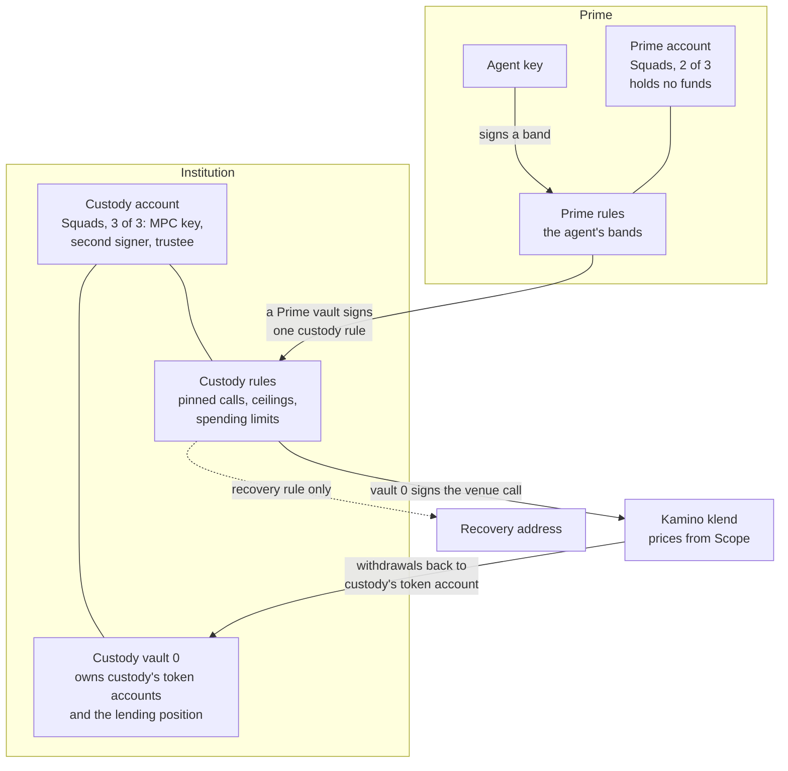

# Prime on Solana: technical detail

On Solana, Prime runs on programs that other teams wrote and deployed, with
configuration only. The Squads Smart Account holds custody's funds and the
rules over them, SPL Token and Token-2022 carry the assets and their
compliance controls, and the venue's own programs (Kamino klend and Scope, for
lending) take the moves. There is no program of ours on Solana: the custody
gate and the Prime account are both Squads Smart Accounts, and the rules are
Squads policies. Off-chain helpers build, check and co-sign transactions.
[architecture.md](architecture.md) shows how this fits with the other chains.
The design keeps the shape of the EVM design ([evm.md](evm.md)): a custody
account owned by custody's signers whose rules name the Prime account, and a
Prime account that holds the agent's bands.

Every claim about a program below cites its source: the Squads Smart Account
at `0e51082` (paths under `programs/squads_smart_account_program/src/`), Kamino
klend at `e921c64`, the commit Kamino's mainnet build is verified against
(paths under `programs/klend/src/`), Token-2022 at `f0a7d60` (program 11.1.0;
the 1.0.0 crate gives the same order of checks), SPL Token at `57bd873`, the
associated token account program at `8efacd6` and Kamino Scope at `b789326`.
The deployed Squads and klend builds were compared with these sources by
behaviour, with no hash check, and the deployed Token-2022 build not yet (see
[Limits](#limits)).

## The use case and the setup

An institution keeps its treasury in an MPC wallet and wants an agent to
supply and withdraw part of it at a lending venue without moving custody. The
two guarantees, and what keeps each on Solana:

- **The MPC wallet always controls the funds:** custody's token accounts are
  owned by the vault of a Squads Smart Account whose signers are custody's
  signers and a trustee, and every change to that account needs all of them.
  A lending position opened from it belongs to the same vault, and every
  withdrawal returns to custody's own token account.
- **Only pinned destinations can receive funds, under a cap:** the custody
  account moves funds only through its rules. Each rule pins the program, the
  instruction and its accounts, bounds the amount per call and per period, and
  lists one signer, a vault of the Prime account. No rule lists a custody key,
  so a stolen custody key moves nothing off the pinned paths.

The setup this page describes:

| | |
|---|---|
| Custody account | An autonomous Squads Smart Account: signers the MPC key, a second custody signer and a trusted third party (the trustee), threshold 3, so every change needs all three. Its vault 0 owns custody's token accounts and any lending position. This account is the custody gate. |
| Custody rules | `ProgramInteraction` policies on the custody account. Each pins the venue calls one lane may make (supply, withdraw, recovery), with a per-call amount ceiling and per-period spending limits. Each lists one Prime vault as its only signer. |
| Prime account | A second autonomous Squads Smart Account with **3 signers, any 2 of which approve**. Holds no funds. Its numbered vaults are the signers the custody rules list. |
| Prime rules | `ProgramInteraction` policies on the Prime account: the agent's bands. Each lets its signers make one call, the custody rule its vault is listed on. |
| Agent | A signer on the Prime rules only. Under a band's ceiling it acts alone; a larger move uses a high-band rule that also needs a second approver. |
| Venue | Kamino klend, called through its `_v2` instructions, with prices from Kamino Scope. |
| Recovery address | A token account of a wallet other than custody's, pinned in the custody account's recovery rule. |

A lighter setup for a capped top-up leaves custody's token account where it
is and approves a Prime vault as its SPL delegate; see
[The lighter path](#the-lighter-path-an-spl-delegate).

## Components



| Program | Written and governed by | Role here |
|---|---|---|
| Squads Smart Account `SMRTzfY6DfH5ik3TKiyLFfXexV8uSG3d2UksSCYdunG` | Squads; upgradeable on mainnet by a Squads v4 multisig, 3 of 5, with no time lock | The custody account and the Prime account: signers, thresholds, vaults and the rules |
| SPL Token `TokenkegQfeZyiNwAJbNbGKPFXCWuBvf9Ss623VQ5DA` and Token-2022 `TokenzQdBNbLqP5VEhdkAS6EPFLC1PHnBqCXEpPxuEb` | Solana's token programs; the classic program is immutable, Token-2022 is upgradeable | The assets; Token-2022's extensions carry a permissioned asset's controls |
| Kamino klend `KLend2g3cP87fffoy8q1mQqGKjrxjC8boSyAYavgmjD` | Kamino; upgradeable on mainnet by a 5-of-10 multisig with a 24 h time lock | The lending venue: reserves, health, liquidation, and a per-market permission gate |
| Kamino Scope (devnet `3Vw8Ngkh1MVJTPHthmUbmU2XKtFEkjYvJzMqrv2rh9yX`, mainnet `HFn8GnPA…`) | Kamino | Price feeds for the venue; a market's curator configures its own feed |
| Off-chain helpers | the Prime app and its relayer; for dynamic checks, a co-signer the institution runs | Build and pay for transactions, check them before signing, and co-sign moves a rule cannot judge on chain. None holds custody's funds |

The governance figures were recorded in October 2026. **A trust note on
review status:** the Squads policy engine this design relies on
(`ProgramInteraction`, its account and data constraints, spending limits and
hooks) appears in no published review of the Smart Account program; the
Certora (January 2025) and OtterSec (May 2025) reports in its repository do
not cover policies or hooks. Kamino's mainnet klend is a verified build of
`e921c64`, a check that the binary matches that source, and Kamino's reports
for klend 1.18 to 1.26 are still requested. Token-2022 is the standard Solana
token program. Nothing on this page is code of ours, so there is nothing of
ours to audit; partners should weigh the review status of the third-party
programs as a trust note.

### Custody account

The custody account is a Squads Smart Account created with no settings
authority (`settings_authority` is the default key, `state/settings.rs:30-39`),
so only its signers' vote changes it. Its signers are custody's MPC key, a
second custody signer and the trustee, each with Initiate, Vote and Execute
(`state/settings.rs:735-738`), and its threshold is 3. Adding or removing a
signer, changing the threshold or a time lock, and adding, changing or
removing a rule are all settings changes that need the threshold.

**Handing over the token accounts:** custody moves each token account under
the custody vault in one of two ways.

- An existing account under the classic SPL Token program changes owner with
  the native `SetAuthority` (`AccountOwner`), signed by custody's wallet. The
  same instruction clears any delegate, and for wrapped SOL the close
  authority (SPL Token `program/src/processor.rs:441-460`); a second
  `SetAuthority` points the close authority at the vault as well. Use a
  dedicated account: an associated token account keeps the address derived
  from the old owner.
- A Token-2022 account carrying `ImmutableOwner` refuses that instruction
  (Token-2022 `program/src/processor.rs:774-775`), and every Token-2022
  account the associated token account program creates carries it (its
  `program/src/processor.rs:134-143`; the classic program treats that call as
  a no-op, SPL Token `processor.rs:805-814`). For those, custody transfers the
  balance into a token account the custody vault owns.

From then on the token accounts answer to the custody vault, and the vault
signs only inside an execution of the custody account: a settings-level
transaction at the threshold, or a rule.

**The custody rules:** each is a `ProgramInteraction` policy, the Squads
policy kind that pins calls (`state/policies/policy_core/payloads.rs:37-42`).
A rule acts for one vault of its account (`account_index`,
`program_interaction.rs:24-35`), here vault 0, and lists its own signers and
threshold (`policy_core/policy.rs:49-55`). For Prime each rule lists one
signer, a vault of the Prime account, with all three permissions, and has
threshold 1. A typical set:

| Custody rule | Signer | Pins | Bounds |
|---|---|---|---|
| Supply, low band | Prime vault 1 | klend `_v2` deposit: the program, the 8-byte discriminator, the reserve and the market, the obligation owned by vault 0, the source as custody's token account | amount at offset 8 at most the low-band ceiling; a daily spending limit per mint |
| Supply, high band | Prime vault 2 | the same | a higher ceiling and its own daily limit |
| Withdraw | Prime vault 1 | klend `_v2` withdraw: the same reserve and obligation, the destination as custody's token account | none needed: the funds come back to custody |
| Recovery | Prime vault 9 | Token `TransferChecked` (discriminator byte 12) from custody's token accounts to the recovery address's token account | none, or a cap the institution chooses |

A venue call needs klend's refresh instructions in the same batch (and a
Scope price refresh where the feed asks for one); the rule gives each its own
constraint, pinned to the same market and reserves. Each rule also carries a
start and an optional expiry (`policy.rs:61-64`), so a custody approval can
lapse on a date, as a Stellar allowance does.

**What custody keeps and gives up:** a single custody key, the MPC key
included, can sign no rule and reach no settings change alone, so it moves
nothing. Custody's three signers together can change anything on the account,
as custody's full threshold can on Stellar. The trustee is what stops a
compromised custody key: no rule and no settings change goes through without
it.

### The lighter path: an SPL delegate

For a small, capped top-up an institution can leave its token account under
its own wallet and `Approve` a Prime vault as the account's SPL delegate for a
fixed amount. The Prime's rules then move up to that amount from custody's
account, to the destinations they pin. Custody stops it alone with one
`Revoke`.

| | Custody account | SPL delegate |
|---|---|---|
| Who owns the token account | the custody vault | custody's wallet |
| Where the destination list lives | custody's rules; changing it needs custody's threshold | the Prime's rules; the Prime owners change it at their own threshold |
| The cap | per call and per period, in custody's rules | one allowance; a transfer by the delegate lowers it (Token-2022 `processor.rs:486-517`) |
| The venue position | owned by the custody vault | owned by a Prime vault: a klend deposit needs its owner's signature, so the delegate moves the top-up into a Prime-owned account first |
| Stopping it | custody's threshold removes the rules | one `Revoke` by custody's wallet |
| Recovery | reaches the whole balance | stops at the remaining allowance |

An SPL account holds one delegate at a time, so a second delegation replaces
the first.

### Rules: what a Squads policy can pin

A `ProgramInteraction` policy holds up to 20 instruction constraints, taken as
a logical OR, and up to 10 spending limits (`program_interaction.rs:24-35`,
`612-617`). The submitter says which constraint each inner instruction
matches, and every instruction must match one (`program_interaction.rs:859-879`).
Each constraint pins:

| Field | What it checks | Source |
|---|---|---|
| `program_id` | the program the instruction calls | `program_interaction.rs:38-45`, `513-519` |
| data constraints, AND | a value at a fixed offset of the instruction data, as `u8`, `u16`, `u32`, `u64` or `u128` little-endian, compared with a constant by `=`, `≠`, `<`, `≤`, `>` or `≥`; or a byte slice by `=` or `≠`. A slice at offset 0 pins the 8-byte discriminator | `program_interaction.rs:93-136`, `186-262` |
| account constraints, AND | the account at a position of the instruction: one of a list of keys, or a fixed-offset field of that account's own data against a constant (`AccountData`), with an optional owner program | `program_interaction.rs:139-159`, `282-327` |

Squads checks every constraint against every inner instruction before any of
them runs (`program_interaction.rs:1072-1079` against `1109` and `1119` for a
synchronous execution; `960-967` against `993` and `1005` for a stored one).
So an `AccountData` constraint sees the state at the start of the execution:
a change made by an earlier top-level instruction of the same transaction
counts, and a change made inside the batch does not.

**Spending limits:** a limit names a mint, a period (one-time, daily, weekly,
monthly or a number of seconds), a ceiling per period, and whether unused
amounts carry over (`state/policies/utils/spending_limit_v2.rs:6-75`). Squads
records each token account the vault owns that the batch passes writable, and
after the batch it charges every decrease against the limit for that mint
(`state/policies/utils/account_tracking.rs:25-80`, `85-163`). A token account
whose mint has no limit, and the vault's own SOL when there is no SOL limit,
must not decrease at all, and no tracked account may change owner or gain a
new delegate (`account_tracking.rs:113-119`, `158-191`). A deposit at the venue
is a decrease, so the period ceiling counts what leaves custody for the venue;
a withdrawal does not give it back. Only decreases count: a borrow or any
other inflow has no cumulative cap.

**Other policy kinds:** a `SpendingLimit` policy pays one mint to a list of
destinations under a period ceiling (`spending_limit_policy.rs:27-35`); with
an empty list it pays any address (`spending_limit_policy.rs:187-191`). An
`InternalFundTransfer` policy moves funds between the account's own vaults.

**Timing:** a rule with a time lock cannot run synchronously
(`utils/context_validation.rs:9-14`). Its batch is stored as a proposal, voted
by the rule's signers, and runs only after the wait
(`instructions/transaction_execute.rs:84-88`); the rule's own signers can
cancel it before then by their threshold (`instructions/proposal_vote.rs:161-175`).
Changing a rule makes every batch stored under it stale (`state/settings.rs:651`),
and removing a rule closes its account (`state/settings.rs:680-702`), so a
stored batch under it can no longer run.

**Two configurations to refuse:** a `ProgramInteraction` policy with no
instruction constraints accepts any instruction (`program_interaction.rs:859`),
and a `SpendingLimit` policy with no destinations pays anyone. Neither belongs
in a Prime setup, and a pre-sign check should refuse both.

### Prime account and the agent's bands

The Prime account is an autonomous Squads Smart Account with three signers,
any two of which approve. Its rules are the agent's bands. A Prime rule acts
for one Prime vault and pins one call: Squads' `execute_transaction_sync_v2`
(discriminator `5a51bb512746804e`) with account 0 equal to one custody rule's
address. So the band chooses which custody rule the agent may use, and the
custody rule decides what that call does.

| Prime rule | Signers | Vault | May call |
|---|---|---|---|
| Low band | the agent, threshold 1 | 1 | the custody rules listing vault 1: supply under the low ceiling, withdraw |
| High band | the agent and a second Prime signer, threshold 2 | 2 | the custody rule listing vault 2: supply under the high ceiling |

No Prime rule acts for vault 9, the recovery vault; only a settings-level
transaction of the Prime owners can.

**Two executions, one inside the other:** the agent's
transaction runs the Prime rule. Squads signs for the Prime vault and calls
Squads again, now on the custody rule, which sees that vault as its signer and
runs the venue call with custody vault 0 as the signer. This is a direct call
from the Prime execution into the custody rule. A synchronous execution clears
the signer flag of the executing rule's own signers in the inner calls and
keeps every other account's flag
(`utils/synchronous_transaction_message.rs:42-58`; the rule passes its signers,
`program_interaction.rs:1086-1092`). So the agent key signs nothing below the
Prime rule, and the Prime vault signs nothing below the custody rule. A rule
whose signer is another Smart Account's vault, run from that vault's own
execution, passed in a devnet simulation on 27 October 2026; see
[What has been run](#what-has-been-run).

**Call depth:** the Prime execution is at stack height 1, the custody rule at
2, klend at 3 and klend's token and farms calls at 4. Solana's limit is 5, so
a hook layer or a venue that nests deeper does not fit.

### The venue: Kamino klend and Scope

**Calls from a Smart Account:** klend's v1 deposit, borrow, repay and
withdraw check that they run at the top level, or under a program on a short
list, and refuse with `CpiDisabled` (`utils/refresh_ix_utils.rs:35-66`,
`lending_market/ix_utils.rs:53-90`). The list holds Squads' v3 and v4 multisig
programs, without the Smart Account program (`utils/consts.rs:223-240`). The
`_v2` instructions skip that check (`handlers/handler_borrow_obligation_liquidity.rs:41-58`
against `process_v1` at `24-39`), so every custody rule pins the `_v2`
instructions. Kamino may close that path; a written answer from Kamino that
`_v2` calls from a program stay supported is a mainnet prerequisite.

**The position belongs to custody:** a klend obligation has one owner, which
must sign deposits and withdrawals
(`handlers/handler_withdraw_obligation_collateral_and_redeem_reserve_collateral.rs:163-171`).
Here that owner is custody vault 0, so the position sits in custody's name and
every withdrawal pays the destination the rule pins, custody's token account.

**Reading venue state:** a rule can compare a field of a venue account with a
constant. For example, a klend obligation keeps a `has_debt` byte at offset
2287 (`state/obligation.rs:89`; the offset follows from the zero-copy layout
and was read on devnet on 27 October 2026). klend sets it in every borrow and
recomputes it on repay, liquidation and loss socialisation
(`lending_market/lending_operations.rs:304`, `819`, `3301`, `2575`;
`state/obligation.rs:579-581`). An `AccountData` constraint `U8 @ 2287 == 0`,
owner klend, on the obligation of a withdraw lets collateral leave only while
nothing is owed. Squads checks it before the batch, so a repay has to run in
an earlier top-level instruction. The offset is a fact of klend 1.26; check it
again after every klend upgrade.

**Prices:** klend reads Scope. A Scope feed is a configuration PDA
`["conf", feed name]` whose admin is whoever signs its creation
(`programs/scope/src/handlers/handler_initialize.rs:13-21`), and only that
admin edits it. A public market uses its curator's feed. A market set up for a
permissioned asset configures its own feed, which should read a market oracle;
the venue's health and liquidation are only as fair as that feed.

### Off-chain helpers

| Helper | What it does | Trusted for |
|---|---|---|
| Prime app and relayer | builds each transaction, adds the lookup tables, pays the fee | nothing over funds. The fee payer signs the outer transaction and is no rule's signer, so its signer flag reaches every inner call; it must hold no token account, delegation or venue permission |
| Pre-sign check | simulates the transaction and reads the accounts it touches: each rule's constraints, signers and limits, the venue's market and reserve settings, the mint's extensions and authorities | refusing a bad shape before a wallet signs. Not built yet for Solana |
| Co-signer for a dynamic check | a key on a rule, run by the institution or the lender, that simulates a move and signs only when a check no constraint can express passes (a ratio between two fields, a value relative to the clock) | its holder's own decision. Its logic runs off chain; hold its key in a multisig or MPC |

A venue's permission gate can carry the same kind of decision. klend's
per-market permission authority (below) can be a Squads vault. When a lender's
Smart Account holds it, the lender's own execution calls the borrower's rule,
which calls klend, and Squads keeps the lender vault's signer flag through the
borrower's execution because the vault is no signer of that rule. That
mechanism is distinct from the custody rule's direct call above; it relies on
Squads passing a non-signer's flag through, which Squads does not document. It
passed klend's permission check in a devnet simulation on 27 October 2026.

## Permissioned assets

A permissioned asset is a token only approved holders may hold, which an
issuer can freeze, and possibly claw back, under law. On Solana the asset is a
Token-2022 mint, and the controls are extensions fixed when the mint is
created.

| Control | Token-2022 mechanism | Source |
|---|---|---|
| Whitelist | `DefaultAccountState = Frozen`: every new token account of the mint starts frozen, and a frozen account can neither send nor receive. The issuer's freeze authority thaws each approved holder | `processor.rs:239-244` (initial state), `387-388` and `553-554` (frozen source, frozen destination) |
| KYC, eligibility and jurisdiction | the issuer runs its checks off chain and thaws only the accounts of holders it approves; withdrawing approval is a freeze | `processor.rs:1447-1488` (freeze and thaw, by the mint's freeze authority) |
| Legal freeze | the freeze authority freezes a holder's account | the same |
| Clawback and forced transfer | a permanent delegate can transfer or burn from any account of the mint. It is chosen at mint creation, and token accounts log a warning when it is set | `processor.rs:486-494`, `216-222` |
| Pause | `Pausable`: the pause authority stops every transfer, mint and burn of the mint | `processor.rs:425-427`, `1112-1114`, `1248-1250` |

A frozen account refuses every transfer before the permanent delegate is
considered (`processor.rs:387` against `486`; the same order in the 1.0.0
crate, `301` against `371`), so a clawback from a frozen account needs a thaw
first, and the freeze authority and the permanent delegate's holder act
together. The issuer's mint, freeze and delegate authorities should each be a
Squads account of the issuer's parties, so no single key holds them.

**At the venue:** klend accepts a reserve mint with `DefaultAccountState`
(Frozen or Initialized), `PermanentDelegate` and `Pausable`, and refuses a mint
whose transfer-hook program is set (`utils/constraints.rs:42-54`, `116-127`,
`139-148`). So a per-transfer rule richer than the whitelist needs a
transfer-hook program. That is new code, and klend then refuses the mint as
a reserve. Collateral posted at klend sits in the reserve's pooled vault, so a
court-ordered clawback of posted collateral goes through the venue's
take-over.

**Whitelisted liquidators:** klend gates deposit, borrow and liquidation per
market or per reserve (`utils/permissioning.rs:13-17`). When a market has a
permission authority and the operation is flagged on the market or on a
reserve it touches, the instruction must carry that authority as a signer, or
klend refuses it (`MissingPermissioner`, `AccountNotSigner`;
`permissioning.rs:65-94`). Liquidation is checked against both the repay and
the withdraw reserve
(`handlers/handler_liquidate_obligation_and_redeem_reserve_collateral.rs:113-122`).
The market owner sets the authority to any key, a Squads vault included
(`handlers/handler_update_lending_market.rs:302-303`). There is one authority
per market, so it covers every gated operation of that market, and there is
no per-position list. The market flag and the reserve flags are joined by OR,
so a reserve cannot exempt an operation flagged market-wide; flag per reserve.
A liquidation pays the seized asset into the liquidator's token account and a
fee into the reserve's fee vault (`handler_liquidate_obligation_and_redeem_reserve_collateral.rs:195-226`),
so with a frozen-by-default mint each of those accounts must be thawed: the
thaw list is a second gate on who can liquidate.

**Notice before a take-over:** the market owner can mark a position for
deleveraging (`handlers/handler_mark_obligation_for_deleveraging.rs:15-41`).
The market's margin-call period then runs
(`individual_autodeleverage_margin_call_period_secs`,
`state/lending_market.rs:129`), and the borrower can repay during it. A mark
sent from a Squads account is still to run on devnet. A plain
liquidation of other collateral in an unhealthy position is immediate, with no
notice.

**Auditable cashflows:** every move is a Squads execution under one rule, and
Squads logs an event naming that rule, its signers and every account passed to
the batch (`instructions/transaction_execute_sync.rs:220-241`). The on-chain legs
of a flow can be traced rule by rule. Matching them with off-chain records is
the same off-chain work as on Stellar.

### The requirements, and how far configuration reaches

**Met** means configuration of the deployed programs covers it; **Partial**
means it covers the common case and a part needs an off-chain helper or new
code; **Limit** means it needs new code, out of this design's scope.

| Requirement | Configuration on Solana | Verdict |
|---|---|---|
| Funds stay in the institution's own account | the custody vault owns custody's token accounts and the venue position | Met |
| Funds go only to pinned destinations, under a cap | custody rules pin program, instruction and accounts; per-call ceilings; per-period spending limits | Met |
| A custody key cannot move funds off the list | no rule lists a custody key; every settings change needs the trustee too | Met |
| Recovery when custody's keys are lost | a custody recovery rule, run by the Prime owners | Met |
| Segregated accounts, with roles and allowlists per account | one Squads account per institution or position; signers' permissions; rule pins | Met |
| Token whitelist, KYC, eligibility, jurisdiction | Token-2022 frozen by default; the issuer thaws approved holders | Met for the whitelist; a per-transfer rule is a Limit (transfer hook) |
| Freeze, clawback, forced transfer | freeze authority; permanent delegate, set at mint creation | Met for holders' balances; posted collateral goes through the venue's take-over |
| Calling exactly the venue's or issuer's functions | program, discriminator, accounts by position, fixed-offset arguments | Met for fixed-layout instructions; Partial for an argument after a variable-length field |
| Gating on the issuer's state | an `AccountData` constraint on a fixed field of an account the instruction passes | Partial: a value relative to the clock, a computed value or an account the call does not pass is a Limit |
| Per-user risk limits | per-call ceilings, spending limits, the venue's health and borrow limits | Partial: a ratio tighter than the venue's (for example an advance against a varying face value) needs a co-signer |
| Deposit and redemption mechanics | the issuer's mint key in a Squads batch; a time-locked rule for a notice; outflow limits | Partial: there is no cumulative cap on inflows; a redemption queue belongs to the issuer's own program |
| Liquidation with notice, by whitelisted liquidators | klend's mark and margin-call period; its per-market `LIQUIDATE` permission; the thaw list | Met for a gated asset; other collateral liquidates at once |
| Auditable cashflows | one Squads event per execution, naming the rule | Met for the on-chain legs; the pre-sign check that reads the rules is not built yet |
| New assets with no new contract | a new mint, rules and, if needed, a reserve | Met |
| No operator in the flow | every key above can be a Squads account of the parties | Partial: it holds only when the market owner, feed admin and issuer keys sit with the parties |

## Owners

The owners of each account are its Squads signers, and each signs with its
own key. There are no seats and no session keys on Solana. A signer's
permissions are Initiate, Vote and Execute (`state/settings.rs:735-738`), and
the account counts the Vote holders against its threshold. A synchronous
execution needs signatures whose permissions together hold all three and whose
Vote count meets the threshold (`utils/context_validation.rs:59-69`).

| Account | Signers | Threshold | Signs |
|---|---|---|---|
| Custody account | custody's MPC key, a second custody signer, the trustee | 3 | settings changes: its rules, its signers, a release of the token accounts |
| Prime account | three owners, each a Solana key: a wallet such as Phantom, or a key held by an MPC or another custodian that signs Solana transactions | 2 | settings changes and the Prime's own stored transactions, recovery included |
| Prime rules | the agent; on a high band, the agent and a second Prime owner | 1 or 2 | the agent's moves |

An owner whose wallet lives on another chain needs a custodian that holds a
Solana key for it.

## Setting it up

1. **The Prime account:** the owners create it with three signers, threshold
   2, no settings authority and a time lock of their choice.
2. **The custody account:** custody's signers and the trustee create it, 3 of
   3, no settings authority.
3. **The hand-over:** custody moves each token account under custody vault 0
   ([Custody account](#custody-account)), and opens the klend obligation and
   its user metadata from vault 0 in a settings-level transaction.
4. **Custody's rules:** at its threshold the custody account adds the supply,
   withdraw and recovery rules, each listing the Prime vault it serves, with
   ceilings, spending limits and an expiry.
5. **The Prime's bands:** at their threshold the Prime owners add the low and
   high bands, each pinned to the custody rules its vault serves.
6. **The check:** before the first move, the institution reads both accounts
   back: every rule's signers, threshold, time lock, constraints and limits,
   and that no rule is empty.

Steps 1 and 2 can run in either order; the custody rules name the Prime vaults
by address, and those follow from the Prime account's address.

## One move

A Kamino supply of N from custody, in the low band. One transaction:

```mermaid
sequenceDiagram
    participant AG as Agent
    participant PR as Prime rule (low band)
    participant CR as Custody rule (supply)
    participant KL as Kamino klend
    participant TK as Token program
    AG->>PR: execute_transaction_sync_v2
    Note over PR: signer the agent; one call,<br/>account 0 = the custody rule
    PR->>CR: execute_transaction_sync_v2, Prime vault 1 signs
    Note over CR: signer Prime vault 1; the program, discriminator,<br/>accounts and amount N against the rule;<br/>balances recorded for the spending limit
    CR->>KL: deposit _v2, custody vault 0 signs
    KL->>TK: transfer N from custody's token account to the reserve
    Note over CR: decrease of N charged to the daily limit
```

If any check fails, the whole transaction reverts. A withdrawal takes the same
path under the withdraw rule, and klend pays custody's token account.

## Recovery

If custody's signers lose access, the Prime owners at their threshold run the
custody account's recovery rule from Prime vault 9: a settings-level
transaction of the Prime account that calls the rule. The rule pays custody's
token accounts to the recovery address and nowhere else. No band reaches vault
9, so an agent cannot recover. A position at the venue comes back first
through the withdraw rule, then goes out through the recovery rule.

The wait is the Prime account's own time lock: its stored transaction runs only
after it, and the Prime owners can cancel it until then. Custody cannot cancel
a Prime transaction; its signers stop a recovery by removing the recovery rule,
which needs all three, the trustee included.

## Stopping it

Custody's three signers remove the custody rules in one settings change, or
let each rule's expiry pass. Once the rules are gone the Prime vaults have
nothing to call, and recovery stops with them. In the lighter path, custody's
wallet sends one `Revoke`.

The Prime owners can also remove the agent's bands at their own threshold, and
can cancel any stored Prime transaction before it runs.

## What has been run

This repository holds no Solana code and no Solana run. The design rests on
the sources cited on this page and on these runs:

| Check | Where | Result |
|---|---|---|
| Squads policies on the deployed builds | a local validator with the Smart Account's devnet and mainnet builds dumped from chain, 26 October 2026 (internal spike) | a time-locked rule refused synchronously (6051) and before its wait (6022); a rule with no constraints let an inner call reach Squads itself; hook and constraint behaviour as read in the source |
| A rule whose signer is another account's vault | devnet simulation, 27 October 2026, nothing sent (the PayFi team's run) | a 2-of-2 rule with a key and a foreign vault passed when the vault's own execution called it, and refused without that execution (6047) |
| A Squads vault as klend's permission authority | the same simulation, on Kamino's devnet klend | the nested borrow passed the permission check (then failed later on an empty position); without the lender's execution it failed with 3010, with the old authority with 6183 |
| The `has_debt` byte | devnet read, 27 October 2026 | 1 on a position owing 700 USDC, 0 on one owing nothing |

Still to run: a full move through the two nested executions on devnet, a mark
and unmark from a Squads account, the Token-2022 frozen-account checks on the
deployed build, and a mint and thaw by an issuer's Squads account. The PayFi
devnet line is running the last three, and a full borrow through the same
nesting (a lender's execution calling a borrower's rule that calls klend).
This design's own shape, a custody rule whose only signer is a Prime vault,
needs a devnet run of its own.

## Deployments

Prime deploys no program on Solana. It configures these, deployed by their
authors:

| Program | Id | Cluster |
|---|---|---|
| Squads Smart Account | `SMRTzfY6DfH5ik3TKiyLFfXexV8uSG3d2UksSCYdunG` | devnet and mainnet |
| SPL Token, Token-2022 | `TokenkegQfeZyiNwAJbNbGKPFXCWuBvf9Ss623VQ5DA`, `TokenzQdBNbLqP5VEhdkAS6EPFLC1PHnBqCXEpPxuEb` | devnet and mainnet |
| Kamino klend | `KLend2g3cP87fffoy8q1mQqGKjrxjC8boSyAYavgmjD` | devnet and mainnet |
| Kamino Scope | `3Vw8Ngkh1MVJTPHthmUbmU2XKtFEkjYvJzMqrv2rh9yX` (devnet), `HFn8GnPA…` (mainnet) | devnet and mainnet |

The two programs of the earlier design, the custody gate
`6ieR7WUs2M2VxEFYosRLuMtCdrWs7sqUeM1P4d5jiUnz` and `prime-seat`
`7ygNrKpK3GYoNLMCkAa4e3mznGPF2KVGbKZsJcq8wSCb`, stay deployed final on devnet
and are unused ([contracts/solana](../contracts/solana/README-architecture.md)).

## Limits

- **One custody key cannot stop the agent alone:** the custody rules come off
  only by custody's full threshold or by their expiry. Where one signer must be
  able to stop, use the lighter path, where one `Revoke` does it.
- **Custody cannot cancel a stored Prime transaction:** it removes the custody
  rule the transaction would call, which takes its full threshold.
- **Checks are fixed-offset comparisons with constants:** a rule cannot relate
  two fields, compare with the clock, read an argument after a variable-length
  field, pin the order or number of instructions, or read an account the
  instruction does not pass. Such a check needs a co-signer off chain, or new
  code.
- **Spending limits count outflows only:** a borrow or a subscription has no
  cumulative cap; a per-call ceiling and the venue's own limits bound it.
- **A tighter risk shape than the venue's needs a co-signer:** the venue
  enforces its own health; a ratio of its own, such as a borrow against a face
  value that changes with each payment, is a co-signer's decision.
- **Transfer rules beyond the whitelist need a transfer hook:** that is new
  code, and klend refuses such a mint.
- **One klend permission authority per market:** it gates every flagged
  operation, liquidation included, so whoever holds it also decides liveness
  of gated liquidations. Several lenders on one market share it.
- **Undocumented behaviour:** klend's `_v2` calls from a program, and Squads
  keeping a non-signer's flag through an execution, are not documented
  interfaces. Kamino or Squads could change either; written confirmations are
  a mainnet prerequisite.
- **Upgradeable third parties:** Squads (no time lock), klend (24 h time lock)
  and Token-2022 can be upgraded. Re-read the rule semantics, the venue's
  instructions and the offsets a rule reads after each upgrade. The deployed
  Squads and klend builds were compared with the sources here by behaviour
  only, and Token-2022's checks are still to run on the deployed build.
- **The fee payer reaches every inner call as a signer:** it must hold nothing
  and no permission.
- **Call depth:** two Squads executions and the venue reach stack height 4 of
  5, with no room for a hook or a venue that nests deeper.
- **Transaction size:** a move must fit 1,232 bytes, the nested executions
  included; lookup tables carry the accounts.
- **A freezable mint can be frozen by its issuer:** while USDC or another
  issuer freezes a token account, moves and recovery from it fail.
- **The Squads policy engine has no published review** (see
  [Components](#components)).
