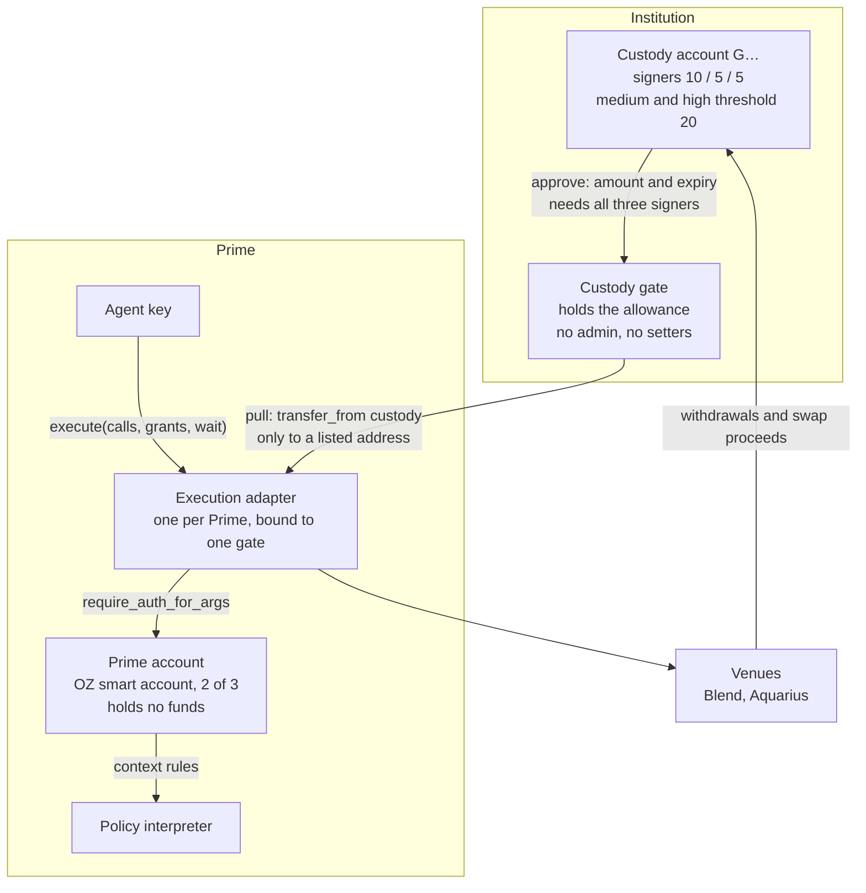
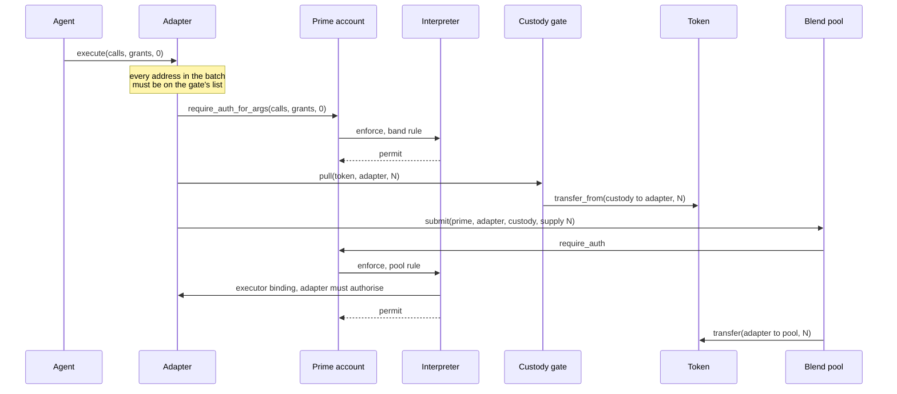

# Prime on Stellar: technical detail

Prime runs on our own Soroban contracts: the policy interpreter, the custody
gate, the execution adapter and the Prime seat, the seat of an owner who signs
with an ed25519 owner key. They live in `contracts/stellar/` in this
repository, with the policy builder in `packages/`. The Prime account itself is
an OpenZeppelin smart account. [architecture.md](architecture.md) covers the
use case and the trust boundaries, and [audit-overview.md](audit-overview.md)
the audit scope.

## The use case and the setup

An institution keeps its treasury in an MPC wallet and wants an agent to swap
and lend part of it without moving custody. Two guarantees make that safe, and
each rests on something the network or our contracts enforce:

- **The MPC wallet always controls the funds:** the custody account is a
  classic Stellar account whose signing thresholds need every custody signer,
  and it only ever grants a bounded allowance.
- **Only the custody gate's listed addresses can receive funds:** the allowance
  is granted to a gate the custody account deploys itself, and the gate
  releases only to addresses on a list fixed when it was deployed.

The setup we tested, and the one the Prime app builds:

| | |
|---|---|
| Custody account | Classic `G…` account. Signers weighted **10** (the MPC key), **5** and **5** (a second signer and a trusted third party). Medium and high thresholds **20**, so every value-moving operation needs all three. The low threshold stays low (1 in our test setup) so the account can still start a transaction. CAP-46-11 requires the medium threshold when a classic account authorises a contract call, so a fresh allowance needs the same 20 as a payment. |
| Custody gate | `contracts/stellar/custody-gate`, deployed by the custody account itself. Holds the allowance, answers to one caller running one build, releases only to listed addresses. |
| Prime account | An OpenZeppelin smart account with **3 signers, any 2 of which approve**. Holds no funds. |
| Execution adapter | `contracts/stellar/execution-adapter`, one per Prime, bound to one gate. Runs a batch of calls in one transaction, at once or after a wait. |
| Policy interpreter | `contracts/stellar/policy-interpreter`. Evaluates the mandate on every call a band rule authorises. |
| Agent | A signer on the band rules only; rule 0 holds the three Prime signers. Under a band's top it acts alone; a larger move uses a high-band rule that also needs a second approver. |

## Components



### Custody gate

`contracts/stellar/custody-gate/src/lib.rs`, 53 sLOC. Its configuration is
written once by the constructor:

| Field | Meaning |
|---|---|
| `custody` | Whose money. The allowance is granted from here. |
| `caller` | The one adapter that may call `pull`. |
| `caller_code` | The wasm hash that adapter must be running. A Soroban contract id commits to the deployer and salt only, so the gate checks the running build on every draw. |
| `allowed` | Every address a batch through that adapter may name, and every address `pull` may pay. |

`pull(token, to, amount)` requires the caller's authorisation, refuses a caller
running any other build (`WrongCallerCode`, 2), refuses a destination not on
the list (`DestinationNotAllowed`, 1), and then spends the allowance with
`transfer_from`. There is no admin, no setter and no upgrade path. Changing the
list means deploying another gate and granting a new allowance, which needs the
custody account's full threshold again. The same holds for a new adapter build:
the gate fixes `caller_code` at creation, so a new adapter build means a new
gate and adapter.

The gate keeps no list of assets. A SAC allowance is granted per token, so a
token the custody account never approved has nothing to spend.

The Prime app fills `allowed` with the execution adapter, the
Prime account, the custody account, the policy interpreter, the asset
contracts, the venues the institution adds, and the recovery address if one is
set. The Prime account, the interpreter and the asset contracts are on the list
because the adapter refuses any batch that names an address the gate does not:
a Blend `submit` names the Prime, a grant names the interpreter, and a pull
names its token.

### Execution adapter

`contracts/stellar/execution-adapter/src/lib.rs`, 226 sLOC. It exists because
Soroban allows one host-function invocation per transaction, so a contract has
to make several calls atomically. The Prime creates it bound to one gate or
with no gate (see [No gate](#no-gate)). Bound to a gate, it has one rule: **a
batch may not mention an address the gate does not name.** Before any call
runs, it checks:

- every call target;
- every argument, however deeply nested, including data that could be read
  back as an address: 32 bytes (a raw key or contract id), 56 (a strkey), 40, 44
  and 48 (the XDR of a contract, account or muxed address) and 69 (a muxed `M`
  strkey);
- every authorisation it is about to hand out as itself.

It also refuses:

- a batch that targets the Prime account itself (`PrimeTarget`, 1);
- any address outside the list (`AddressNotAllowed`, 2);
- an authorisation to deploy a contract, or a host object the walk cannot read
  (`Uncheckable`, 3).

Only then does it ask the Prime to authorise the whole batch and run the calls.

The adapter is deployed by the Prime at an address derived from the gate and
its two wait numbers (see below), so the custody account can name it on the
gate before it exists. `rebind` moves it to a successor gate. Only the current
gate's custody account can call it, and it refuses a successor that cannot
answer `custody()`.

### The wait

A batch can wait before it runs, counted in ledgers. `execute(calls, grants,
wait)` takes the wait as a third argument.

- **`wait` 0** runs the batch at once.
- **`wait` above 0** checks the batch, stores it whole on the ledger and
  returns its number. It can run from `wait` ledgers later until its run
  window closes.

The Prime approves `(calls, grants, wait)` together, so no party can shorten the
wait afterwards. A rule can demand a longer wait of its own with
`call_arg(2) >= N`, because the grammar compares a `u32`.

| Function | Who | What |
|---|---|---|
| `run(id)` | Anyone, from the ready ledger to the end of the run window | Checks the stored batch again against the gate bound now, then runs it. It runs once. |
| `cancel(id, by)` | The Prime, at the quorum of whichever rule approves it, or the custody account the gate answers to | Drops a stored batch, waiting, ready or lapsed. |

Two numbers are fixed when the adapter is created, and custody agrees to both:

- **`min_wait`** binds every caller, including the Prime's own rule 0, which
  carries no predicate. Above 0, everything waits, recovery included, and the
  custody account has that long to cancel.
- **`run_window`** is how long a ready batch stays runnable. After that it
  lapses (`NotRunnable`), because it was approved against a market that has since
  moved, and perhaps by an agent since revoked. With a window of 0 it can run
  only on its ready ledger.

Errors: `WaitTooShort` 4, `NotScheduled` 5, `NotRunnable` 6 (before the ready
ledger or after the window), `NotACanceller` 7. A stored batch sits in
persistent storage under its number as `(calls, grants, run_at)`, readable by
anyone; there are no events.

**The address commits to both numbers:** the adapter's address is
`deployer(prime, sha256("prime.execution.adapter.v5" + XDR((gate, min_wait,
run_window))))`, with a void for "no gate". The salt text is a fixed domain
constant. The constructor refuses to run at any other address
(`NotWhereAgreed`, 8). The gate pins its caller's address and build but not the
arguments it was created with. Without the address check, the Prime could
create the adapter at the address custody put on the gate with a `min_wait` of
0. Custody derives the address from the numbers it agrees to and names it on
the gate.

### The run rule

A stored batch runs under a rule on the Prime scoped to the adapter. `run(id)`
asks the Prime to approve `run(id)`, and a venue that asks the Prime mid-batch,
such as Blend's `submit`, sits inside that approval.

The run rule lists no signer. It carries the policy interpreter as its only
policy, with the predicate `call_fn == "run"`, and the owners bind it to the
adapter with `bind_executor`. The interpreter then accepts a call under it that
authenticated no signer, and takes the adapter's own `run` context as the
adapter's consent (see [Keyless rules](#keyless-rules-and-the-executor-binding)).
No key signs, so any account can run a stored batch once it is ready, and
only the batch the Prime approved runs.

**The run rule needs its predicate:** without it, the rule would approve an
immediate `execute` or a `cancel` for the Prime with no key. The interpreter
refuses a rule scoped to its bound adapter unless the predicate pins
`call_fn == run` on every path (221), at `bind_executor`, at a re-install and at
`enforce`. Under a rule bound to the adapter, any context other than the
adapter's own `run` still needs a grant from the adapter, and a batch cannot
carry a grant for its own `execute`. Agent rules permit `execute` only, so an
agent cannot cancel.

**A venue rule:** a rule scoped to the venue (a Blend pool's `submit`) and bound
to the adapter answers the venue's request inside a batch. The binding means
the venue call must come through the adapter: the interpreter asks the adapter
to authorise the exact account and context, and the adapter grants it only for
a call in a batch it checked. A keeper that calls the pool directly is refused.

### No gate

The Prime can create its adapter with no gate. Such an adapter checks no
address, so the Prime can bundle its own calls: for example
`[Y.hello(…), USDC.transfer(X, M, A), XLM.transfer(X, N, B)]`, where the
transfers happen only if `hello` does not fail. The Prime `X` can be a G
account or an OpenZeppelin account. Whether an adapter has a gate is fixed when
it is created.

| | Gate set | No gate |
|---|---|---|
| Addresses checked | every target, argument, nested value and grant against the gate's list | none |
| A call to the Prime itself | refused (`PrimeTarget`, 1) | refused (`PrimeTarget`, 1) |
| Grants and `executor_authorizations` | checked against the list | `executor_authorizations` refused (`Uncheckable`, 3): the adapter acts as itself only towards the contracts it calls directly. In an immediate `execute`, `grants` may hold only its word to the Prime's policy, `enforce(prime, context)` with nothing nested; any other grant is refused (3) |
| `wait` above 0, `min_wait` above 0 | allowed | refused (`NoWait`, 10), at `execute` and at creation |
| `run` | runs a stored batch | finds nothing (`NotScheduled`, 5) |
| `cancel` | the Prime or the gate's custody | the Prime (nothing is ever stored) |
| `rebind` | custody of the current gate, to another gate | refused (`NoGate`, 9); a gated adapter cannot be rebound to none either, because `rebind` takes an address |

**The no-gate flow:** every batch runs at once, signed by the agent's own keys.

1. The agent calls `execute(calls, [], 0)`. The adapter asks the Prime to
   approve `(calls, grants, wait)`.
2. A G account signs one authorisation entry, or none when it submits the
   transaction itself. An OpenZeppelin account checks every context in one
   `__check_auth`, and each context needs its own rule: the agent needs a rule
   for `execute` on the adapter and one for each token it moves, each listing
   the agent's key.
3. Each nested `X.require_auth`, such as the token's `transfer(X, …)`, is filed
   under that approval and checked against its own rule.

**The word of an adapter with no gate:** in an immediate `execute`, and only
there, the adapter hands out its word to the Prime's policy that a context came
through this call: the `enforce(prime, context)` entries the batch lists in
`grants`, for its own Prime with nothing nested, plus the same entry for the
`execute` it is running, which no batch can spell. The interpreter's `enforce`
asks a bound executor for exactly that, so a rule the Prime's admins bound to
this adapter (`bind_executor`) passes for the contexts the batch names. A
keyless rule scoped to the adapter passes for its `execute` only if its
predicate pins the whole batch: `call_fn == execute`, a wait of 0, the number
of calls, and each call's target and function (the interpreter refuses anything
less with 221). The word authorises no move, and nothing is stored, so none
outlives the call. This is how a keyless liquidation runs: anyone may call
`execute`, and the Prime's rules, bound to the adapter, decide. With no gate,
those predicates are the only fence. It stores no batch, so its `run` still
stops before it asks the Prime. A keyed rule scoped to the adapter that does
not pin the number of grants to 0 lets its signer hand out such words.

**What bounds a no-gate batch:** with no address list, the agent's token rules
are the whole constraint. Pin every recipient (`eq` or `in` on the destination
argument) and bound every amount from both sides. A cap holds per call: three
transfers of 20 under a cap of 20 move 60 on one approval. An OpenZeppelin
`spending_limit` on the rule binds a total, across the calls of one batch too.

**Nothing waits:** a stored batch runs under `run`, where the adapter is the one
asking the Prime, so the Prime's token rules would have to accept the adapter's
request. Such rules would also answer an immediate `execute`, where the adapter
asks too, so an agent allowed to call `execute` could move the Prime's funds
through them instead of through its own capped rules. A no-gate adapter
therefore runs every batch at once.

**Custody's funds stay out of reach:** a custody gate pins the address and
build of its one caller, and custody derives that address from the gate
itself, so a no-gate adapter's address is never the one on the gate. Measured
on testnet: a no-gate adapter's `pull` through custody's gate is refused with
`Error(Auth, InvalidAction)`.

**A signed bundle is valid until its expiry ledger:** a bundle that fails on
chain does not use up its authorisation's nonce. When the Prime's entry carries
address credentials, whoever holds it can submit it again until
`signatureExpirationLedger`, and it runs if the failing call would now succeed.
Tools should therefore sign bundles of the Prime's own funds with a short
expiry. Where the signer authenticates as the transaction source instead, only
that signer can resubmit: a G account that submits its own bundle uses up its
sequence number when the transaction fails.

### The Prime app

The Prime app (a separate repository, out of audit scope) drives these
contracts. Before any wallet signs, on its own signing paths and for every call
the Prime account would authorise there, nested calls included, it refuses:

- a rule signed by an execution adapter, or an adapter added as a signer;
- a transfer, an allowance or a venue payout to an adapter with no gate or an
  adapter it cannot verify;
- `bind_executor` to anything but the adapter of a custody gate an owner
  confirmed;
- `remove_policy` on any rule, and an install on a rule whose interpreter holds
  no document for it;
- a request it cannot read in full.

These refusals are an extra layer. The contracts do not rely on them.

### Keeping contracts live

Every contract instance, persistent entry and uploaded wasm on Soroban starts
with the network's minimum lifetime, about 7 days on testnet. Using an entry
does not extend it unless the contract does so itself. When the lifetime runs
out, the entry archives and has to be restored before anything can use it.
Anyone can restore or extend an entry by paying the fee, and a transaction that
touches an archived entry can restore it as part of the same transaction.

The adapter extends itself. `execute` and `run` extend its instance to about
30 days once fewer than about 7 remain. A stored move is extended to last until
its run window closes, up to the network maximum of about 180 days; a move
whose window ends later archives first and has to be restored before it runs.

The interpreter keeps each rule as one persistent entry, keyed
`(account, rule_id)`, and extends it back to about 30 days only when an allowed
call uses it with fewer than 100 ledgers (about 8 minutes) left. Nothing else
is extended on its own, so a deployment keeps its entries alive with a
keep-alive job.

### Prime account and the mandate

The Prime account is an OpenZeppelin smart account. Its rule 0 holds the three
signers and a threshold of two. The mandate is a set of further context rules,
each carrying a policy-interpreter predicate. The predicate pins the shape of
the batch: which calls, which venue, which direction, amounts within the band.
The venue call also carries an authorisation naming the exact token transfer,
and Soroban matches an authorisation to its context exactly, so the amount the
venue takes is fixed too.

A band is one such rule. In the test setup, swaps and Blend supply and
withdrawal each have a low band (the agent alone, 1 approval) and a high band
(agent and admin, 2 approvals, enforced by OpenZeppelin's threshold policy).
The predicate refuses an over-band amount under the low rule outright, before
any second signature is sought.

Blend credits a supply to whoever authorises it, so a supplied position is held
in the Prime account's name. Blend's `submit` takes `(from, spender, to, …)`,
and the mandate pins `to` to the custody account, so a withdrawal can only pay
the custody account. Swap proceeds go straight to the custody account.

### Policy interpreter

`contracts/stellar/policy-interpreter`, 800 sLOC. The smart account calls
`enforce` on every call a policed rule authorises. The predicate grammar, its
limits and the install checks are documented in
[contracts/stellar/policy-interpreter/README.md](../contracts/stellar/policy-interpreter/README.md).

- **It fails closed:** an undecodable predicate, an unknown node or a selector
  the call cannot answer all deny, with a specific deny code.
- **`enforce` writes only a TTL bump:** it reads the rule's stored document and
  a permit extends that entry; a deny rolls the bump back with the frame. A
  `read` calls other contracts (below).
- **`install` guards the rule:** it checks the grammar version, the byte cap,
  the predicate's hash, the scope (no `Default` rule, none scoped to the
  account or the interpreter, 218), the operator and admin sets (at most 16,
  free of `External` signers, 212, and of the interpreter's own address, 219), a fresh
  nonce, and that the predicate holds at least one selector leaf (216). It
  stores a hash of the rule's signers, which `enforce` compares on every call
  (204).
- **`call_path`** walks into the batch the adapter submits (`calls[n].args[i]`,
  map keys, lengths). That is what lets one predicate bound a whole batch and
  relate two of its calls.
- **Limits per instance:** each instance takes its `Limits` in its constructor,
  stores them once and returns them from `limits()`. There is no setter and no
  upgrade path, so a different limit means a new instance at a new address.

  | Field | Floor | Ceiling | Testnet instance `CDER6P73…` |
  |---|---|---|---|
  | `max_reads` (distinct reads) | 1 | 8 | 8 |
  | `max_leaves` (weighted leaves) | 4 | 400 | 400 |
  | `max_predicate_bytes` | 256 | 40,960 | 24,576 |
  | `max_elems` (vector elements) | 2 | 64 | 32 |
  | `max_in_operands` (`in`/`nin` entries) | 1 | 64 | 32 |
  | `max_depth` | 2 | 8 | 5 |

  A value outside its floor and ceiling fails the constructor with error 220.
  An install that breaks the instance's limits fails with error 201, and a
  predicate over `max_predicate_bytes` fails with error 207.
- **`read`, `now` and `scaled`:** `read(contract, fn, args, path)` calls a
  fixed function of a fixed contract and picks a value out of the result, so a
  rule can check a live price, a pool's debt or a custody balance. Its
  arguments may be constants or taken from the call, and the result may be any
  value but void, so `eq(read(REGISTRY, contains, [call_arg(1)]), lit(true))`
  asks a registry contract whether the receiver is on its list. `now` is the
  ledger timestamp, and `scaled(src, num, den, add)` computes
  `src * num / den + add`, with every step checked. A predicate may make at
  most the instance's `max_reads` distinct reads, so `enforce` never makes more
  than `max_reads` external calls, quantifiers included. Soroban has no
  read-only call, so read targets must be contracts the owner trusts, ideally
  immutable; a read cannot target a contract already on the call stack (the
  host refuses re-entry and the read denies). A read sees the state at the
  moment the account's authorisation is checked, after anything the submitter
  ran earlier in the same transaction. Read only values the submitter cannot
  move and restore within one transaction (an oracle-signed or admin-set price,
  a balance the agent cannot debit). A rule that reads over a batch must pin
  the batch's length, every element, its `executor_authorizations` and
  `grants`, and must pin `wait` to 0, because a rule on `execute` with a wait is
  evaluated once, when the batch is stored. The interpreter's address must
  never hold value, allowances or roles, because a read target sees it as its
  caller. The full list is in the
  [interpreter README](../contracts/stellar/policy-interpreter/README.md#cross-contract-reads).
- **Generic values:** `lit(x)` is a constant of any type, `ne` and `nin` are a
  denylist whose unresolvable operand still denies, every integer type of up to
  128 bits compares as a number, and the quantifiers `all(vec, P)`,
  `any(vec, P)` and `sum(vec, …)` state a property of every or some element of
  a vector, or total one. A vector longer than the instance's `max_elems`
  denies, and quantifiers do not nest. Details are in the
  [interpreter README](../contracts/stellar/policy-interpreter/README.md#quantifiers-all-any-elem-sum).

The interpreter answers one question: is this call one the policy permits? It
does not see what a transaction moved, keep rolling totals or count calls.
Amount limits over time come from the allowance and its expiry, or from
OpenZeppelin's `spending_limit` beside the interpreter.

#### Keyless rules and the executor binding

`bind_executor(rule, executor)` binds a rule to an execution adapter. It needs
the smart account's authorisation and the policy admins'. A re-install keeps
the binding. Under a bound rule, `enforce` also requires the adapter's own
authorisation of the exact account and context.

A rule may list no signer. `install` accepts an empty operator set, and
`enforce` accepts a call that authenticated no signer only when all three hold
(else 210):

- the rule, as OpenZeppelin passes it, lists no signer;
- the interpreter is the rule's only policy;
- the rule is bound to an executor.

The checks inside `enforce` run in this order, and any refusal rolls back the
whole call:

1. the empty-signer gate above (210);
2. the stored predicate is decoded;
3. a bound rule whose scope, as OpenZeppelin passes it, is the bound executor
   must pin `call_fn == run` on every path (221);
4. a bound rule needs the executor's authorisation of the exact account and
   context, except the executor's own `run` context under a rule scoped to it;
5. the rule's signer set must match the hash `install` stored (204);
6. the TTL is extended and the predicate decides.

The exception in step 4 rests on a host property: a context that names the
adapter exists only because the adapter's code asked the account for it. Only
`run` is taken that way. An `execute` or a `cancel` under the same rule still
needs a grant from the adapter. **Bind a rule to the contract it is scoped to
only when that contract is an execution adapter:** under the exception, the
binding stands in for that contract's consent to its own `run`, so the rule
approves whatever that `run` does.

`pins_call_fn` decides step 3: an `and` pins when any child does, an `or` only
when every child does, and a compare pins only as `eq` between `call_fn` and
the symbol `run`, either side. `in`, `ne`, quantifiers and every other shape
pin nothing. The same check runs at `bind_executor`, against the scope `install`
recorded, and at a re-install under a kept binding. The `enforce` check reads
OpenZeppelin's own record of the rule, so an install that misstated the scope
cannot get round it.

Three properties of the OpenZeppelin account complete the design:

- **`remove_policy` cannot strip a keyless rule:** the account refuses to
  leave a rule with no signer and no policy (`NoSignersAndPolicies`, 3004). The
  interpreter refuses a keyless rule with a second policy, so every keyless rule
  it permits keeps its predicate.
- **A keyed rule stripped of its signer stays refused:** after `remove_signer`
  a bound rule lists no signer and passes the gate in step 1 (an unbound one
  stops there with 210), and the stored signer
  hash refuses it at step 5 (204), or step 4 refuses it first when the adapter
  does not grant its context.
- **Delegated adapter signers fail on the 0.8.0 account:** OpenZeppelin's 0.8.0
  account refuses a `Delegated(X)` signer when X is a contract called in the
  operation (`DelegatedSignerIsContextContract`, 3017). A run rule signed by the
  adapter fails there at first use. The keyless run rule lists no signer, so
  the check never applies to it.

**Two routes detach a binding:** `uninstall` needs only the policy admins and
deletes the document with its binding; a later `install` stores none. A keyless
rule then refuses every call: 206 while no document exists, 210 once one is
installed again. A keyed rule runs without the adapter's
check once the owners install a document again. OpenZeppelin's `remove_policy`
goes on when the policy's `uninstall` fails, so the account alone can take the
interpreter off a keyed rule, which then runs with no adapter approval. On a
keyless rule with one policy, 3004 refuses the removal.

Tests: `tests/keyless.rs` drives these checks in the interpreter's test host,
and the `oz08/` crate runs the interpreter wasm against OpenZeppelin's 0.8.0
account (built from upstream commit `8e25220`; the release is not tagged yet)
with real authorisation entries.

## Owners and Prime seats

The Prime account's owners are the signers of its rule 0. A native owner is a
Stellar `G…` account and signs each decision itself. The seat owner is an
ed25519 key. Its holder must produce a raw ed25519 signature over the 32-byte
grant hash. In the reference integration a NEAR-routed MPC holds the key; any
signer that can raw-sign that hash, such as a server-held keypair or a custody
service configured for raw ed25519 signing, can serve. Interactive wallets that
sign only transactions or prefixed messages produce signatures the seat refuses.
The owner gets a Prime seat: a contract (`prime-seat`) deployed for that owner
and that account. The seat verifies only ed25519 signatures.

`contracts/stellar/prime-seat/src/lib.rs`, 97 sLOC. The constructor stores the
account's 32-byte contract id and the owner key, and nothing changes them.

| Function | What it does |
|---|---|
| `grant(key, start, end, by, sig)` | Starts, extends or ends a session. The owner signs `sha256("prime-seat-grant" ‖ network id ‖ account ‖ seat ‖ key ‖ be64 start ‖ be64 end)`; with `end` 0 the owner or the key itself signs an end, which stores 0 and refuses every later grant for that key while the entry lives (temporary storage at the maximum TTL, about 180 days; after it expires, a grant the owner signed for that key can be valid again). A grant needs `start <= now <= end`, at most 604,800 seconds, and an end later than the stored one. Anyone may submit it |
| `verify(hash, key_data, proof)` | The `External` signer interface, used in rule 0 only. `key_data` must be the account's id, and the proof is a live session key's signature over `sha256(seat ‖ hash)` with the digest's preimage |
| `__check_auth(payload, (key, sig, preimage), contexts)` | The `Delegated` signer interface, used in rules other than rule 0. The first context must be a call on the stored account whose first argument is the account's digest, with only non-zero rule ids |
| `batch_canonicalize_key(keys)` | One constant per seat, so the account refuses a second `External` entry for the same seat |

The account build the Prime app deploys (`91a2cd56…`) signs
`sha256(payload ‖ XDR(rule ids))`. The seat checks the preimage against the
digest and reads the rule ids from it: `External(seat, account id)` passes only
when every id is 0, and `Delegated(seat)` only when no id is 0. A rule 0 holding
`Delegated(seat)` beside `External(seat)` therefore cannot let one session pass
rule 0 alone. Grants live in temporary storage at the maximum TTL; every use
compares the stored end with the ledger timestamp.

**Rule 0 layout:** each native account sits in rule 0 as `Delegated(G)` and
each seat as `External(seat, account id)`, under two policies installed
together: `simple_threshold` M (the approvals the owners agreed) and
`weighted_threshold` with every native account at weight K, every seat at
weight 1, and threshold K, where K is the number of seats plus one. K is fixed
when the account is created. A seat added later sits at weight 0: it counts
toward M and never toward K. Seats alone sum below K, so every decision carries
a native owner's signature, and seat owners supply the other approvals through
their sessions. The app checks this layout on read-back
([contracts/stellar/prime-seat/README.md](../contracts/stellar/prime-seat/README.md)
lists every invariant).

**Rules that list a seat:** besides rule 0, a seat may sit in a
`CallContract(X)` rule as `Delegated(seat)` with the policy-interpreter
predicate, where X is a contract other than the account, its policy contracts
and the seats. There the session acts alone inside what the predicate allows. A
seat counts as one signer, so a rule with `simple_threshold` 2 over a native
account and a seat needs both.

### Changing who signs a policed rule

- **The interpreter pins a rule's signers:** `install` stores a hash of the
  rule's signer set, and `enforce` refuses with error 204
  (`RuleSignersChanged`) once the set differs. `remove_signer` or `add_signer`
  on a policed rule leaves that rule refusing every signer. To take a signer, a
  seat included, out of a policed rule, add a new rule without it and then
  remove the old one, or remove the policy, change the signers and add the
  policy again with the policy admins' authorisation. A removed signer gains
  nothing from the refusal.
- **`remove_context_rule` can leave an orphan interpreter entry:** the account
  asks each policy to uninstall, and the interpreter's `uninstall` needs the
  policy admins' own authorisation. When the transaction carries only the
  rule-0 signatures, `uninstall` fails, the account removes the rule anyway,
  and the interpreter's entry for `(account, rule id)` stays until it archives.
  The account gives every new rule a fresh id, so the entry is never read
  again; it costs rent, and an admin can still call `uninstall` directly.
- **`External` signers are refused** in a policed rule and in its admin set
  (error 212), so a seat joins a policed rule as `Delegated(seat)`.
- **`Default` scope is refused** (error 218), and so is a rule scoped to the
  account itself or to the interpreter.
- **A seat cannot be a policy admin:** the admins authorise reinstall,
  rotation and `uninstall` by `require_auth`, and a seat authorises only inside
  its own account's `__check_auth`. A policy whose admins were seats could never
  be changed or uninstalled. The rule itself can still be removed through
  rule 0.

## Setting it up

The custody account deploys the gate and grants one allowance per asset, each
at its full threshold. The Prime's owners create the execution adapter and
install the bands at their own threshold; a venue rule is bound to the adapter
before an agent uses it.

The custody account picks the gate's salt, which fixes the gate's address, and
the gate's address fixes the adapter's. Either side can deploy first. The
allowance can last up to 180 days, the longest a Soroban ledger entry can live
(`max_entry_ttl`, 3,110,400 ledgers). An allowance set to the largest `i128` is
treated as unlimited in amount; the expiry still applies.

## One move

A Blend supply. The gate spends the allowance, the pool draws from the adapter,
and the interpreter checks both the batch and the nested venue call.



If any step fails, the whole transaction reverts. A stored batch takes the same
path from `run(id)`, with the run rule in place of the band rule.

## Recovery

A recovery address, a `G…` wallet other than the custody account, can be added
to the gate's list when the gate is set up. The Prime account's own authority,
2 of 3, can then run one call, `pull(asset, recoveryAddress, amount)`, through
the adapter. It moves the custody account's funds to that address and nowhere
else. A band pins every destination, so an agent's rules cannot reach it.
Recovery uses the gate's existing list.

The recovery is a stored batch like any other: it waits at least the adapter's
`min_wait`, and the custody account or the Prime can cancel it until it runs.
With `min_wait` at 0 it can run at once.

## Stopping it

The custody account sets the allowance to zero, or lets it expire. Either needs
the custody account's full threshold. Once the allowance is gone the gate has
nothing to spend, and recovery stops with it.

The custody account can also cancel any stored move before it runs, with
`cancel(id, custody)`.

## What has been run

| Check | Where | Result |
|---|---|---|
| Keyless rules and the executor binding | `tests/keyless.rs` (19 tests) and the `oz08/` suite (14 tests, OpenZeppelin's 0.8.0 account) | keyless `run` with the run and venue rules permits; an unbound keyless rule, a second policy, a stripped keyed rule, an unpinned self-scoped rule and an `execute` or `cancel` without the adapter's grant are refused; `remove_policy` on a keyless rule fails with 3004 |
| The address rule against a real Prime and live Blend and Aquarius | `scripts/verify-execution-address-rule-testnet.ts`, testnet, adapter `4985cd12…` with a gate | 35 of 35 on 20 October 2026. A Blend supply, a withdrawal to custody and an Aquarius swap succeed. Refused: a stranger in any argument, nested value, strkey, raw 32 bytes or authorisation; a pull to the gate itself; a token custody never approved; a batch calling the Prime; a deploy authorisation; a Prime-signed rebind. Custody rebinding to a non-gate is refused and the binding stays put |
| The adapter's wait against a real Prime, the gate and live Blend | `scripts/verify-execution-wait-testnet.ts`, testnet, adapter `4985cd12…` with a gate | 45 of 45 on 20 October 2026. Succeeded: a Blend supply at once; a stored Blend supply and a stored recovery pull to the trustee, each run later by an account with no role; an agent's batch after the minimum wait its own rule demands. Refused: the agent below that minimum, and the agent cancelling; a stranger cancelling; running early, twice, after a cancel, or after the run window; a wait below the adapter's floor; the Prime creating the adapter at custody's address with a lower floor or a longer window |
| The adapter with no gate, for a G and an OpenZeppelin Prime | `scripts/verify-execution-null-gate-testnet.ts`, testnet, adapter `4985cd12…` | 69 of 69 on 20 October 2026, log `evidence/execution-null-gate-testnet.log`. Succeeded: `[hello, USDC.transfer, XLM.transfer]` with one authorisation by X (a G account, and an OpenZeppelin account through rule 0); an agent's bundle at its cap, one rule per context. Refused: the bundle once `hello` failed, with no balance moved; its signed entry after its expiry ledger; a call to the Prime; a grant; any wait, and a no-gate adapter with a minimum wait; `rebind`; a stranger's `cancel`; the agent over its cap or citing its adapter rule for a token context; a no-gate adapter's pull through custody's gate |
| A rule that follows another, built and reviewed by policy-synth | `install_policy` with `follow`, testnet instance `CDER6P73…`, live-test account `CASJ5GEC…` | 25 October 2026: rule 7 follows rule 6 (`cap-500`), install `c284ff4f…`. policy-synth reads rule 7 through rule 6 (its predicate and install nonce 1), its `check` permits a transfer of 400 and refuses 600 under the followed predicate, and following rule 7 (itself a reference) is refused before anything is built. Recorded in `packages/policy-synth/fixtures/rpc/bind.json` |
| Referenced rules | `tests/ref_rule.rs` (18 tests) and `oz08/` `r1`, `r2` | a rule following `(A, rule_id)` evaluates A's re-installed predicate at its next `enforce`, with no change to its OZ rule; only the follower's own install sets or clears the reference, and the payload hash commits to it (`208`); a missing source is `206`, a chained or self-referencing one `201`; A cannot install, bind or enforce for the follower, whose signers (`210`, `204`), binding and grant are its own; the run pin (`221`) holds the fetched predicate; a permit extends the referenced entry's TTL |
| Contract unit tests, this tree | `cargo test` in each crate (see [Build and test](#build-and-test)) | interpreter 434 (its 18 conformance cases also run in release), `oz08/` 14, adapter 62, gate 3, Prime seat 21 |

The address-rule, wait and no-gate scripts install their rules on the
interpreter instance recorded in `deployments/interpreter-testnet.json`; they
test the gate and the adapter. Their run rule lists the adapter as its
signer, which the 0.7.2-line account accepts; the keyless run rule described
above is exercised in `tests/keyless.rs` and `oz08/`, both in the test host.
The logs indexed in [evidence/README.md](../evidence/README.md) were recorded
on `CDZV4AG4…`, two instances before `CDER6P73…`; `CD46LN75…` came between them.

## Build and test

Each crate is standalone (soroban-sdk 27, `wasm32v1-none`, Rust 1.97.1 from
`rust-toolchain.toml`, stellar CLI 27.1.0). `build-wasm.sh` remaps the crate and
registry paths, so its Linux build is the one behind every deployed and pinned
hash; `stellar contract build` and macOS give other bytes.

```sh
( cd contracts/stellar/policy-interpreter && ./build-wasm.sh && cargo test )   # tests/worst_case.rs loads the wasm
( cd contracts/stellar/policy-interpreter && cargo test --release --test conformance )
( cd contracts/stellar/policy-interpreter/oz08 && cargo test --locked )          # loads the same wasm
( cd contracts/stellar/execution-adapter && ./build-wasm.sh && cargo test )
( cd contracts/stellar/custody-gate && ./build-wasm.sh && cargo test )
( cd contracts/stellar/prime-seat && ./build-wasm.sh && cargo test )
```

| Crate | `build-wasm.sh` sha256 | Recorded in | Tests |
|---|---|---|---|
| `policy-interpreter` | `6704996f626904a4e33b95bda17b73963fc9cf502ffdfdbe9d85b4b10288e0d4` | `contracts/build-hashes.json` | 440 (the 18 conformance cases among them also run in release), 25 in `oz08/` |
| `execution-adapter` | `bf85432c859f1ee543c14e9cc9b2c150c12753cc9580053b8d27a41eee85b4a0` | `contracts/build-hashes.json` | 67 |
| `custody-gate` | `b01024f31a24108f47b57fec3bfe40efa86ec002ddbe2d8445adbacb7f09fbab` | `deployments/` | 3 |
| Prime seat | `393f0e5d340ed25ef1aa9beb2a5b6446b84247f75c5d858113779c9fa11baa87` | `contracts/build-hashes.json` | 21 |

CI compares each hash with its record.

## Deployments

All on Stellar testnet.

| | Address or hash |
|---|---|
| Policy interpreter instance | `CDER6P73JWMIVD3X6TGGOQIDAH3DLU7OKRTLT4ULPTZ3QJJ3QUGTK7CM`, wasm `6704996f…` (this source), deployed with reads 8, leaves 400, bytes 24,576, elems 32, `in` entries 32, depth 5. Created by `scripts/deploy-interpreter-testnet.ts`, recorded in [`deployments/interpreter-testnet.json`](../deployments/interpreter-testnet.json) and pinned in `packages/policy-synth/src/config.ts`. It replaced `CD46LN75…` on `810f53f1…` (this source before referenced rules and the immediate-batch pin), which replaced `CDZV4AG4…` on `69cad1d5…` (before the keyless executor rules); the record lists both as superseded and policy-synth trusts neither |
| Execution adapter code | `bf85432c859f1ee543c14e9cc9b2c150c12753cc9580053b8d27a41eee85b4a0`, 28,003 bytes, pinned in [`contracts/build-hashes.json`](../contracts/build-hashes.json) and recorded with upload `be2f7813a0081fe3c1a5d41be4bba1d12db73e52ca9bb415c478ec91ad6e3e5e` in [`deployments/execution-testnet.json`](../deployments/execution-testnet.json), which lists the earlier builds `4985cd12…` and `3dd675c0…` as superseded |
| Custody gate code | `b01024f31a24108f47b57fec3bfe40efa86ec002ddbe2d8445adbacb7f09fbab`, recorded in [`deployments/execution-testnet.json`](../deployments/execution-testnet.json) |
| Prime seat code | `393f0e5d340ed25ef1aa9beb2a5b6446b84247f75c5d858113779c9fa11baa87`, pinned in [`contracts/build-hashes.json`](../contracts/build-hashes.json); the Prime app deploys one seat per seat owner and account |
| OpenZeppelin smart account code | `91a2cd56…`, the account code the Prime app deploys and the seat's digest check is tied to ([`deployments/oz-accounts.json`](../deployments/oz-accounts.json)) |
| OpenZeppelin `simple_threshold`, `weighted_threshold`, `spending_limit` | addresses in [`deployments/oz-policies.json`](../deployments/oz-policies.json) |

## Limits

- **An adapter with no gate guards only the Prime's own rules:** it checks no
  address, so what a batch through it can do is what the Prime's rules allow
  for each call that asks the Prime, and anything the adapter itself holds or
  is allowed to spend. Send it nothing and give it no allowance.
- **The keyless shape on the older account build:** the keyless rules are
  verified against an OpenZeppelin 0.8.0 account (built from upstream commit
  `8e25220`) in the interpreter's `oz08/` test crate. `91a2cd56…` is the older
  0.7.2-line account; we still need to re-check that it accepts a rule with no
  signer and one policy.
- **The seat is tied to the account's digest format:** it reads the rule ids
  out of `sha256(payload ‖ XDR(rule ids))`, the form of the account build
  `91a2cd56…`. An account build that hashes something else, such as OpenZeppelin's
  0.8.0 digest, makes every seat signature fail until new seats are deployed.
  It fails closed.
- **A seat in a rule with no policy is unbounded:** the seat sees only its
  account's `__check_auth` frame, never the call being authorised, so it cannot
  limit what such a rule reaches. The chain allows the rule; installing it takes
  a decision with a native signature, and the app refuses to build it.
- **A rule scoped to the threshold policies must not list a seat:** those
  policies change a threshold or a weight on the account's own authorisation, so
  a session in such a rule could lower rule 0's threshold.
- **Rule 0 holds at most 15 signers:** an OpenZeppelin account created with 16 is
  refused (error 3010), so more than 15 owners need another layout.
- **The account cannot change its own rule 0 thresholds:** a call to
  `set_threshold` or `set_signer_weight` on its rule 0 policies fails with
  "Contract re-entry is not allowed", so changing M or K, or adding a native
  owner, means a new account.
- **Seats do not keep themselves alive:** a grant does not extend the seat's
  instance or code. The relayer extends them with `ExtendFootprintTTL`.
- **Nothing alerts custody when a move is stored:** the adapter emits no
  events, by design. A stored move is public on the ledger and the Prime app
  lists it, but custody has to look.
- **Revoking an agent's rule does not stop the moves it already stored:** a
  stored move runs under the run rule. To stop one, cancel it, or remove the
  run rule, which pauses every ready move until the rule is reinstalled.
- **The Prime account is on the gate's list, so the gate will pay it:** the
  adapter needs the Prime on the list because venue calls name it, and `pull`
  releases to any listed address. A batch run under the Prime's own authority
  (rule 0, 2 of 3 in the app's setup) can therefore draw custody funds into the
  Prime account, within the allowance. An agent's bands cannot do this. Closing
  it needs a contract change: the gate would keep the addresses it may pay
  separate from the addresses a batch may name.
- **Rule 0 stands behind an open position:** a Blend position sits in the
  Prime's name, and rule 0's signers can install any rule, so while a position
  is open the Prime's own 2 of 3 signers are the control that protects it.
- **A key's authority is the most that any of its rules allows:** a key on both
  a policed rule and an unpoliced one names the unpoliced one and is not
  constrained. A constrained key must sit on the policed rule and nowhere else.
  `install_policy` reads the account and reports every rule a signer could name
  instead (`authorityScan`).
- **Transitive authority:** once a policy permits calling a contract, it also
  permits whatever that contract can do with authority it already holds. A
  policed key should hold no standing allowances.
- **A predicate built outside the encoder can pin some calls and leave the
  count open:** the encoder refuses that shape. A hand-built one is its author's
  responsibility, and any extra call still has to pass the adapter's address
  rule.
- **A venue that decodes an address out of a longer blob** is outside the
  adapter's comparison, which covers the encodings the host can turn back into
  an address. It would still have to be a listed venue.
- **Swap prices have a floor from the mandate and no market check of their
  own:** a band pins a minimum output, and `scaled` can express a floor relative
  to the input. A rule can `read` a price feed only through an oracle whose
  lookup takes plain arguments, and the rule is then as trustworthy as that
  oracle.

## The policy builder

The rest of this repository is the OZ Policy Builder, which builds rules for
the policy interpreter. `@crediolabs/policy-synth` records a transaction or
takes a mandate stated as data, lowers it to a predicate, checks it against the
interpreter, renders a review, and returns an unsigned install transaction for
the user's wallet. The CLI (`packages/policy-builder-cli`) and the MCP server
(`packages/policy-builder-mcp`) wrap the same core.
[`packages/policy-synth/README.md`](../packages/policy-synth/README.md) is the
full reference.

The builder writes keyed rules, and keyless rules for an execution adapter: a
rule with no signer needs `executor`, and `bind_policy` builds the
`bind_executor` that binds it once installed. A rule scoped to its executor must
pin `run` or a whole immediate batch (the interpreter's `pins_own`, 221), which
the builder checks first. It can write a rule that follows another rule's
predicate (`install_policy` with `follow`): the payload is the reference, and
every check below is judged on the followed predicate as it is at build time,
which the review shows with its nonce.

Enforcement happens on chain. The builder checks a rule before it is signed:

| Check | What it does |
|---|---|
| Interpreter | On testnet only the pinned instance is accepted (`INTERPRETER_MISMATCH` for any other address), and no input turns that off. On a network with no pin, a call names `interpreterAddress`, and it is accepted only if its live code hash is a build the package trusts. |
| RPC endpoint | The operator's: `POLICY_BUILDER_RPC_URL_TESTNET` (one variable per network) in the environment, else the network default. It must be https, or http on loopback. No tool input takes an endpoint. |
| Threshold | Several `signers` with no `threshold`, or with a threshold one signer meets alone, are refused, because a rule with any policy attached is satisfied by any one of its signers. `threshold` attaches OpenZeppelin's `simple_threshold` (`{ simple: n }`) or `weighted_threshold` (`{ weighted: { weights, n } }`) beside the interpreter. `anyOne: true` installs a rule any one signer can use alone; it is an override like those below. |
| Spending limit | `spendingLimit` attaches OpenZeppelin's `spending_limit`. It is refused unless every branch of the predicate pins `call_fn` to `transfer` and the rule's scope is shown to be a token, because that policy fails every other function. |
| Read safety | A `read` outside the safe list is refused with `READ_UNSAFE`. The list holds the three testnet Reflector oracles (`lastprice`, `price`) and the operator's `POLICY_BUILDER_SAFE_READS_TESTNET`; a listed read needs constant arguments. `POLICY_BUILDER_ALLOW_SPOT_READS=1` lets other reads through. All three switches are operator environment only, and no tool input can set them. |
| Authority overlap | The builder reads every rule on the account and refuses a rule a shared signer could bypass through a looser or unpoliced neighbour, or an account whose rules it could not all read. A neighbour that follows another rule's predicate is read through that rule (one level, as the interpreter does) and refused as a neighbour, since it can widen without the account; beside a new rule that follows, a tighter neighbour is refused too. |
| Keyless rules and binding | `signers: []` needs `executor`, read off the ledger: it must be an execution adapter, and a rule scoped to it must pin `run` or a whole immediate batch (`call_fn = execute`, wait 0, the number of calls, each call's target and function name), as the interpreter's `pins_own` does (221). `bind_policy` builds `bind_executor` after re-reading the rule, its predicate and admins (the source account alone); `BIND_BUILD_FAILED` otherwise. A keyed rule scoped to a no-gate adapter must hold the grants of `execute` (argument 1) to none on every branch, or permit no `execute`; while one on the account does not (or the rules are not all read), a keyless rule for that adapter and a binding to it are refused too, with no override, since its signer could have the adapter hand out its word to a keyless rule. A no-gate adapter that carries keyless rules must be dedicated: no rule of any kind may approve its `execute` except those keyless rules, a Default-scoped keyed rule or a plain OpenZeppelin rule included; the builder refuses the ones scoped to the adapter, and a Default-scoped rule is the owners' alone (rule 0's signers can already change every rule). The review says that with no gate anyone may run an immediate batch through the adapter, so the predicate is the only fence. |
| Referenced rules | `follow: { smartAccount, ruleId }` reads that rule off the install's interpreter. A missing rule, a rule that itself follows another, an interpreter build with no references, or an undecodable predicate is refused before anything is built. The install carries the XDR of `(account, rule_id)` and its hash; `rule.follows` and the review's `Follows` node give the followed rule's nonce and predicate hash now, and say that its admins can change it without this account's signature. |
| Amounts | An amount with no cap, and a swap whose least output has no floor, are refused. |
| Contract signers | Each contract signer's instance is read off the ledger. An execution adapter bound to no gate (`prime` stored, `gate` void) is refused as a signer, whatever its code hash: an agent allowed to call its `execute` could cite the rule for the adapter's calls and move funds past its own caps. An execution adapter with a gate (`prime` stored, `gate` an address) signing a rule scoped to itself is refused unless every branch of the predicate pins `call_fn = run`. A contract signer that is not deployed is refused too. No override waives any of these. |
| Signed expiry and fee | The builder sets the authorisation's expiry: the ledger the recording simulation ran at plus `POLICY_BUILDER_AUTH_LEDGERS` (default 300, at most 17,280), and the two simulations must report ledgers within 20 of each other. The transaction carries a time bound from the builder's clock, the window at 6 s a ledger (30 minutes by default). A resource fee above `POLICY_BUILDER_MAX_RESOURCE_FEE` (default 100,000,000 stroops, 10 XLM) is refused. Both are operator environment only. |

Five overrides are tool inputs: `allowOverlap`, `allowUnboundedAmount`,
`allowOpenSlippage` and `anyOne` on `install_policy`, and `allowAdminRule` on
`revoke_policy`. Each waives one refusal and is the account owners' decision.
No refusal names them. Each one set comes back in `overrides`, as
`{ flag, waived }` with the refusal it waived (or `null` when nothing needed
it), and the review opens with an `Overrides set in the request` node before
the Authority header (in `removes` for a revoke). Testnet honours them, echoed
all the same; on any other network a flag set to `true` is refused before the
network is asked unless the operator sets `POLICY_BUILDER_ALLOW_OVERRIDES=1`.

`review_unsigned` is the owner's side of the review. A wallet or the Prime app
runs it on the unsigned XDR (an install, a removal or a `bind_executor`) it is about to sign (also `reviewUnsigned` from
`@crediolabs/policy-synth`, with `smartAccount` set): it reads the bytes alone,
with no RPC, lists in `problems` what it finds wrong in them (an authorisation
for anything but the call or by a rule other than 0, a `__check_auth` digest
that does not match on the network, an interpreter other than the pin, a
predicate whose hash does not match its bytes, an unknown policy, an External
signer or admin, a fee above the ceiling, no time bound or one longer than the
window plus 120 s for the owner's clock, a signature already on the envelope,
and a contract signer unless `readContracts` reads it through the operator's
RPC, after which only an adapter bound to no gate, an adapter signing a rule
scoped to itself that does not pin `call_fn = run`, or an undeployed contract
is flagged; every other contract then reads signable unvetted, and the owner
checks who controls it; and an install that follows another rule, unless
`readContracts` also reads that rule's predicate and nonce off the pinned
interpreter), and renders the transaction, the Authority header and
the predicate from the bytes. `signable` means no such problem was found.
Nothing is signed yet, so an agent can rewrite the unsigned bytes
consistently, recomputing the digest: itself as admin or signer, a threshold
dropped, a cap raised with a matching hash. Those read signable, as do
installs built with an override and rules the builder refuses for reasons it
does not check from the bytes (overlap, read safety, 1-of-n). The rewrite shows
in the Authority header and the predicate, so the owner reads them against what
they meant before signing.

`install_policy` returns the facts it installs as an `authority` object
(`{ signers, threshold, admins, validUntil, total, interpreter, limits }`), and
the rendered review opens with an Authority header built from the same facts.
The review marks the package's own names for an address as `[role]` and names
from the request as `«label»`. A read outside the safe list shows as "(live
value, movable within one transaction)".
