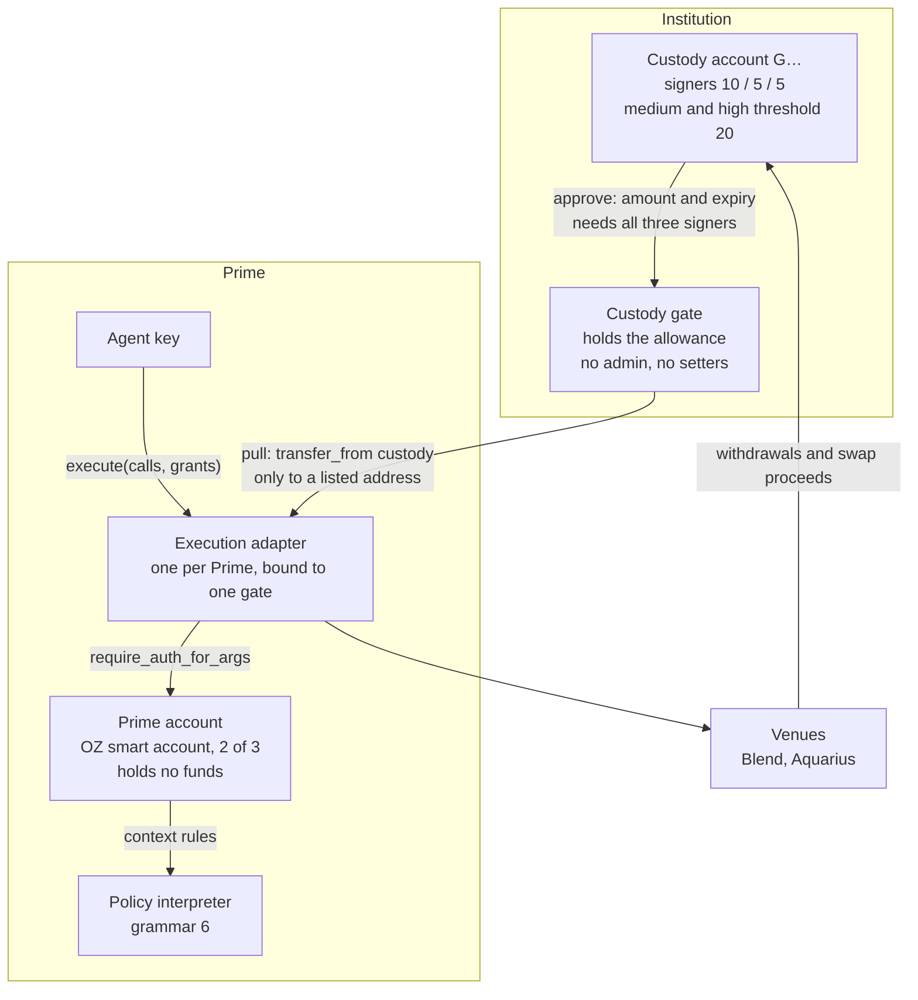
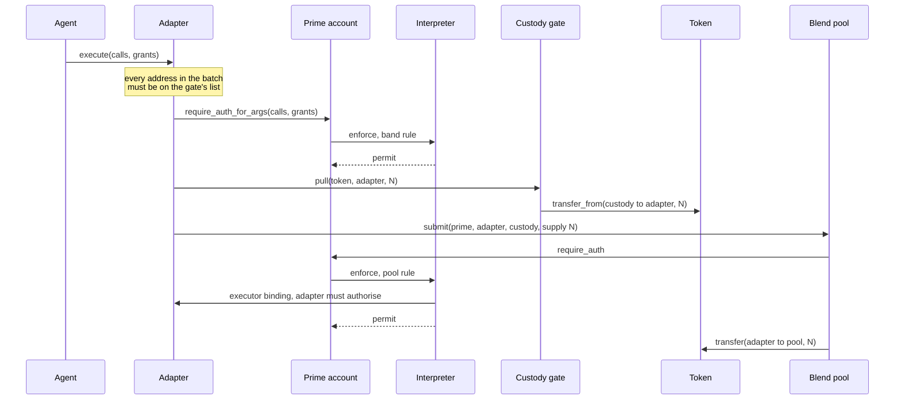

# Prime on Stellar: technical detail

On Stellar, Prime runs on our own Soroban contracts: the custody gate, the
execution adapter and the policy interpreter (together called OctoGate), and
`prime-seat`, the seat of an owner whose wallet lives on another chain. They
live in `contracts/stellar/` in this repository, with the tooling in
`packages/` and `scripts/`; the Prime app drives them. The Prime account itself
is an OpenZeppelin smart account.
[architecture.md](architecture.md) covers the use case and how Stellar fits with
the other chains.

Mainnet runs the grammar-6 interpreter, built from the `main` branch. This
branch holds the grammar-7 source, which runs on testnet only. Where the two
differ, this page says which one it describes.

## The use case and the setup

An institution keeps its treasury in an MPC wallet and wants an agent to swap
and lend part of it without moving custody. Two guarantees make that safe, and
on Stellar each rests on something the network or our contracts enforce:

- **The MPC wallet always controls the funds:** the custody account is a
  classic Stellar account whose signing thresholds need every custody signer,
  and it only ever grants a bounded allowance.
- **Only the custody gate's listed addresses can receive funds:** the allowance
  is granted to a gate the custody account deploys itself, and the gate
  releases only to addresses on a list fixed when it was deployed.

The setup we tested, and the one the app builds:

| | |
|---|---|
| Custody account | Classic `G…` account. Signers weighted **10** (the MPC key), **5** and **5** (a second signer and a trusted third party). Medium and high thresholds **20**, so every value-moving operation needs all three. The low threshold stays low (1 in our test setup) so the account can still start a transaction. |
| Custody gate | `contracts/stellar/custody-gate`, deployed by the custody account itself. Holds the allowance, answers to one caller running one build, releases only to listed addresses. |
| Prime account | An OpenZeppelin smart account with **3 signers, any 2 of which approve**. Holds no funds. |
| Execution adapter | `contracts/stellar/execution-adapter`, one per Prime, bound to one gate. Runs a batch of calls in one transaction, at once or after a wait. |
| Policy interpreter | `contracts/stellar/policy-interpreter`. The custody setups on mainnet and in the Prime app use grammar 6. Evaluates the mandate on every call a band rule authorises. |
| Agent | A signer on the band rules only; rule 0 holds the three Prime signers. Under a band's top it acts alone; a larger move uses a high-band rule that also needs a second approver. |

## Components



### Custody account

`scripts/scenario/fordefi-custody.ts` builds the test version.

Soroban calls face the same threshold as payments. CAP-46-11, the Soroban
Authorization Framework, requires the medium threshold when a classic account
authorises a contract call, so granting a fresh allowance through a contract
needs the same 20 as a payment. `scripts/verify-mpc-threshold-testnet.ts` checks every route
out of the account on testnet, submitted to the network and not only
simulated. With one key, `payment`, Soroban `approve`, `setOptions` and
`accountMerge` are all refused; with enough weight, the same `payment` and
`approve` succeed. That script uses weights of 10 and 10 against the same
thresholds. We ran the 10 / 5 / 5 account through the app, where two of the
three signers reach 15 of 20 and are still refused.

### Custody gate

`contracts/stellar/custody-gate/src/lib.rs`, 91 lines including comments. Its
configuration is written once by the constructor:

| Field | Meaning |
|---|---|
| `custody` | Whose money. The allowance is granted from here. |
| `caller` | The one adapter that may call `pull`. |
| `caller_code` | The wasm hash that adapter must be running. A Soroban contract id commits to the deployer and salt only, so the gate checks the running build on every draw. |
| `allowed` | Every address a batch through that adapter may name, and every address `pull` may pay. |

`pull(token, to, amount)` requires the caller's authorisation, refuses a caller
running any other build (`WrongCallerCode`, 2), refuses a destination not on
the list (`DestinationNotAllowed`, 1), and then spends the allowance with
`transfer_from`. There is no admin, no setter and no upgrade path. Changing the
list means deploying another gate and granting a new allowance, which needs the
custody account's full threshold again.

The gate keeps no list of assets. A SAC allowance is granted per token, so a
token the custody account never approved has nothing to spend.

The Prime app's gate wizard (`apps/web/ui/octopos/onboard-gate-page.tsx`)
fills `allowed` with:

- the execution adapter;
- the Prime account;
- the custody account;
- the grammar-6 policy interpreter;
- the asset contracts;
- the venues the institution adds;
- the recovery address, if one is set.

The Prime account, the interpreter and the asset contracts are on the list
because the adapter refuses any batch that names an address the gate does not.
A Blend `submit` names the Prime, a grant names the interpreter, and a pull
names its token.

### Execution adapter

`contracts/stellar/execution-adapter/src/lib.rs`. It exists because Soroban allows
one host-function invocation per transaction, so a contract has to make several
calls atomically. It has one rule: **a batch may not mention an address the
gate does not name.** Before any call runs, it checks:

- every call target;
- every argument, however deeply nested, including data that could be read
  back as an address: 32 bytes (a raw key or contract id), 56 (a strkey), 40, 44
  and 48 (the XDR of a contract, account or muxed address) and 69 (a muxed `M`
  strkey);
- every authorisation it is about to hand out as itself.

It also refuses:

- a batch that targets the Prime account itself (`PrimeTarget`, 1);
- any address outside the list (`AddressNotAllowed`, 2);
- an authorisation to deploy a contract (`Uncheckable`, 3).

Only then does it ask the Prime to authorise the whole batch and run the calls.

The adapter is deployed by the Prime at an address derived from the gate and
its two wait numbers (see below), so the custody account can name it on the
gate before it exists. `rebind` moves it to a successor gate. Only
the current gate's custody account can call it, and it refuses a successor
that cannot answer `custody()`.

### The wait

A batch can wait before it runs, counted in ledgers. The Prime app sets new
gates up for this adapter; pairs made with the v3 adapter keep working, and its
source is at tag `archive/execution-adapter-v3`.

`execute(calls, grants, wait)` takes the wait as a third argument.

- **`wait` 0** runs the batch at once, exactly as v3.
- **`wait` above 0** checks the batch, stores it whole on the ledger and
  returns its number. It can run from `wait` ledgers later until its run
  window closes.

The Prime approves `(calls, grants, wait)` together, so no party can shorten the
wait afterwards. The batch keeps argument positions 0 and 1, so every existing
predicate path into it still fits. A rule can demand a longer wait of its own
with `call_arg(2) >= N`, because the grammar compares a `u32`.

| Function | Who | What |
|---|---|---|
| `run(id)` | Anyone, from the ready ledger to the end of the run window | Checks the stored batch again against the gate bound now, then runs it. It runs once. |
| `cancel(id, by)` | The Prime, at the quorum of whichever rule approves it, or the custody account the gate answers to | Drops a stored batch, waiting, ready or lapsed. |

Two numbers are fixed when the adapter is created, and custody agrees to both
(see below):

- **`min_wait`** binds every caller, including the Prime's own rule 0, which
  carries no predicate. Above 0, everything waits, recovery included, and the
  custody account has that long to cancel.
- **`run_window`** is how long a ready batch stays runnable. After that it
  lapses (`NotRunnable`), because it was approved against a market that has since
  moved, and perhaps by an agent since revoked. With a window of 0 it can run
  only on its ready ledger.

**A stored batch runs under a "run" rule on the Prime:** this rule is scoped to
the adapter, its signer is the adapter, and its predicate is
`call_fn == "run"`. `run` asks the Prime to approve `run(id)`, and a venue that
asks the Prime mid-batch, such as Blend's `submit`, sits inside that approval.

Without the rule the venue's request would come first. The smart account checks
a contract signer with `require_auth_for_args`, which the adapter passes only
when it is the one asking, so the pool rule's adapter signature failed with
`Error(Auth, InvalidAction)` on testnet. No key signs the run rule, so any
account can run a stored batch.

**The run rule needs its predicate:** without it, the rule would let anyone
have the adapter approve an immediate `execute` or a `cancel` for the Prime. Agent rules
permit `execute` only, so an agent cannot cancel.

New errors: `WaitTooShort` 4, `NotScheduled` 5, `NotRunnable` 6 (before the
ready ledger or after the window), `NotACanceller` 7. A stored batch sits in
persistent storage under its number as `(calls, grants, run_at)`, readable by
anyone; there are no events.

**The address commits to both numbers:** it derives from
`sha256("prime.execution.adapter.v4" + gate + min_wait + run_window)`, each
part in its XDR encoding. The constructor refuses to run at any other address
(`NotWhereAgreed`, 8).

The gate pins its caller's address and build but not the arguments it was
created with. Without the address check, the Prime could create the
adapter at the address custody put on the gate, with a `min_wait` of 0. Custody derives
the address from the numbers it agrees to and names it on the gate.

The gate is the unchanged v3 contract; it only has to name the v4 adapter and
its build.

### Keeping contracts live

Every contract instance, persistent entry and uploaded wasm on Soroban starts
with the network's minimum lifetime: about 7 days on testnet and 120 on mainnet.
Using an entry does not extend it unless the contract does so itself. When the
lifetime runs out, the entry archives and has to be restored before anything can
use it. Anyone can restore or extend an entry by paying the fee.

The adapter extends itself. `execute` and `run` extend its instance to about
30 days once fewer than about 7 remain. A stored move is extended to last
until its run window closes, up to the network maximum of about 180 days; a
move whose window ends later archives first and has to be restored before it
runs. Adapter builds before `68d012e7…` do neither.

The interpreter extends a rule's entries back to about 30 days, but only when
an allowed call uses them with fewer than 100 ledgers (about 8 minutes) left, so
in practice they archive like everything else. Nothing else is extended on its own.

For testnet, where entries last a week, OctoPos has a keep-alive script,
`apps/web/scripts/keep-alive.ts` in the OctoPos repository (this repository has
none). For each account listed in `apps/web/scripts/keep-alive.testnet.json` it
collects everything a Prime depends on (its instance and wasm, its rules and
policies, the interpreter's per-rule entries, its gates, adapters and stored
moves, and the shared code), restores what has archived and extends anything
with fewer than 21 days left to 30. The script still keys the interpreter's
entries the grammar-6 way: four per rule, `(account, rule_id, tag)` with tags 1
to 4. A grammar-7 rule record is one entry keyed `(account, rule_id)`, which the
script never collects, so a grammar-7 rule archives on its own schedule. The fix
is off-chain work on the M3 gate.

On mainnet we do not run it. Since protocol 23, a transaction that touches an
archived entry can restore it as part of the same transaction, and the account
that submits the transaction pays for the restore. On testnet we created a setup
whose uploaded code had archived; it went through, and the submitter paid 3.82
XLM for the restore. On 1 October 2026 we read when each mainnet entry the app
relies on will archive, unless someone extends it first:

| Entry | Archives around |
|---|---|
| OpenZeppelin smart account code `91a2cd56…` | 7 December 2026 |
| OpenZeppelin `simple_threshold` policy code | 23 December 2026 |
| Gate and adapter code, the grammar-6 interpreter's code and instance | 30 March 2027 |
| A Prime, gate, adapter or policy created by a user | about 120 days after it is created or last extended |

Restoring an archived entry is a one-off fee, paid by the transaction that
needs it.

### Prime account and the mandate

The Prime account is an OpenZeppelin smart account. Its rule 0 holds the three
signers and a threshold of two. The mandate is a set of further context rules,
each scoped to the adapter and carrying a policy-interpreter predicate. The
predicate pins the shape of the batch: which calls, which venue, which
direction, amounts within the band. The venue call also carries an
authorisation naming the exact token transfer, and Soroban matches an
authorisation to its context exactly, so the amount the venue takes is fixed
too.

A band is one such rule. In the test setup, swaps and Blend supply and
withdrawal each have a low band (the agent alone, 1 approval) and a high band
(agent and admin, 2 approvals, enforced by OpenZeppelin's threshold policy).
The predicate refuses an over-band amount under the low rule outright,
before any second signature is sought.

Blend credits a supply to whoever authorises it, so a supplied position is held
in the Prime account's name. Blend's `submit` takes `(from, spender, to, …)`,
and the mandate pins `to` to the custody account, so a withdrawal can only pay
the custody account. Swap proceeds go straight to the custody account.

### Policy interpreter

`contracts/stellar/policy-interpreter`. The interpreter has two grammars
in service, and they run in different places:

| | Grammar 6 | Grammar 7 |
|---|---|---|
| Where it runs | Mainnet, under Prime custody: `CAOBQ4ZX…`. Also testnet: `CDPR5VTX…` | Testnet only: `CDZV4AG4…` |
| Source | The `main` branch (`contracts/policy-interpreter`, `SELF_VERSION` 6) | This branch, `feat/grammar-v7` (`SELF_VERSION` 7 in `src/version.rs`) |
| Who uses it | The Prime app, for every custody setup in this document | The 2.x npm packages (`@next`), which pin it and speak no other grammar |
| Limits | Compiled in | Chosen per instance at deploy time (see below) |

The custody design in this document and the Prime app run on grammar 6. The smart
account calls `enforce` on every call a policed rule authorises. The predicate
grammar, its limits and the install checks are documented in
[contracts/stellar/policy-interpreter/README.md](../contracts/stellar/policy-interpreter/README.md).

**Grammar 6 properties (mainnet custody, policed accounts):**

- **`enforce` changes no value:** it reads the predicate document and the
  signer-set hash that install wrote, and nothing else. A permit bumps the
  rule's storage TTL; a deny rolls that back.
- **It fails closed:** an undecodable predicate, an unknown node or a selector
  the call cannot answer all deny, with a specific deny code.
- **Grammar 6 adds `call_path`**, which walks into the batch the adapter
  submits (`calls[n].args[i]`, map keys, lengths). That is what lets one
  predicate bound a whole batch and relate two of its calls.
- **An executor binding** (`bind_executor`) makes a venue rule demand the
  adapter's own authorisation as well, so a venue call that did not come
  through the adapter is refused.

**Grammar 7 (testnet, the 2.x packages)** keeps those properties except the
first, which `read` ends, and adds the following.

- **Limits per instance:** each grammar-7 instance takes its `Limits` in its
  constructor, stores them once and returns them from `limits()`. There is no
  setter and no upgrade path, so a different limit means a new instance at a new
  address. Every limit is per instance:

  | Field | Floor | Ceiling | Testnet instance `CDZV4AG4…` |
  |---|---|---|---|
  | `max_reads` (distinct reads) | 1 | 8 | 8 |
  | `max_leaves` (weighted leaves) | 4 | 400 | 400 |
  | `max_predicate_bytes` | 256 | 40,960 | 24,576 |
  | `max_elems` (vector elements) | 2 | 64 | 32 |
  | `max_in_operands` (`in`/`nin` entries) | 1 | 64 | 32 |
  | `max_depth` | 2 | 8 | 5 |

  A value outside its floor and ceiling fails the constructor with error 220.
  An install that breaks the instance's limits fails with error 201, and a
  predicate over `max_predicate_bytes` fails with error 207.
- **Grammar 7 adds `read`, `now` and `scaled`:** `read(contract, fn, args,
  path)` calls a fixed function of a fixed contract and picks a value out of the
  result, so a rule can check a live price, a pool's debt or a custody balance.
  Its arguments may be constants or taken from the call, and the result may be
  any value but void, so `eq(read(REGISTRY, contains, [call_arg(1)]), lit(true))`
  asks a registry contract whether the receiver is on its list, and the list
  can change without reinstalling the rule. `now` is the ledger timestamp, and
  `scaled(src, num, den, add)` computes `src * num / den + add` over any of
  those, with every step checked. `scaled` replaces `call_arg_scaled`. A
  predicate may make at most the instance's `max_reads` distinct reads (8 on the
  testnet instance, which is also the ceiling). Identical reads (same contract,
  function, constant arguments) are one call, made once per `enforce`, and a
  read with a call-derived argument counts as its own call, so `enforce` never
  makes more than `max_reads` external calls, quantifiers included. **This
  ends the grammar-6 property that `enforce` reads nothing but the authorised
  call:** it now calls the contracts its predicate names. Soroban has no
  read-only call, so those contracts must be ones the owner trusts, ideally
  immutable; a read cannot target a contract already on the call stack (the
  host refuses re-entry and the read denies); a simulation must carry real
  signatures so the reads' ledger entries end up in the footprint. A read
  sees the state at the moment the account's authorisation is checked, after
  anything the submitter ran earlier in the same transaction and before the
  calls the authorisation covers. Read only values the submitter cannot move
  and restore within one transaction (an oracle-signed or admin-set price, a
  balance the agent cannot debit), never a spot AMM price or an
  agent-debitable balance. A rule that reads over a batch must pin the batch's
  length, every element and its `executor_authorizations`, and `grants`; and
  because a rule on `execute` with `wait > 0` is evaluated once, when the batch
  is stored, it must pin `wait` to 0 (put read checks on the venue rules
  instead). The interpreter's
  address must never hold value, allowances or roles, because a read target
  sees it as its caller. A rule must
  still constrain the call itself: reads and the clock alone do not satisfy
  the install check. The full list of limits and failure modes is in the
  [interpreter README](../contracts/stellar/policy-interpreter/README.md#cross-contract-reads).
- **Grammar 7 is generic enough that a new use case needs only a new rule:**
  `lit(x)` is a constant of any type (a string, bytes, a bool, a
  map, an enum value...), `ne` and `nin` are a denylist whose unresolvable
  operand still denies (and which also catches the muxed form of a listed
  account), every integer type of up to 128 bits compares as a number, and a map key in a path may
  be any constant. The quantifiers `all(vec, P)` and `any(vec, P)` state a
  property of every or some element of a vector (a batch, a payout list, a swap
  route; `elem(...)` is the current element), and `sum(vec, ...)` totals one;
  a vector longer than the instance's `max_elems` denies, each body leaf and
  each `sum` counts `max_elems` times toward `max_leaves` (32 and 400 on the
  testnet instance), and quantifiers do not nest. A read's call-derived
  argument is chosen by the agent: read only functions that are safe for any value
  of it. Time windows (office hours, weekdays)
  are `now` and `scaled`; there is no extra leaf. Details and the fail-safe
  rules are in the [interpreter README](../contracts/stellar/policy-interpreter/README.md#quantifiers-all-any-elem-sum).

The interpreter answers one question: is this call one the policy permits? It
does not see what a transaction moved, keep rolling totals or count calls
(grammar 7 can read the ledger clock and the contracts its predicate lists, as
above). Amount
limits over time come from the allowance and its expiry.

## Owners and seats

The Prime account's owners are the signers of its rule 0. An owner whose wallet
is a Stellar wallet (Freighter or Hana, which sign Soroban authorization
entries) is a native `G…` account and signs
each decision in its wallet. An owner whose wallet lives on another chain
(MetaMask, Phantom) has no Stellar account. It gets a seat: a `prime-seat`
contract deployed for that owner and that account, whose owner key is an
ed25519 key the NEAR MPC holds. Since the move-only session was withdrawn on
12 October 2026, a seat is the only place a session key exists on Stellar.

`contracts/stellar/prime-seat/src/lib.rs`, 99 formatted sLOC. The constructor
stores the account's 32-byte contract id and the owner key, and nothing changes
them.

| Function | What it does |
|---|---|
| `grant(key, start, end, by, sig)` | Starts, extends or ends a session. The owner signs `sha256("prime-seat-grant" ‖ network id ‖ account ‖ seat ‖ key ‖ be64 start ‖ be64 end)`; with `end` 0 the owner or the key itself signs an end, and an ended key never returns. A grant needs `start <= now <= end`, at most 604,800 seconds, and an end later than the stored one. Anyone may submit it |
| `verify(hash, key_data, proof)` | The `External` signer interface, used in rule 0 only. `key_data` must be the account's id, and the proof is a live session key's signature over `sha256(seat ‖ hash)` with the digest's preimage |
| `__check_auth(payload, (key, sig, preimage), contexts)` | The `Delegated` signer interface, used in rules other than rule 0. The first context must be a call on the stored account whose first argument is the account's digest, with only non-zero rule ids |
| `batch_canonicalize_key(keys)` | One constant per seat, so the account refuses a second `External` entry for the same seat |

The deployed account (`91a2cd56…`) signs `sha256(payload ‖ XDR(rule ids))`.
The seat checks the preimage against the digest and reads the rule ids from it:
`External(seat, account id)` passes only when every id is 0, and
`Delegated(seat)` only when no id is 0. A rule 0 holding `Delegated(seat)`
beside `External(seat)` therefore cannot let one session pass rule 0 alone.
Grants live in temporary storage at the maximum TTL; every use compares the
stored end with the ledger timestamp.

**Rule 0 layout:** each native account sits in rule 0 as `Delegated(G)` and
each seat as `External(seat, account id)`, under two policies installed
together: `simple_threshold` M (the approvals the owners agreed) and
`weighted_threshold` with every native account at weight K, every seat at
weight 1, and threshold K, where K is the number of seats plus one. K is fixed
when the account is created. A seat added later sits at weight 0: it counts
toward M and never toward K. Seats alone sum below K, so every decision carries a signature from a native Stellar
wallet, and the NEAR-routed owners supply the other approvals through their
sessions. The app checks this layout on read-back
([contracts/stellar/prime-seat/README.md](../contracts/stellar/prime-seat/README.md)
lists every invariant).

**Rules that list a seat:** besides rule 0, a seat may sit in a
`CallContract(X)` rule as `Delegated(seat)` with the policy-interpreter
predicate, where X is a contract other than the account, its policy contracts
and the seats. There the session acts alone inside what the predicate allows. A
seat counts as one signer, so a rule with `simple_threshold` 2 over a native
account and a seat needs both.

### Changing who signs a policed rule

The first three hold for every interpreter version deployed so far (grammars 3
to 7): the signer hash, the admin check on `uninstall` and the `External`
refusal were in the interpreter's first commit (`da568de`) and are still in
`contracts/stellar/policy-interpreter/src/lib.rs`.

- **The interpreter pins a rule's signers:** `install` stores a hash of the
  rule's signer set, and `enforce` refuses with error 204
  (`RuleSignersChanged`) once the set differs. `remove_signer` or `add_signer`
  on a policed rule leaves that rule refusing every signer. To take a signer, a
  seat included, out of a policed rule, add a new rule without it and then
  remove the old one, or remove the policy, change the signers and add the
  policy again with the policy admins' authorisation. The refusal fails safe: a removed signer gains nothing.
- **`remove_context_rule` can leave an orphan interpreter entry:** the account
  asks each policy to uninstall, and the interpreter's `uninstall` needs the
  policy admins' own authorisation. When the transaction carries only the
  rule-0 signatures, `uninstall` fails, the account removes the rule anyway,
  and the interpreter's entry for `(account, rule id)` stays until it archives
  (seen on testnet on 18 October 2026). The account gives every new rule a fresh
  id, so the entry is never read again; it costs rent, and an admin can still call
  `uninstall` directly.
- **`External` signers are refused** in a policed rule and in its admin set
  (error 212), so a seat joins a policed rule as `Delegated(seat)`.
- **`Default` scope is refused** (error 218) by grammar 6 and 7. Grammar 7 also refuses a rule scoped to the account
  itself or to the interpreter, with the same error.
- **A seat cannot be a policy admin:** the admins authorise reinstall,
  rotation and `uninstall` by `require_auth`, and a seat authorises only inside
  its own account's `__check_auth`. A policy whose admins were seats could never
  be changed or uninstalled. The rule itself can still be removed through
  rule 0.

## Setting it up

In the Prime app (shown here on testnet; app.untangled.finance takes the same
steps on mainnet):

| Step | Where | Signatures |
|---|---|---|
| 1. Create the Prime account | `#/onboard/stellar` | one |
| 2. Deploy the gate and grant the limit | `#/onboard/stellar/gate`, signed by the custody account | all three custody signers, for the deploy and again for each asset's allowance |
| 3. Create the execution adapter | Accounts, then Manage execution | 2 of the Prime's 3 |
| 4. Install the bands | Policies, then Custody-funded action | 2 of 3, per band. A Blend pool is first allowed and bound to the adapter. |
| 5. Run a batch | Apps, then Prime Execution | what the chosen band requires |

The custody account picks the gate's salt, which fixes the gate's address, and
the gate's address fixes the adapter's. Either side can deploy first. The
allowance can last up to 180 days, the longest a Soroban ledger entry can live
(`max_entry_ttl`, 3,110,400 ledgers). An allowance set to the largest `i128` is
treated as unlimited in amount; the expiry still applies.

## One move

A Blend supply. The gate spends the allowance, the pool draws from the adapter,
and the interpreter checks both the batch and the nested venue call.



If any step fails, the whole transaction reverts.

## Recovery

A recovery address, a `G…` wallet other than the custody account, can be added
to the gate's list when the gate is set up. The Prime account's own authority,
2 of 3, can then run one call, `pull(asset, recoveryAddress, amount)`, through
the adapter. It moves the custody account's funds to that address and nowhere
else. A band pins every destination, so an agent's rules cannot reach it.
Recovery uses the gate's existing list and needed no contract change.

Through a v4 adapter the recovery is a stored batch like any other: it waits at
least the adapter's `min_wait`, and the custody account or the Prime can cancel
it until it runs. With `min_wait` at 0 it runs at once, as on v3.

Run on testnet through the Prime app (commit `f39950f5`): with a fresh
10 / 5 / 5 custody account, 1,000 XLM and then 500 XLM were recovered to the
trustee wallet, each signed by two Prime signers and none of the custody
signers.

## Stopping it

The custody account sets the allowance to zero, or lets it expire. Either needs
the custody account's full threshold. Once the allowance is gone the gate has
nothing to spend, and recovery stops with it.

The custody account can also cancel any stored move before it runs, with
`cancel(id, custody)`.

## What has been run

| Check | Where | Result |
|---|---|---|
| Every route out of a threshold-20 account with one key | `scripts/verify-mpc-threshold-testnet.ts`, testnet | 7 of 7 |
| The address rule against a real Prime and live Blend and Aquarius | `scripts/verify-execution-address-rule-testnet.ts`, testnet | All 35 checks passed against the adapter with no wait on 29 September 2026, on the Linux builds recorded in `deployments/execution-testnet.json` - the same results the v3 adapter gave. The log is `evidence/execution-address-rule-testnet.log`. A Blend supply, a withdrawal to custody and an Aquarius swap succeed. Refused: a stranger in any argument, nested value, strkey, raw 32 bytes or authorisation; a pull to the gate itself; a token custody never approved; a batch calling the Prime; a deploy authorisation; a Prime-signed rebind. Custody rebinding to a non-gate is refused and the binding stays put. |
| The adapter's wait against a real Prime, the unchanged gate and live Blend | `scripts/verify-execution-wait-testnet.ts`, testnet | All 45 checks passed on 29 September 2026 on the Linux builds; the log is `evidence/execution-wait-testnet.log`. Succeeded:<br>• a Blend supply at once;<br>• a stored Blend supply and a stored recovery pull to the trustee, each run later by an account with no role and no Prime signature;<br>• an agent's batch after the minimum wait its own rule demands.<br>Refused:<br>• the agent below that minimum, and the agent cancelling;<br>• the run rule used for an immediate `execute`, a stored batch or a `cancel`;<br>• a stranger cancelling;<br>• running early, twice, after a cancel, or after the run window;<br>• a wait below the adapter's floor;<br>• the Prime creating the adapter at custody's address with a lower floor or a longer window.<br>The Prime and custody both cancel. An agent's stored move still runs after its rule is removed; removing the run rule pauses a ready move; a move stored with a wait past the network minimum lives until its window closes, and using the adapter extends its own instance to ~30 days. |
| The full scenario in the Prime app | the Prime app's Fordefi scenario guide, on beta against testnet | 10 XLM under the low band succeeds with the agent alone; 150 XLM under the low band is refused; 150 XLM under the high band succeeds after the admin approves. Custody's XLM fell by exactly 315, the sum of the moves less the withdrawal. |
| Contract unit tests, grammar-6 source | `cargo test` in each crate on `main` | interpreter 151 (the conformance suite included), adapter 33, gate 3, run on 1 October 2026 |
| Contract unit tests, this tree | `cargo test` in each crate (see [Build and test](#build-and-test)) | interpreter 397 and the release conformance run 18, adapter 45, gate 3, `prime-seat` 21, measured on 18 October 2026 |

## Build and test

Each crate is standalone (soroban-sdk 27, `wasm32v1-none`, Rust 1.97.1 from
`rust-toolchain.toml`, stellar CLI 27.1.0). `build-wasm.sh` remaps the crate and
registry paths, so its Linux build is the one behind every deployed and pinned
hash; `stellar contract build` and macOS give other bytes.

```sh
( cd contracts/stellar/policy-interpreter && ./build-wasm.sh && cargo test )   # tests/worst_case.rs loads the wasm
( cd contracts/stellar/policy-interpreter && cargo test --release --test conformance )
( cd contracts/stellar/execution-adapter && ./build-wasm.sh && cargo test )
( cd contracts/stellar/custody-gate && ./build-wasm.sh && cargo test )
( cd contracts/stellar/prime-seat && ./build-wasm.sh && cargo test )
```

| Crate | `build-wasm.sh` sha256 | Recorded in | Tests (18 October 2026) |
|---|---|---|---|
| `policy-interpreter` (grammar 7) | `69cad1d5ce9aeaa0dad6980fd030e528935a0ebdd290111f393e9fd0564a68b0` | `deployments/grammar7-testnet.json` | 397, and 18 in the release conformance run |
| `execution-adapter` | `3dd675c06a1f9b27b336347d7c7745d20845b6c1f35acfe4cd2ca93ab1db49c3` | `deployments/execution-testnet.json` | 45 |
| `custody-gate` | `b01024f31a24108f47b57fec3bfe40efa86ec002ddbe2d8445adbacb7f09fbab` | `deployments/execution-testnet.json` | 3 |
| `prime-seat` | `393f0e5d340ed25ef1aa9beb2a5b6446b84247f75c5d858113779c9fa11baa87` | `contracts/build-hashes.json` | 21 |

CI compares each hash with its record. The grammar-6 interpreter on mainnet
(`5143e641…`) builds from `main`, and this branch's
`scripts/deploy-grammar6-testnet.ts` refuses to run on the grammar-7 source.

## Deployments

| | Network | Address or hash |
|---|---|---|
| Policy interpreter, grammar 6 (custody design) | testnet | `CDPR5VTX6R2ZPKREPD7FBW5ANVWXMVJIBIH2GMF36XPOFNMHRDIRUAZQ`, recorded in [`deployments/grammar6-testnet.json`](../deployments/grammar6-testnet.json) |
| Execution adapter build | testnet and mainnet | `3dd675c06a1f9b27b336347d7c7745d20845b6c1f35acfe4cd2ca93ab1db49c3`, the Linux build of `contracts/stellar/execution-adapter`, recorded in [`deployments/execution-testnet.json`](../deployments/execution-testnet.json) and rebuilt by CI. Its code is uploaded on both networks (read back from mainnet on 18 October 2026; the mainnet upload is not in `deployments/prime-mainnet.json`), and the Prime app makes new gates for it on both. It refuses a recipient written as a muxed address. The app still recognises `eefcfdd7…`, `68d012e7…`, `32a8658a…` and `23a7b289…` for gates set up with them. |
| Execution adapter v3 builds (earlier pairs) | - | `5be8b08eefe704970fbb51612ef4f6222df3d4b0f2ab6704544e761e3576e708` and `0e088421…`, still recognised by the app |
| Custody gate build | testnet | `b01024f31a24108f47b57fec3bfe40efa86ec002ddbe2d8445adbacb7f09fbab`, the Linux build of `contracts/stellar/custody-gate`, recorded in the same file. Gates set up earlier run `2788f05b…`, the same design. |
| Policy interpreter, grammar 7 (the 2.x packages' pin) | testnet | `CDZV4AG46EDDLK5DZL2WY4C4XXNSRQWLAYIUI3ELS3XGPLUCECB3MPRT`, wasm `69cad1d5…`, deployed with reads 8, leaves 400, bytes 24,576, elems 32, `in` entries 32, depth 5. Recorded in [`deployments/grammar7-testnet.json`](../deployments/grammar7-testnet.json) and pinned in `packages/policy-synth/src/config.ts`. Three earlier grammar-7 instances are superseded, and 2.x refuses them |
| Policy interpreter, grammar 4 (the 1.x packages' pin, npm `latest` 1.3.0) | mainnet and testnet | mainnet `CDN755TDYZM3ZQ5OXTJ6TIBUBWZV2KRI2BYJPBXD2MVWED4STT3VBN52`, testnet `CCBHVZ6HGGV7C4SNHCZ3S5665Z2WEMHTMBAEPO4XW6PKON464BEBANU5` |
| Policy interpreter, grammar 6 | mainnet | `CAOBQ4ZXANKXAGEJWJLIGQJDFCTHMEZVUPLPX277KSDMEU4MEWVVXO2R`, the Linux build `5143e641…` that the CI of `main` rebuilds, created by `scripts/deploy-prime-mainnet.ts` and recorded in [`deployments/prime-mainnet.json`](../deployments/prime-mainnet.json) |
| Execution adapter and custody gate builds, 1 October 2026 | mainnet | `68d012e7…` and `b01024f3…`, the Linux builds recorded in [`deployments/prime-mainnet.json`](../deployments/prime-mainnet.json) and uploaded by `scripts/deploy-prime-mainnet.ts`. The gate is the testnet build. Setups made with `68d012e7` keep it, because a gate pins its adapter's build |
| `prime-seat` build | testnet | `393f0e5d340ed25ef1aa9beb2a5b6446b84247f75c5d858113779c9fa11baa87`, recorded in [`contracts/build-hashes.json`](../contracts/build-hashes.json). The code is uploaded on testnet; the Prime app deploys one seat per NEAR-routed owner and account and pins this hash. No seat runs on mainnet |
| OpenZeppelin smart account code | testnet and mainnet | `91a2cd56…`, the account code the Prime app deploys and the seat's digest check is tied to ([`deployments/oz-accounts.json`](../deployments/oz-accounts.json)) |
| OpenZeppelin `simple_threshold`, `weighted_threshold`, `spending_limit` | testnet and mainnet | addresses in [`deployments/oz-policies.json`](../deployments/oz-policies.json) |

The v3 pair is not on mainnet. A gate pins its adapter's build and has no
setter, so adopting a new adapter build means a new
gate and adapter for that custody account. Earlier generations are still
deployed and still reachable by accounts that use them; their source is at tag
`archive/contracts-before-v3-only`.

## Limits

- **External audit in progress:** an external audit of `main` is under way,
  covering the interpreter, the custody gate, the execution adapter and the
  three npm packages (the scope Untangled gave the auditor on 10 October 2026); `prime-seat` is outside it. They have also been through internal adversarial review and a
  STRIDE threat model of grammar 6, last run on 1 October 2026
  ([report](../evidence/stride-threat-model.md)). Grammar 7 and the 2.x
  packages have their own STRIDE model, with its status checked at 2.0.0 on
  17 October 2026 ([report](../evidence/stride-threat-model-g7.md)). Every P0
  item in it still has open work, so grammar 7 stays on testnet.
- **Adapter builds before `3dd675c0` can let a batch name an unlisted
  recipient:** `68d012e7` and earlier pass a recipient written as a muxed
  address, which a token's `transfer` credits to the account behind it;
  `eefcfdd7` refuses a muxed address but passes the XDR of an address given as
  bytes. A rule that pins every recipient with `eq` or `in` is unaffected,
  because the interpreter compares by XDR. A gate pins its adapter's
  build, so a setup on an earlier build moves by creating a new gate and
  adapter.
- **The seat is tied to the account's digest format:** it reads the rule ids
  out of `sha256(payload ‖ XDR(rule ids))`, the form of the pinned OpenZeppelin
  account `91a2cd56…`. An account build that hashes something else makes every
  seat signature fail until new seats are deployed. It fails closed.
- **A seat in a rule with no policy is unbounded:** the seat sees only its
  account's `__check_auth` frame, never the call being authorised, so it cannot
  limit what such a rule reaches. The chain allows the rule; installing it takes
  a decision with a native signature, and the app refuses to build it.
- **A rule scoped to the threshold policies must not list a seat:** those
  policies change a threshold or a weight on the account's own authorisation, so
  a session in such a rule could lower rule 0's threshold.
- **Rule 0 holds at most 15 signers:** an OpenZeppelin account created with 16 is
  refused (error 3010, measured on testnet in the October spike), so more than
  15 owners need another layout.
- **The account cannot change its own rule 0 thresholds:** a call to
  `set_threshold` or `set_signer_weight` on its rule 0 policies fails with
  "Contract re-entry is not allowed" (seen on testnet on 13 October 2026), so
  changing M or K, or adding a native owner, means a new account.
- **Seats do not keep themselves alive:** a grant does not extend the seat's
  instance or code. The relayer extends them with `ExtendFootprintTTL`.
- **Nothing alerts custody when a move is stored:** the adapter emits no
  events, by design. A stored move is public on the ledger and the Prime app
  lists it, but custody has to look.
- **Revoking an agent's rule does not stop the moves it already stored:** a
  stored move runs under the run rule. To stop one, cancel it,
  or remove the run rule, which pauses every ready move until the rule is
  reinstalled.
- **The Prime account is on the gate's list, so the gate will pay it:** the
  adapter needs the Prime on the list because venue calls name it, and `pull`
  releases to any listed address. A batch run under the Prime's own authority
  (rule 0, 2 of 3 in the app's setup) can therefore draw custody funds into the
  Prime account, within the allowance. Run on testnet on 29 September 2026: the
  gate paid 2,000,000 stroops of custody's XLM to the Prime under rule 0. An
  agent's bands cannot do this. Closing it needs a contract change: the gate
  would keep the addresses it may pay separate from the addresses a batch may
  name.
- **Rule 0 stands behind an open position:** a Blend position sits in the
  Prime's name, and rule 0's signers can install any rule, so while a position
  is open the Prime's own 2 of 3 signers are the control that protects it.
- **A key's authority is the most that any of its rules allows:** a key on both
  a policed rule and an unpoliced one names the unpoliced one and is not
  constrained. A constrained key must sit on the policed rule and nowhere else.
  `install_policy` reads the account and reports every rule a signer could name
  instead (`authorityScan`).
- **Transitive authority:** once a policy permits calling a contract, it also
  permits whatever that contract can do with authority it already holds. A
  policed key should hold no standing allowances.
- **A predicate built outside the encoder can pin some calls and leave the
  count open:** the encoder refuses that shape. A hand-built one is its author's
  responsibility, and any extra call still has to pass the adapter's address
  rule.
- **A venue that decodes an address out of a longer blob** is outside the
  adapter's comparison, which covers the two encodings the host can turn back
  into an address. It would still have to be a listed venue.
- **Swap prices have a floor from the mandate and no market check:** a
  band pins a minimum output, and the grammar can express a floor relative to
  the input (`call_arg_scaled` in grammar 6, `scaled` in grammar 7). Grammar 6
  reads no price feed. Grammar 7 can `read` one, but only through an oracle
  whose lookup takes plain arguments, and the rule is then as trustworthy as
  that oracle.

## The policy builder

The rest of this repository is the OZ Policy Builder, which builds grammar-7
rules. `@crediolabs/policy-synth` records a transaction or takes a mandate stated
as data, lowers it to a predicate, checks it against the interpreter, renders a
review, and returns an unsigned install transaction for the user's wallet. The
CLI (`packages/policy-builder-cli`) and the MCP server
(`packages/policy-builder-mcp`) wrap the same core. Version 2.0.1 of all three
is on npm under the `next` tag; `latest` is still 1.3.0, for grammar 4.
[`packages/policy-synth/README.md`](../packages/policy-synth/README.md) is the
full reference.

Enforcement happens on chain. The builder checks a rule before it is signed:

| Check | What it does |
|---|---|
| Interpreter | On testnet only the pinned instance is accepted (`INTERPRETER_MISMATCH` for any other address), and no input turns that off. Mainnet has no grammar-7 pin: a call names `interpreterAddress`, and it is accepted only if its live code hash is a build the package trusts. |
| RPC endpoint | The operator's: `POLICY_BUILDER_RPC_URL_TESTNET` or `_MAINNET` in the environment, else the network default. It must be https, or http on loopback. No tool input takes an endpoint. |
| Threshold | Several `signers` with no `threshold`, or with a threshold one signer meets alone, are refused, because a rule with any policy attached is satisfied by any one of its signers. `threshold` attaches OpenZeppelin's `simple_threshold` (`{ simple: n }`) or `weighted_threshold` (`{ weighted: { weights, n } }`) beside the interpreter. `anyOne: true` installs a rule any one signer can use alone, on purpose. |
| Spending limit | `spendingLimit` attaches OpenZeppelin's `spending_limit`. It is refused unless every branch of the predicate pins `call_fn` to `transfer` and the rule's scope is shown to be a token, because that policy fails every other function. |
| Read safety | A `read` outside the safe list is refused with `READ_UNSAFE`. The list holds the three testnet Reflector oracles (`lastprice`, `price`) and the operator's `POLICY_BUILDER_SAFE_READS_TESTNET` or `_MAINNET`; a listed read needs constant arguments. `POLICY_BUILDER_ALLOW_SPOT_READS=1` lets other reads through. All three switches are operator environment only, and no tool input can set them. |
| Authority overlap | The builder reads every rule on the account and refuses a rule a shared signer could bypass through a looser or unpoliced neighbour, or an account whose rules it could not all read. |
| Amounts | An amount with no cap, and a swap whose least output has no floor, are refused. |

Four overrides are tool inputs: `allowOverlap`, `allowUnboundedAmount` and
`allowOpenSlippage` on `install_policy`, and `allowAdminRule` on `revoke_policy`.
No field names them. `allowOverlap` shows only indirectly (a `refuse` overlap or
`complete: false` in a successful response's `authorityScan`), `allowAdminRule`
shows in `removes` (rule 0, a Default scope, or a scope on the account itself),
and `allowUnboundedAmount` and `allowOpenSlippage` leave no trace. Keep the
request with the response. Echoing them, and gating them behind the operator on
mainnet, is open item P0-4 in the
[grammar-7 STRIDE model](../evidence/stride-threat-model-g7.md).

`install_policy` returns the facts it installs as an `authority` object:
`{ signers, threshold, admins, validUntil, total, interpreter, limits }`.
`threshold` is `{ n, weights?, raw }` or absent, `validUntil` a ledger or
`null` (never expires), and `total` the `spendingLimit` or `null`. The rendered
review opens with an Authority header built from the same facts: who signs, how
many must approve, the admins, the expiry, the rolling total and the interpreter
with its limits. In the review, the package's own names for an address are
marked `[role]` (such as `[smart account]`, `[signer]`, `[admin]` or
`[interpreter]`) and
names from the request are marked `«label»`. A label is plain words, so it cannot
pass for a role, and the header's first line is the legend for the two marks. A
read outside the safe list shows as "(live value, movable within one
transaction)".
