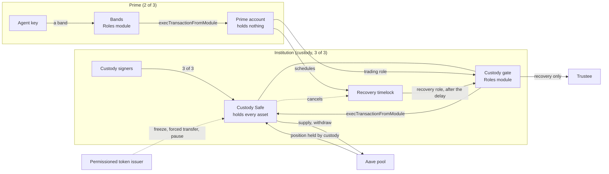

# STRIDE threat model: Prime on EVM, configuration only

**Date:** 27 October 2026.
**Tree:** Prime on EVM deploys no contract of ours ([docs/evm.md](../docs/evm.md)). What is in scope is configuration on existing contracts: a Safe as the custody account, a Zodiac Roles v2.1.1 module as the custody gate, a second Safe with its own Roles module as the Prime account, an OpenZeppelin TimelockController for recovery, and the Roles scopings that are the policy. The sources each row cites are read at the versions below.
**Network:** Base Sepolia (chain 84532) only. There is no mainnet version. Every key in a run is a throwaway; nothing was sent to mainnet. The fork work ran against the live Base Sepolia contracts through a public RPC on 27 October 2026.
**Sources, at their versions:** Safe at tag `v1.4.1` (`safe-global/safe-smart-account`, `contracts/`), the same checks also run on Safe `v1.5.0`; Zodiac Roles v2.1.1 at `218a5164` (`gnosisguild/zodiac-modifier-roles`, `packages/evm/contracts/`); OpenZeppelin TimelockController 5.6.0 (npm `@openzeppelin/contracts@5.6.0`, `contracts/governance/TimelockController.sol`). The deployed Base Sepolia mastercopies were matched to these by address against `safe-deployments` and `mastercopies.json` (see section 6.9), and on 27 October 2026 byte for byte against a local build of each source: Safe 1.4.1 and Roles v2.1.1 match ([build-hash-match.md](build-hash-match.md), T-14).

**A word on evidence:** the custody-Safe shape here (a Prime Safe calling the custody gate, whose trading role pins the venue calls, into Aave) runs end to end on a fork of Base Sepolia, and the fork work both makes the allowed move and refuses every attack below with the exact Safe or Roles status. A separate live Base Sepolia run of 29 September 2026 exercised the related custody-at-a-plain-address shape against the real Aave v3 pool and Uniswap router. The two foundations:

- **The configuration check** ([`scripts/evm-config-check/test/ConfigOnly.t.sol`](../scripts/evm-config-check/README.md)) deploys only existing code on a fork and makes 55 checks per Safe version; its moves and refusals are cited as `[fork:<line>]` against that file, run 27 October 2026 ([log](../scripts/evm-config-check/run-2026-10-27.txt)).
- **The STRIDE attack cases** in the same file (`test_stride_safe141`, `test_stride_safe150`) extend the check with the proof-of-concept attacks for this model: 26 checks per Safe version, cited as `[fork:<line>]`, run 27 October 2026 ([log](../scripts/evm-config-check/run-stride-2026-10-27.txt)).
- **The live testnet run** of 29 September 2026 (the plain-address shape) is cited as `[testnet]`, from `docs/evm.md` "What has been run" and `deployments/evm-testnet.json`.
- **The build-hash match** of 27 October 2026 compares each deployed Safe and Roles runtime with a local build of its source; it is cited as `[build-hash]` ([build-hash-match.md](build-hash-match.md)).
- A row with only a source behind it is cited `[src]` at file and line, and its status says so.

**Two shapes, and where each is modelled:** sections 1 to 10 model the shape `test/ConfigOnly.t.sol` builds, where the Prime account is the gate's trading member and calls the gate directly, with no wait on a move. The design `docs/evm.md` now describes (design B) keeps that fence and puts a move timelock in front of it: a second OpenZeppelin TimelockController, `TLx`, becomes the gate's one trading member, and every move is scheduled, waits, and then runs. [Section 11](#11-the-move-timelock-delta-design-b) is the delta for that timelock, with its own fork evidence from the reference-line harness (`test/RefLine.t.sol`, `test/StrideTimelock.t.sol`); the earlier sections stand unchanged, and the gate, the bands, custody's cap, recovery and the stop paths carry their findings into design B.

Every threat has one ID by STRIDE category: `S-` spoofing, `T-` tampering, `R-` repudiation, `I-` information disclosure, `D-` denial of service, `E-` elevation. The tables give the control at file and line, how it was checked, and a status:

| Status | Meaning |
|---|---|
| Holds | the control exists at the cited line and a check matched it on the fork (a move ran, or an attack was refused with the stated status) |
| Holds (source) | the control exists at the cited line and was read in source; no fork run of this exact case |
| Gap | a documented limit of configuration on Safe and Roles; a fork case shows it, and section 8 lists it with the compensating step |
| Open | a gap with the severity given; section 8 lists every open item |
| Accepted | a residual kept on purpose, with the reason in section 9 |
| By design | the behaviour is the feature; the docs state it |

## 1. Scope

**In scope (configuration, nothing we wrote):**

| Artifact | What it is | Where |
|---|---|---|
| Custody Safe | a Safe 1.4.1 or 1.5.0, custody's three signers, threshold 3 of 3, no fallback handler and no other module; holds every asset and position | on chain; Safe `contracts/` |
| Custody gate | a Zodiac Roles v2.1.1 module on the custody Safe, whose owner, avatar and target are the custody Safe; a trading role and a recovery role | on chain; Roles `packages/evm/contracts/` |
| Trading-role scoping | the gate's rules for the Prime account: approve the pool capped, supply on behalf of custody within a daily cap, withdraw to custody | on chain; the gate's events |
| Recovery-role scoping | the gate's rules for the timelock: transfer or withdraw to the trustee only | on chain; the gate's events |
| Recovery timelock | an OpenZeppelin TimelockController 5.6.0, proposer the Prime account, cancellers the Prime account and custody, executor open, self-administered | on chain; OZ `TimelockController.sol` |
| Prime account | a Safe with 3 owners, any 2 approve, holds nothing; its own Roles module holds the agent's bands | on chain |
| The bands | the Prime account's Roles scoping for the agent: the gate call, the inner selector and arguments, the amount band, the daily cap and the role key | on chain; the bands module's events |
| The asset | a token; where it is permissioned, its issuer's ERC-3643 controls | on chain; the issuer's token |
| The venue | an Aave v3 market, USDC | on chain; Aave |

**Out of scope, with the trust placed in each:**

- **Safe 1.4.1 and 1.5.0:** the self-authorization guard, the module path, `checkNSignatures`, owner and module management, and the guard hook behave as the source reads. Audits: Ackee audited Safe core 1.4.0, and Safe and the auditors agreed the one ERC-4337 opcode fix in 1.4.1 needed no new audit; Certora and Ackee audited 1.5.0. Upgradeable only by a Safe changing its own singleton, a 3-of-3 self-call here.
- **Zodiac Roles v2.1.1 mastercopy and its Integrity and Packer libraries:** membership, target and function clearance, the condition tree, allowances and the unwrapper behave as the source reads. Audits cover v2 (G0 Group and Omniscia, 2023) and v2.1 (Omniscia and G0 Group, November 2023); v2.1.1 (June 2026) is v2.1 with three fixes, including the EIP-1271 and `Bitmask` ones. Each gate and bands module is an ERC-1167 proxy to the one mastercopy; a proxy has no admin and no upgrade path (section 6.9).
- **OpenZeppelin TimelockController 5.6.0:** the role model, the delay, the hash and the schedule, execute and cancel paths behave as the source reads. OpenZeppelin's reports cover the 5.x changes; Certora verified TimelockController formally at v4.4.0.
- **The issuer's permissioned token (ERC-3643 or similar):** its identity registry, compliance, freeze, forced transfer, recovery and pause behave as its own code and audits say. Prime adds no contract to the token (section 6.5).
- **The venues (Aave, any swap router):** their accounting, health and liquidation behave as their own code and audits say. Aave can upgrade its pool through its own governance; a stablecoin issuer such as Circle can freeze its token (section 6.7).
- **Off-chain helpers:** the Prime app that writes and reads back the scopings, Gnosis Guild's `zodiac-roles-sdk` and the Roles app, and any co-signer. None holds custody's funds; they are trusted only for what section 6.6 states, and the chain never relies on a pre-sign check.
- **RPC providers and wallets:** an RPC answers truthfully about the chain; a wallet signs only what it shows (section 6.6).

## 2. Assets

| ID | Asset | Where it lives |
|---|---|---|
| A1 | Custody's funds and its venue position | token accounts and an Aave position owned by the custody Safe |
| A2 | The trading-role scoping: targets, selectors, the condition tree, the daily cap, the member (the Prime account) | the gate's storage and events |
| A3 | The recovery-role scoping: the trustee pin and the member (the timelock) | the gate's storage and events |
| A4 | The custody Safe's own settings: owners, threshold 3, enabled modules, the absence of a fallback handler | the custody Safe |
| A5 | A band: the pinned gate call, the inner selector and arguments, the amount band, the agent's daily cap, the role key, `shouldRevert` | the bands module's storage and events |
| A6 | The timelock's roles and delay: proposer, cancellers, open executor, the self-held admin | the TimelockController |
| A7 | The permissioned token's authorities: identity registry, compliance, freeze, forced transfer, recovery, pause | the issuer's token |
| A8 | The unsigned Safe transaction and the wallet's rendering of it | the owner's wallet |
| A9 | Availability: the kill switch's path to the chain, the venue's liveness | Base; the venue |

## 3. Actors

| Actor | Trust | What it controls |
|---|---|---|
| Custody's signers (MPC key, a second signer, a trusted third party) | Fully trusted at their 3-of-3; none alone | together, anything on the custody Safe: its rules, its owners, its modules, the release of its funds. Alone, nothing |
| Prime owners (three signers, any two) | Trusted for the agent's mandate | the Prime account's bands and settings, scheduling and cancelling a recovery, using the trading role directly within custody's pins and cap |
| Agent (a member of a Prime band) | Untrusted after install | only the band it holds, and the call arguments the band leaves open |
| Recovery timelock | A contract, trusted only to delay and to pay the trustee | after the delay, the recovery-role calls the gate allows |
| Issuer (holds the permissioned token's authorities) | Trusted for the whitelist and the token's controls | registry, compliance, freeze, forced transfer, recovery, pause |
| Venue (Aave, a swap router) | Trusted to run as audited and to govern its own upgrades | the pool's accounting, health and liquidation |
| Relayer / submitter / fee payer | Untrusted for funds | submits a transaction once the signatures are in; holds no key that matters |
| RPC provider | Untrusted for integrity | every read and simulation |

## 4. Trust boundaries

- **TB1, a single custody key to the custody Safe:** one custody key signs no change and moves nothing; only the 3-of-3 changes the Safe or its modules.
- **TB2, any external caller to the custody Safe's module path:** only an enabled module drives the Safe with no owner signature; every other caller is refused (`GS104`).
- **TB3, the Prime account to the custody gate:** the Prime account reaches custody's funds only as the trading role's member, and only through the calls the role lists, each with its recipient pinned to the custody Safe.
- **TB4, the gate to the custody Safe's own settings:** the gate's roles list neither the custody Safe nor the gate as a target, so no role can make the Safe change its own owners or modules; owner management is a self-call only (`GS031`).
- **TB5, the owner of a Roles module to its rules:** only the module's owner writes its scopings, caps and unwrappers (`onlyOwner`); custody owns the gate, the Prime account owns the bands.
- **TB6, the agent to a band:** every call argument the band leaves unpinned is the agent's choice.
- **TB7, the Prime account to the timelock, and the timelock to the gate:** the Prime account proposes and either party cancels; after the delay anyone executes, and the gate still pins the recovery to the trustee.
- **TB8, the token to its holder:** a permissioned token moves only between holders its issuer has verified, and the issuer can freeze, force-transfer, recover or pause.
- **TB9, the venue to its own governance:** the venue can upgrade or pause under its own rules, outside custody's control.
- **TB10, the owner to the unsigned transaction:** what an owner signs is the wallet's rendering; the pre-sign check `evm_review` reads the same bytes off chain and gives the hash the owner signs.

## 5. Data flow

A supply in the low band: the agent signs the band; the bands module runs the batch as the Prime account, which calls the gate with the trading role; the gate checks the call against the trading-role scoping and custody's daily cap, then makes the custody Safe approve and supply; the position is custody's. Any failing step reverts the whole batch, because the band pins `shouldRevert = true`.

## 6. Threats per component

### 6.1 The custody Safe and the module path

The custody Safe holds every asset. It changes only at its 3-of-3, and it runs a module's call with no signature, so the fence is which module is enabled and what that module (the gate) allows.

| ID | STRIDE | Threat | Control | Verified | Status |
|---|---|---|---|---|---|
| S-01 | S | Someone who is not an enabled module drives the Safe through the module path | the module path refuses any caller that is not an enabled module (`ModuleManager.sol:88`, `GS104`) | `[fork:775]` a stranger calling `execTransactionFromModule` on custody is refused `GS104` | Holds |
| S-02 | S | A single custody signer, or a stranger, changes the Safe's owners or threshold | owner and threshold management is a self-authorized call, so only the Safe itself (its signers at the 3-of-3) makes it (`SelfAuthorized.sol:10`, `GS031`); `checkNSignatures` enforces the threshold (`Safe.sol:274`) | `[fork:779]` a stranger calling `addOwnerWithThreshold` on custody is refused `GS031`; `[fork:700]` two of three custody signers are refused | Holds |
| T-01 | T | A role makes the Safe change its own owners or modules (a module can make the Safe call itself) | the gate's roles list neither the custody Safe nor the gate as a target, so no trading or recovery call reaches the Safe's own settings; a target the role has not scoped is refused (`PermissionChecker.sol:178`, `TargetAddressNotAllowed`) | `[fork:593]` a call to the custody Safe through the gate is refused with the target status; `[fork:595]` a call to the gate through the gate likewise | Holds |
| E-01 | E | The Safe runs with a fallback handler or a second module that widens the surface | the setup enables only the gate and sets no fallback handler; a new module is itself a 3-of-3 change | `[fork:527]` the gate is the enabled module and is wired to custody as owner, avatar and target; `[src]` `docs/evm.md` "the setup", no fallback handler | Holds (source) |
| D-01 | D | The custody Safe is bricked, or a lost-key custody cannot recover | recovery runs through the timelock and the recovery role, paying the trustee; custody can also cancel it (section 6.3) | `[fork:647]` a recovery runs after the delay and pays the trustee | Holds |

### 6.2 The custody gate: the trading-role scoping

The trading role is the Prime account's reach into custody's funds. It lists the calls custody allows and pins every recipient to the custody Safe; its daily cap counts every supply, whoever starts it. Lines are in Roles unless noted.

| ID | STRIDE | Threat | Control | Verified | Status |
|---|---|---|---|---|---|
| S-03 | S | A move sends funds or a position to someone other than custody | `supply`'s `onBehalfOf` is `EqualToAvatar`, which the module resolves to the custody Safe, and `withdraw`'s `to` is pinned to it (`PermissionLoader.sol:59-63`); a mismatch is refused (`PermissionChecker.sol`, parameter status) | `[fork:579]` supply on behalf of a stranger refused; `[fork:581]` withdraw to a stranger refused | Holds |
| T-02 | T | A call the role never listed reaches custody's funds | a target the role has not scoped is refused (`:178`, `TargetAddressNotAllowed`); on a scoped target a selector the role does not list is refused (`:132`, `FunctionNotAllowed`); delegatecall and sending ETH are off unless turned on | `[fork:583]` a plain transfer refused with the function status; `[fork:587]` an aUSDC transfer refused with the target status; `[fork:589]` a borrow refused with the function status; `[fork:591]` a delegatecall refused | Holds |
| T-03 | T | An approval goes to a spender other than the pool, or above its per-call cap | the approve scoping pins the spender to the pool and the amount under the per-approval ceiling (`PermissionBuilder.sol:133`, `scopeFunction`) | `[fork:585]` an approval to a stranger refused with the parameter status | Holds |
| E-02 | E | The daily cap is exceeded, by the agent or by the Prime owners directly | `supply`'s amount is bound to an allowance that refills per period (`AllowanceTracker.sol:20-45`); a call over the remaining budget is refused (`PermissionChecker.sol:704`, `AllowanceExceeded`) | `[fork:610]` custody's daily cap is reached even for the Prime owners; `[fork:568]` the agent's own cap is reached | Holds |
| T-04 | T | The gate's rules are changed by someone other than custody | every scoping, cap and membership call is `onlyOwner`, and the owner is the custody Safe (`PermissionBuilder.sol:57-156`, `Roles.sol:69`) | `[fork:783]` a stranger scoping a gate target refused `OwnableUnauthorizedAccount`; `[fork:786]` a stranger raising the cap refused the same; `[fork:600]` the Prime account changing the gate refused | Holds |
| T-05 | T | Calldata after the last checked argument changes the call the venue sees | a Roles condition reads only up to the last parameter it pins; trailing calldata is not seen, so a venue that reads `msg.data.length` or the last bytes of calldata sees a different call | `[fork:802]` a supply with 32 bytes of trailing calldata still passes the gate; the Aave pool's ABI decoder drops them, so the move is unchanged here | Gap |
| T-06 | T | Revoking a target leaves its function scopes, so re-scoping re-opens the old calls | `revokeTarget` and `scopeTarget` reset only the target's clearance; the function scopes stay stored and return when the target is scoped again (`PermissionBuilder.sol:72-97`) | `[fork:810]` a supply is refused with the target status after `revokeTarget`; `[fork:816]` the same supply passes again after `scopeTarget`, with no function re-added | Gap |
| E-03 | E | An unwrap adapter is registered that splits a batch before it is checked | `setTransactionUnwrapper` is `onlyOwner`, so only custody registers one on the gate (`Periphery.sol:21-28`); a reader of the rules must count any adapter | `[fork:790]` a stranger registering an adapter refused `OwnableUnauthorizedAccount`; `[fork:794]` the Prime account registering one refused the same | Holds; the reader duty is E-11 |
| E-04 | E | A sibling of an `Or` or `And` uses a different parameter layout, so a rule means less than it reads | every child of an `And` or `Or` must share one parameter layout, enforced when the scoping is written (`Integrity.sol:256-299`); a band with calls of two layouts gives each its own gate entry point or its own band | `[src]` the bands here split the two layouts across `execTransactionWithRole` and `execTransactionWithRoleReturnData` (`test/ConfigOnly.t.sol:447-482`) | Holds (source) |
| I-01 | I | A rule cannot read a price, a balance or another contract's state, so a check that needs one cannot be written as configuration | every Roles condition compares the call's own data with constants; a market or balance check needs `Custom`, which calls a contract of ours, and none is used | `[src]` `docs/evm.md` "Limits"; `Types.sol:21-78` lists the operators, none of which reads external state except `Custom` | Accepted |

### 6.3 The recovery role and the OpenZeppelin TimelockController

The timelock delays recovery and pays the trustee. The Prime account proposes, both the Prime account and custody cancel, anyone executes after the delay, and the timelock administers itself. Lines are in OZ `TimelockController.sol` and Roles.

| ID | STRIDE | Threat | Control | Verified | Status |
|---|---|---|---|---|---|
| S-04 | S | Someone other than the Prime account schedules a recovery | `schedule` is `onlyRole(PROPOSER_ROLE)`, and only the Prime account holds it (`TimelockController.sol:271`) | `[fork:624]` a stranger cannot schedule; `[fork:824]` the Prime account holds the proposer role, `[fork:826]` custody does not | Holds |
| T-07 | T | A recovery runs before the delay | `execute` reverts until the operation is ready (`TimelockController.sol`, `isOperationReady`) | `[fork:629]` a recovery before the delay is refused | Holds |
| E-05 | E | A recovery pays an address other than the trustee | the recovery-role scoping pins the transfer and withdraw recipient to the trustee; the gate refuses any other, even after the delay | `[fork:661]` a scheduled recovery to a stranger is refused by the gate when it runs | Holds |
| S-05 | S | A stranger cancels a pending recovery, or custody cannot | `cancel` is `onlyRole(CANCELLER_ROLE)`; both custody and the Prime account hold it, a stranger does not (`TimelockController.sol`, the canceller role) | `[fork:836]` a stranger cannot cancel `AccessControlUnauthorizedAccount`; `[fork:633]` custody cancels; `[fork:839]` the Prime account cancels its own; `[fork:822-823]` both hold the canceller role | Holds |
| E-06 | E | The timelock's delay or roles are changed without the delay, or an admin key lingers | the timelock administers itself, so a change to its delay or roles also waits the delay and custody can cancel it; custody renounced the admin role at setup | `[fork:820]` custody no longer holds the admin role, `[fork:821]` the timelock holds it; `[fork:669]` a direct call to shorten the delay is refused | Holds |
| D-02 | D | The open executor lets anyone run a recovery, or none runs it | the executor role is open, so recovery does not depend on one key; after the delay any address runs it | `[fork:825]` the executor role is open (held by the zero address); `[fork:647]` a stranger runs the recovery after the delay | Holds; by design |
| R-01 | R | A recovery leaves no trace to reconcile | every schedule, cancel and execute emits an event, and every custody move is a Safe and Roles event | `[src]` `TimelockController.sol` `CallScheduled`, `Cancelled`, `CallExecuted`; `docs/evm.md` "Policies" | Holds (source) |

### 6.4 The Prime account and the agent's bands

The Prime account is a 2-of-3 Safe holding nothing; a band is a role whose member is the agent, pinning the gate call, the inner selector and arguments, the amount band, the agent's daily cap, the role key and `shouldRevert`.

| ID | STRIDE | Threat | Control | Verified | Status |
|---|---|---|---|---|---|
| S-06 | S | A non-member uses a band | the bands module refuses a caller that is not a member of the role (`PermissionChecker.sol:31,36`, `NoMembership`) | `[fork:575]` a stranger on the band is refused | Holds |
| S-07 | S | The agent votes on the Prime account, or signs a move the band does not cover | the agent is a band member only; a Safe decision needs 2 of 3 owner signatures (`Safe.sol:274`) | `[fork:849]` a Safe transaction with the agent's one signature is refused (`GS020`, one signature cannot meet the 2-of-3 threshold) | Holds |
| T-08 | T | The agent supplies above its band, another asset, another target, or a call its band does not list | the band pins the amount under the per-move ceiling, the asset, the target and the inner selector (a `Bitmask` beside a `Matches`); a mismatch is refused with its status | `[fork:550]` over the band refused (greater-than status); `[fork:552]` another asset refused (parameter status); `[fork:555]` another target refused; `[fork:556]` a withdraw padded to supply's layout refused (bitmask status) | Holds |
| E-07 | E | The agent spends past its daily cap, or the cap never refills | the inner amount is bound to the agent's allowance, which refills per period (`AllowanceTracker.sol:20-45`) | `[fork:568]` the agent over its daily cap is refused; `[fork:571]` the cap refills after a day | Holds |
| E-08 | E | A failing step in the agent's batch half-executes, leaving an approval or a partial move | the band pins `shouldRevert = true`, so a failing step reverts the whole batch; the bands module splits a `multiSend` and checks each call (`Periphery.sol:21-28`, `PermissionChecker.sol:72-105`) | `[fork:538]` the agent's two-call batch runs atomically; `[src]` `test/ConfigOnly.t.sol:455` pins `shouldRevert = true` | Holds |
| S-08 | S | A band never expires, so a stale agent keeps its reach | membership is a standing flag; an agent holds its band until the Prime owners revoke it (`Roles.sol:69`) | `[src]` `docs/evm.md` "Limits"; the review sets the revoke step (section 8) | Open, Medium |

### 6.5 Permissioned assets: the issuer's ERC-3643 controls

A permissioned token carries its own controls, set by its issuer under ERC-3643 (or a similar controller standard). Prime adds no contract to the token; it registers the custody Safe and the venue addresses, and the scopings decide which issuer functions the Prime account may call. No permissioned token was deployed on the fork, so these rows are source reads and configuration facts.

| ID | STRIDE | Threat | Control | Verified | Status |
|---|---|---|---|---|---|
| S-09 | S | A holder outside the issuer's registry sends or receives the asset | a transfer needs both wallets in the identity registry, verified against the issuer's claims, neither frozen, the token unpaused, and the compliance rules passed (ERC-3643) | `[src]` `docs/evm.md` permissioned-assets rows 1, 6, 9; the issuer's token | Holds (source) |
| E-09 | E | The asset must be clawed back or stopped | the issuer's own freeze, partial freeze, forced transfer, recovery and pause act with no change on Prime's side | `[src]` `docs/evm.md` row 4; the issuer's token | Holds (source) |
| T-09 | T | The Prime account calls an issuer function it should not, or with the wrong argument | a band or trading rule pins the issuer's contract, the selector and any argument, dynamic and nested ones included; the same scoping machinery proven for the venue calls applies | `[fork:552-556]` the selector-and-argument pinning (`Bitmask` + `Matches` + parameter conditions) is the same mechanism the bands use against the pool | Holds (by analogy) |
| I-02 | I | A limit that depends on the issuer's state (NAV, lifecycle, a jurisdiction) cannot be written as configuration | a scoping reads no external state; such a limit needs the issuer's own compliance rules or a `Custom` contract | `[src]` `docs/evm.md` rows 3, 6, 7, 10 | Accepted |
| D-03 | D | The issuer freezes or pauses, stopping custody's own moves and recovery | inherent to a permissioned asset; while the issuer freezes an account or pauses the token, moves and recovery from it fail | `[src]` `docs/evm.md` row 10; the issuer's token | Accepted |
| S-10 | S | A permissioned venue is not verified by the issuer, so a move into it fails or leaks the asset | the issuer must verify each venue and liquidator address that holds the token; configuration adds no notice or cure period | `[src]` `docs/evm.md` rows 10, 11, "Limits" | Open, Medium (operational) |

### 6.6 Off-chain helpers: the SDK, the config builder and the reader

The Prime app writes the scopings and reads them back from the module's events; Gnosis Guild's `zodiac-roles-sdk` builds and shows them. None holds custody's funds, and the chain never relies on a pre-sign check.

| ID | STRIDE | Threat | Control | Verified | Status |
|---|---|---|---|---|---|
| T-10 | T | An owner signs a transaction that does more than the wallet shows | `evm_review` (`packages/policy-synth`) reads an unsigned Safe transaction from its bytes alone, with no RPC: the EIP-712 hash the owners sign, each call of a MultiSend batch, and every scoping, cap, member and unwrapper it writes. With `readChain` (opt-in, the operator's test-network RPC, one block) it also reads the Safe's owners, threshold, modules, guard and fallback handler after the batch, each Roles module's owner, avatar, target and MultiSend unwrap adapters, the clearance and function scopes stored for the roles, targets and functions the batch names (an open target or an under-read scope left live is a problem), allowances, members, each timelock's delay and roles, and an ERC-3643 token's identity and freeze state for the Safe. Roles keeps no index of a role's targets, so a stored scope on a target the batch does not name, nor `targets`, stays unseen | `evm.test.ts`: the fork check's two configuration batches rebuilt byte for byte and judged signable, with the hashes the live Safe 1.4.1 computed on the fork; `evm-chain.test.ts`: the move-timelock setup on a local Base Sepolia fork in ten states, recorded: a correct state passes, and an open target, a live `allowFunction`, a dormant one a `scopeTarget` revives, a loosened band, a key module, custody at 2 of 3, a kept timelock admin, a foreign unwrapper and a frozen, unverified custody on an ERC-3643 token are each caught | Open, Low |
| E-10 | E | The SDK builds a scoping that reads differently from what the owner intended (an open target, an empty condition, a wrong layout) | `evm_review` flags an open target (`allowTarget`), any arguments (`allowFunction`), a tree that constrains nothing, a `Matches` whose children differ from the function's ABI, a band's inner call with no selector `Bitmask`, a recipient not pinned to the avatar and calldata past the last argument (T-05), and warns on a `revokeTarget` without its functions (T-06) | `[fork:802,816]` the concrete cases; `evm.test.ts` builds each as a change to the fork check's batch and sees it flagged or warned | Open, Medium |
| E-11 | E | The reader misses an unwrap adapter and under-reports what a batch can do | an adapter is an owner setting on the module (`Periphery.sol:21-28`); the reader must enumerate adapters as part of the rules | `[fork:790,794]` only the owner can register one, so the set is bounded and readable from the owner's own transactions | Open, Medium |
| S-11 | S | The relayer or app substitutes a different transaction | an owner's wallet renders and signs the Safe hash; the relayer and app hold no custody funds and the chain never relies on them (`Safe.sol:274`) | `[src]` `docs/evm.md` "Owners" | Accepted |

### 6.7 The venues

| ID | STRIDE | Threat | Control | Verified | Status |
|---|---|---|---|---|---|
| T-11 | T | A move reaches a venue the role never listed | the trading role scopes only the pool and the asset; any other target is refused | `[fork:587]` an aUSDC transfer refused with the target status; `[testnet]` 48 refused attempts on the live run, including a pull to the Prime account | Holds |
| D-04 | D | The venue upgrades its pool or pauses, changing or stopping a move | the venue governs its own upgrades; Aave's pool is upgradeable through Aave governance, and a stablecoin issuer can freeze its token | `[src]` `docs/evm.md` "Limits", "The venues are trusted" | Accepted |
| I-03 | I | A swap's minimum output or a health check cannot read the market, so it floors at a constant | a Roles condition reads no price; a swap's minimum output has a floor and no market check, and a limit relative to collateral value cannot be written | `[src]` `docs/evm.md` "Limits"; `[testnet]` the live run's swap pinned a minimum output above zero | Accepted |
| S-12 | S | The venue opens the position in someone else's name | custody's calls pin `onBehalfOf` and the recipient to the custody Safe, so the position and every withdrawal are custody's | `[fork:542]` after the move custody holds the aUSDC and the Prime account holds nothing | Holds |

### 6.8 The kill switch and the stop paths

Each stop is one transaction of the Safe concerned. The Prime account cannot undo any of custody's.

| ID | STRIDE | Threat | Control | Verified | Status |
|---|---|---|---|---|---|
| E-12 | E | The agent or the Prime owners keep trading after custody pulls the trading role | `assignRoles(prime, [trading], [false])` removes the member; a later call is refused `NoMembership` | `[fork:675]` custody revokes the trading role; `[fork:678]` the agent is stopped; `[fork:680]` the Prime owners are stopped | Holds |
| E-13 | E | A move runs after a full stop, or a scheduled recovery runs | `disableModule` on the custody Safe stops trading and recovery; a scheduled recovery then fails on the module path (`GS104`) | `[fork:683]` custody disables the gate; `[fork:693]` a recovery cannot run while the gate is off | Holds |
| D-05 | D | The budget cannot be dropped quickly | `setAllowance` with the balance and refill at zero stops every supply at once | `[fork:867]` after the cap is set to zero, a supply is refused with the allowance status | Holds |
| D-06 | D | Base's sequencer delays custody's kill switch | a Safe transaction is an EOA transaction; if the sequencer stalls, the owner forces it through Base's L1 portal on Ethereum, up to about 12 hours later | `[src]` `docs/evm.md` "Limits"; the sequencer path sits outside a fork (D-06, section 8) | Open, Medium |

### 6.9 Upgrade authorities and supply chain

| ID | STRIDE | Threat | Control | Verified | Status |
|---|---|---|---|---|---|
| T-12 | T | A Roles module is upgraded under the Prime, changing every rule's meaning | each gate and bands module is an ERC-1167 minimal proxy to the one Roles v2.1.1 mastercopy; a minimal proxy has no admin and no upgrade path, so the code is fixed at the mastercopy | `[fork:852-855]` the gate and the bands module are each a 45-byte minimal proxy whose runtime hard-codes the mastercopy `0xF2964CE6…283D5` | Holds |
| T-13 | T | The Safe singleton or mastercopy address is not the audited one | the setup uses the canonical addresses; they match `safe-deployments` v1.4.1 and v1.5.0 and `mastercopies.json` v2.1.1 at `218a5164` | `[src]` `docs/evm.md` "Contracts and their audits", `deployments/evm-testnet.json`; the fork deploys proxies of exactly these singletons | Holds (source) |
| T-14 | T | The deployed Base Sepolia runtime differs from the source read here | a local build of each source compared byte for byte with the deployed runtime: Safe 1.4.1 at `v1.4.1` (SafeL2, SafeProxyFactory, MultiSend, MultiSendCallOnly, CreateCall) and Roles v2.1.1 at `218a5164` (mastercopy, Integrity, Packer, unwrapper); the init code of each also gives its deployed address through its `CREATE2` factory. Safe 1.5.0 matches Safe's published code hashes. Each TimelockController is made by a Prime's setup, so it has no fixed deployment to compare | `[build-hash]` [build-hash-match.md](build-hash-match.md), 27 October 2026: 9 of 9 match; `[fork]` the behaviour of every control matched on the fork against the live contracts | Holds (Safe, Roles); the timelock instances are a setup check |
| T-15 | T | The issuer upgrades its permissioned token, changing a function a scoping pins | re-read the token's functions and any pinned offsets after each issuer upgrade | `[src]` `docs/evm.md` "Permissioned assets" | Open, Medium |
| S-13 | S | The Zodiac `ModuleProxyFactory` or `Permit2` adds an unaudited route | neither is used; modules are deployed through Safe's `CreateCall`, and `Permit2` is left out because it adds signature routes out of custody | `[src]` `docs/evm.md` "Not used, and why" | Holds (source) |

## 7. On-chain and fork evidence on Base Sepolia

Two foundations sit behind the tables.

**The fork work (`[fork:<line>]`), run 27 October 2026:** on a fork of Base Sepolia against the live Safe, Roles and Aave contracts, with OpenZeppelin TimelockController 5.6.0 from npm, `scripts/evm-config-check/test/ConfigOnly.t.sol` builds the whole design and runs it on Safe 1.4.1 and Safe 1.5.0:

- **The base check:** 55 checks per Safe version ([run-2026-10-27.txt](../scripts/evm-config-check/run-2026-10-27.txt)). The agent's batch supplies 10 and custody holds the aUSDC; the band's top, the agent's cap and refill, and custody's cap hold; a long list of attacks is refused, each with its Roles or Safe status; recovery is scheduled, cancelled by custody, run by a stranger after the delay, and refused before it and for a stranger's address; the stop paths hold. Six altered configurations each fail the check.
- **The STRIDE attack cases:** 26 checks per Safe version ([run-stride-2026-10-27.txt](../scripts/evm-config-check/run-stride-2026-10-27.txt)), `test_stride_safe141` and `test_stride_safe150`. The attacks and the status each returned:

| Attack | Line | Result |
|---|---|---|
| A stranger drives the custody Safe through the module path | `:775` | refused `GS104` |
| A stranger adds a custody owner directly | `:779` | refused `GS031` |
| A stranger scopes a gate target | `:783` | refused `OwnableUnauthorizedAccount` |
| A stranger raises custody's daily cap | `:786` | refused `OwnableUnauthorizedAccount` |
| A stranger registers an unwrap adapter | `:790` | refused `OwnableUnauthorizedAccount` |
| The Prime account registers an unwrap adapter | `:794` | refused `OwnableUnauthorizedAccount` |
| A supply with trailing calldata | `:802` | passes the gate (gap T-05) |
| A supply after `revokeTarget` | `:810` | refused `ConditionViolation(2)` TargetAddressNotAllowed |
| A supply after re-`scopeTarget`, no function re-added | `:816` | passes, the old scope returns (gap T-06) |
| A stranger cancels a scheduled recovery | `:836` | refused `AccessControlUnauthorizedAccount(stranger, CANCELLER_ROLE)` |
| The Prime account cancels its own recovery | `:839` | allowed (canceller role) |
| A Safe transaction with the agent's one signature | `:849` | refused `GS020` (below the 2-of-3) |
| A supply once custody's cap is zero | `:867` | refused `ConditionViolation(17)` AllowanceExceeded |

Read-only evidence in the same run: custody holds the canceller role and not the admin role, the timelock administers itself, and the executor role is open (`:820-826`); the gate and the bands module are each a 45-byte minimal proxy pointing at the Roles v2.1.1 mastercopy (`:852-855`).

**The live testnet run (`[testnet]`), 29 September 2026:** the related custody-at-a-plain-address shape ran on Base Sepolia against the real Aave v3 pool, Uniswap v3 router, Safe, Roles and OpenZeppelin contracts: state read back 43 of 43 at first deployment and 20 of 20 after recovery moved to the timelock, four moves (an agent supply, a swap, a withdraw and a shared-account supply), the daily caps refusing moves over them, 48 refused attempts, a recovery that ran after the delay, a cancelled one that never ran, and a full stop that blocked it. Addresses in `deployments/evm-testnet.json` (`docs/evm.md` "What has been run").

## 8. Open items

| ID | Severity | Item | What would close it |
|---|---|---|---|
| T-10 | Low | `evm_review` reads the chain only with `readChain` (opt-in), and Roles keeps no index of a role's targets | the Prime app runs `readChain` before every signature and passes `targets` from the module's events |
| E-10 | Medium | The SDK can build a scoping that reads differently from the intent (an open target, an empty condition, a wrong layout) | `evm_review` flags each in the bytes, tested against the T-05 and T-06 cases; a scoping already on chain is read by `readChain` for the roles and targets the batch names (T-10) |
| T-05 | Medium (gap) | Calldata after the last pinned argument passes Roles | target venues that decode arguments with the Solidity ABI decoder; the read-back warns on a venue that reads `msg.data.length` or trailing bytes |
| T-06 | Medium (gap) | `revokeTarget` keeps the function scopes, which return on re-`scopeTarget` | revoke each function before the target, and give unrelated rules their own role key; the read-back counts stored-but-dormant function scopes |
| E-11 | Medium | An unwrap adapter is an owner setting the reader must enumerate | the read-back lists every adapter registered on each module |
| S-08 | Medium | A band never expires | the review sets and tracks a revoke step for each agent band |
| S-10 | Medium (operational) | A permissioned venue must be issuer-verified, and configuration adds no notice period | verify each venue and liquidator address with the issuer; keep the venue's own liquidation rules in view |
| D-06 | Medium | Base's sequencer could delay the kill switch by up to about 12 hours | document the L1-portal force path; measure it on testnet; keep the full stop (`disableModule`) as the backstop |
| T-14 | Low | Safe 1.4.1 and Roles v2.1.1 match their sources byte for byte ([build-hash-match.md](build-hash-match.md)); each TimelockController instance comes from a Prime's setup | the setup's verifier compares each timelock's runtime with the build the setup deploys, and each proxy's implementation address with the mastercopy |
| T-15 | Medium | An issuer upgrade can change a token function a scoping pins | re-read the token's functions and offsets after each issuer upgrade |
| I-01, I-02, I-03 | Accepted | No price, balance or state read without a `Custom` contract | kept out on purpose (no contract of ours); the venue's own health and the issuer's compliance are the backstop |
| D-03, D-04 | Accepted | The issuer can freeze or pause, and the venue can upgrade or pause | inherent to a permissioned asset and a trusted venue |

## 9. Residual and accepted risks

| ID | Residual | Why it stays |
|---|---|---|
| T-05, T-06 | The trailing-calldata and revokeTarget behaviours are documented Roles behaviours | contained by targeting ABI-decoding venues, by revoking functions before targets, and by the read-back; no on-chain guard changes them |
| I-01, I-02, I-03 | No configuration rule reads a price, a balance or another contract's state | by design; a market or state check needs a `Custom` contract, which Prime does not add; the venue's own health and the issuer's compliance are the backstop |
| D-03, D-04 | A permissioned asset can be frozen or paused by its issuer, and a venue can upgrade or pause | inherent to the asset and the venue; both sit outside custody's control |
| D-06 | Base's sequencer sits between custody and the kill switch | an L2 property; the L1 portal is the force path and the full stop is the backstop |
| S-11 | The off-chain app and relayer render and submit, but the owner signs the Safe hash | the chain never relies on them; the residual is the wallet's rendering, which the read-back (T-10) addresses |
| T-13, T-14 | The deployed Safe and Roles contracts match their sources by address, by bytes and by behaviour; a mainnet setup repeats the byte check on its own network | the canonical addresses are the published releases (the review status of each is in `docs/evm.md`, "Contracts and their audits"), the runtime equals a local build of the cited source, and the match on the fork covers the behaviour |

**What the on-chain layer guarantees, for this design's shape:** custody's funds stay in the custody Safe, and a single custody key moves nothing; only the 3-of-3, by a self-call, changes its owners or modules. No role reaches the custody Safe's own settings or the gate's. The trading role moves funds only through the calls custody listed, with every recipient pinned to the custody Safe, under a per-call ceiling and a daily cap that counts the agent and the Prime owners alike. A band reaches only the gate call it pins, and the agent, who is no Safe owner, acts only inside its band and its daily cap. Recovery runs only through the timelock, waits the delay, pays only the trustee, and custody can cancel it; the kill switch and the full stop each take one custody transaction. Each gate and bands module is a minimal proxy to the audited Roles mastercopy, with no upgrade path. The two documented gaps, trailing calldata and the dormant function scope after `revokeTarget`, are contained by the venue choice, the revoke order and the off-chain read-back, the remaining high-priority work.

## 10. Method and evidence

1. **Sources:** each control was read at the version in the header. The load-bearing lines were read directly for this model: Safe's `GS104` on the module path (`ModuleManager.sol:88`) and `GS031` self-authorization (`SelfAuthorized.sol:10`); Roles' `onlyOwner` on every write and `revokeTarget`/`scopeTarget` keeping function scopes (`PermissionBuilder.sol:57-156`, `72-97`), membership and `NoMembership` (`PermissionChecker.sol:31,36`), the target and function status (`:132,178`), the allowance check (`:704`), `EqualToAvatar` (`PermissionLoader.sol:59-63`), the one-layout rule (`Integrity.sol:256-299`) and the unwrapper (`Periphery.sol:21-28`); OZ's proposer, canceller, executor and admin roles and the delay (`TimelockController.sol`).
2. **Fork work:** `scripts/evm-config-check/test/ConfigOnly.t.sol` builds the design on a fork of Base Sepolia and runs the base check (55 per Safe version) and the STRIDE attack cases (26 per Safe version) on Safe 1.4.1 and 1.5.0; every cited `[fork:<line>]` is reproducible with `FORK_URL=https://sepolia.base.org forge test --match-contract ConfigOnlyTest`. The run of 27 October 2026 is in `run-2026-10-27.txt` and `run-stride-2026-10-27.txt`.
3. **The live testnet run:** the related plain-address shape on Base Sepolia, 29 September 2026, `[testnet]`, with its addresses in `deployments/evm-testnet.json` and its summary in `docs/evm.md`.
4. **Provenance:** the deployed contracts are matched by canonical address to `safe-deployments` and `mastercopies.json`, and byte for byte to a local build of each source (`[build-hash]`, [build-hash-match.md](build-hash-match.md)). Every row says whether it rests on the fork, the live testnet run, or a source read.

## 11. The move-timelock delta (design B)

Sections 1 to 10 model the direct shape. Design B keeps every control there and adds a move timelock, `TLx` - an OpenZeppelin TimelockController 5.6.0 - in front of the trading role. `TLx` becomes the gate's one trading member, and the Prime account no longer calls the gate at all. A move is now two transactions a delay apart: the Prime account schedules a gate call on `TLx` (the agent through its band, or the owners at their threshold), and once the delay is over anyone executes it, at which point `TLx` calls the gate and the gate checks it. The agent's band is checked **when the move is scheduled**; custody's cap and the gate's rules are checked **when it runs**. This is the same split the recovery timelock already had (6.3), now on the trading path.

This section covers only what the timelock adds. The gate's scopings, the band's pins, custody's daily cap, the recovery role, the kill switch and the stop paths are unchanged, and their findings (6.1, 6.2, 6.4 to 6.9) carry over; design B only moves the gate's trading member from the Prime account to `TLx`, so the kill switch is now `assignRoles(TLx, [trading], false)` and the Prime account's reach becomes a schedule where it was once a direct call.

**Evidence for this section:** the reference-line harness builds design B in full on a fork of Base Sepolia against the live Safe, Roles and Aave contracts, with two OpenZeppelin TimelockController 5.6.0 instances from npm:

- `[refline:<line>]` - `scripts/evm-config-check/script/RefLine.s.sol`, the `RefLineBase` phases that `test/RefLine.t.sol` runs on the fork (128 checks per Safe version) and that `script/RefLine.s.sol` runs transaction by transaction on a chain. Run 27 October 2026.
- `[tl:<line>]` - `scripts/evm-config-check/test/StrideTimelock.t.sol`, the move-timelock STRIDE proof-of-concept cases, 71 checks per Safe version on Safe 1.4.1 and 1.5.0, run 27 October 2026 ([run-stride-timelock-2026-10-27.txt](../scripts/evm-config-check/run-stride-timelock-2026-10-27.txt)). It builds design B through `RefLineBase.setupLine` and then runs each attack below, every one returning the exact Safe, Roles or TimelockController status.

### 11.1 What the timelock adds

Over the assets and actors of sections 2 and 3:

| ID | Asset | Where it lives |
|---|---|---|
| A10 | `TLx`'s roles and delay: proposer (the Prime account), cancellers (the Prime account and custody), the open executor, the self-held admin, `getMinDelay` | the move TimelockController |
| A11 | the scheduled operations: each pending gate call, its ready time, its predecessor and salt | `TLx` storage and `CallScheduled` events |

| Actor | Trust | What it controls on `TLx` |
|---|---|---|
| Keeper / executor | Untrusted for funds | after the delay, runs any ready operation; holds no role that matters |
| Move timelock `TLx` | A contract, trusted to delay and to hold the trading role | after the delay, the trading-role calls the gate allows |

### 11.2 Threats the move timelock adds

Lines marked `TimelockController.sol` are OpenZeppelin `@openzeppelin/contracts@5.6.0`.

| ID | STRIDE | Threat | Control | Verified | Status |
|---|---|---|---|---|---|
| TL-S1 | S | Someone other than the Prime account, or a single Prime key, schedules a move | `schedule` is `onlyRole(PROPOSER_ROLE)` and only the Prime account holds it; the account is 2 of 3, so one key cannot; the agent reaches `schedule` only through its band, never `TLx` directly | `[refline:1141]` one Prime owner scheduling a move is refused `GS020`; `[refline:772]` the agent on `TLx` directly is refused `AccessControlUnauthorizedAccount`; `[refline:649-651]` the Prime account holds the proposer role and neither custody nor the agent does | Holds |
| TL-S2 | S | A stranger cancels a pending move, or a party who should cannot | `cancel` is `onlyRole(CANCELLER_ROLE)`; both custody and the Prime account hold it, a stranger does not | `[refline:652-653]` both custody and the Prime account hold the canceller role; `[refline:809]` custody cancels an agent move during the wait; `[tl:221]` custody cancels a Prime-scheduled operation | Holds |
| TL-D1 | D | The executor is open: anyone runs a ready move, including one the owner meant to cancel, and a ready move never expires | the open executor is the liveness choice, so no single key gates a move; the owner's lever is `cancel` **during the wait**, before the move is ready; once ready, `execute` has no upper window and runs whenever anyone sends it | `[tl:111]` a stranger runs a ready move with no executor role; `[tl:113,116]` after it runs custody's `cancel` reverts, the operation is `Done`; `[tl:128]` a move still runs a month after it became ready | By design; residual, Low |
| TL-D2 | D | The agent's daily cap is spent when a move is scheduled, so a cancelled move still counts and cannot be re-scheduled that day | the agent's allowance is drawn at `schedule`, inside the band; `TLx.cancel` touches only the operation and leaves the allowance where it stands, so the budget does not refill on a cancel | `[tl:135-150]` five supplies of 10 spend the agent's 50-a-day, custody cancels one, and a sixth the same day is refused `AllowanceExceeded`; `[src]` `docs/evm.md` "Move timelock", "the agent's cap is spent at scheduling" | Accepted, Low |
| TL-E1 | E | Revoking the agent's band stops new schedules but not the moves it already scheduled, so an owner who revokes believes the agent is stopped while a scheduled move still runs | the band is checked at `schedule`; a scheduled operation lives on `TLx` and no longer depends on the band. Revoking it only stops new schedules. To stop a scheduled move, `TLx.cancel` each one, or custody's kill switch (`assignRoles(TLx, [trading], false)`), which fails every move when it runs, scheduled or not | `[tl:170-191]` the agent schedules a move, the Prime owners revoke the band, a new schedule is refused `NoMembership`, and the move scheduled before the revoke still runs after the delay and moves custody's funds; `[refline:1066]` the kill switch does stop a scheduled move (`NoMembership` at execute) | Open, Medium |
| TL-E2 | E | The Prime account, the sole proposer, schedules a self-administered call on `TLx` - `updateDelay` or a role grant - because `TLx` administers itself and the proposer can propose any target | `TLx` renounced custody's admin and administers itself, so `updateDelay` and the role calls are reachable only as a scheduled self-call that still waits the current delay and that custody's canceller can stop; a stranger cannot schedule or call them. A 2-of-3 Prime that is not cancelled over a full delay can set the delay to zero and erase the cancel window for later moves; custody's kill switch is a call on the gate, independent of `TLx`'s delay, and still stops every move at once | `[tl:209-221]` the Prime owners (2 of 3) schedule `TLx.updateDelay(0)` and custody cancels it; `[tl:233-249]` left un-cancelled it runs after the delay and `getMinDelay()` is 0; `[tl:254-264]` with the delay at zero custody's kill switch still refuses a move `NoMembership`; `[refline:859]` a stranger calling `updateDelay` directly is refused `TimelockUnauthorizedCaller`, `[refline:866]` scheduling one is refused `AccessControlUnauthorizedAccount`; `[src]` `evm_review` (`packages/policy-synth`) warns at sign time on a `TLx` schedule whose target is not a gate `execTransactionWithRole` and on a direct `updateDelay`, so the self-administered schedule is visible before a Prime owner signs | Open, Medium |
| TL-T1 | T | A move's salt and predecessor are left open in the band, so a move could be replayed | the operation id is `hash(target, value, data, predecessor, salt)`; `TLx` refuses a second schedule of the same id, so a salt cannot replay a pending or done move. A new salt is a new operation, and each one draws the agent's cap, so a duplicate still fits inside the daily budget. An open predecessor only lets the agent delay its own move behind an unmet one, which moves nothing | `[tl:158-165]` the same salt and call scheduled twice is refused `ModuleTransactionFailed` (the band's `shouldRevert` wraps `TLx`'s `TimelockUnexpectedOperationState`), and a new salt for the same supply is accepted and draws the cap | By design, Low |
| TL-T2 | T | The move the gate checks at execute is not the move that was scheduled: config, allowance or scope changed in between | every check but the band runs at execute, so a move that has become invalid - custody's cap used first, a rule revoked, the kill switch thrown - fails when it runs, with the gate's status. The reverse, a move invalid at schedule that becomes valid at execute, needs custody to loosen its own gate, a 3-of-3 custody action | `[refline:962]` a scheduled supply over custody's cap is refused `AllowanceExceeded` at execute after earlier moves used the cap; `[refline:1066,1073]` scheduled moves fail at execute once the kill switch is thrown; `[src]` `docs/evm.md` "A move is checked when it runs" | Holds; by design |

### 11.3 The cancel window, and how it compares

The timelock's point is the wait: between `schedule` and ready, nothing moves, and either custody or the Prime account can `cancel` a move by its id, or custody can throw the kill switch for all of them. That is a real window the direct shape does not have - in `test/ConfigOnly.t.sol` a move runs the moment the Prime account signs it. On Stellar the equivalent is a stored batch on the execution adapter with a `min_wait`, cancellable by the Prime or the gate's custody ([stride-threat-model.md](stride-threat-model.md) E-15, T-09); on Solana the wait sits on the Prime account or a Prime rule, bypassed only by a synchronous call the host refuses ([stride-solana.md](stride-solana.md) T-06). Design B brings EVM into line with those two.

Two edges are worth stating plainly, because they shape how the window is used:

- **The window is bounded below, and closes at the ready time:** once a move is ready the open executor runs it whenever anyone sends `execute` (TL-D1), so a cancel has to land before the ready time. On Base's current single sequencer, ordering is first-come, so cancelling well ahead of ready is the safe practice; cancelling at the boundary races the keeper. This is the same shape as Stellar's run window, with one difference: OpenZeppelin's TimelockController sets a floor on the wait and no ceiling, so a ready move stays runnable indefinitely (TL-D1), where a Stellar batch has a bounded run window and lapses after it ([stride-threat-model.md](stride-threat-model.md) D-09). A ready EVM move that should not run is a standing liability until it is cancelled or the kill switch drops it.
- **The window only helps a watcher:** nothing on chain forces anyone to look during the wait. The value of design B is that a watcher - custody, the Prime owners, or a monitor on the `CallScheduled` events - has time to cancel; with no watcher, the delay only adds latency. This is the operational condition behind TL-E1 and TL-E2: revoking a band or watching for a delay change both assume someone reads the pending operations.

### 11.4 Open items and residuals the timelock adds

| ID | Severity | Item | What would close it |
|---|---|---|---|
| TL-E1 | Medium | Revoking an agent's band leaves its scheduled moves live | the revoke procedure cancels each of the agent's pending moves (or throws the kill switch); `TLx` exposes only `isOperationPending(id)` for a known id, so listing what is still pending after a revoke is a monitor over its `CallScheduled` events |
| TL-E2 | Medium | The Prime account can schedule `TLx`'s own `updateDelay` or role grants; left un-cancelled over a delay it collapses the cancel window | `evm_review` warns at sign time when a Prime batch schedules a `TLx` target that is not a gate `execTransactionWithRole`, and on a direct `updateDelay`, so the Prime owners see the self-administered call before they sign; custody watches `TLx`'s pending operations and cancels them; the kill switch stays the delay-independent backstop; a non-zero floor on the delay would need a `Custom` timelock, which Prime does not add |
| TL-D1 | Low (residual) | The open executor runs a ready move at will, and a ready move never expires | cancel while the move is still waiting, ahead of the ready time; a monitor on `CallScheduled` flags a move approaching ready; the kill switch drops every scheduled move at once |
| TL-D2 | Low (accepted) | The agent's cap is spent at scheduling and a cancel does not refund it | documented in `docs/evm.md`; the owners plan the agent's cap around it, and a cancelled move is a spent slot for the day |

**What the move timelock changes, for design B's shape:** every move now waits, and the wait is a window where custody or the Prime account can cancel a move by its id, or custody can stop all of them with the kill switch - a lever the direct shape lacks. The proposer is the Prime account at its threshold, so a lone compromised Prime key schedules nothing, and the gate still checks every move when it runs, so the timelock widens no permission: a move `TLx` lets through is still only a move the gate allows. The weaknesses, stated plainly, are that the window closes at the ready time and not at the owner's word, that a ready move does not expire, that revoking a band does not reach the moves already scheduled, and that the proposer can schedule the timelock's own delay down - each contained by cancelling during the wait, watching the pending operations, and custody's kill switch, which is independent of `TLx` and stops every move at once.
