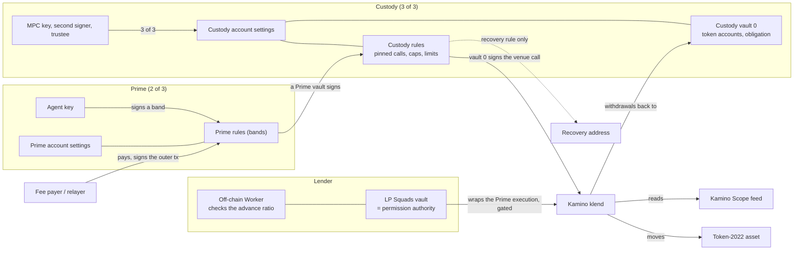

# STRIDE threat model: Prime on Solana, configuration only

**Date:** 27 October 2026.
**Tree:** Prime on Solana deploys no program of ours ([docs/solana.md](../docs/solana.md)). What is in scope is configuration of third-party programs: a Squads Smart Account as the custody gate and a second as the Prime account, their `ProgramInteraction` rules, Token-2022 extensions on the asset, and a Kamino klend market with Scope prices. The sources each claim cites, read at the commits below.
**Network:** Solana devnet only. Every key used in a run is a throwaway; nothing was sent to mainnet. Reads were made against the public devnet RPC on 27 October 2026.
**Program sources, at their commits:** Squads Smart Account `0e51082` (`/tmp/sol-p0/sa`, paths under `programs/squads_smart_account_program/src/`); Kamino klend `e921c64` (`/tmp/lpcos/klend`, paths under `programs/klend/src/`); Token-2022 `f0a7d60` (`/tmp/t22`, `program/src/`, crate 11.1.0); SPL Token `57bd873`; associated token account `8efacd6`; Kamino Scope `b789326`. The deployed devnet builds were compared with these by behaviour only; there is no hash check (see section 8).

**A word on evidence:** this design's own shape (a Prime rule calling a custody rule whose only signer is a Prime vault, with instruction constraints and a spending limit, into klend) has not run end to end on devnet. The nearest run is the PayFi Solana `sol-devnet` line (payfi branch `feat/solana-v2` at `04b8747`, `evidence/solana-v2/e2e.md`), which exercises the same Squads policy engine, the same klend and the same Token-2022 asset in the same nesting. Its devnet transactions are cited below as `[payfi:<sig>]`; that line is itself under code and security review, so its rows are **pending review**. Rows marked `[devnet-read]` are this model's own reads, made directly against the devnet RPC and reproducible. Where a control has only a source read behind it, the status says so.

Every threat has one ID by STRIDE category: `S-` spoofing, `T-` tampering, `R-` repudiation, `I-` information disclosure, `D-` denial of service, `E-` elevation. The tables give the control at file and line in the sources above, how it was checked, and a status:

| Status | Meaning |
|---|---|
| Holds | the control exists at the cited line and a check (a devnet run, a devnet read, or the program's own refusal) matched |
| Holds (source) | the control exists at the cited line and was read in source; no on-chain run of this exact case |
| Open | a gap with the severity given; section 8 lists every open item |
| Accepted | a residual kept on purpose, with the reason in section 9 |
| By design | the behaviour is the feature; the docs state it |

## 1. Scope

**In scope (configuration, nothing we wrote):**

| Artifact | What it is | Where |
|---|---|---|
| Custody account | a Squads Smart Account, signers the MPC key, a second custody signer and the trustee, threshold 3 of 3, no settings authority | on chain; `state/settings.rs` governs it |
| Custody rules | `ProgramInteraction` policies on the custody account: supply, withdraw, recovery, each pinning the venue call and listing one Prime vault | on chain; `state/policies/implementations/program_interaction.rs` |
| Prime account | a second Squads Smart Account, three signers, any two approve, holds no funds; its vaults are the signers the custody rules list | on chain |
| Prime rules (bands) | `ProgramInteraction` policies on the Prime account, pinning Squads' own `execute_transaction_sync_v2` with account 0 equal to a custody rule | on chain |
| The asset | a Token-2022 mint with the extensions chosen at creation (default state, freeze, permanent delegate, pause) | on chain; Token-2022 `program/src/` |
| The venue | a Kamino klend market and reserves, prices from a Scope feed | on chain; klend and Scope |

**Out of scope, with the trust placed in each:**

- **Squads Smart Account program (`SMRTzfY6…`):** that `__check_auth`, rule selection, the synchronous and stored execution paths, the `ProgramInteraction` constraint and spending-limit checks, and the signer semantics work as the source reads. The policy engine this design rests on appears in no published review: the Certora (January 2025) and OtterSec (May 2025) reports in the program's repository do not cover policies or hooks. Upgradeable on mainnet by a Squads v4 multisig, 3 of 5, with no time lock.
- **Kamino klend (`KLend2g3…`):** reserve accounting, health, liquidation, the `_v2` instruction path and the per-market permission gate work as the source reads. Kamino's mainnet build is a verified build of `e921c64`; Kamino's reviews for klend 1.18 to 1.26 are still requested. Upgradeable by a 5-of-10 multisig with a 24 h time lock.
- **Kamino Scope (`3Vw8Ngkh…` devnet):** a feed PDA `["conf", name]` returns the price its admin set, and refuses to run under CPI. The feed admin is trusted as far as the market curator who holds it.
- **Token-2022, SPL Token, the associated token account and System programs:** the standard Solana token stack; its order of checks (frozen before permanent delegate, pause before transfer) is as the source reads.
- **Off-chain helpers:** the Prime app, its relayer and fee payer, and any co-signer. None holds custody's funds. They are trusted only for what section 6.7 states, and the chain never relies on the pre-sign check.
- **RPC providers and wallets:** an RPC answers truthfully about the chain except where a row defends against one that lies; a wallet signs only what it shows.

## 2. Assets

| ID | Asset | Where it lives |
|---|---|---|
| A1 | Custody's funds and its venue position | token accounts owned by the custody vault; a klend obligation owned by the custody vault |
| A2 | A custody rule: pinned program, discriminator, accounts, data constraints, spending limits, signer (a Prime vault), start and expiry | the custody account's settings |
| A3 | A Prime rule (a band): the pinned `execute_transaction_sync_v2`, account 0, its signers and threshold | the Prime account's settings |
| A4 | The custody account's settings: signers, threshold 3, the absence of a settings authority | the custody account |
| A5 | The asset's authorities: mint, freeze, permanent delegate, pause | the Token-2022 mint |
| A6 | The market's permission authority and the Scope feed admin | the klend market; the Scope feed PDA |
| A7 | The unsigned transaction and the wallet's rendering of it | the owner's wallet; the only thing the owner reads and signs |
| A8 | Availability: the time to live of the accounts, rules and obligation, and the venue's liveness | ledger state; Kamino |

## 3. Actors

| Actor | Trust | What it controls |
|---|---|---|
| Custody's signers (MPC key, second signer, trustee) | Fully trusted together; none alone | together, anything on the custody account: its rules, its signers, the release of its token accounts. Alone, nothing |
| Prime owners (three signers, 2 of 3) | Trusted for the agent's mandate | the Prime account's rules and settings, recovery, cancelling a stored Prime transaction |
| Agent (a signer on a Prime band) | Untrusted after install | the band it signs, the call arguments the band leaves open, what else runs in the transaction |
| LP / lender (holds the market permission authority through its own Squads account) | Trusted for the advance decision and gated liveness | co-signs a gated deposit, borrow or liquidation; its off-chain Worker checks the advance ratio |
| Market owner | Trusted to configure the venue | the permission authority, marking a position for deleveraging, the reserve and market flags |
| Scope feed admin | Trusted for the price | the price the venue reads |
| Issuer (holds the asset's authorities) | Trusted for the whitelist and the asset's controls | thaw, freeze, mint, permanent-delegate transfer, pause |
| Fee payer / relayer | Untrusted for funds | pays the fee, signs the outer transaction; its signer flag reaches every inner call |
| RPC provider | Untrusted for integrity | every read and simulation |

## 4. Trust boundaries

- **TB1, custody key to the custody account:** a single custody key signs no rule and reaches no settings change; only the 3-of-3, trustee included, changes the account.
- **TB2, Prime execution to custody rule:** a Prime rule calls a custody rule whose only signer is a Prime vault. Squads clears the Prime vault's signer flag below the custody rule, and sets custody vault 0 as the signer of the venue call.
- **TB3, custody rule to the venue:** a `ProgramInteraction` constraint pins the program, the discriminator, the accounts and the fixed-offset arguments of the venue call, and a spending limit caps the outflow per period.
- **TB4, agent to the band:** every call argument the band leaves unpinned is the agent's choice.
- **TB5, the LP's execution to klend's permission gate:** the LP's own Squads execution wraps the Prime execution; Squads passes the LP vault's signer flag through to klend, which checks it against the market's permission authority.
- **TB6, the asset to its holder:** a Token-2022 account is frozen until the issuer thaws it; a permanent delegate can move or burn from a thawed account.
- **TB7, the venue to the price:** klend reads a Scope feed; the feed is only as fair as its admin.
- **TB8, the fee payer to the transaction:** the fee payer signs the outer transaction and reaches every inner call as a signer, so it must hold no token account, delegation or venue permission.
- **TB9, the owner to the unsigned transaction:** what the owner signs is the wallet's rendering; there is no built pre-sign check on Solana yet.

## 5. Data flow

A supply in the low band: the agent signs the Prime rule; Squads signs for the Prime vault and calls the custody rule, which sees that vault as its signer and runs klend's `_v2` deposit with custody vault 0 as the signer; the deposit's decrease is charged to the rule's daily limit. If any check fails the whole transaction reverts.

## 6. Threats per component

### 6.1 Custody account and the SetAuthority hand-over

The custody account is a Squads Smart Account with no settings authority, so only its 3-of-3 changes it. Lines are in Squads `state/`.

| ID | STRIDE | Threat | Control | Verified | Status |
|---|---|---|---|---|---|
| S-01 | S | A stranger, or one custody signer, changes a setting or moves a token account | every settings change needs all three signers' aggregated permissions (Initiate, Vote, Execute) and the vote count at the threshold (`utils/context_validation.rs:59-69`); the account has no settings authority (`state/settings.rs:30-39`) | source read; the 3-of-3 refusal of a single signer is the same check the advance gate relies on (section 6.4) | Holds (source) |
| S-02 | S | A compromised MPC key alone moves funds off the pinned paths | no rule lists a custody key as a signer; a rule lists only a Prime vault, and a settings change needs the trustee too | source read; `docs/solana.md` "What custody keeps and gives up" | Holds (source) |
| T-01 | T | After the hand-over a token account keeps a stale owner or delegate, so an old key still moves it | classic `SetAuthority(AccountOwner)` clears any delegate in the same instruction (SPL Token `program/src/processor.rs:441-460`); a second `SetAuthority` points the close authority at the vault | source read | Holds (source) |
| T-02 | T | A Token-2022 associated token account is handed over with `SetAuthority`, keeping an address derived from the old owner | an account carrying `ImmutableOwner` refuses `SetAuthority(AccountOwner)` (Token-2022 `processor.rs:774-775`), and every associated token account carries it (ATA `processor.rs:134-143`); so custody transfers the balance into a fresh vault-owned account instead | source read | Holds (source) |
| E-01 | E | The hand-over into a frozen-by-default mint silently leaves funds unmovable, or the rent payer's signer flag leaks | a transfer into a frozen account fails (`processor.rs:553-554`), so the issuer thaws the new account first; opening the obligation in a settings-level transaction clears custody's own signer flags (`utils/synchronous_transaction_message.rs:42-58`), so the rent payer is vault 0 or a non-member | source read; the signer-strip is confirmed on devnet in the nested advance `[payfi:3Gh7kss5]` | Holds |
| R-01 | R | A custody move leaves no trace to reconcile | every Squads execution logs an event naming the rule, its signers and every account passed (`instructions/transaction_execute_sync.rs:220-241`) | source read | Holds (source) |
| D-01 | D | Custody loses its keys and the funds are stuck | the Prime owners run the custody recovery rule from a dedicated vault, paying custody's token accounts to the pinned recovery address only; no band reaches that vault | source read; `docs/solana.md` "Recovery" | Accepted |

### 6.2 The custody rules: the ProgramInteraction policy model

A custody rule is a `ProgramInteraction` policy holding up to 20 instruction constraints (OR) and up to 10 spending limits. Lines are in Squads `state/policies/implementations/program_interaction.rs` unless noted.

| ID | STRIDE | Threat | Control | Verified | Status |
|---|---|---|---|---|---|
| T-03 | T | The submitter claims a constraint an inner instruction does not meet | every inner instruction must match a declared constraint, and the count must match (`:859-879`); each constraint pins the program (`:38-45`, `513-519`), a byte or numeric value at a fixed offset (`:93-136`, `186-262`), and an account by key list or by a fixed-offset field of its data with an optional owner (`:139-159`, `282-327`) | source read; a mismatched account claim refused on the PayFi line `[payfi: neg G1-other-rule, ProgramInteractionAccountConstraintViolated]` | Holds |
| T-04 | T | A state read is stale or changed inside the batch | constraints are checked before any inner instruction runs (`:1072-1079` against `1109`, `1119`; stored path `:960-967` against `993`, `1005`), so a change by an earlier top-level instruction counts and a change inside the batch does not; a `has_debt == 0` gate on a withdraw therefore needs any repay as an earlier top-level instruction | source read; the before-execution order underlies the has_debt gate (T-13) | Holds (source) |
| E-02 | E | **A rule with no instruction constraints accepts any instruction** | the validator skips the whole constraint check when the list is empty and returns success (`:859`, the guard is `if !self.instructions_constraints.is_empty()`); a pre-sign check must refuse an empty-constraint `ProgramInteraction` rule on the custody account | **source read, confirmed**: the branch at `:859` runs the match only when constraints exist, so an empty list permits anything | Open, High |
| E-03 | E | A `SettingsChange` policy on the custody account lets its own signers change settings below the 3-of-3 | the policy kind exists (`state/policies/policy_core/policy.rs:226-235`; `implementations/settings_change.rs`); nothing on chain forbids installing it on the custody account, so it defeats the trustee property. A pre-sign check must refuse any `SettingsChange` policy on the custody account | source read | Open, High |
| E-04 | E | A `SpendingLimit` policy with no destinations pays anyone | an empty destination list pays any address (`spending_limit_policy.rs:187-191`); a pre-sign check must refuse it on the custody account | source read | Open, Medium |
| T-05 | T | A spending limit is defeated by a token account with no limit, or by changing the rule mid-period | a rule with at least one limit tracks every token account the batch passes writable and charges each decrease against the mint's limit; a mint with no limit, and the vault's SOL with no SOL limit, must not decrease at all, and no tracked account may be closed or change or lose its delegate (`:1095-1120`; `state/policies/utils/account_tracking.rs:113-129`, `158-191`). Changing a rule refills every limit to a full period (`:638-654`), so a change mid-day allows up to a second day's amount | source read; the refill is confirmed at `:638-654`; the daily-cap refusal ran on the PayFi line `[payfi: neg R4 over the daily cap, ProgramInteractionInsufficientTokenAllowance]` | Holds |
| E-05 | E | A per-call cap is repeated until the balance is gone | a spending limit bounds the outflow per period; it does not bound the single call. The review must size the limits as the sum over every rule that moves a mint, since nothing caps the account as a whole (`:34`) | source read; the per-rule nature underlies the "size as a sum" limit | Open, Low |
| D-02 | D | A rule with no limit relies on its pinned destination alone | by design: the withdraw and recovery rules pin the destination (custody's own account, the recovery address) and track no balance; only decreases are capped, so a borrow or other inflow has no cumulative cap | source read | By design |
| T-06 | T | A rule with a time lock is called synchronously from a Prime execution, so a wait is bypassed | a time-locked rule refuses a synchronous call (`utils/context_validation.rs:9-14`, `TimeLockNotZero`); a custody rule carries no time lock and the wait sits on the Prime account or a Prime rule | **source read, confirmed** at `:9-14` | Holds (source) |

### 6.3 The Prime account and the agent's bands

The Prime account is a Squads Smart Account, 2 of 3, holding no funds. A band pins Squads' own `execute_transaction_sync_v2` (discriminator `5a51bb512746804e`) with account 0 equal to a custody rule.

| ID | STRIDE | Threat | Control | Verified | Status |
|---|---|---|---|---|---|
| S-03 | S | The agent signs a venue call directly, or signs for the Prime vault below the band | a synchronous execution clears the signer flag of the executing rule's own signers in the inner calls, and keeps every other account's flag (`utils/synchronous_transaction_message.rs:42-58`); so the agent key signs nothing below the band and the Prime vault signs nothing below the custody rule | **source read, confirmed** at `:42-58`: only members of the consensus account being executed lose `is_signer`; the nested shape ran on the PayFi line `[payfi:3Gh7kss5]` (LP execution to PO rule to klend) | Holds |
| E-06 | E | A band lets the agent reach a custody rule it was not meant to | the band pins account 0 to one of the custody rules listing that vault, by a key list (`:139-142`); the custody rule then decides what the call does. A high band adds a second Prime approver by its own threshold | source read; the account-0 pin is the same constraint kind as T-03 | Holds (source) |
| E-07 | E | The agent reaches the recovery vault | no band acts for the recovery vault; only a settings-level transaction of the Prime owners can | source read; `docs/solana.md` "Recovery" | Holds (source) |
| D-03 | D | The call nests past Solana's stack limit | the Prime execution is at height 1, the custody rule at 2, klend at 3, klend's token calls at 4, which is four of five for an ungated venue, with no room for a hook; a deposit-gated market whose authority is a Squads vault takes it to five of five | source read; the full depth to klend at height 3 ran on the PayFi line `[payfi:3Gh7kss5]`, 872 bytes, 358,214 compute units, `[devnet-read]` slot 515,680,593 | Holds |
| S-04 | S | The agent's rule never expires | each rule carries a start and an optional expiry (`state/policies/policy_core/policy.rs:61-64`); the review should set an expiry, as a Stellar allowance lapses | source read | Open, Medium |

### 6.4 The advance gate: the LP's Prime account as klend's permission authority

A lender can hold klend's per-market permission authority in its own Squads vault. The lender's execution wraps the Prime execution, and Squads passes the lender vault's signer flag through to klend. An off-chain Worker checks the advance ratio before the lender signs. Lines are in klend `utils/permissioning.rs` and Squads `utils/synchronous_transaction_message.rs`.

| ID | STRIDE | Threat | Control | Verified | Status |
|---|---|---|---|---|---|
| S-05 | S | Someone borrows or deposits at a gated market without the lender | klend's gate checks the carried account equals `market.permissioning_authority` (`MissingPermissioner`) and is a signer (`AccountNotSigner`, 3010) (`permissioning.rs:65-94`); the op is gated when the authority is non-default and the op is flagged market-wide or on a touched reserve (`:65-72`) | source read; on the PayFi line a borrow without the lender's execution gave `AccountNotSigner`, and the PO naming its own key gave `MissingPermissioner` 6183 `[payfi: neg po-alone, neg po-alone-own-key]` | Holds |
| E-08 | E | The lender vault's passed-through signer flag reaches more than the gated klend call | the flag reaches every instruction of the wrapped Prime execution (`synchronous_transaction_message.rs:42-58` keeps a non-member's flag), so the lender vault must be an empty index that is a member of nothing, the Prime rule must pin the klend call by program, discriminator and accounts, and the lender's own policy must pin Squads' `execute_transaction_sync_v2` with account 0 equal to the Prime rule | **source read, confirmed**: the strip at `:42-58` touches only the executing account's members; the pass-through ran on the PayFi line `[payfi:3Gh7kss5]`; using the lender key to run another rule was refused `[payfi: neg G1-other-rule]` | Holds; residual Medium (section 9) |
| E-09 | E | One permission authority per market gates liquidation too, so whoever holds it decides the liveness of a gated liquidation | the gate covers DEPOSIT, BORROW and LIQUIDATE with one authority (`permissioning.rs:13-17`); liquidation checks both the repay and the withdraw reserve (`handler_liquidate_obligation_and_redeem_reserve_collateral.rs:113-122`); there is no per-position list, and the market flag ORs with the reserve flags | source read; the LIQUIDATE reach is the same `check_permissions` path as S-05 | Accepted, Medium |
| T-07 | T | The advance ratio the Worker enforces is not on chain, so a compromised Worker key over-advances | a Squads constraint compares only against constants; a ratio between a borrow and a varying face value is the Worker's off-chain decision. On chain, klend's own health, a per-call cap and the reserve borrow limit bound it | source read; the PayFi line's gate refused a 91% advance and a sub-20% cover off chain `[payfi: neg gate 91%, neg gate cover below 20%]` | Open, High (off-chain control) |
| S-06 | S | A second lender uses the first lender's authority on a shared market | one authority per market; several lenders on one market share it, and a single authority cannot represent them separately | source read | Accepted |
| E-10 | E | The lender's pass-through depends on Squads keeping a non-signer's flag through an execution, which Squads does not document | none on chain beyond the source behaviour; a written confirmation from Squads that pass-through stays supported is a mainnet prerequisite | source read; behaviour matched on devnet `[payfi:3Gh7kss5]` | Open, Medium |

### 6.5 Token-2022 permissioned controls

The asset is a Token-2022 mint; the controls are extensions chosen at creation. Lines are in Token-2022 `program/src/processor.rs`.

| ID | STRIDE | Threat | Control | Verified | Status |
|---|---|---|---|---|---|
| S-07 | S | A holder that is not approved sends or receives the asset | with `DefaultAccountState = Frozen` every new account starts frozen (`:238-244`), and a frozen account neither sends (`:387-388`) nor receives (`:553-554`); the issuer's freeze authority thaws only approved holders (`:1447-1488`) | **source read, confirmed** at `:238-244`, `:385-390`, `:553-554`; a stranger's liquidation into an un-thawed account was refused `AccountFrozen` 0x11 on the PayFi line `[payfi: neg stranger takes POT]` | Holds |
| E-11 | E | A permanent delegate moves the asset out of a frozen or paused account, bypassing the freeze | the frozen-source check runs before the permanent-delegate match (`:387` before `:486`), and the pause check before the delegate (`:425-427` before `:486`), and a burn checks frozen first (`:1230` before `:1258-1277`); so a clawback from a frozen account needs a thaw first; the freeze authority and the delegate's holder act together | **source read, confirmed**: `:385-390` precedes the delegate branch at `:486-494` | Holds (source) |
| E-12 | E | One key holds freeze, mint and permanent delegate | not enforced on chain; the issuer should hold each authority in a Squads account of its parties, so no single key holds them. A permanent delegate is set only at creation and the account logs a warning (`:216-222`) | source read | Open, Medium |
| T-08 | T | A whitelisted liquidator's own account is not thawed, so a gated liquidation cannot pay out | a liquidation pays the seized asset into the liquidator's account and a fee into the reserve's fee vault (`handler_liquidate_obligation_and_redeem_reserve_collateral.rs:195-226`); with a frozen-by-default mint each of those, plus the reserve supply vault and custody's accounts, must be thawed; the thaw list is a second gate on who can liquidate | source read; the frozen liquidator account is confirmed by the same `AccountFrozen` refusal `[payfi: neg stranger takes POT]` | Holds |
| D-04 | D | A freezable mint is frozen by its issuer, so custody's own moves and recovery fail | inherent to a permissioned asset; while an issuer freezes an account, moves and recovery from it fail | source read | Accepted |

### 6.6 The venue: Kamino klend and Scope

Lines are in klend `programs/klend/src` and Scope `programs/scope/src`.

| ID | STRIDE | Threat | Control | Verified | Status |
|---|---|---|---|---|---|
| T-09 | T | A v1 klend instruction is called from a Squads execution, where its checks differ | klend's v1 deposit, borrow, repay and withdraw refuse a call from outside the top level or an unwhitelisted program with `CpiDisabled` (`utils/refresh_ix_utils.rs:35-66`, `lending_market/ix_utils.rs:53-90`). At `e921c64` the v1 whitelist holds sixteen entries and does not include the Smart Account program (`utils/consts.rs:223-240`), so an unlisted top-level program is forbidden (`ix_utils.rs:86`, `None => Ok(true)`). Two reasons refuse the call: the Smart Account program is unlisted, and Prime's nested call reaches klend at stack height three, which would also exceed any level-one allowance. Every custody rule pins the `_v2` instructions, which skip the check (`handler_borrow_obligation_liquidity.rs:41-58` against `24-39`); `docs/solana.md:307-309` is correct | **source read, confirmed** against the canonical `e921c64` (`/tmp/lpcos/klend`): sixteen whitelist entries, SMRT absent, unlisted-program branch forbids (`ix_utils.rs:86`) | Holds (source) |
| S-08 | S | The venue position is opened in someone else's name | a klend obligation has one owner, which must sign deposits and withdrawals (`handler_withdraw_obligation_collateral_and_redeem_reserve_collateral.rs:163-171`); here the owner is custody vault 0, so every withdrawal pays the destination the rule pins | source read | Holds (source) |
| T-10 | T | Scope's price is refreshed inside the batch, where it could be manipulated | Scope's `refresh_price_list` refuses any CPI (`RefreshInCPI`) and any preceding non-compute-budget instruction (`RefreshWithUnexpectedIxs`) (`programs/scope/src/handlers/handler_refresh_prices.rs:205-234`), so it must be the first top-level instruction; klend's `refresh_reserve` and `refresh_obligation` need no signer and only the same slot | **source read, confirmed** at `:205-234`: the refresh checks `crate::ID == current_ix.program_id` and `get_stack_height() <= TRANSACTION_LEVEL_STACK_HEIGHT`; the top-level refreshes ran on the PayFi line `[payfi:3Gh7kss5]` (Scope + reserve + obligation refreshes at the top) | Holds |
| T-11 | T | **has_debt can read 0 while a debt exists, letting collateral leave** | a withdraw rule pins `U8 @ 2287 == 0`, owner klend, on the obligation; klend sets `has_debt` in every borrow and recomputes it on repay, liquidation and loss socialisation (`state/obligation.rs:89`; `lending_market/lending_operations.rs:304`, `819`, `3301`, `2575`). Interest only grows a non-zero amount and 0 stays 0; a refresh does not clear it. The offset is a fact of klend 1.26 and must be re-checked after each upgrade | **`[devnet-read]` confirmed, 27 October 2026**: on a devnet obligation owing 700 USDC byte 2287 read 1; on one owing nothing it read 0 (both klend-owned, 3,344-byte struct). The withdraw refusal with debt ran on the PayFi line `[payfi: neg pot-out with debt, neg sol-out with debt, ProgramInteractionInvalidNumericValue]`, and passed once has_debt read 0 `[payfi:3b8CdXpn sol-out, payfi:txVS8Hna pot-out]` | Holds |
| E-13 | E | A deposit-gated market also gates custody's supply, which the custody rule cannot satisfy | DEPOSIT gates both the plain supply and the collateral deposit (`handler_deposit_reserve_liquidity.rs:43-48`, `handler_deposit_reserve_liquidity_and_obligation_collateral.rs:91-96`); vault 0 is not the authority and the Prime vault's flag is cleared below the custody rule, so the authority must sign from outside, as a top-level key or through its own Squads execution wrapping the Prime one, which takes the move to five of five stack height | source read; the DEPOSIT gate is the same `check_permissions` path as S-05 | Accepted, Medium |
| E-14 | E | The Scope feed admin sets an unfair price, so health and liquidation are wrong | a feed PDA's admin is whoever signed its creation (`handler_initialize.rs:13-21`), and only that admin edits it; a market for a permissioned asset should read a market oracle, and the venue's fairness is only as good as that feed | source read | Accepted |
| T-12 | T | A `_v2` call from a program is undocumented and Kamino may close it | none on chain; a written answer from Kamino that `_v2` calls from a program stay supported is a mainnet prerequisite | source read | Open, Medium |
| E-15 | E | A take-over seizes a position with no notice | marking needs a margin-call period above 0 (`handler_mark_obligation_for_deleveraging.rs:13-41`; `state/lending_market.rs:129`; `lending_operations.rs:2620-2623`), and the borrower can repay during it; after it, on a market with autodeleverage enabled, liquidators reduce the position to the target LTV with a bonus that grows over time (`state/liquidation_operations.rs:469-506`) | source read; a Squads market owner marked and unmarked positions on the PayFi line `[payfi:5qDXsjg4 mark, payfi:34m7AiSH unmark]`, both 2-of-3, and a seize on an unmarked obligation was refused | Holds |

### 6.7 Off-chain helpers

| ID | STRIDE | Threat | Control | Verified | Status |
|---|---|---|---|---|---|
| E-16 | E | The fee payer holds a token account or a permission, so its passed-through signer flag moves funds | the fee payer signs the outer transaction and is no rule's signer, so its flag reaches every inner call; it must hold no token account, delegation or venue permission | source read; the strip rule (`synchronous_transaction_message.rs:42-58`) keeps a non-member's flag, which is why the fee payer must hold nothing | Open, Medium (operational) |
| T-13 | T | The owner signs a transaction that does more than the wallet shows | the design calls for a pre-sign check that simulates the transaction and reads each rule's constraints, signers and limits, the market and reserve settings, and the mint's extensions, and it is **not built yet for Solana**; until it exists the owner relies on the wallet's rendering | source read; `docs/solana.md` "Off-chain helpers" | Open, High |
| E-17 | E | A co-signer's off-chain logic is the only thing enforcing a dynamic check (a ratio, a value against the clock) | by design: a check no constraint can express rests on the co-signer's decision, whose key should sit in a multisig or MPC | source read | Accepted |
| S-09 | S | The relayer or app substitutes a different transaction | the owner's wallet renders and signs; the app and relayer hold no custody funds and the chain never relies on them | source read | Accepted |

### 6.8 Upgrade authorities and supply chain

| ID | STRIDE | Threat | Control | Verified | Status |
|---|---|---|---|---|---|
| T-14 | T | A third-party upgrade changes a rule's meaning, an instruction's layout, or an offset a rule reads | Squads (no time lock), klend (24 h time lock) and Token-2022 are upgradeable; re-read the rule semantics, the venue's instructions and every offset after each upgrade. The deployed Squads and klend builds were compared with the sources here by behaviour only | source read; the has_debt offset is re-checkable (T-11) and was re-read on devnet | Open, Medium |
| T-15 | T | The deployed build is not the source read here | no hash check was made against the deployed devnet or mainnet builds; a byte-for-byte match is a mainnet prerequisite | source read | Open, Medium |
| S-10 | S | The Squads policy engine has an unreviewed flaw | the engine appears in no published review (section 1); partners weigh this as a trust note | source read | Open, High (trust note) |

## 7. On-chain evidence on devnet

Two kinds of evidence sit behind the tables. This model's own reads, made against the public devnet RPC on 27 October 2026 and reproducible with the same calls; and the PayFi `sol-devnet` line, which runs the same policy engine, klend and Token-2022 in the same nesting (payfi `feat/solana-v2` at `04b8747`, `evidence/solana-v2/e2e.md`, pending review).

**This model's own devnet reads (`[devnet-read]`):**

| What | Call | Result |
|---|---|---|
| The nested advance reaches klend within the limits | `getTransaction(3Gh7kss5…)` | slot 515,680,593, no error, 358,214 compute units, seven top-level instructions, matching the cited size and depth (Scope and klend refreshes at the top, then the LP execution to the Prime rule to klend) |
| `has_debt` at offset 2287 reads a debt | `getAccountInfo(PRmUVKg2…)` | klend-owned, 3,344 bytes, byte 2287 = 1 on an obligation owing 700 USDC |
| `has_debt` reads 0 with no debt | `getAccountInfo(DyW8HyKP…)` | klend-owned, 3,344 bytes, byte 2287 = 0 on an obligation owing nothing |
| The mint, mark, unmark and close-out transactions are real | `getTransaction` on each | all present, no error, compute units matching the PayFi record: mint 53EP6k5K (23,936), mark 5qDXsjg4 (40,810), unmark 34m7AiSH (41,059), SOL out 3b8CdXpn (191,792), POT out txVS8Hna (181,250), release 39ymMCYE (64,420) |

**PayFi line transactions cited above (`[payfi:…]`, pending review):** the full advance through the nested gate `3Gh7kss5…`; the has_debt close-out `3b8CdXpn…` (SOL out) and `txVS8Hna…` (POT out); the mint under an issuer Squads account `53EP6k5K…`; mark `5qDXsjg4…` and unmark `34m7AiSH…` under a 2-of-3 market-owner account. Simulated refusals (no signature, nothing sent): a withdraw while has_debt read 1 (`ProgramInteractionInvalidNumericValue`); a borrow without the lender's execution (`AccountNotSigner`); the PO naming its own key as the permission account (`MissingPermissioner` 6183); the lender key used to run another rule (`ProgramInteractionAccountConstraintViolated`); a payment over the daily limit (`ProgramInteractionInsufficientTokenAllowance`); a stranger's liquidation into a frozen account (`AccountFrozen` 0x11); a seize on an unmarked obligation (`InvalidNumericValue`); a non-member marking through the 2-of-3 (`InvalidSignerCount`).

**One PayFi caveat carried forward:** the PayFi e2e record marks one 9,950-USDC daily-cap row "not refused" (a reset of the day's allowance during the script, nothing sent); the larger 10,001-USDC attempt was refused by the spending limit. The spending-limit refill on a rule change (T-05, `program_interaction.rs:638-654`) is the mechanism behind that reset; it is a documented limit and a known behaviour.

## 8. Open items

| ID | Severity | Item | What would close it |
|---|---|---|---|
| E-02 | High | An empty-constraint `ProgramInteraction` rule on the custody account accepts any instruction | the pre-sign check (T-13) refuses an empty-constraint rule; the setup check reads every custody rule back and refuses any with no constraints |
| E-03 | High | A `SettingsChange` policy on the custody account defeats the 3-of-3 | the pre-sign check refuses any `SettingsChange` policy on the custody account |
| T-07 | High (off-chain) | The advance ratio rests on the Worker's off-chain check, so a compromised Worker key can over-advance up to the venue's own limit | hold the Worker key in a multisig or MPC; keep the venue health, the per-call cap and the reserve borrow limit as the on-chain backstop |
| T-13 | High | No pre-sign check is built for Solana, so the owner relies on the wallet's rendering | build the owner-side surface that simulates and reads the rules, the market, the reserves and the mint before a wallet signs |
| S-10 | High (trust note) | The Squads policy engine has no published review | a review of the `ProgramInteraction` policy, its constraints, spending limits and hooks |
| E-04 | Medium | A `SpendingLimit` policy with no destinations pays anyone | the pre-sign check refuses it on the custody account |
| S-04 | Medium | Agent bands default to no expiry | the review sets a start and an expiry on every band |
| E-08 | Medium (residual) | The lender vault's passed-through flag reaches every instruction of the wrapped Prime execution | use an empty lender vault index that is a member of nothing; pin the Prime rule's klend call and the lender policy's account 0 |
| E-09 | Medium | One permission authority per market gates liquidation too | accept it, or flag LIQUIDATE per reserve only where a shared authority is acceptable |
| E-10, T-12 | Medium | Squads' pass-through and klend's `_v2`-from-a-program are undocumented | written confirmations from Squads and Kamino before mainnet |
| E-12 | Medium | One key could hold freeze, mint and permanent delegate | hold each asset authority in a separate Squads account of the issuer's parties |
| E-13 | Medium | A deposit-gated market also gates custody's supply and takes the move to five of five stack height | keep the venue ungated for custody's supply, or carry the authority from outside and accept the depth |
| T-14, T-15 | Medium | Third-party upgrades and the deployed-build provenance | re-read offsets and semantics after each upgrade; a byte-for-byte match of the deployed builds before mainnet |
| E-16 | Medium (operational) | The fee payer reaches every inner call as a signer | the fee payer holds no token account, delegation or venue permission |
| E-05 | Low | Spending limits are per rule, so the account-wide daily outflow is their sum | size the limits as a sum across every rule that moves a mint |

## 9. Residual and accepted risks

| ID | Residual | Why it stays |
|---|---|---|
| E-08 | The lender vault's signer flag reaches every instruction of the wrapped Prime execution | the mechanism of the pass-through; contained by an empty lender index and by pinning the Prime rule's call and the lender policy's account 0; no single on-chain guard covers it |
| E-09, S-06 | One permission authority per market gates every flagged operation, liquidation included, and cannot represent several lenders separately | klend's design; whoever holds the authority decides the liveness of gated liquidations |
| E-17, T-07 | A dynamic check (an advance ratio, a value against the clock) is the co-signer's off-chain decision | a Squads constraint compares only against constants; the venue's own health and the on-chain caps are the backstop |
| D-04 | A freezable asset can be frozen by its issuer, stopping custody's moves and recovery | inherent to a permissioned asset |
| E-13 | A deposit-gated market takes the move to five of five stack height | the authority must sign from outside; keep the venue ungated for custody's supply where the depth matters |
| D-01 | Recovery runs by the Prime owners and not by custody; custody cannot cancel a stored Prime transaction | custody stops a recovery by removing the recovery rule, which needs the 3-of-3 |
| S-10, T-12, E-10 | The policy engine is unreviewed, and the `_v2`-from-a-program and pass-through behaviours are undocumented | kept as trust notes; written confirmations and a review are mainnet prerequisites |

**What the on-chain layer guarantees, for this design's shape:** custody's funds stay in accounts the custody vault owns, and a single custody key moves nothing. A custody rule moves funds only to its pinned destinations, only through the pinned program and instruction, under a per-call cap and a per-period limit; a withdraw of collateral passes only while the obligation owes nothing. A Prime band reaches only the custody rule it pins, and the agent key signs nothing below the band. A gated klend operation needs the lender's own execution. A frozen-by-default asset moves only to thawed, approved holders, and a clawback needs a thaw first. The end-to-end run of this exact shape (a Prime rule calling a custody rule whose only signer is a Prime vault, with constraints and a spending limit, into klend) still needs its own devnet transaction; the nearest is the PayFi line, which runs the same engine, venue and asset in the same nesting, and is under review.

## 10. Method and evidence

1. **Sources:** each control was read in the program source at the commit given in the header. The heavily cited lines were read directly for this model: the Squads signer strip (`synchronous_transaction_message.rs:42-58`), the empty-constraint branch (`program_interaction.rs:859`), the time-lock refusal (`context_validation.rs:9-14`), the spending-limit refill (`program_interaction.rs:638-654`); klend's permission gate (`permissioning.rs:65-94`), the v1 CPI whitelist and its depth check (`consts.rs:223-240`, `ix_utils.rs:53-90`), the has_debt field (`obligation.rs:89`); Token-2022's frozen-before-delegate order (`processor.rs:238-244`, `385-390`, `486-494`, `553-554`); Scope's refresh guard (`handler_refresh_prices.rs:205-234`); the ATA immutable-owner call (`processor.rs:134-143`).
2. **Devnet reads:** the nested advance transaction, the two has_debt obligations and the six PayFi close-out and take-over transactions were fetched from the public devnet RPC on 27 October 2026; the results are in section 7.
3. **The PayFi line:** the same policy engine, klend and Token-2022 in the same nesting, with its devnet signatures and simulated refusals; cited as `[payfi:…]` and pending its own code and security review.
4. **Provenance:** this design's own end-to-end shape has not run on devnet. Every row says whether it rests on a devnet run, a devnet read, the PayFi line, or a source read alone.
