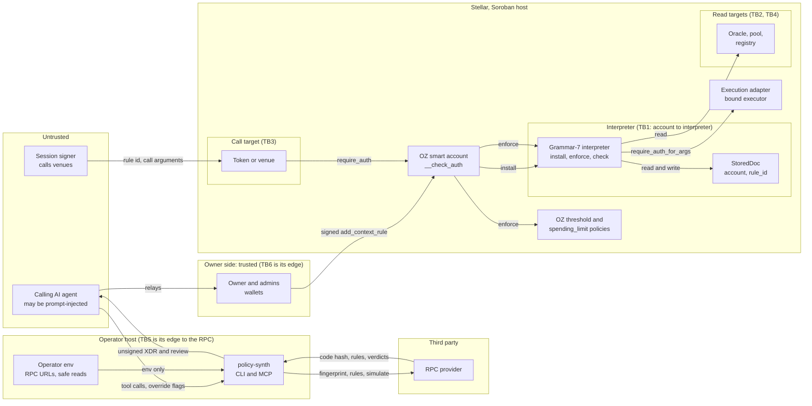

# OZ Policy Builder: STRIDE threat model, grammar 7

**Subject:** the grammar-7 policy interpreter (`contracts/stellar/policy-interpreter`) and the off-chain toolchain that builds rules for it: `@crediolabs/policy-synth`, `@crediolabs/policy-builder-cli` and `@crediolabs/policy-builder-mcp` 2.0.0. Other systems (wallets, RPC providers, OpenZeppelin's contracts, the Prime app) appear here only as actors.
**Modelled at:** `feat/grammar-v7` at `9ff281a`, on 2026-10-15 and 16. The fixes recorded below were written on the same branch, up to `b21a7c7`.
**Status checked at:** 2.0.0 (npm tag `next`, published 2026-10-17). Its `src/` is byte-identical to `feat/grammar-v7` at `e29fb94` for every policy-synth file cited here (`install.ts`, `card.ts`, `config.ts`, `tools.ts`, `record.ts`, `chain.ts`), and the line numbers are from that source.
**Network:** testnet only. The model made no mainnet calls, and grammar 7 has no mainnet deployment.
**Grammar 6:** the grammar-6 model, still in production on mainnet, is [stride-threat-model.md](stride-threat-model.md).

## Method

1. **Two STRIDE passes, per element:** one on chain (the interpreter's entry points, predicate evaluation, and its composition with the OZ smart account and OZ policies), one off chain (policy-synth, the CLI and the MCP server over stdio and HTTP).
2. **Validation:** an independent validator re-ran every reproducer, re-rated each finding from a Prime institution's point of view (what can a prompt-injected or compromised agent, or a lying RPC, get past the owner?), added eight threats both passes missed (N1 to N8) and merged the two priority lists. Its verdicts are the severities in this file.
3. **Signed tests:** 10 tests on the real OZ account wasm (`91a2cd56`) sign every authorisation step with a real `SorobanAuthorizationEntry` and use policy wasm fetched from testnet with matching hashes. All 10 pass.

**Correction to the earlier reproducers:** the on-chain reproducers P1 to P5 used mocks. P1 to P3 ran a stand-in account calling `enforce` directly, with mocking switched off at the step that matters. P4 and P5 drove the real account's `__check_auth` through `try_invoke_contract_check_auth`, with the delegated signers mocked. The final report describes them as fully signed, and that description is wrong. The 10 signed tests re-confirmed the three results that carry the most weight (read manipulation through a wrapper, 1-of-n on a rule with policies, `spending_limit` failing closed) with no mocks, and negative controls show the host enforcing the signatures (a forged operator signature fails, and so does a forged or absent oracle-admin signature).

**Severity:** likelihood times impact for an institution using Prime. **Confirmed:** reproduced in a test with authorisation enforced at the step that matters. **Theoretical:** reasoned from the code.

## Assets

| ID | Asset | Where it lives |
| --- | --- | --- |
| A1 | Funds and positions held by the smart account | OZ account, tokens, venues |
| A2 | Stored rule document (`StoredDoc`: predicate, executor, nonce, signer hash, master set) | interpreter storage, key `(account, rule_id)` |
| A3 | Install parameters: predicate bytes and hash, nonce, admins, optional cap and threshold | `add_context_rule` arguments built off chain |
| A4 | Signer sets: the rule's operators (pinned by `signers_hash`) and the master set (Policy Signer role) | OZ account storage and A2 |
| A5 | The unsigned XDR and its review text | tool response and `outFile`; the only things the wallet signs and the owner reads |
| A6 | Trust pins: `INTERPRETER`, `INTERPRETER_WASM`, `OZ_ACCOUNT_WASM`, `POLICY_CONTRACTS`, `SAFE_READS` | `packages/policy-synth/src/config.ts`, `deployments/*.json` |
| A7 | Availability of authorisation: the TTL of A2 and of the interpreter's instance and code | ledger state |

## Actors

| Actor | Trust | What it controls |
| --- | --- | --- |
| Account owner and admin signers (rule 0) | Fully trusted | Sign the install XDR after reading a review |
| Policy Signer (master set, `admins`) | Trusted to administer | Uninstall alone; with the account, re-install, rotate the set, bind an executor |
| Calling AI agent (MCP or CLI client) | Untrusted, may be prompt-injected | Tool inputs: `signers`, `admins`, expiry, caps, override flags, `interpreterAddress` on mainnet |
| Agent or session signer (a rule's signer) | Untrusted after install | Which rule it claims, the call arguments, what else runs in the transaction |
| Operator | Trusted for the host | The MCP server's environment: RPC URLs, `POLICY_BUILDER_OUT_DIR`, operator safe reads, `POLICY_BUILDER_ALLOW_SPOT_READS` |
| RPC provider | Semi-trusted: untrusted for integrity | Every chain read, simulation and reported code hash |
| Read targets (oracles, pools, registries) | Trusted by the rule author as far as their admins | Arbitrary code that runs inside `enforce` |
| OZ smart account and OZ policies (`simple_threshold`, `weighted_threshold`, `spending_limit`) | Trusted code, pinned by hash | Call `install` and `enforce`; compose policies as all-of |
| Execution adapter (bound executor) | Trusted Prime component | Authorises calls when a rule binds it |
| Prime app and its keep-alive job | External | Relays reviews to the owner; extends TTLs |
| Soroban host | Trusted | Auth framework, re-entry ban, rollback, budget |

## Trust boundaries

- **TB1, account to interpreter:** `install` and `enforce` arguments come from the calling account and are believed as given, bounded by the key `(account, rule_id)` and `account.require_auth()`.
- **TB2, interpreter to read targets:** external code runs inside `__check_auth`, with the interpreter as invoker.
- **TB3, authorised call to predicate:** every call argument is chosen by the signer.
- **TB4, ledger state to predicate:** `read` results and `now` are as trustworthy as whoever can move them.
- **TB5, builder to chain:** code hashes, rules and simulations come from an RPC; the owner approves text derived from them.
- **TB6, builder to owner:** the review text and the XDR reach the owner through the untrusted agent. The owner's only trusted input is the wallet's rendering of the XDR.

## Data flow

## Findings by STRIDE category

IDs are the final report's (S1, T1, ...), the off-chain pass's (E...), the on-chain pass's section numbers (3.x) or the validator's (N...). The fix column points at the priority list below.

### Spoofing

| ID | Threat | Validated severity | Evidence | Fix |
| --- | --- | --- | --- | --- |
| S1 (E8-S.1, 3.6 S) | Mainnet has no pinned interpreter, so `interpreterAddress` is agent input. A lying RPC can report a trusted code hash for another contract, which then polices the rule | Medium | Theoretical; `config.ts:44` | P0-1 |
| S2 (3.1 S) | A signer squats `(victim, rule_id)` before the owner installs | Info | `install` always calls `smart_account.require_auth()` | None |
| E2-S.3 | Any local process can call the MCP HTTP tools: there is no authentication | Medium on a shared host, Low otherwise | Confirmed: an unauthenticated local POST gets 200 | P2-13 |
| E9-S.1 to S.3 | A contract's parameter names mislead, a fake token claims a known symbol, a short address is ground to look alike | Low | Theoretical | None |

### Tampering

| ID | Threat | Validated severity | Evidence | Fix |
| --- | --- | --- | --- | --- |
| T1 (E5-T.1) | A lying RPC adds sub-invocations to the account's auth entry. The unsigned XDR carries the extra call and the review shows only `add_context_rule` | Medium, High before a mainnet pin | Confirmed: a forged `transfer` sub-invocation reaches the account's entry | P0-2 |
| E10-T.1, N2 | The agent relays the review and the XDR, and no tool or app decodes the XDR on the owner's side. Every review control reaches the owner through the agent | High (raised from Medium) | Theoretical; this is the seam the review controls depend on | P0-3 |
| T4 (3.3 T) | Same-transaction read manipulation: a wrapper contract moves a pool's value, has the account's authorisation checked, and moves it back. The interpreter cannot detect it, because Soroban exposes neither the call stack nor the transaction root to a contract | High, if any mainnet rule uses `read` | Confirmed with signed entries: a wrapper moves a reserve from 100 to 1,000 and a denied `act(80)` is permitted; a static cap of 60 binds it; an admin-set oracle cannot be moved by the operator | P0-6 |
| T5 (P3) | A read price of 0 zeroes a `scaled` floor | Low (lowered from Medium: reachable only through a hand-written `expr` or `encodedPredicate`) | Confirmed | P0-6 |
| E4-T.2 | A verdict on a predicate with a `read` is a snapshot of state at simulation time | Medium, merged into P0-6 | Theoretical | P0-6 |
| E11-T.1 | `recordHash` records whatever envelope the RPC returns for hash H without checking its hash | Medium | Confirmed: hash `aaaa…` recorded against an unrelated envelope | P1-7 |
| E9-T.1 | Specs are cached by wasm hash without hashing the fetched bytes | Low | Theoretical; display only | P1-7 |
| E15-T.1 | Indirect prompt injection: RPC error text and recorded string arguments reach the agent verbatim | Medium | Confirmed: an RPC error appears verbatim in 3 tool outputs | P1-8 |
| E8-S.2, 3.6 T | The OZ account build `91a2cd56`, the custody contract, does not reproduce from any known source | Medium (raised from Low) | `deployments/oz-accounts.json` records two failed reproductions | P1-9 |
| N5 | There is no grammar-7 mainnet deploy pipeline, and CI had never run on this branch | Medium (blocks P0-1) | `scripts/deploy-prime-mainnet.ts` deploys grammar 6 | P0-1 |
| N6 | `deployments/*.json` is held to source only on testnet; no CI parity covers a mainnet record | Medium (mainnet) | `ci.yml` | P1-9 |
| T3 (3.1 T) | A rule scoped to another policy contract exposes its admin calls; only the builder's address list refuses it | Low | `config.ts:146` | P2-15 |
| E4-T.1 | `install_policy` is not bound to an earlier `verify_policy` | Low (lowered from Medium): the install response carries its own review, built from the bytes it installs | Theoretical | None |
| T2 (3.1 T) | A re-install smuggles a new admin set or a stale predicate | Info | `signers_hash` re-checked, nonce must be prior plus one | None |

### Repudiation

| ID | Threat | Validated severity | Evidence | Fix |
| --- | --- | --- | --- | --- |
| R1 (3.1 R) | The interpreter emits no events for install, uninstall, rotation or executor binding | Low | OZ emits its own policy events | Open question |
| E1-R.1 | No record of which override flags produced an XDR | Low, merged into P0-4 | Theoretical | P0-4 |
| E4-R.1 | `ok: true` without `complete: true` is read as proof | Low | The tool description warns | None |
| R2 (3.2 R) | Which rule and signer authorised a call shows only as a deny code in diagnostics | Info | | None |

### Information disclosure

| ID | Threat | Validated severity | Evidence | Fix |
| --- | --- | --- | --- | --- |
| I1 (3.1 I) | A mandate (counterparties, caps, venues) is public ledger state | Info | Inherent | None |
| I2 (E4-I.1) | Every predicate under consideration is sent to the RPC in simulations | Low | Inherent to simulation | None |
| I3 (E2-I.1, E11-I.1) | The RPC hostname appears in transport errors | Low | Confirmed: query strings and basic-auth credentials stay out of errors; the hostname appears | None |

### Denial of service

| ID | Threat | Validated severity | Evidence | Fix |
| --- | --- | --- | --- | --- |
| D2 (P2) | The master set uninstalls a rule without the account, and the rule then always denies. `admins` is agent input, defaulting to `sourceAccount` | Low | Confirmed | Open question |
| D1 (3.1 D) | A contract in the master set that never authorises bricks the rule's administration | Low | Theoretical | None |
| D3 (3.2 D) | An archived rule entry makes authorisation fail | Low on mainnet (lowered from Medium), and TTL upkeep must ship with the grammar-7 rollout | `enforce` bumps the rule entry; instance and code need extending by the keep-alive job | External actor |
| D4 (3.2 D) | CPU per call | Low | Worst case measured within budget (see "Configurable limits" below) | None |
| E1-D.1, E2-D.1, E3-D.1, E7-D.1, E11-D.1 | Deep inputs, concurrent HTTP calls, hostile rule counts, RPC calls with no timeout | Low | `deep.ts`: a 400 KB nested body errors in about 0.7 s and the server keeps serving | P2-14 |
| N7 | Revoke through `remove_context_rule` leaves the interpreter's document behind | Info | Theoretical; rent only | None |

### Elevation of privilege

| ID | Threat | Validated severity | Evidence | Fix |
| --- | --- | --- | --- | --- |
| E4 (E5-E.1, E6-E.1) | The refusal text names the override flag (`allowOverlap`, `allowUnboundedAmount`, `allowOpenSlippage`, `allowAdminRule`), the agent sets it, and the success response does not say a refusal was overridden | High | Confirmed | P0-4 |
| E5 (E10-S.1) | The review showed only the predicate: an agent could name its own key as signer, leave expiry unset and pass an attacker address as `admins`, and the attacker address read as a role inside the predicate | High | Confirmed at `9ff281a`: the attacker recipient read «admin» in the review, and the governed signers appeared only as wire values | P0-3, role-label fix |
| N1 | A cap inside the predicate is per call. An agent can repeat the call and move the whole balance of the scoped token, while the review reads "must be at most 500" | High | Review output at `9ff281a` | P0-3, P2-12 |
| N3 | `signers` and `admins` accept any contract address. A signer contract whose `__check_auth` returns `Ok` lets anyone use the mandate | Medium-High | `tools.ts:77` | P0-5 |
| E1 (P4, 3.2 E) | A rule with any policy is satisfied by any ONE of its signers, and the review did not say so | Medium | Confirmed on the deployed account bytes; re-confirmed by the signed tests: `simple_threshold(2)` denies A alone `#3202` and permits A+B; weighted {A:2, B:1}, threshold 2 permits A and denies B `#3213` | P1-10 |
| N4 | `validUntilLedger` is optional and defaults to never, so an agent key stays authorised until someone revokes it | Medium | `install.ts:418` | P1-11 |
| E3 (P1) | The interpreter acts as a confused deputy through a read's side effects | Low: needs value or a role granted to the interpreter's address | Confirmed | Open question |
| E2 (P5) | `remove_policy` on an agent rule leaves an unconstrained signer | Low for Prime (lowered from Medium): needs rule-0 auth | Confirmed | Open question |
| 3.4 E | The agent names a looser rule it also holds | Low on chain; off chain the guard is the overridable `allowOverlap` | Theoretical | P0-4 |
| N8 | `spending_limit` denies every function except `transfer`, and the builder attached it to any predicate | Low (usability) | Confirmed: `approve` denied `#3223` while the interpreter permits it | P2-12 |

## Priorities

The numbering is the final report's. The validator's merged list numbers the same items differently and has one more P1, a keep-alive for grammar-7 rule entries; that job lives in the Prime app, so here it is the external actor in D3.

**P0, before any mainnet grammar-7 install:**

1. **P0-1, pin the mainnet interpreter through a reproducible pipeline:** a grammar-7 mainnet deploy script with an artifact hash check and a record, CI run on the branch so the parity gate passes, then `INTERPRETER.mainnet` set so any other address is refused.
2. **P0-2, bind the auth tree to the operation:** refuse unless the simulated `rootInvocation().function()` equals the built call and has no sub-invocations, and show the auth tree in the review.
3. **P0-3, put the authority grant in the review and render it on the owner's side:** first, an authority header (signers in full, who can act alone, admins and their powers, expiry, rolling total or "no total limit", interpreter); second, a `review_unsigned(xdr)` decoder that a wallet or the Prime app can run without the agent.
4. **P0-4, take overrides away from the agent:** echo every `allow*` used as the first review line and as `overrides[]`, drop the "set allowX" hint from refusals, and on mainnet honour `allow*` only when the operator sets an environment switch.
5. **P0-5, vet contract signers:** refuse a contract in `signers` or `admins` unless its live code hash is a pinned `prime-session` or OZ account build, and show the hash in the header.
6. **P0-6, read safety, if any mainnet rule uses `read`:** refuse reads of targets and functions outside an operator-controlled safe list, mark movable reads in the review, refuse `scaled` over a read without `gt(read, 0)`, and mark read verdicts as snapshots. If no mainnet rule reads, this is P1.

**P1, soon:**

7. **P1-7, RPC answer binding:** check the envelope's hash in `recordHash`; hash fetched wasm before caching it.
8. **P1-8, treat tool output as data:** reduce non-simulation RPC errors to a code and status; mark recorded strings and rule names as untrusted in the tool descriptions.
9. **P1-9, provenance of custody code:** document the source build or reproduction of the OZ account and `prime-session` builds in `deployments/*.json`, with CI parity for mainnet records.
10. **P1-10, 1-of-n and thresholds:** a threshold option that attaches OZ's `simple_threshold` or `weighted_threshold`, and refuse several signers without one unless `anyOne` is explicit.
11. **P1-11, default expiry for agent rules:** require `validUntilLedger` or a `prime-session` signer for mainnet installs.

**P2, later:**

12. **P2-12, spending-limit usability:** guard `spendingLimit` against predicates that permit anything but `transfer`, and say in the review whether there is a rolling total.
13. **P2-13, HTTP transport:** an optional bearer token from the environment; refuse an out directory that is group- or world-writable.
14. **P2-14, DoS hygiene:** RPC timeouts, a cap on concurrent HTTP tool runs, a simulation budget per call.
15. **P2-15, housekeeping:** refresh `evidence/bun-audit.log`; refuse scopes by policy code hash in place of an address list.

## Status at 2.0.0

Checked on 2026-10-17 against the 2.0.0 source. Five items are done; every P0 still has open work, so mainnet installs stay blocked.

| Item | Status | Closed by, or where it stands |
| --- | --- | --- |
| P0-1 mainnet pin and deploy pipeline | Open | `config.ts:44` `mainnet: null`. `INTERPRETER_WASM` (`config.ts:51-53`) holds only the testnet build `69cad1d5`, so on mainnet any address running that build passes. `scripts/deploy-prime-mainnet.ts` deploys grammar 6; the only grammar-7 deploy script, `scripts/deploy-grammar7-limits-testnet.ts`, is testnet only. CI runs on pushes to `main` and on pull requests (`ci.yml:3-6`), and `gh run list --branch feat/grammar-v7` returned no runs on 2026-10-17 |
| P0-2 auth-tree binding | Open | `install.ts:231` copies `original.rootInvocation()` from the simulation into the signed entry, and `install.ts:243` folds it into the `__check_auth` digest, with no comparison against the built call |
| P0-3, first half: authority header | Done | `b56d2b3`, `d04fb7f`, `d534b28`, with audit fixes `dabd9ac` and `2876c98`. `card.ts:361-427` (`authority()`), shown first in `install_policy`'s review (`tools.ts:335`, `588`): signers in full, who must approve or who acts alone (`card.ts:367-375`), admins and their powers (`card.ts:390-395`), "never expires" or "valid through ledger N" (`card.ts:397-398`), a rolling total or "no total limit: each call may move up to its own cap" (`card.ts:399-413`), the interpreter and its limits (`card.ts:414-420`). Each line carries its wire value. A contract signer reads as `contract` plus its address (`card.ts:364`); its code hash waits on P0-5, where the final report said the header already shows it |
| P0-3, second half: owner-side decoder | Open | No `review_unsigned` or other XDR-to-review decoder exists in `packages/*/src` |
| P0-4 override echo and operator gating | Open | Refusals still name the flag (`install.ts:321`, `379`, `384`, `463`, `468`). Responses carry no `overrides` field, and no environment switch gates `allow*` on mainnet |
| P0-5 contract signer vetting | Open | `tools.ts:77` `anyAddress` accepts any contract id for `signers` and `admins`; nothing checks its code hash |
| P0-6 read safety | Done for the lint | `bcb4328` (lint and review mark), `0b41ba6` (operator lists). `install.ts:426-432` refuses `READ_UNSAFE` unless the read is safe or the operator sets `POLICY_BUILDER_ALLOW_SPOT_READS=1`; no tool input can. `config.ts:108-142`: `SAFE_READS` holds three Reflector oracles on testnet (`lastprice`, `price`) and nothing on mainnet; the operator adds entries through `POLICY_BUILDER_SAFE_READS_TESTNET` and `_MAINNET`; arguments must be constants. `card.ts:238-245` marks other reads "(live value, movable within one transaction)". Still open: the `gt(read, 0)` guard for `scaled` over a read, and marking read verdicts as snapshots. Pairing a read bound with a static cap is advice in `docs/stellar.md`, and nothing enforces it |
| P1-7 RPC answer binding | Open | `record.ts:96-120` decodes the returned envelope without checking its hash; `spec.ts:50-53` caches specs by wasm hash without hashing the bytes |
| P1-8 tool output as data | Open | RPC error text still reaches tool output through `messageOf` (`envelope.ts:41-44`), cut to 512 characters |
| P1-9 custody code provenance | Open | `deployments/oz-accounts.json` still records failed reproductions of `91a2cd56` |
| P1-10 threshold and `anyOne` | Done | `e619bc9`. `install.ts:67-76` builds OZ's threshold policy; `install.ts:393-414` refuses duplicate signers, a threshold that can never be met, `anyOne` beside a real threshold, and 1-of-n (several signers with no threshold, or one a single signer meets alone) unless `anyOne: true`. Live proof on a real OZ account: `evidence/oz-threshold-g7-live.log` |
| P1-11 default expiry | Open | `install.ts:418` defaults `validUntil` to `null`. The header now says "never expires", so the default is visible |
| P2-12 spending-limit guard | Done | `c8aea8b`. `install.ts:433-443` refuses `spendingLimit` unless every branch pins `call_fn = transfer` and the scope is shown to be a token. It shipped as a refusal, where the report asked for a warning. The rolling-total line is in the header (P0-3) |
| P2-13 HTTP transport | Open | No token on the HTTP transport; the out directory's permissions are unchecked |
| P2-14 DoS hygiene | Open | Only the limits read (`chain.ts:268`, 5 s) and name reads (`spec.ts:147`) have timeouts |
| P2-15 housekeeping | Open | `evidence/bun-audit.log` is dated 2026-08-27; `POLICY_CONTRACTS` (`config.ts:146`) is an address list |
| Role-label spoof (E5) | Done | `9ad5683`. `card.ts:58-81`: the package's roles print as `[role]` and labels from the request as `«label»`, plain words only (`LABEL`, `card.ts:66`), with a legend as the header's first line (`card.ts:376-380`). Roles come from `tools.ts:319-329`. Addresses the request gives as `signers` or `admins` still read `[signer]` or `[admin]` inside the predicate; the header lists the same addresses in full |

The CHANGELOG's 2.0.0 section has an entry for each: the threshold option, the authority header, the spending-limit guard, and `READ_UNSAFE` with the operator safe reads.

## Configurable limits, shipped after the model

The interpreter the model ran against had its limits compiled in: `DECODE_LIMITS`, with at most 4 reads per predicate. On 2026-10-16, after the model, `9ff9b5f` made the limits a deploy-time `Limits` struct, and `5728d23` set the byte ceiling to 40 KiB. Each instance now fixes its own `max_reads` between 1 and 8 at deploy time and returns it from `limits()`. The testnet pin, `CDZV4AG4…` (wasm `69cad1d5`, built from `5728d23`), was deployed with 8. These changes are in 2.0.0.

What this changes in the model:

- **Read budget:** the final report's "reads capped at 4" (T4) now reads "at most `max_reads` distinct reads per predicate, up to 8, fixed per instance at deploy time". The binding cost is memory: the interpreter README ("Reads and the per-transaction context budget") measures 8 wasm reads at 12.7 MB for one context and 11.4 MB for each further one, so a transaction holds at most 2 such contexts inside the 80% margin, and 4 exceed the limit and fail closed with `Budget ExceededLimit`. CPU for 8 reads is about 7.7M (`evidence/worst-case-ceilings-2026-10-16.txt`: 7,735,068).
- **Severity:** T4 is unchanged. One movable read is enough for the wrapper attack, so a higher read count only widens the set of read targets whose admins a rule must trust. The safe-list lint applies to every read.
- **Evidence instance:** `evidence/oz-threshold-g7-live.log` ran on `CA5ICI2O…`, a grammar-7 testnet instance with compiled-in limits that the current pin supersedes. The threshold result depends on OZ's policies and is unaffected.

## What held up

- **Reproducible build:** at `9ff281a`, `./build-wasm.sh` gave `a975353d…`, the pinned testnet bytes at the time. The current pin `69cad1d5` is recorded as built from `5728d23` in `deployments/grammar7-testnet.json`.
- **Host and Origin guard on the HTTP transport:** a 12-case matrix (200 ×4, 403 ×7, 415 ×1) blocks DNS rebinding and cross-site requests.
- **Scope refusal:** the interpreter refuses a rule scoped to Default, to itself or to the account, checked on the real OZ account bytes.
- **`check` always panics:** reads inside `check` roll back, and no state survives.
- **Immutability:** the interpreter has no upgrade entry point.
- **Worst case without reads:** 48.1M CPU of 400M for the largest single rule at `9ff281a`.
- **`outFile`:** a bare-name regex and `O_CREAT | O_EXCL` stop traversal, overwrites and symlink follows.
- **Secrets in errors:** query strings and basic-auth credentials stay out of errors.
- **Signer set pinned:** every `enforce` compares the stored signer hash with the live set and denies `204` on a change.
- **`spending_limit` fails closed:** OZ v0.7.2 `spending_limit.rs:292` panics `NotAllowed` for anything but a well-formed `transfer`. In the signed test C1 (cap 500 per 100 ledgers), `transfer 500` is permitted, a further `transfer 1` in the same period is denied `#3221`, `approve` is denied `#3223` while the interpreter permits it, and `transfer 500` is permitted again after 101 ledgers.
- **Threshold beside the interpreter:** OZ runs every policy's `enforce` on every permit, so a threshold binds (signed tests B1, B2; live log above).

## Rejected and downgraded claims

- **3.4-E2, "`spending_limit` counts only `transfer`, so `approve` and venue calls escape the cap":** rejected. The on-chain author read `spending_limit.rs:242` and missed `:292`, which panics for every other context. The residual is N8 (Low, usability), closed by P2-12.
- **E4-T.1, install not bound to verify:** lowered from Medium to Low, because the install response carries its own review built from the bytes it installs.
- **3.2 D, archival:** lowered from Medium to Low on mainnet, with TTL upkeep required for the grammar-7 rollout.
- **P3, a zero read price zeroes a `scaled` floor:** lowered from Medium to Low; the intent layer never builds it.
- **P5, `remove_policy` widens an agent rule:** lowered from Medium to Low for Prime; it needs rule-0 auth.
- **E10-T.1, the agent relays the review:** raised from Medium to High.
- **E8-S.2 and 3.6 T, the OZ account build does not reproduce:** raised to Medium for `91a2cd56`, the custody contract.

Corrections to the final report, found while checking it against the code:

- P1 to P5 used mocks (see Method); the report calls them fully signed.
- Its C1 summary says the cap "denies transfer 5000". That figure comes from the validator's separate test (`transfer 500` and `5000` against a cap of 500). C1 itself denies a second transfer of 1 within the period.
- It says the authority header shows a contract signer's code hash. The header shows the address only.
- It describes the spending-limit check as a warning added under P0-3. It shipped as a refusal, under P2-12 (`c8aea8b`).

## Open questions

- **Multi-seat co-signing:** when a 2-of-3 rule 0 has to authorise the install, how does the Prime co-sign flow re-wrap `buildSelfCall`'s single-signer auth, and does the owner-side review still bind what the seats sign? For such a rule the simulation fails today, which is fail-closed.
- **Wallet rendering:** how Freighter or a custodian renders `add_context_rule` arguments and auth entries decides how much of P0-3 the tools must carry.
- **Mainnet reads:** whether any mainnet grammar-7 rule will use `read` decides whether P0-6's open parts are P0 or P1.
- **1-of-n on chain:** the interpreter is immutable, so before a mainnet grammar-7 deploy it has to be decided whether `enforce` should require every rule signer, or whether the threshold option (P1-10) and the header's wording stay the control.
- **Optional on-chain hardening:** account auth on `uninstall` (D2, E2), events from `install`, `uninstall`, `rotate_master_signer_set` and `bind_executor` (R1), and an on-chain refusal of scopes on other policy contracts (T3). Each needs a re-audit, so the question is whether to bundle them into the audited mainnet build.
- **Interpreter addresses:** monitor them for value or roles granted to them (E3).

## Reproducers

| What | Where | Result |
| --- | --- | --- |
| Threshold beside the interpreter, live on testnet | `evidence/oz-threshold-g7-live.log`, from `packages/policy-synth/scripts/live-threshold.ts` (`WEIGHTED=1` for the weighted run) | 2-of-2: A alone denied `#3202`, A+B permitted. Weighted {A:2, B:1}, threshold 2: B alone denied `#3213`, A permitted |
| Read budget at the ceiling | `evidence/worst-case-ceilings-2026-10-16.txt`, from `tests/worst_case.rs` on wasm `69cad1d5` | 8 wasm reads in one context: 7,735,068 CPU, 12.7 MB memory |
| Read manipulation through a wrapper (repo version) | `contracts/stellar/policy-interpreter/tests/grammar7.rs` | A wrapper defeats a spot read |
| On-chain P1 to P5 | Kept off-repo: `tests/stride_poc.rs` written against `9ff281a` | 5 of 5 pass (mocked, see Method) |
| Off-chain | Kept off-repo: `zz_stride.test.ts` (forged sub-invocation, unbound `recordHash`), `http.ts` (12-case Host and Origin matrix), `inject.ts`, `leak.ts`, `ssrf.ts`, `deep.ts` | 2 of 2 tests pass; each script reproduces |
| `spending_limit` denies non-transfer | Kept off-repo: the validator's test on OZ account `91a2cd56` with the testnet `spending_limit` bytes `9ce30ea1` | Without the cap, `transfer 500`, `transfer 5000` and `approve` pass; with a cap of 500, only `transfer 500` passes |
| 10 fully signed tests | Kept off-repo: `stride_checks.rs` with the OZ account, threshold and `spending_limit` wasm fixtures | 10 of 10 pass: A1 to A6 read manipulation, B1 and B2 thresholds, C1 spending limit, and OZ v0.7.2's caps of 5 policies and 15 signers per rule |

The off-repo files were written for the 15 to 16 October run against `9ff281a` and were not committed.
