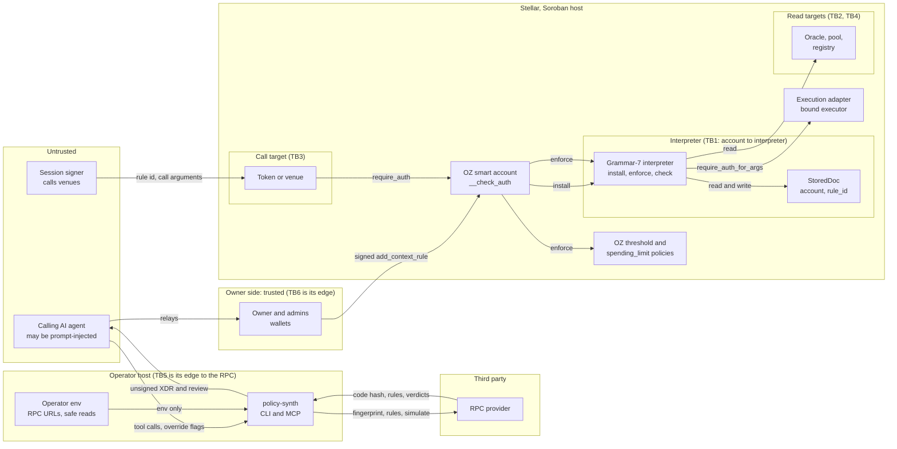

# OZ Policy Builder: STRIDE threat model, grammar 7

**Prime app update:** 20 October 2026. The Prime app's half of G7S-14 and G7S-16 is done in octopos #228 and #229, and the reviews of those pull requests found two ways to detach a rule's executor binding, recorded under G7S-16. Its section comes first; the contracts in this tree are unchanged.
**Final rerun:** 19 October 2026, on `feat/grammar-v7` at `3624e930`, after #25 (`63768d67`), #27 (`f4472f8b`) and #26 (the v5 adapter `4985cd12…` with an optional gate). Its section comes first. The rerun of 18 October follows; where an item's status moved, the final rerun's reconciliation table says so and the item's row is updated.
**Rerun:** 18 October 2026, on the final tree of `feat/grammar-v7` at `46e4c6a5` (after #20, seats and NEAR signer v2, and #21, the `contracts/` layout with the spike and every `prime-session` removed), plus the four commits of the pull request that carries this file. Sessions are seat-only on every chain from that date.
**First run:** 15 and 16 October 2026 on `9ff281a`, validated, kept below as "The model of 15 and 16 October" with its findings, priorities and reproducers. Its status table at 2.0.0 is replaced by the item-by-item status in this file.
**Grammar 6:** the grammar-6 model, still in production on mainnet, is [stride-threat-model.md](stride-threat-model.md).
**Networks:** Stellar testnet, Solana devnet, NEAR testnet and a local anvil fork of Base Sepolia, each with throwaway keys made for this run. Mainnet was read only.
**Live rows:** [g7-stride-final-2026-10-19.log](g7-stride-final-2026-10-19.log) for the final rerun and [g7-stride-2026-10-18.log](g7-stride-2026-10-18.log) for the rerun of 18 October list every on-chain check with its transaction id.

## The Prime app's half of G7S-14 and G7S-16, 20 October 2026

### Scope

octopos `main` at `f062e074` (#227, #230, #231 and #232), then #228 and #229, merged as `6dc44df8` and `b5e92432` from heads `ed25fb44` and `2230e918`. Each statement below was checked against that code, against the testnet transactions it cites (read back from Horizon and listed with their full hashes in [g7-app-2026-10-20.log](g7-app-2026-10-20.log)), and by read-only reads of mainnet and of the beta and production bundles on 20 October 2026. File names are in octopos `apps/web`. No contract or pin in this repository changes.

### What the beta app runs

- **New gates name a gated v5 adapter on testnet:** a gate set up from the beta app names the v5 build `4985cd12…` at the v5 address as its caller (`NEW_GATE_EXECUTOR`, #231). A mainnet build names v4 `3dd675c0…`. A gate pins its caller's build, so gates made earlier keep theirs and keep working.
- **v5 stays out of mainnet builds:** the v5 hash and salt text sit only inside inline `VITE_STELLAR_NETWORK === 'testnet'` comparisons. `scripts/assert-mainnet-build.ts` (#227) refuses a build holding the full or short v5 hash, the v5 salt text or the no-gate test-id prefix. It runs in `deploy:mainnet`, in the wrangler mainnet env's build command and in CI. Read on 20 October 2026: the production bundle holds `3dd675c0` and no v5 text, the beta bundle holds both, and the v5 code entry is absent on mainnet at ledger 65,035,731.
- **No screen creates an adapter with no gate yet:** `ui/octopos/execution-adapter-v5.ts` (#232) derives the no-gate address and reads its state, on testnet only.

### How the app tells contracts apart

| Reader | Where | What it checks |
| --- | --- | --- |
| A gate's adapter | `readExecutionAdapterState` (`ui/octopos/execution-adapter-v4.ts`) | the gate's `caller_code` gives the build. For a v4 or v5 build, the instance at the gate's caller must run that code, be on the app's list and store `prime` equal to this Prime, and since #232 its stored `gate` must equal this gate: a gate whose caller is a no-gate adapter, or an adapter bound to another gate, reads "not bound to this gate", and Manage execution and the console send nothing through it (review-pr232, rows R9 to R14; 27 real testnet gates read with no false refusal). A v3 gate, or one whose configuration cannot be read, goes to `readAdapterV3State`, which checks the code at the derived v3 address only (review-pr232 I-3) |
| Any contract a call names | `adapterKindOf` (`ui/octopos/adapter-signer-hold.ts`, #228) | a Stellar Asset Contract by its executable; the stateless executor `57bf132b…` by its code; a listed adapter build (v3, v4, and v5 in a testnet build) storing `prime` and a void `gate` is a no-gate adapter, and with an address `gate` a gated one. Any other code storing `prime`, or a listed build that lacks either key, is an unverified adapter. A mainnet build lists no v5 code, so it reads every v5 adapter as unverified |

### What the app refuses

The hold runs before any wallet is asked, on the app's own signing paths, for every call the Prime account authorises there: on the call before simulation and on the whole recorded authorisation tree after it. It runs on the generic invoke path, `signAndSubmit`, the co-sign continuation, a session's approval, the venue wallet path and `assertSignerAdditionSafe`. It opens the Prime's own `execute(target, fn, args)` and every adapter batch, and holds each inner call the same way.

| Shape | Refused when | Item |
| --- | --- | --- |
| A rule an adapter with no gate signs | `add_context_rule` with a no-gate or unverified adapter among its `Delegated` signers, whatever the scope | G7S-14 |
| A rule an execution contract signs for its own calls | a gated adapter, the stateless executor or an unverified adapter signs a rule scoped to itself, to the Prime, to every call (`Default`) or to contract creation. The one exception is the app's run rule: scoped to the adapter, the adapter its only signer, and this network's grammar-6 interpreter holding exactly the `call_fn == run` predicate bytes. A threshold beside it only narrows | G7S-16 |
| An adapter added as a signer | `add_signer` or `batch_add_signer` naming any execution contract (all four kinds) or a contract that is not deployed | G7S-14, G7S-16 |
| An adapter as a document admin | an execution contract or an undeployed contract in `policy_admins` (a new rule, `add_policy`, `install`) or in `rotate_master_signer_set` | |
| A change to a rule an execution contract answers for | `add_policy`, `remove_signer`, `update_context_rule_valid_until`, and every interpreter or OpenZeppelin policy call, on a rule a no-gate adapter signs or an adapter signs for itself; the run predicate installed on the run rule passes | G7S-16 |
| Funds | `transfer`, `transfer_from`, `mint` or `approve` to a no-gate or unverified adapter at any depth of the tree; the payee of each venue function the app builds (Blend `submit`, Soroswap, Aquarius, Phoenix, vault `deposit`, `redeem`, `withdraw`); any call no exact check reads that names one anywhere in its arguments | G7S-14 |
| A forged rule | a policy call handed one of the account's rules is judged on the rule with that id read from chain; the argument must equal it byte for byte, and no id, an unknown id or a failed read refuses | |
| A binding | `bind_executor` on one of the account's rules may name only the account's stateless executor, deployed at its derived address with its code, or the adapter a custody gate of this account names. That gate must be confirmed by an owner in this browser (the typed trustee matched the gate's custody), pass the connect check, and read usable for this Prime as above: for a v4 or v5 gate that includes the stored `prime` and `gate`, for a v3 gate the code alone | G7S-12, G7S-16 |
| A policy taken off a rule | `remove_policy` on any rule; the app never builds it, and removing the whole rule stays open | G7S-16 |
| A document where none is | `install` on the grammar-5 or grammar-6 interpreter for one of the account's rules where that interpreter keeps no document | G7S-16 |
| The account's code and functions | `upgrade`, and any function outside the 17 that the account code `91a2cd56…` has; `rebind` on an execution contract | |
| Depth | a batch, the account's `execute` or an authorisation tree nested past 64 levels | |
| An unreadable state | a contract kind, rule, document or tree that cannot be read refuses, with "could not be checked just now" or "could not be read in full" | |

Policies lists the rules already installed in each of the first two shapes, and every rule whose interpreter keeps no document for it, and asks the owners to revoke them (`ui/octopos/open-recipient-scan.ts`). The refusals are not behind the testnet flag, so the next mainnet build will carry them; the production bundle read on 20 October 2026 does not, and that build waits for Tuan's approval.

### Evidence

| What | Where | Result |
| --- | --- | --- |
| Unit and path tests | `ui/octopos/adapter-signer-hold.test.ts`, `adapter-signer-hold-paths.test.ts`, `adapter-signer-hold-generic.test.ts`, `open-recipient-scan.test.ts`, `open-recipient-notice.render.test.tsx`; the hold's tests also run in a testnet build in CI | pass at both heads; web suite 7,877 (#228) and 7,921 (#229) tests, NEAR flag off and on |
| Testnet run | `scripts/verify-adapter-signer-holds-testnet.ts`, on a fresh OpenZeppelin Prime with a v4, a gated v5 and a no-gate v5 adapter, driving the app's own signing paths and counting wallet requests | 106 of 106 at `ed25fb44`, 137 of 137 at `2230e918` |
| Shapes that passed earlier heads, rebuilt and refused before the wallet is asked | reviews review-pr228 to review-pr228h | a no-gate rule through a relay (`5e069293…`); the batch interpreter told to hold `call_fn = execute` on the run rule (`866c109b…`); `batch_add_signer` of an adapter (`081f2f5f…`); the Prime's `execute` paying the no-gate adapter (`abe1a63e…`); a forged rule struct (`cb6fa6c5…`); a binding to a contract that only stores `prime` and `gate` (`e7a43aeb…`); a binding to the adapter of a gate remembered and never confirmed (`b9bc60ba…`) |
| No false refusal on the app's flows | review-pr228h, 32 rows on a fresh Prime | run rules on v4 and v5, agent and band rules, seat rules, bindings to the stateless executor and to v4 and v5 on confirmed gates, payments, Soroswap, Blend, Aquarius and vault calls all go through |
| Mutants | the authors' and the reviewers' sets | the survivors are equivalent, only add refusals, or are covered by testnet rows alone, such as review-pr228h's B9 (one confirmed gate vouching for another) and P2 (`remove_policy` on a policy id other than 0) |

### Residual, Low

- **The refusals live in the app:** a wallet or tool outside it can still sign any of these shapes, and the contracts accept them as described under G7S-14 and G7S-16. On its own side `policy-synth` refuses the two rule shapes and `review_unsigned` flags `add_signer`.
- **Contract creations pass the hold:** the owners can be asked to create an adapter on a gate someone else made (review-pr228g, KH0). Binding a rule to it stays refused until an owner confirms that gate.
- **v3 gates and the co-sign path skip the stored-gate check:** a v3 gate's adapter is read by its derived address and code only, so one its gate's custody has rebound to another gate still reads usable and can be bound to a rule (review-pr232 I-3). The co-sign path (`verifyAdapterV3Cosign` in `execution-cosign.ts`) accepts an `execute` on any listed build acting for the Prime without the stored-gate check (review-pr232 I-2). Rebinding needs the gate's custody, so both stay Low; the app's no-gate console work (N5) is to close them.
- **The built-in Stellar Wallet signs what reaches it:** its SEP-43 `signTransaction` and `signAuthEntry` (`ui/prime-account/stellar-wallet/module.ts`) show a card and run no hold. The app's own flows run the hold before they reach it; a request that reaches it another way is signed without the hold, and a review still has to test that case.
- **A confirmation is kept per browser:** a browser that never confirmed the gate refuses the binding, so this fails closed.
- **Rules already installed stay until the owners revoke them:** Policies lists rules in the first two shapes and rules whose interpreter holds no document for them. A rule already detached through `remove_policy`, before #228 or by another wallet, no longer names the interpreter, reads as an ordinary rule and is not listed.
- **Wording on rule 0 (review-pr228h, L-1):** the policy-removal and no-document refusals advise removing the rule, and the app refuses to remove rule 0. Both fire only on calls the app never builds; a follow-up gives rule 0 its own sentence.
- **The short expiry for no-gate bundles** is due with the no-gate flow, in progress in octopos.
- **Values the host cannot pay:** an address carried as bytes or a string passes the fallback check (review-pr228f, U5 to U7).

## Final rerun, 19 October 2026

### What changed, and what this run checked

Three pull requests merged after the rerun of 18 October. #25 and #27 change the packages only. #26 changes the Stellar execution adapter, its scripts and its docs. Every other contract source is the source at `46e4c6a5`: `git diff 46e4c6a5 3624e930` over the interpreter, the Stellar seat and gate, the blend-pool test double, the EVM seat, both Solana programs and NEAR v2 shows no change, and NEAR v1 left the tree (G7S-2). Their pins in `contracts/build-hashes.json` and `deployments/` are unchanged; the only pin that moved is the adapter's own, in `contracts/build-hashes.json`, while `deployments/execution-testnet.json` keeps the v4 build `3dd675c0…` the Prime app pins.

| Component | Changed since `46e4c6a5` | This run |
| --- | --- | --- |
| Stellar `execution-adapter` | v5: optional gate, 228 lines of code, `4985cd12…` | threats derived again from `lib.rs` in both modes; `build-wasm.sh` gives `4985cd12…`; 62 unit tests; 159 testnet rows on fresh instances (119 in the first round, 40 for G7S-16) |
| Stellar `custody-gate` | none | `build-wasm.sh` gives `b01024f3…`; its interplay with v5 run on testnet (rows C3 to C9, I2, I3) |
| `policy-synth`, CLI, MCP server | #25: `review_unsigned`, overrides refused on mainnet, auth expiry and fee bounds. #27: contract signer kinds, signed envelopes | threats derived again from `install.ts`, `review.ts`, `chain.ts` and `tools.ts`; the TypeScript gate; rows J1 to J8; two tests added here |
| Interpreter, seats, Solana gate, EVM seat | none | controls re-read at the lines the rows cite; the live rows of 18 October stand |
| NEAR v2 signer | none | access keys and code hashes of both signer accounts read on NEAR testnet on 19 October |
| octopos, for C2 | #225 merged as `35fe7fd2` | the beta and production bundles read on 19 October |

**Testnet:** one harness, run on fresh accounts and fresh instances of the v5 and gate code entries that #26 uploaded. It reads those entries and does not upload them again. Every key was a throwaway made in memory for the run and never written to disk. The harness ran three times, each on new instances. Run 1 stopped at row G2 with two rows the harness expected wrongly: B5 is refused where I had expected it to run, and G2 needed its account funded first. Runs 2 and 3 passed every row but G2d, whose criterion was mine and wrong: sent again straight after it ran, an applied envelope gets `TRY_AGAIN_LATER` from the RPC for a short while, and about 45 s later `ERROR` with `txBadSeq` (review-opb28 saw both). Run 3 is in the log with 111 of 112 rows as expected, followed by a separate run of G2d: the same envelope sent again through the RPC and through Horizon moves nothing, the account's sequence stays, and the hash appears once in its history. After review-opb28 a third harness ran the G7S-16 rows (L to O) on new instances; they are at the end of the log.

**Mainnet**, read only at ledger 65,016,730: the v5 code entry is absent; `3dd675c0` and `b01024f3` are present.

### Result

No new finding at Medium or above. One new Low item, G7S-16, found by review-opb28 and fixed in `policy-synth` by this pull request, and one new Info item, G7S-15. C2 is fixed by octopos #225, so G7S-1 (the NEAR signer accounts' FullAccess keys) is the one open High. Mainnet grammar-7 installs stay blocked on the open P0 items: P0-1, P0-5, the two open parts of P0-6, and the Prime app running P0-3's decoder.

| Severity | Open after the final rerun |
| --- | --- |
| High | G7S-1 |
| Medium | G7S-3 |
| Low | G7S-2, G7S-4, G7S-7, G7S-8, G7S-10, G7S-12, G7S-14 and G7S-16 (their residuals; the Prime app's half is done since 20 October, see the section above), the residual of C2 |
| Info | G7S-5, G7S-6, G7S-11, G7S-15 |

The open items of the first run (P0-1, P0-5, P0-6, P1-7 to P1-9, P1-11, P2-13 to P2-15 and the rows that go with them) keep their severities; the reconciliation table below gives each its status.

The four Low items of review-opb27 are folded in: L1 as two tests, L2 as the residual of the `policy-synth` row and of G7S-14, L3 as wording in the tool description and the docs, L4 in this summary.

### The adapter, derived again from the v5 code

Lines are in `contracts/stellar/execution-adapter/src/lib.rs` at `3624e930`. Rows are in [g7-stride-final-2026-10-19.log](g7-stride-final-2026-10-19.log). X_C is an OpenZeppelin Prime with an agent whose USDC rule caps a transfer at 20; W is an OpenZeppelin account the agent owns; R is custody's gate for the gated adapter.

| STRIDE | Threat | Mode | Control | Verified on testnet, 19 October |
| --- | --- | --- | --- | --- |
| S | A stranger creates a Prime's adapter | both | the constructor's address must derive from the Prime and `sha256("prime.execution.adapter.v5" ‖ XDR((gate, min_wait, run_window)))` (`:181-187`) | H3 `#8`; S4, S5, S8 created through rule 0 |
| S | A stranger, or another Prime, runs a batch through a Prime's adapter | both | `prime.require_auth_for_args((calls, grants, wait))` (`:241`, `:247`) | H4 `#3016`; H5: X_G's null adapter cannot move X_C's USDC (`Error(Auth, InvalidAction)`) |
| T | A batch drives the Prime's own `execute` or admin calls | both | `PrimeTarget` (`:334-336`), checked whether or not the gate lists the Prime | H1, H2 `#1` (R lists X_C in H2); A8: `X_C.execute` called by a callee is refused `#3002` by the Prime's rules |
| T | A batch re-enters the adapter, directly or through a callee | both | the host refuses re-entry | A9, A10 `Error(Context, InvalidAction)` |
| T | A batch names an address off the gate's list | gated | `check`, `scan`, `scan_data`, `scan_entry` (`:322-346`, `:384-488`) | B5b, B7 `#2`; C7 against the successor's list after a rebind |
| E | An agent passes its cap on a token | null | each context the Prime authorises needs its own rule, which the interpreter checks | A1 `#100`; A6 `#100` for the transfer called by a callee; A7 the same at the cap runs |
| E | Per-call caps add up inside one approval (N1) | null | none per batch; OpenZeppelin `spending_limit` on the rule binds a total | A2: three transfers of 20 under a cap of 20 move 60 on one signature; A3 `#3221` for the same under a total of 50; A4 moves 40; A5 `#3221` |
| E | A rule scoped to one adapter is cited for another | both | the account matches each context to the cited rule's scope | A11, B2, B3 `#3002` |
| E | A rule a gated adapter signs (a band) answers a batch the null adapter asked for | both | the adapter's signature holds only while it is the one asking the Prime | B1, B5 `Error(Auth, InvalidAction)`, nothing moved; B6: through the gated adapter itself the same rule moves 100 past the agent's cap, to listed addresses only (B7 `#2`) |
| E | A rule the null adapter signs answers the agent's `execute` (G7S-14) | null | none in the contract; `policy-synth` refuses such a rule since #27, and the Prime app since octopos #228 | J7: with the rule installed by a raw `add_context_rule`, the agent moves 100 against a cap of 20 (tx `4e3b6aa3…`); J8: a stranger with no rule is refused `#3016` |
| E | A rule the gated adapter signs, scoped to that adapter, answers anyone's `execute` (G7S-16) | gated | the run rule's predicate (`call_fn = run`), which the owners must write; since #28 `policy-synth` refuses such a rule without it, and since octopos #228 the Prime app does too | review-opb28 L1: with an adapter-signed rule scoped to the adapter whose predicate is `call_fn = execute`, a stranger with no key moved 7 USDC to a listed address (tx `25ef231e…`); with `call_fn = run` the same call is refused `#100`, and row O5 here repeats that refusal |
| E | Grants or `executor_authorizations` carry the adapter's authority further | null refuses; gated checks | `scan_entry` (`:479-488`) | D1, D2 `#3`; D3, D4 `#2`, D4 through a sub-invocation |
| E | A null adapter stores a batch, or is created with a floor | null | `NoWait` (`:178-180`, `:246`) | E1, E2, E3 `#10`; E4 `#5` |
| E | The binding moves without custody, a null adapter gains a gate, or a gated one loses it | both | `rebind`: `NoGate`, the bound gate's custody signs, the successor must answer `custody()`, the argument is an `Address` (`:211-217`) | C1 `#9`; C2 `Error(WasmVm, InvalidAction)`; C3 (the Prime's owners) and C5 (another custody) refused; C4 a token as successor refused; C6 and C9 custody rebinds and back; C8 the old custody can no longer |
| E | Someone other than the Prime or the bound gate's custody cancels | both | `cancel` (`:307-315`) | F1, F2, F7, F8 `#7`; F3, F9 an agent's execute rule `#100`; F4 a stranger as the Prime `#3002`; F5, F10, F12 the Prime and custody cancel; F11 the batch is gone `#5` |
| S | A null adapter draws on custody | null | the gate pins its caller's address and code (`custody-gate/src/lib.rs:74-77`) | I3 refused at the gate's caller check, and I3b the gated adapter pulls; I2: a gate whose custody put a null adapter on it still pays only its own list (`#1` off it) |
| I | Funds held by a null adapter | null | none: the adapter acts as itself towards its direct callees | I1: the agent moves 1 XLM sent to the adapter, with its `execute` rule alone |
| R | A signed bundle runs twice, or after it failed | both | a run spends the nonce; the expiry ledger bounds a failed entry; source credentials tie an entry to its source | G1: a failed address-credential bundle runs once a stranger resubmits it before expiry (tx `8dc18ebc…`), then `Error(Auth, ExistingValue)`; G2: a G Prime's source-credential entry fails in another source's transaction, and its envelope cannot run twice (G2d-3: the RPC answers `TRY_AGAIN_LATER` at first and `txBadSeq` about 45 s later, Horizon answers with the original transaction, and nothing moves); G3: the same for an OpenZeppelin Prime whose signer is the source |

### The packages, derived again

| STRIDE | Threat | Control | Verified |
| --- | --- | --- | --- |
| E | A rule whose signer is a null adapter, alone, beside a key, or another account's | `install_policy` reads each contract signer's instance and refuses `prime` with a void `gate` (`chain.ts:250`, `install.ts:598`) | J1 to J4 on testnet; the two tests added here put the null adapter first and second among contract signers |
| E | A signer that is not deployed yet, created later as a null adapter | refused as not deployed (`install.ts:601-603`) | `install.test.ts`; review-opb27 1a |
| E | An execution adapter, v3 to v5, gated, as signer of a rule scoped to itself that does not pin `call_fn = run` in every branch (G7S-16) | `install_policy` reads the signer's instance (`prime` and an address `gate`) and refuses the rule, with no override; `review_unsigned` flags it with `readContracts` or `contracts`, and offline the contract signer is already a problem (this pull request) | `install.test.ts`, `review.test.ts`, `contracts.test.ts`; 14 mutants of the check, all killed; testnet rows L to O |
| E | Any other contract as signer: a seat, a smart account, a gated adapter signing any other rule, a contract the agent deployed | none: it reads signable, unvetted (P0-5) | J5 the gated adapter, J6 the agent's own OpenZeppelin account, both signable with `readContracts` |
| E | A signer added with `add_signer`, or a rule the Prime app builds itself | `review_unsigned` flags `add_signer`. Since 20 October the Prime app refuses both shapes on every call its account authorises (octopos #228, the section above) | review-opb27 rows 5a, 5b; G7S-14 |
| T | The operator's RPC answers the instance read falsely | the read trusts the operator's RPC, as every RPC read does (P1-7) | code read |
| T | The owner signs bytes the agent changed | `review_unsigned` from the bytes alone (#25) | `review.test.ts` passes at this head |
| E | An override set on mainnet | refused before any request unless `POLICY_BUILDER_ALLOW_OVERRIDES=1` (`install.ts:403-410`) | `install.test.ts`, `tools.test.ts` |
| T | The RPC sets the signed expiry or fee (G7S-13) | bounds in `buildSelfCall` (#25) | tests pass at this head |

### G7S-15, Info: on a gated adapter, cancel and every batch wait on the bound gate

`cancel` asks the bound gate for its custody before it compares `by` with the Prime (`lib.rs:309`), and `execute` and `run` ask the gate for its list (`:323-327`). While the gate's instance is archived, the Prime cannot cancel a stored batch, and nothing runs either, because `run` fails at the same call; anyone can restore the instance. A successor gate that answers `custody()` at the rebind and later fails it while `allowed()` still answers is worse: stored batches still run and cancel fails. Either way the Prime has a fallback that never touches the gate: removing its run rule through rule 0 stops every stored batch from running. A successor that fails later is custody's own choice. Code read; no change proposed.

Two notes from review-opb28 sit beside it. The adapter emits no event when it stores, cancels or rebinds: `min_wait` exists so custody can see a move coming, so custody watches by reading the Prime's transactions or the adapter's storage (R1 covers the interpreter only). And custody can widen the perimeter: `rebind` takes any contract that answers `custody()`, and that successor's `allowed()` then bounds every rule the adapter signs. The Prime cannot rebind; custody can, to a list of its choosing.

### G7S-16, Low, fixed in `policy-synth` here: an execution adapter signing a rule scoped to itself

Found by review-opb28 (L1) on testnet. A gated adapter's signature holds whenever the adapter is the one asking the Prime, which it is during its own `execute`, `run` and `cancel`. A rule scoped to the adapter and signed by it therefore answers anyone who calls those, with no key, unless its predicate permits `run` alone. That is why the run rule carries `call_fn = run` ("The run rule needs its predicate" in `docs/stellar.md`). With `call_fn = execute` instead, a stranger ran the Prime's batch and moved 7 USDC to a listed address (tx `25ef231e…`). The loss is bounded by the gate's list and by the rules the adapter signs (band rules), and the shape needs the owners to install the rule at rule 0's quorum. The same holds for v3 and v4, whose `execute` asks the Prime the same way.

**Fixed in `policy-synth` by this pull request:** `contractKinds` now names an instance holding `prime` and an address `gate` a `gated adapter` (every build from v3 to v5, read from instance storage whatever the code hash). `install_policy` refuses a rule whose signers include a gated adapter when the rule is scoped to that adapter and some branch of the predicate permits a function other than `run`; no override waives it. `review_unsigned` flags the same shape with `readContracts` (or `contracts`); offline, every contract signer is already a problem, because what it runs is not in the bytes. Breaking: an install of that shape, which was built before, is refused. Testnet rows L (the kinds read), M (refused for v5 and v4, alone and beside a key, for `execute` and `cancel`), N (flagged; the run rule reads signable) and O (the run rule and the band rules of v5 and v4 install, and a stranger citing the installed run rule for `execute` is refused `#100`).

**Residual, Low:**
- The Prime app's own paths. Its run rule is built with a fixed `call_fn == run` predicate (octopos `execution-adapter-v4.ts:538-565`), so the app does not build the shape. Its `addSigner` helper (`smart-account-account-ops.ts:68-84`) runs `assertSignerAdditionSafe`, which does not refuse adding the adapter as a signer to a rule scoped to the adapter: its executor-only exemption treats an adapter signer as safe. On octopos `91ba1828` no screen calls that helper (only testnet scripts, and the assistant's add-signer card, which only screenshot scripts render), and the seat-owners dialog adds `External` seats to rule 0 only. Adding a signer to an interpreter-policed rule also makes it refuse every signer (`#204`). So the app half is open as hardening, with no reachable path today. Closed on 20 October by octopos #228: `assertSignerAdditionSafe` and every signing path refuse an execution contract as an added signer, and a rule an adapter signs for itself unless it is the app's run rule (the Prime app section above).
- Rules already installed on deployed adapters. A read-only check of the mainnet Primes known to own adapters found no rule scoped to an adapter and signed by it; the detail stays off this repository. An adapter build that keeps no instance storage (the stateless design of September) is not recognised by the storage read. The Prime app recognises it by its code hash (`57bf132b…`) since octopos #228; `policy-synth` does not.

#### G7S-16, the binding: a rule's executor binding can be detached (Low, added 20 October 2026)

Found by the reviews of octopos #228 (review-pr228f L-3, review-pr228g L-2) and checked here against the interpreter source and the testnet transactions. `bind_executor` needs the account and the document's admins, and from then on `enforce` demands the bound adapter's approval of every call the rule allows (`lib.rs:144-151`, `:178-180`). That approval sends the rule's calls through the adapter, and so through the gate's list. The interpreter keeps the executor inside the rule's document entry, and two routes take it off with only one of the two parties:

1. **The document's admins alone:** `uninstall` calls `require_master` on the stored admins and deletes the entry, executor included, without asking the account (`lib.rs:237-241`). `install` carries an executor over only from an entry that is still there (`:135`), so the next install stores none. Between the two, the rule refuses every call (D2); it runs unbound only once the owners install a document again, since `install` needs the account's authorisation (`lib.rs:119`). On testnet, against the grammar-6 interpreter `CDPR5VTX…`: an agent's XLM rule bound to the Prime's gated v5 adapter (tx `3b2cd23c…`) refused the agent's direct transfer; the admin key alone uninstalled the document, with no authorisation from the account (`c5f3dcb9…`); the owners reinstalled the same document (`be8c24c7…`), which stored no executor; the agent then paid itself 0.1 XLM from the Prime (`dee3d8ba…`).
2. **The account alone:** OpenZeppelin's `remove_policy` calls the policy's `uninstall` and goes on when that call fails. The interpreter's `uninstall` fails without the admins, so the policy leaves the rule and the document stays behind, orphaned with its executor. The rule then has neither predicate nor binding. On testnet: `remove_policy` on a bound agent rule (`ab693327…`); in that successful transaction the interpreter's `uninstall` raised `Error(Auth, InvalidAction)` and the account emitted `policy_removed`. The agent then paid itself (`987c6f06…`). This route leaves the rule running unbound at once.

Each route needs a party that could already widen the rule (the admins with the owners, or rule 0's quorum; the second route is E2's shape), so this is Low. What the routes add is that the gate's check on a bound rule goes with them, and route 1 starts with a step the account never signs. Grammar 6 on `main` has the same layout (`contracts/policy-interpreter/src/lib.rs:145-149`, `:254-269`).

**The Prime app since octopos #228:** it refuses `remove_policy` on every rule, and an `install` on the grammar-5 or grammar-6 interpreter for a rule that interpreter holds no document for; Policies names such a rule and advises removing it. On testnet (review-pr228h): the `ab693327` shape is refused before the wallet is asked (KU1), and the agent's payment then fails `Error(Auth, InvalidAction)` with the Prime's balance unchanged (KU3); after an admin `uninstall`, the reinstall is refused, the scan names the rule, and `remove_context_rule` removes it (`ade8ae08…`). The app cannot see the admins' `uninstall` itself, since the account is never asked.

**For the next interpreter build:** deployed interpreters have no upgrade path, so a fix can only go into a new build, which for grammar 7 means before it reaches mainnet. Keep a rule's executor in an entry of its own that `uninstall` leaves in place, and restore it on the next `install`. Then no install after an uninstall drops a binding, whichever wallet signs it. That closes route 1. The interpreter keeps a rule in one entry so that its parts share a lifecycle and cannot archive apart (`lib.rs:188-191`), so a separate executor entry needs the same TTL bump in `enforce` and `bind_executor`, and a read in `enforce` that fails closed when the entry is absent or archived. Requiring the account's authorisation on `uninstall` (decision 5, D2) would also close route 1; either change does it. Route 2 is the OpenZeppelin account's behaviour (`remove_policy` ignores a failed `try_uninstall`), outside this tree, and no interpreter change reaches a rule the policy was taken off: rule 0's quorum and the app's refusal stay its controls.

### Reconciliation with every earlier item

"Holds" means the control was re-read at this head and the earlier evidence stands. Current line references are given where an item is open. Every package and script line reference in this file points at `fa3580bb`, the sections of 18 October included; the rows from #23 first cited its head (`66b8f8cf`), rows added later cited their own trees, and all of them were moved to `fa3580bb` afterwards. The contract references of those sections cite `46e4c6a5`, where every contract but the execution adapter has the same lines as at `fa3580bb`; the v4 adapter rows say so.

| Item | Status on 18 October | Status on 19 October | Evidence |
| --- | --- | --- | --- |
| P0-1 mainnet pin and deploy | Open | Open | `config.ts:79` `mainnet: null`; no grammar-7 mainnet deploy script |
| P0-2, T1 auth-tree binding | Fixed (`bc0d20d`) | Holds | `install.ts:233-244`; its tests pass at `3624e930` |
| P0-3 first half, authority header | Done | Holds | |
| P0-3 second half, E10-T.1, N2 | Fixed in the packages by #25 | Holds in the packages; the Prime app does not run it yet | octopos `35fe7fd2` pins `policy-synth` 0.5.6 (web) and 1.3.0 (relayer) and never calls `reviewUnsigned` |
| P0-4, E4, E1-R.1, 3.4 E | Fixed by #25 | Holds | `install.ts:403-410` |
| P0-5, N3 contract signers | Open; one case closed | Open; two cases closed in `policy-synth` (G7S-14, G7S-16), each with an app residual, and the docs say every other contract passes unvetted (review-opb27 L3) | `tools.ts:82`, used for signers and admins at `:540-541`; J5, J6. A cheap hardening (review-opb27): refuse an instance whose `prime` names another account |
| P0-6 read safety | Lint done; two parts open | Open | `install.ts:566` |
| P1-7, E9-T.1 | First half fixed | Second half open; the contract-kind read of #27 also trusts the operator's RPC | `spec.ts:50` |
| P1-8, E15-T.1 | Open | Open | `envelope.ts:38-41` |
| P1-9, E8-S.2, 3.6 T | Half done | Half done | the deployed v4 adapter `3dd675c0` rebuilds from `a86a496`; CI now holds the v5 source to its pin (review-opb26 I4) |
| P1-10, E1 | Done | Holds | |
| P1-11, N4 default expiry | Open | Open | `install.ts:556` `validUntil: i.validUntilLedger ?? null` |
| P2-12, N8 | Done | Holds; A3 to A5 show the OpenZeppelin total binding across one batch | |
| P2-13, E2-S.3 | Open | Open | `http.ts:57` |
| P2-14, E1-D.1 | Open | Open | |
| P2-15 | Open | Open | |
| E5 role labels | Done | Holds | |
| N1 per-call cap | Mitigated | Mitigated | A2 to A5 |
| G7S-13 | Fixed by #25 | Holds | |
| C2 `remove_signer` breaks a policed rule | Open, High | Fixed in octopos #225 (`35fe7fd2`, merged 18 October 23:56 UTC), deployed to beta (Stellar). Residual, Low: the contract still refuses every signer after a change (`#204`, by design), so any builder outside the fixed dialog can still break a rule, failing safe; C3 entries remain | review-pr225, round 2 MERGE: on testnet the replacement rules answer as the originals, and a rule already broken or expired is switched off. On 19 October the beta bundle's `seat-stellar-owners-CnkbodPH-h1.js` carries the new dialog text; production (entry `index-mWvjAzsM`, 297 chunks read) holds no owners dialog, and the mainnet build refuses `VITE_NEAR_SEATS` |
| C1, C3, C4 | Holds, Low | Holds | interpreter source unchanged |
| H1 a removed seat | Mitigated in the apps | Holds; the C2 fix replaces a policed rule that lists a removed owner | review-pr225 |
| G7S-1 NEAR FullAccess keys | High, open (decided to stay for the testnet beta) | High, open | read on 19 October: `seats.prime-spike-muwguc60.testnet` holds one FullAccess key `ed25519:9hEsUKUV…`, code `4b98d6d3…`; `signer.prime-spike-muwguc60.testnet` holds `ed25519:K7JPXNYz…`, code `c27904a3…` |
| G7S-2 | Low | Low | as G7S-1 for the v1 account |
| G7S-3 | Medium | Medium, open | a read-only mainnet scan on 18 October listed the gates involved; its detail stays off this public repository. Moving each account is for Tuan and the owners |
| G7S-4 to G7S-11 | as listed | unchanged | sources and `ci.yml` actions unchanged in what these items cite |
| G7S-12 | Low | Holds on v5 | v5 with a gate runs v4's checks in v4's order (review-opb26, section 1); B6 shows the shape on custody's gate |
| G7S-14 | Low | Low: fixed in `policy-synth`; open in the Prime app | J1 to J4 and the two new tests. Open: rules the app builds with `buildAddContextRuleArgs`, signers it adds with `add_signer` (`smart-account-account-ops.ts:74`, a picker that takes any `C…`), and a short bundle expiry. octopos `35fe7fd2` has no v5 adapter yet. On 20 October the app's half is done by octopos #228 and #229 (the section above); the short expiry waits for the no-gate flow |
| The rows added with v5 (G1 to G9, C2 to C9, B1 to B3) | verified by `verify-execution-null-gate-testnet.ts`, 69 rows | Hold on fresh instances | G5, C7 as H1; G6 as D1, D2; C5 as A1; C6 as A11, B2; G8, C8 as E1 to E3; G7, C9, B3 as C1, C2; B2 as I3; G2 to G4 as G1 to G3. C5b, G0 and the cost rows rest on #26's run |
| The rows of the v4 adapter and the gate | verified on `3dd675c0` | Hold; `3dd675c0` stays the deployed build | v5 with a gate re-run here as B7, C3 to C9, D3, D4, F6 to F12 |
| The `policy-synth` row for a null-gate signer | Fixed | Fixed in `policy-synth`; open in the Prime app (review-opb27 L2) | row updated below; the Prime app refuses it since 20 October (octopos #228) |
| review-opb27 L1 | Low | Fixed here | `install.test.ts` "a null-gate adapter is refused wherever it stands among contract signers"; `review.test.ts` "every contract signer is judged, and one missing from the facts is a problem"; with them the mutants H5, H6 and H7 of review-opb27 fail |
| review-opb27 L2, L3, L4 | Low | Fixed here | the rows above, the tool description and the docs, this summary |
| G7S-16 (review-opb28 L1) | | Low: fixed in `policy-synth` here; the app half and installed rules are the residual | see G7S-16; the app half is done on 20 October (octopos #228), and two ways to detach a binding are added there |
| review-opb28 L2, L3, I1 to I3 | | Fixed here | G2d wording; the Limits line in `docs/stellar.md`; G7S-15 and the two notes after it |
| The first run's other rows: S1, S2, T2 to T5, E4-T.1, E4-T.2, E9-S, E11-T.1, N5 to N7, T3, R1, E4-R.1, R2, I1 to I3, D1 to D4, E2, E3 | as in the tables below | Hold | the interpreter source is unchanged; the package code these rows cite is unchanged or was re-read here (RPC endpoints still come from the operator's environment only, `chain.ts:34-46`) |
| The per-component rows for the seats, the Solana gate, NEAR, the interpreter's entry points, scripts and CI | verified on 18 October | Hold | sources unchanged |
| review-opb21 L1, N2, N4 | Low | unchanged | |

## The rerun of 18 October 2026

The sections from here to "The model of 15 and 16 October" are the rerun of 18 October on `46e4c6a5`, with the rows whose status moved updated.

## Summary

The rerun covered every component in the final tree. Every artifact rebuilt here equals its pin, and every deployed copy read here equals its build (NEAR v1 by its on-chain code hash, since `cargo-near` is absent on this machine). 1,429 checks on chains passed and none failed: 153 on Stellar testnet, 92 through the execution contracts on testnet, 129 on Solana devnet, 88 on NEAR testnet, 622 on a local fork of Base Sepolia (58 Foundry tests and 564 matrix rows) and 345 on a local Solana validator loading the deployed gate bytes.

This pull request closes two open items in the toolchain, test first: P0-2 (the account signs exactly the call that was built) and the first half of P1-7 (a recording is bound to the hash asked for). It also ports two records from `main`: the protocol-29 drift baseline and the mainnet upload of adapter `3dd675c0`.

New in this run, by severity:

| Severity | Count | Items |
| --- | --- | --- |
| High | 1 | G7S-1 |
| Medium | 1 | G7S-3 |
| Low | 9 | G7S-2, G7S-4, G7S-7, G7S-8, G7S-9 (fixed here), G7S-10, G7S-12, G7S-13 (added after review-opb23, fixed by #25), G7S-14 (added with the v5 adapter) |
| Info | 3 | G7S-5, G7S-6, G7S-11 |

Added after the rerun, on 18 October 2026, with the adapter's optional gate (v5 build `4985cd12…`): G7S-14, Low, the adapter created with no gate. Its rows are at the end of the Stellar execution table and its finding after G7S-13. That pull request changes the adapter's source and pin; the v4 build `3dd675c0…` the rest of this model ran against is unchanged and still the one deployed.

Open from earlier reviews at High on 18 October: C2 (`remove_signer` bricks an interpreter rule). octopos #225 fixed it the same night (final rerun), so G7S-1 is the one open High. P0-3's owner-side decoder (E10-T.1) and P0-4's override echo and gate (E4) were fixed in the packages by #25 (`63768d67`, 18 October 2026); P0-3 protects an owner only once the Prime app runs the decoder on the owner's side. Mainnet grammar-7 installs stay blocked on every open P0.

Decisions for Tuan are in "Decisions needed" at the end of the rerun sections. None of the fixes in this pull request changes a contract or a pinned hash.

## Scope of the rerun

| Component | Build | Deployed copy checked | Verification in this run |
| --- | --- | --- | --- |
| Stellar `policy-interpreter`, grammar 7 | `69cad1d5` (`build-wasm.sh`) | testnet `CDZV4AG4…` runs `69cad1d5`, live to ledger 8,229,508, limits as recorded | 397 tests and 18 in release; testnet rows X1 to X26, B5 to B7, G1 to G41 |
| Stellar `custody-gate` | `b01024f3` | code entry on testnet and mainnet | 3 tests; testnet `verify-execution-*` 80 of 80; owner-made gate rows F1 to F10 |
| Stellar `execution-adapter` | `3dd675c0` | code entry on testnet and mainnet (uploaded 11 October 2026) | 45 tests; same 80 testnet rows and F1 to F10 |
| Stellar `test-blend-pool` | `7ba261ed` | none: testnet test double | code read |
| Stellar `prime-seat` | `393f0e5d` | testnet code entry; every seat deployed in this run reads back that hash | 21 tests; testnet setup, probe, a3, neg, bounded, g7 parts |
| EVM `PrimeSeat` | runtime `3b4402d5`, creation `4d355864` | octopos pins (template `bf34aaa2`) | 51 tests; 7 real-Safe tests and 564 matrix rows on a fork with real Safe 1.4.1, 1.5.0 and Zodiac Roles |
| Solana `prime-seat` | localnet `4428191f`, devnet `a389f4a1` | devnet `7ygNrK…` dumps to `a389f4a1`, authority none | 36 tests; devnet matrix 129 of 129 |
| Solana `custody-gate` | `a5d19edb` | devnet `6ieR7W…` dumps to `a5d19edb`, authority none | 43 app-check tests; 345 of 345 on a local validator with the mainnet feature set, mainnet Squads and Token-2022, loading the same bytes |
| NEAR `prime-near-signer` v1 | `c27904a3` | `signer.prime-spike-muwguc60.testnet` code hash equals the build | 5 live rows (v1 signs; v1 and v2 keys differ) |
| NEAR `prime-near-signer-v2` and vectors | `4b98d6d3`; vectors regenerate byte for byte | `seats.prime-spike-muwguc60.testnet` code hash equals the build | 4 tests (12 accepted, 42 refused); 88 of 88 live rows with the real MPC |
| `policy-synth`, CLI, MCP server | 2.0.1 at this head | npm `next` is 2.0.0 | 1,687 tests, isolated 1,665 / 6 / 16, two fixes, live builds against testnet |
| Scripts that deploy or sign | `scripts/*.ts` | | code read; `deploy-prime-mainnet.ts` run with no network: refuses on the interpreter hash before any secret or call |
| CI and supply chain | `.github/workflows/ci.yml`, `upstream-drift.yml` | | read; drift check run live |

Solana `prime-session` left the tree in #21. Its devnet program `6JyReewx…` stays deployed, final (dump `c8836361`, authority none) and still used by octopos `main`'s Solana app until that app drops the move-only session. It is out of this model's code scope.

## Method of the rerun

1. **Gate:** CONTRIBUTING.md order, TypeScript on Bun 1.3.14. Every step passed on `46e4c6a5`; the TypeScript steps passed again on this pull request's head. `git status` stayed clean after the contract tests. The NEAR v1 job needs `cargo-near`, absent on this machine; its deployed code hash equals the pinned build.
2. **Per component and trust boundary:** each STRIDE category, with the entry point, the control at file and line, and how the control was checked: a test that ran, the code, or a live run.
3. **Live runs:** new throwaway keys for every chain. Stellar from friendbot. Solana from the agents' devnet wallet `9AHQV6Wu…`, which spent 0.160 SOL. NEAR through the agents' relayer account (allowed by `near-int/funding/README.md`), one `flock` on `prime-refine/near.lock` per call. EVM on a local anvil fork of Base Sepolia.
4. **Prior items:** every row of the first run, every item of its status table and every finding of the reviews that fed this run (`review-opb20`, `review-opb21`, `g7-seats`, `near-review-contracts`, `proofs`) has a status below.
5. **Callers read:** octopos `main` at `bb040c0a`, read only: the relayer's NEAR calls, the Stellar seat removal plan, the Solana seat removal, the adapter pins and the mainnet build guard.

## Assets, actors and trust boundaries added for the final tree

The first run's tables below still hold for the interpreter and the toolchain. The final tree adds these.

| ID | Asset | Where it lives |
| --- | --- | --- |
| A8 | A seat's grants and session keys | Stellar seat temporary storage; EVM `sessions`; Solana grant signature checked per call, End marker per key |
| A9 | The NEAR signer code, root of every NEAR-routed owner key | `seats.prime-spike-muwguc60.testnet` (v2), `signer.prime-spike-muwguc60.testnet` (v1) |
| A10 | Custody's funds behind a gate | Stellar: the SAC allowance to the gate; Solana: the token account the gate PDA owns |
| A11 | A Safe and its Zodiac Roles rules | Base Sepolia |
| A12 | Build provenance | `contracts/build-hashes.json`, `deployments/*.json`, octopos pins |

| Actor | Trust | What it controls |
| --- | --- | --- |
| NEAR-routed owner (wallet on another chain) | Trusted for its seat | Signs readable grant and End texts through v2 |
| Session key | Untrusted after its grant | Votes and moves as the seat until the grant ends |
| Holder of a NEAR signer account key | Fully trusted (G7S-1) | Can deploy other code on the signer account. Both keys sit in `~/.near-credentials` on the agents' VM, and the octopos relayer Worker holds v1's key too |
| octopos relayer (Cloudflare Worker) | Semi-trusted | Pays NEAR calls, sponsors Stellar and Solana steps, holds the relayer account key, which is also v1's FullAccess key (G7S-1) |
| Custody and its trustee | Trusted for their funds | Gate creation, cap, release, rebind, cancel |
| CI runner and the third-party actions and installers | Semi-trusted | Every artifact built in CI |

- **TB7, NEAR signer to MPC:** the MPC derives a key from the caller account and the path. Whoever controls the signer account's code controls every key derived under it.
- **TB8, seat to account digest (Stellar):** the seat trusts that the account's `__check_auth` digest is `sha256(payload ‖ XDR(rule ids))`, the format of OZ account `91a2cd56`.
- **TB9, adapter to venues:** a batch may name only addresses on the gate's list.
- **TB10, gate to token program (Solana):** the gate signs as owner or as the cap delegate only.
- **TB11, CI to artifacts:** a build is trusted through its hash parity with the record.

## Status of every earlier item

"Fixed here" means a commit in this pull request; "Mitigated" means a control exists and a residual remains.

### The priority list of the first run

| Item | Status on 2026-10-18 | Evidence |
| --- | --- | --- |
| P0-1 mainnet pin and deploy pipeline | Open | `packages/policy-synth/src/config.ts:79` `mainnet: null`; `INTERPRETER_WASM` (`config.ts:86`) holds testnet builds only; no grammar-7 mainnet deploy script. `scripts/deploy-prime-mainnet.ts` deploys grammar 6 and refuses this tree on the interpreter hash, before reading a secret or calling a network (run with networking off) |
| P0-2 auth-tree binding | Fixed here (`bc0d20d`) | `install.ts:233-244` refuses unless the simulated `rootInvocation` is the built call with no sub-invocation. Tests: a forged sub-invocation, another call, and the same function with another argument are refused (`install.test.ts`, three cases). Live: real testnet simulations of an install with the interpreter alone, with `simple_threshold` and with `spending_limit`, and a revoke, all pass the check (`synth/live-p02.log`) |
| P0-3, first half: authority header | Done | unchanged since 2.0.0: `card.ts:362` `authority()` |
| P0-3, second half: owner-side decoder | Fixed in the packages by #25 (`63768d67`); the Prime app still has to run it | `review_unsigned` and `reviewUnsigned` (`review.ts:85`) read an unsigned install or removal from its bytes with no RPC and list the problems in them; `signable` means only that none was found: a consistent rewrite reads signable, and its authority shows in the review for the owner to judge. Tests: `review.test.ts`, real testnet builds edited byte by byte; 90 of 90 mutants killed in the review of #25. Live: every edit an agent can make to a built install without recomputing the digest is flagged, and a consistent rewrite shows the attacker as admin (review-opb25). A contract signer is a problem unless `readContracts` reads it (this pull request) |
| P0-4 override echo and operator gating | Fixed by #25 (`63768d67`) | no refusal names a flag; `allowOverlap`, `allowUnboundedAmount`, `allowOpenSlippage`, `anyOne` and `allowAdminRule` come back in `overrides` (`{ flag, waived }`) and open the review (`card.ts:432`); on mainnet a flag set to `true` is refused before any request unless the operator sets `POLICY_BUILDER_ALLOW_OVERRIDES=1` (`install.ts:405`). Tests in `install.test.ts` and `tools.test.ts`; review-opb25 counted 0 requests on the package, the CLI and the MCP server |
| P0-5 contract signer vetting | Open; one case closed by #27, a second by #28 (G7S-16) | `tools.ts:82` `anyAddress`, used for `signers` and `admins` (`:540-541`). `install_policy` now reads each contract signer's instance and refuses an execution adapter bound to no gate, or a contract that is not deployed (`install.ts:598-603`); see G7S-14. Every other contract passes unvetted: a seat, a smart account, an adapter with a gate, or a contract an agent deployed (final rerun, J5 and J6) |
| P0-6 read safety | Lint done; two parts open | `install.ts:566` refuses `READ_UNSAFE` unless `POLICY_BUILDER_ALLOW_SPOT_READS=1`. The `gt(read, 0)` guard under `scaled` and a snapshot mark on read verdicts are still to build |
| P1-7 RPC answer binding | First half fixed here (`6185846`) | `record.ts:125-136` hashes the returned envelope under the network passphrase and refuses another hash (fee bumps answer to the outer and inner hash). Tests: 4 new cases. Live: two testnet transactions record, and the same envelope offered for another hash is refused (`synth/live-p17.log`). Second half open: `spec.ts` caches specs by wasm hash without hashing the fetched bytes |
| P1-8 tool output as data | Open | `envelope.ts:41-43` `messageOf` passes RPC text through, cut at 512 characters |
| P1-9 custody code provenance | Half done | seats: reproducible builds pinned in `contracts/build-hashes.json` with CI parity on every seat. OZ account `91a2cd56`: `deployments/oz-accounts.json` still records no source commit or build command |
| P1-10 threshold and `anyOne` | Done | unchanged; on chain re-confirmed by G3, G4 (seat alone and native alone refused `#3202` under `simple_threshold` 2) and G5 (both pass) |
| P1-11 default expiry | Open | `install.ts:556` defaults `validUntil` to `null`; the header says "never expires" |
| P2-12 spending-limit guard | Done | `install.ts:572-580` |
| P2-13 HTTP transport | Open | no token; the Host and Origin guard holds on loopback only (`http.ts:57-73`); with `allowExternalHost` both go |
| P2-14 DoS hygiene | Open | timeouts on the limits read and name reads only |
| P2-15 housekeeping | Open | `evidence/bun-audit.log` here is dated 2026-08-27 (this run's `bun audit`: no vulnerabilities); `POLICY_CONTRACTS` (`config.ts:181`) is an address list |
| Role-label spoof (E5) | Done | unchanged since 2.0.0 |

### The findings of the first run

| ID | Status on 2026-10-18 | Evidence |
| --- | --- | --- |
| S1 | Open with P0-1 | as above |
| S2 squat `(victim, rule_id)` | Control holds | X5: a stranger's `install` for a fresh rule id fails on chain at the account's `__check_auth` (tx `39fbb1cb…`); `lib.rs:119` |
| E2-S.3 unauthenticated local HTTP | Open with P2-13 | the MCP suite serves `tools/list` to a plain local POST |
| E9-S.1 to S.3 | Open, Low | display only |
| T1 forged sub-invocation | Fixed here with P0-2 | |
| E10-T.1, N2 | Fixed in the packages by #25, with P0-3 | the Prime app has to run `reviewUnsigned` on the owner's side, with `smartAccount` set |
| T4 read manipulation | Mitigated by the lint | `grammar7.rs` still shows a wrapper defeating a spot read, as the model expects |
| T5 zero read price | Open, Low, with P0-6 | |
| E4-T.2 | Open with P0-6 | |
| E11-T.1 | Fixed here with P1-7 | |
| E9-T.1 | Open with P1-7 | |
| E15-T.1 | Open with P1-8 | |
| E8-S.2, 3.6 T | Open with P1-9 | |
| N5 | Open with P0-1. CI now runs on pull requests into this branch (13 jobs green on #21) | |
| N6 | Open: `deployments/prime-mainnet.json` has no CI parity; this pull request adds the `3dd675c0` upload record (G7S-3) | |
| T3 rule scoped to another policy contract | Open, Low | `lib.rs:96-100` refuses Default, the account and the interpreter only; X11 refuses the interpreter scope `#218` live |
| E4-T.1 | Low, no change | |
| T2 re-install smuggles admins or a stale predicate | Control holds | X14 nonce replay `#202`, X15 changed admin set `#203`, both with the account and the admin signing |
| R1 no interpreter events | Open, Low | |
| E1-R.1 | Fixed by #25, with P0-4 | `overrides` records each flag set and the refusal it waived |
| E4-R.1, R2 | No change | |
| I1 to I3 | No change | RPC endpoints come from the operator's environment only (`chain.ts:34-42`); no tool input names a URL |
| D2 admins uninstall alone | Confirmed live, Low | X24: the admin alone uninstalls (tx `e5ed2362…`), then X25: every call through the rule is refused `#206`, and X26: OZ still lists the rule. `lib.rs:237-241`. On 20 October: a reinstall after it stores no executor, so it also drops the rule's binding (G7S-16) |
| D1 | Low, no change | |
| D3 archival | Low | `enforce` bumps the rule entry (`lib.rs:193`); the testnet instance lives to ledger 8,229,508; mainnet has no grammar-7 instance |
| D4 CPU | Low, no change | |
| E1-D.1 and the other DoS rows | Open with P2-14 | |
| N7 orphan entry after `remove_context_rule` | Confirmed live, Low | G27 removes a rule through rule 0 (tx `851b3f94…`); G28 reads the interpreter entry still present; G41 shows OZ never reuses the id |
| E4 overrides | Fixed by #25, with P0-4 | `anyOne` is one of the gated, echoed flags (review-opb25 L7) |
| E5 | Done | |
| N1 per-call cap | Mitigated | the header states "no total limit" and P2-12's `spendingLimit` binds a total |
| N3 contract signers | Open with P0-5 | |
| E1 1-of-n | Done with P1-10 | |
| N4 | Open with P1-11 | |
| E3 confused deputy | Low, no change | |
| E2 `remove_policy` | Low, no change | On 20 October: OZ removes the policy even when the interpreter's `uninstall` fails, so the document and its executor binding stay behind and the rule runs unbound (G7S-16, tx `ab693327…`); the Prime app refuses `remove_policy` since octopos #228 |
| 3.4 E | Fixed off chain by #25, with P0-4 | `allowOverlap` is echoed, and refused on mainnet without the operator's switch |
| N8 | Done with P2-12 | |

### Findings of the reviews that fed this run

| ID | Source | Status on 2026-10-18 | Evidence |
| --- | --- | --- | --- |
| C1 `External` refused `#212`, Default and self scope `#218` | review-opb20 | Holds, Low | B5, B6 `#218`; B7 `#212`. Grammar 6 refused `External` and Default too; grammar 7 adds the account and the interpreter as refused scopes |
| C2 `remove_signer` leaves an interpreter rule refusing every remaining signer | review-opb20 | Fixed in octopos #225 (`35fe7fd2`, final rerun); residual Low | G26 to G35 with octopos `main`'s `removalPlan` (`seat-stellar-owners.ts`, byte-equal to `bb040c0a`): after the plan's `remove_signer` step (tx `633bc3bd…`) the native plus seat 0 are refused `#204`. Holds for every interpreter version. The octopos fix is in progress (`web-rule-removal`) |
| C3 orphan entry | review-opb20 | Holds, Low | as N7 |
| C4 a seat as policy admin can never authorise | review-opb20 | Holds, Low | `require_master` (`lib.rs:328-333`) against the seat's `__check_auth` (`prime-seat/src/lib.rs:116-123`); policy-synth could refuse an admin running the seat wasm (with P0-5) |
| F1 `permissions: contents: read` | review-opb20 | Fixed in #21 | `ci.yml:8-9`, `upstream-drift.yml` |
| F2 CONTRIBUTING gate list | review-opb20 | Fixed in #21 | |
| F3 `names.test.ts` order | review-opb20 | Fixed in #21 | passes alone and in the full run |
| F4 MCP 1 MiB test on Bun 1.3.14 | review-opb20 | Fixed in #21 | passes on Bun 1.3.14 in both TypeScript runs |
| F5 `build-hashes.json` date | review-opb20 | Fixed in #21 | |
| F6 C2 and C3 hold for every version | review-opb20 | Docs | for the docs pass |
| L1 the 413 leaves the socket open on Bun 1.3.14 | review-opb21 | Open, Low | `http.ts:81-83` sends `connection: close`; the CHANGELOG line needs the wording the review gives |
| L2, L3, L5 | review-opb21 | Docs | for the docs pass |
| L4 silent `prime-session` to `prime-seat` edit in this file | review-opb21 | Fixed here | note under "Priorities" below |
| N1 `deploy-prime-mainnet.ts` on the kept list | review-opb21 | Updated here | it now pins adapter `3dd675c0` with `main`; it still refuses this tree on the grammar-6 interpreter hash |
| N2 grammar-6 guard skipped with `PRIME_WASM_DIR` | review-opb21 | Low, no change | |
| N3 grammar-6 model paths | review-opb21 | Docs | |
| N4 `package/` left by the OZ fetch | review-opb21 | Open, Low | the gate script here deletes it after copying |
| H1 a removed seat keeps acting in rules that list it | near-review-contracts | Mitigated in the apps; contract residual Low | Stellar: G26 to G34 run octopos `main`'s plan and the removed seat then acts nowhere (`#3000`, `#3016`). Solana: `manage-signers-dialog.tsx` rewrites rules that list a removed seat (code read, no live run here). The seats read nothing about the owner list on Stellar and Solana; EVM `exec` asks `isOwner` (fork tests `test_removedOwnerSeatCannotExecOnSafe141` and `150`) |
| H2 relayer EVM template | near-review-contracts | Fixed in octopos #169 | relayer pins `bf34aaa2` |
| M1 v2 outside CI | near-review-contracts | Fixed in #20 | `near-v2` job and pin |
| L1 Stellar End lasts about 180 days | near-review-contracts | Low, no change | an old grant cannot return: v2 signs starts at most 300 s ahead and windows of at most 7 days |
| R1 to R8 | near-review-contracts | R4 is G7S-1; the others hold as accepted for beta | R7 shown again by B8, B9 (tx `b7484bc7…`) |

## STRIDE per component, final tree

Each row names the threat, where it enters, the control with its file and line, and how this run checked the control. Rows that the first run already covers for the interpreter and the toolchain are in its tables below and in the status tables above.

### Stellar `prime-seat` (`contracts/stellar/prime-seat/src/lib.rs`)

| STRIDE | Threat | Entry point | Control | Verified |
| --- | --- | --- | --- | --- |
| S | A session key votes in rule 0 as `Delegated`, or acts in another rule as `External`, so one session passes rule 0 alone (the #13 layout) | `__check_auth`, `verify` | the seat reads the rule ids from the digest preimage: `verify` serves rule ids all 0 (`:96`), `__check_auth` serves rule ids all non-zero and only the pinned account's frame (`:119-123`) | probe P1-3, P1-4, P3-1 refused `#1`; P2-2 refused `#3003`; G13 refused |
| S | A key's signature made for one seat used under another | proofs | the key signs `sha256(seat id ‖ digest)` (`:46-51`) | N1 refused (`Crypto, InvalidInput`), control N1c passes |
| S | The seat used by a second account | `verify` | `key_data` must equal the stored account id (`:97`) | N2 refused `#3003` |
| T | A grant replayed after an End, or an older grant after a newer one | `grant` | an End stores 0 and blocks every later grant; a grant needs a later end than the stored one (`:72-77`) | N7, N8 refused |
| T | A grant that starts in the future or lasts over 7 days | `grant` | `start <= now <= end`, `end - start <= 604,800` (`:73`) | N5, N6 refused |
| R | Grants and Ends leave no event | `grant` | transaction history only | accepted for beta |
| I | Grants are public ledger entries | storage | inherent | |
| D | A temporary End expires after about 180 days | storage | old grants cannot return (v2's time rules) | near-review L1 |
| E | A session key compromised during its window | key | the window (at most 7 days) and the End by owner or key | G16 to G21, N4, N7 |
| E | The seat's signature also authorises contexts after the first in its own entry (G7S-5) | `__check_auth` (`:116`) | the key must sign the whole entry | code read; Info |

### Stellar policy interpreter, grammar 7, entry points called directly

| STRIDE | Threat | Entry point | Control | Verified |
| --- | --- | --- | --- | --- |
| S | A stranger installs or re-installs for someone else's account | `install` | `smart_account.require_auth()` (`lib.rs:119`) | X4, X5 fail on chain at the account's `__check_auth` (tx `cc3dd3d0…`, `39fbb1cb…`) |
| S | A stranger drives `enforce` to run reads or bump a rule's TTL | `enforce` | `smart_account.require_auth()` (`lib.rs:167`) | X6 fails on chain the same way (tx `32e44c35…`) |
| T | A signer set change rides on an old install | `enforce` | `signers_hash` compared on every call, `#204` (`lib.rs:181-182`) | G35 `#204` |
| T | A malformed install | `install` | hash `#208`, empty admins `#209`, interpreter as admin `#219`, interpreter scope `#218`, 17 operators `#217`, grammar 6 `#200` | X8 to X13 |
| T | A rule scoped to the account or Default | `install` | `lib.rs:96-100` | B5, B6 `#218` |
| E | Admins rotate themselves without the account, or the account without the admins | `rotate_master_signer_set`, `bind_executor` | both parties (`lib.rs:145-147`, `256-257`) | X16, X17, X20, X21 refused; X19 both signing (tx `efc2ec71…`); X22 operators unchanged after rotation |
| D | Admins alone uninstall, and the rule then denies everything (D2) | `uninstall` | admins only (`lib.rs:237-241`) | X24, X25, X26 |
| E | A rule's executor binding is detached by `uninstall` and a reinstall, or by the account's `remove_policy` (G7S-16) | `uninstall`, `install` | none on chain: `uninstall` deletes the executor with the document, and `install` carries one over only from an entry still there (`lib.rs:135`, `:237-241`); the Prime app refuses both of its own steps (octopos #228) | review-pr228f on the grammar-6 interpreter, txs `c5f3dcb9…`, `be8c24c7…`, `dee3d8ba…`; review-pr228g, `ab693327…`, `987c6f06…` |
| I | `check` used as a free caller of read targets | `check` | always fails, rolls back (`lib.rs:215-235`) | X7: `#0` for a permit, `#100` for a deny |

### EVM `PrimeSeat` (`contracts/evm/prime-seat/src/PrimeSeat.sol`)

| STRIDE | Threat | Entry point | Control | Verified |
| --- | --- | --- | --- | --- |
| S | Sessions vote alone on the Safe | `isValidSignature` | a live key's signature over `(seat, h)` plus a Safe owner's own signature over `h` (`:78-84`) | 58 rows "sessions alone refused" across Safe 1.4.1 and 1.5.0, 2-of-3 and 3-of-5, on the fork |
| S | The grant preimage passed off as a Safe signature | `isValidSignature` | the 1.4.1 form needs 66 bytes starting `0x1901` (`:87-90`) | 60 preimage rows: the 1.4.1 preimage and its 65- and 66-byte prefixes refused, the 0x1901 controls pass |
| T | `exec` aimed at the Safe, an enabled module, the seat, or as a delegatecall | `exec` | `:64-68` | rows "exec refusals" and `test_execRefusesModulesTheSafeEnabled` |
| T | A signed `exec` replayed, or held past a re-grant | `exec` | nonce and the session end in the digest (`:70`) | replay and held-back grant rows refused (28 exec refusal rows) |
| E | A seat removed as an owner keeps moving through Roles | `exec` | `isOwner(seat)` (`:65`) | `test_removedOwnerSeatCannotExecOnSafe141` and `150`; 48 owner-check rows in each matrix run |
| E | A signed `exec` waits until the end of its session (G7S-4) | `exec` | none per call | code read; Low |
| I | `isValidSignature` answers address 0 (off-chain reads) | view | the same checks apply | code read; Info |

### Solana `prime-seat` (`contracts/solana/prime-seat/src/lib.rs`)

| STRIDE | Threat | Entry point | Control | Verified on devnet |
| --- | --- | --- | --- | --- |
| S | A grant for another account, key or owner | `process` | the ed25519 instruction must carry the owner's signature over the grant hash of this settings, seat and key (`:57-59`, `:91-95`) | T6, T8a to T8d, M9 refused `0x7`; M8, M10 refused by the ed25519 program; M12 refused by Squads (`NotASigner`) |
| S | The ed25519 instruction index points elsewhere | `signed_by` | the header and length are fixed, and the key and message are read from the verified instruction (`:94-95`) | M6, M7, M11 refused |
| T | A session creates a transaction, so the content of a change would come from a session | `process` | allow-list of six vote calls and `executeTransactionSyncV2` with a policy payload of kind 0 to 2 (`:74-76`) | F4, F4b, F6a to F6d, P7, P8b, S0a, S1 refused `0x8`; F5a, F5b refused by Squads |
| T | A key reused after its End | marker | a call is refused when the marker account is owned by the program (`:56`) | R1.1 to R1.5, R3, R4, R5, R7 |
| D | A stranger pre-funds the marker to block an End | End | the End assigns the funded marker to the program, so funding it first changes nothing (`:61-68`) | R7a to R7c: the End still works |
| E | The key is the owner itself | `process` | `Custom(9)` (`:53`) | R8 refused `0x9` |
| E | A removed seat acts in a rule that lists it | policy use | app rewrites the rules on removal (octopos) | near-review H1 (validator); app code read |

### Solana `custody-gate` (`contracts/solana/custody-gate/src/lib.rs`)

| STRIDE | Threat | Entry point | Control | Verified on the local validator |
| --- | --- | --- | --- | --- |
| S | A caller other than the two lanes moves funds | `transfer` | the lane must sign and be the agent or owners vault (`:73-74`) | section T |
| S | A gate created against a Squads account with a settings authority | `create` | settings authority must be zero (`:46`) | G11 refused `0x5` |
| T | The agent pays outside the list, after the end time or past the cap | `transfer` | destination owner on the list, `now <= until`, delegate cap (`:75-87`) | sections T, E, A, B |
| T | The close-and-reopen bypass | `allow` | the source's close authority must be the gate or none (`:101`) | section X: X1 to X6 |
| E | One custody key raises the cap | `allow` | a raise needs the multisig threshold, a cut needs one signer (`:97`) | section A |
| E | Custody releases alone | `release` | the threshold (`:112`) | section R |
| D | A stranger pre-funds the gate address | `create` | transfer, allocate, assign (`:53-63`) | section G |
| T | Any one multisig member creates the gate at the expected seed with other parameters (G7S-7) | `create` | the app reads the gate back before the hand-over (`app-checks`, "gate read-back") | code read; Low |
| I | Slot counting over 11 slots where SPL counts `n` (G7S-6) | `votes` (`:140-146`) | unused slots of an initialised multisig are zero | code read; Info |

### Stellar `custody-gate` and `execution-adapter`

| STRIDE | Threat | Entry point | Control | Verified on testnet |
| --- | --- | --- | --- | --- |
| S | Another contract draws on custody's allowance | gate `pull` | caller auth and caller code hash (`custody-gate/src/lib.rs:74-80`) | "pull from a foreign gate listed on ours" refused |
| T | A batch pays an address the gate does not list | adapter `check`, `scan`, `scan_data` (`execution-adapter/src/lib.rs:289-434`) | every target, argument, nested value, auth entry and address-shaped bytes | address-rule: 14 refusals, 7 controls; 45 unit tests including the muxed cases |
| T | A batch drives the Prime's own `execute` | `check` | `PrimeTarget` (`:299-301`) | refused `#1` |
| T | A stored batch runs early, late or twice | `run` | window check and delete before run (`:256-262`) | `#6` before the wait, lapse after the window, run once |
| E | The run rule approves an immediate `execute` or a cancel | the Prime's run rule | the rule's predicate permits `run` only | "a stranger executes at once through the run rule" `#100` |
| E | The Prime rebinds the adapter to its own gate | `rebind` | the current gate's custody signs (`:168-175`) | "the Prime admin tries to rebind" refused; custody rebinds |
| E | Mainnet gates made before 11 October pin a muxed-passing adapter (G7S-3) | old adapter builds | octopos flags them (`EXECUTOR_PASSES_MUXED_WASM_HASHES`) | code read; Medium |
| E | An adapter bound to no gate, or to a contract that has no `allowed` | adapter `__constructor`, `check` | the constructor never calls the gate; every `execute` and `run` calls `gate.allowed()` first (`:291`) | F9: adapters bound to an empty address (tx `5e90390b…`) and to the XLM SAC (tx `56c73bcb…`) deploy; F10: every `execute` on them fails (`Storage, MissingValue`; `Value, InvalidInput`) |
| E | The owners bind an adapter to a gate of their own and give an agent a rule on it (G7S-12) | owner-made gate, agent rule | custody's real gate pins its caller's address and code (`custody-gate/src/lib.rs:74-77`); the owners' own list still binds the adapter | F1 to F8: the agent moves Prime-held XLM to the owner-listed stranger (tx `7b703ed0…`), an unlisted account is refused `#2`, a pull through custody's real gate is refused (`Auth, InvalidAction`), custody's balance is unchanged |

The rows above cite the v4 source at `46e4c6a5`. The rows below were added with the v5 build `4985cd12…` and cite its source; their checks are in [execution-null-gate-testnet.log](execution-null-gate-testnet.log).

| STRIDE | Threat | Entry point | Control | Verified on testnet |
| --- | --- | --- | --- | --- |
| T | A batch through an adapter with no gate names any address (G7S-14) | `check` with no gate (`execution-adapter/src/lib.rs:322-346`) | none on addresses, by design. The Prime approves every batch, and an OpenZeppelin Prime checks each context that asks it against a rule of its own | G1, C2: the bundle with one authorisation by X; C4: the agent at its cap; C5, C6: over the cap, or with its adapter rule cited for a token context, refused (`#100`, `#3002`) |
| T | A null batch drives the Prime's own `execute` | `check` | `PrimeTarget` kept with no gate (`:334-336`) | G5, C7: `#1` |
| E | The null adapter's own authority reaches past its direct callees | grants and `executor_authorizations` | refused with no gate (`Uncheckable`, `:479-482`) | G6: `#3` |
| E | Token rules signed by the adapter answer an agent's immediate `execute` | a token rule on the Prime whose signer is the null adapter | none in the contract, which cannot see the Prime's rules. `NoWait` (`:178-180`, `:246`) removes the only reason to install such a rule. `policy-synth` refuses one since #27 (the `policy-synth` row below), and the Prime app since octopos #228 (hazard in G7S-14) | with no such rule: C5b, the adapter as a co-signer, `#3016`; C6, the adapter rule cited for a token context, `#3002`. With one installed by the owners: review-opb26 P4, the agent moved 100 USDC against a cap of 20 (tx `e90fe2a3…`) |
| E | A stored batch needs adapter-signed token rules | `execute` with a wait | `NoWait` at `execute` and at creation | G8, C8a, C8b: `#10`; C8f: creation refused `#10` |
| E | A null adapter is bound to a gate of the owners', or a gated one is freed | `rebind` | `NoGate` (`:211-212`); `rebind` takes an address, never a void | G7, C9: `#9`; B3: void refused (`WasmVm, InvalidAction`), the binding stays |
| S | A null adapter draws on custody | gate `pull` | caller address and code pin (`custody-gate/src/lib.rs:74-77`) | B2: refused (`Auth, InvalidAction`), custody's balance unchanged; B1: the gated adapter on the same build pulls (control) |
| R | A bundle that failed runs later from the same signed entry | Soroban authorisation, address credentials | the entry's expiry ledger; the nonce is spent only by a successful run. A signer that authenticates as the transaction source cannot be resubmitted by anyone else | G2: failed on chain, nothing moved; G3: the same entry ran once `hello` answered; G4: refused after its expiry (`Auth, InvalidInput`) |

### NEAR signers (`contracts/near/prime-near-signer-v2`, and v1 at tag `archive/near-signer-v1`)

| STRIDE | Threat | Entry point | Control | Verified on NEAR testnet |
| --- | --- | --- | --- | --- |
| S | A caller gets a grant signed without the wallet | v2 `sign` | wallet signature over the rendered text, per scheme (`prime-near-signer-v2/src/lib.rs:138-163`, `:190-196`) | 16 signature negatives refused |
| T | A vote, a free payload or a non-canonical field signed | v2 `plan` | typed requests, `deny_unknown_fields`, votes refused by name (`:56`, `:123`) | 12 former vote shapes, 26 canonical-form negatives refused |
| T | A start far ahead, or a long window | v2 `plan` | `start <= now + 300`, `0 < end - start <= 604,800` (`:101-102`) | 4 time vectors; 17 boundary rows against the block time |
| S | v1 and v2 keys collide | MPC derivation | the predecessor differs | 5 rows; v1 signs an arbitrary payload for a wallet signature (tx `4iu99Lph…`) |
| E | The holder of a signer account key deploys other code (G7S-1) | NEAR account keys | none on chain | `view_access_key_list`: one FullAccess key on each signer account |
| E | v1 signs any payload the wallet approves (G7S-2) | v1 `sign` (`prime-near-signer/src/lib.rs:20-31`, at tag `archive/near-signer-v1`) | the wallet text shows the payload hex | live tx above; Low |

### `policy-synth`, CLI, MCP server

| STRIDE | Threat | Entry point | Control | Verified |
| --- | --- | --- | --- | --- |
| T | A lying RPC changes what the account signs | `buildSelfCall` | Fixed here: the tree must be the built call (`install.ts:233-244`) | 3 tests; 4 live builds |
| T | A lying RPC records another flow | `recordHash` | Fixed here: envelope hash check (`record.ts:125-136`) | 4 tests; live |
| T | A lying RPC sets the signed auth expiry and the resource fee (G7S-13) | `buildSelfCall` | Fixed by #25: expiry = the recording pass's ledger + `POLICY_BUILDER_AUTH_LEDGERS` (`install.ts:248`); the two passes within 20 ledgers (`:289`); a time bound from the builder's clock (`:317`); a resource fee below 0 or above `POLICY_BUILDER_MAX_RESOURCE_FEE` refused (`:298-307`) | review-opb23 B9 to B11 now refused; review-opb25 live; residual in G7S-13 |
| E | A rule an execution adapter with no gate signs lets an agent pass its caps (review-opb26 P4, tx `e90fe2a3…`: five times the cap; again on fresh instances in the final rerun, J7) | `install_policy`, and the Prime app's own builders | Fixed in `policy-synth` (`install_policy`, `review_unsigned`) by #27: each contract signer's instance is read off the ledger, and an instance holding `prime` and a void `gate` is refused as a signer whatever its code hash, as is an undeployed contract (`install.ts:598-603`, `chain.ts:250`); `review_unsigned` flags a contract signer unless `readContracts` reads it. Open in the Prime app (G7S-14): rules it builds with `buildAddContextRuleArgs` and signers it adds with `add_signer` are not checked | testnet: the null adapter `CD5Y3SNP…` refused alone and beside a key; the gated `CCXFDHD7…` installs (tx `3dcefe6f…`) and is revoked (tx `0044d23e…`); final rerun J1 to J4 refused, and two tests with two contract signers |
| S | A web page drives the HTTP tools | `http.ts` | loopback bind, Host and Origin guard (`http.ts:55-73`) | MCP suite, 16 of 16 |
| D | A large body | `http.ts` | 1 MiB limit, 413 (`http.ts:12`, `:81-83`) | MCP suite on Bun 1.3.14; review-opb21 L1 for the socket |
| I | Secrets in errors | `messageOf` | URL credentials stay out of errors (first run) | unchanged |
| E | The agent writes outside the out directory | `outFile` | bare name, `wx` flag (`tools.ts:566`, `:622-647`) | unchanged; tests |
| I | Key handling | packages | the packages hold no key: they return unsigned XDR | grep: no secret key use in `packages/*/src` |

### Scripts and CI

| STRIDE | Threat | Entry point | Control | Verified |
| --- | --- | --- | --- | --- |
| T | A deploy script uploads an unreviewed build | `deploy-prime-mainnet.ts` | sha256 check of every artifact before a secret or a call | run with networking off: refuses on the interpreter hash |
| T | A grammar-6 deploy from grammar-7 source | `deploy-grammar6-testnet.ts:93` | `SELF_VERSION` guard (skipped with `PRIME_WASM_DIR`) | review-opb21 |
| I | A deploy secret on the command line (G7S-10) | `deploy-grammar6-testnet.ts:102` | `--secret` or `DEPLOY_SECRET` | code read; Low |
| T | A build that drifts from its pin | CI | hash parity on every contract (`ci.yml`) | all parity steps green locally |
| T | A third-party action or installer changes under a tag (G7S-8) | `ci.yml` | tags only; `curl \| sh` for Solana | code read; Low |
| E | A workflow token writes to the repository | workflows | `permissions: contents: read` in both; `pull_request`, never `pull_request_target` | code read |
| D | Upstream moves unseen | `upstream-drift.yml` | weekly check from `main` | run live: protocol 29 on both networks against a baseline of 28 here (G7S-9) |

## New findings

### G7S-1, High: both NEAR signer accounts hold a FullAccess key

- **What:** `seats.prime-spike-muwguc60.testnet` (v2) holds one FullAccess key (`ed25519:9hEsUKUV…`). `signer.prime-spike-muwguc60.testnet` (v1) holds `ed25519:K7JPXNYz…`, the same key as the relayer account `prime-spike-muwguc60.testnet`, which the octopos relayer Worker uses to pay NEAR calls.
- **Where the keys are:** both FullAccess keys sit on the agents' VM, in `~/.near-credentials/testnet/` (mode 600): v2's `9hEsUKUV…` in `seats.prime-spike-muwguc60.testnet.json`, and v1's `K7JPXNYz…` in `prime-spike-muwguc60.testnet.json`, under the relayer account's name. The relayer Worker holds `K7JPXNYz…` as well, so that key also controls the account that pays every NEAR call. Added on 18 October 2026 after review-opb23 (L4); the earlier text gave only the Worker as the holder of v1's key.
- **Impact:** the holder can deploy other code at either account and get MPC signatures under every key derived there, for any wallet path, with no wallet signature. For v2 that is every NEAR-routed seat owner on Stellar, Solana and EVM: grants for any session key, so votes beside a native signature on rule 0 and moves alone in rules that list the seat. Beta accepts this as R4 (Q10). For production it is a blocker.
- **Controls today:** none on chain. The relayer calls `seats.*` with no code-hash check (`apps/prime-relayer/src/near-sign-live.ts`); the client checks the MPC signature against the offline-derived key, which a redeployed contract still passes.
- **Fix:** after a last code-hash check, delete the key on `seats.prime-spike-muwguc60.testnet` (a `DeleteKey` signed by itself); the code becomes permanent and no hash changes. Retire or lock v1 the same way (G7S-2). A relayer check of the code hash before each call would detect a redeploy only for calls that go through the relayer; a direct caller bypasses it, so it adds detection without prevention.
- **Decision:** Tuan, before any account holds value. I removed no key.
- **Decided on 18 October 2026 (Tuan):** v2's key stays for the testnet beta only, because deleting it ends upgrades and a new account would change every NEAR-routed owner's derived key and seat. The v2 account must be locked (the key deleted, or held by a multisig) before any mainnet use or value. Open item. v1 follows G7S-2.

### G7S-2, Low: NEAR signer v1 signs any payload its wallet approves, and stays deployed

v1 asks the MPC to sign `payload` for any wallet that signs the v1 text, and the text shows the payload only as hex. Live row: the MPC returned a signature for an arbitrary payload under the v1 key (tx `4iu99Lph…`). octopos `main` calls only `seats.*` (relayer `NEAR_SIGNER_ACCOUNT`, `apps/web/ui/octopos/near/request.ts:30`), and mainnet builds refuse the NEAR client (`apps/web/scripts/assert-mainnet-build.ts`). Keys derived under v1 are owners of spike-era testnet accounts only (round 9, EVM Safes on Base Sepolia). v1 is redundant in this tree: v2 serves every seat. Proposed: move `contracts/near/prime-near-signer` and its CI job out of the tree (it stays at a tag), and lock or delete the deployed account under G7S-1. Decision for Tuan; I changed nothing.

**Decided on 18 October 2026 (Tuan):** the source, its CI job and its `build-hashes.json` entry left the tree in the next pull request into `feat/grammar-v7`; the source stays at tag `archive/near-signer-v1` (last build `c27904a3`). The account `signer.prime-spike-muwguc60.testnet` still exists and still signs any payload a wallet approves until it is removed. Deleting it cannot be undone, so it waits for Tuan's explicit yes. Nothing in octopos calls it.

### G7S-3, Medium: mainnet gates made before 11 October 2026 pin an adapter build that passes a muxed recipient

The adapter `3dd675c0`, which refuses a muxed address and address XDR given as bytes, was uploaded to mainnet on 11 October 2026. This branch's `deployments/prime-mainnet.json` still listed only `68d012e7`; this pull request ports `main`'s record (`updates[0]`, upload tx `23c83e44…`). A gate pins its caller's code and has no setter, so a gate created on mainnet between 1 and 11 October names `68d012e7`, a build that lets a batch pay an account behind a muxed address the gate never listed. The exposure needs an agent rule that leaves a transfer recipient open (rules that pin every recipient with `eq` or `in` compare by XDR and stay safe) and funds the adapter can move. octopos marks such gates (`execution-adapter-v3.ts`, `EXECUTOR_PASSES_MUXED_WASM_HASHES`, `adapterBuildIsSuperseded`) and refuses to confirm them. Which mainnet gates pin `68d012e7` cannot be listed from public read-only tools: neither Soroban RPC nor Stellar Expert filters instances by wasm. The one mainnet adapter in the repository's records, `CATAOK5A…` from the September demo, runs `57bf132b`, an earlier design. Proposed: list mainnet gates with an indexer query over contract instances by wasm hash (`b01024f3`, `2788f05b`), read each gate's `caller_code`, and move each affected account to a new gate and adapter. Decision for Tuan: who runs the scan.

### G7S-4, Low: EVM `PrimeSeat.exec` has no per-call deadline

A signed `exec` stays valid until the session ends, the owner grants the key again, or another `exec` uses the nonce. Anyone holding it can submit it. A deadline in the digest would bind it to a time; that is a contract change, a new hash and new pins, so it waits for the next seat build.

### G7S-5, Info: the Stellar seat checks only the first context of its own entry

`__check_auth` reads `c.get(0)` (`prime-seat/src/lib.rs:116`). Further contexts in the same seat entry ride on the key's signature over the entry's payload. Reaching them needs the session key to sign that payload, so a holder of the key gains nothing it did not have.

### G7S-6, Info: the Solana gate counts all 11 multisig slots

`votes` counts every slot (`custody-gate/src/lib.rs:144`), where SPL Token counts the first `n`. For an initialised multisig the slots past `n` are zero, so both counts agree.

### G7S-7, Low: any one member of custody's multisig can create the gate at an expected seed

The gate address derives from the multisig, the settings and the seed, and the remaining parameters (lanes, recovery, end time, list) are free. The trustee could create a gate at the seed custody planned with other parameters; custody's create then fails. The app's read-back of the gate before the hand-over is the control (`app-checks`, "gate read-back"), and custody's funds move only after the hand-over.

### G7S-8, Low: CI trusts mutable tags and unverified installers

Actions are pinned by tag (`actions/checkout@v4`, `oven-sh/setup-bun@v2`, `Swatinem/rust-cache@v2`, `actions/cache@v4`, `foundry-rs/foundry-toolchain@v1`). The Solana CLI installs through `curl | sh` with no checksum (the cargo-near installer left `ci.yml` with NEAR signer v1, #24), and `cargo install cargo-audit --version ^0.22` floats. The workflow token is read-only and the jobs hold no secret, and every contract artifact is held to its recorded hash, so a tampered tool can turn CI red or hide a test failure, while a changed artifact still fails parity. Proposed: pin actions by commit, download the Solana installer by version with a checksum, pin cargo-audit exactly.

### G7S-9, Low, fixed here: the drift baseline was protocol 28 while both networks run 29

The drift check failed live on this branch. `65f4e91` accepts 29 on the evidence of this run's testnet suites, as `main` did in `2d4098a`. The weekly schedule runs from `main`, which already carries 29.

### G7S-10, Low: `deploy-grammar6-testnet.ts` takes a secret on the command line

`--secret S` (`scripts/deploy-grammar6-testnet.ts:102`) puts a deployer secret in shell history and the process list. Testnet throwaway keys only. Proposed: read it from `DEPLOY_SECRET` alone, as `deploy-prime-mainnet.ts` does.

### G7S-11, Info: the MCP SDK differs from `main`

This branch pins `@modelcontextprotocol/sdk` 1.31.0 and `main` 1.32.1. 1.31.0 is the first release patched for GHSA-6qxp-vccf-f47h, `proxy-addr` is pinned at 2.0.8 on both, and `bun audit` reports nothing here. Aligning to 1.32.1 is optional.

### G7S-12, Low: an adapter bound to a gate the owners made moves Prime-held funds to the owners' list, and nothing checks the binding

Tuan's question, proved on testnet with throwaway keys (`exec/fakegate.log`, Prime `CD7HMDQJ…`). The owner deployed a gate `F` from the real custody-gate code `b01024f3` (tx `2dbc4936…`), with itself as custody and a stranger on the list. Through rule 0 the Prime deployed an adapter bound to `F` (tx `3180a5fd…`); its constructor checks only that its address derives from the Prime, the gate and the two numbers. The owner then installed an agent rule on that adapter with the grammar-7 interpreter (`call_fn = execute`, tx `40604501…`) and a band rule on the XLM SAC signed by the adapter (tx `79a4dc75…`). The agent alone then paid 5 XLM of the Prime's own funds to the stranger (tx `7b703ed0…`). An account off `F`'s list was refused `#2`, and a pull through custody's real gate was refused at the gate's caller check, with custody's balance unchanged.

An adapter with no working gate fails closed: one bound to an empty address or to the XLM SAC deploys (F9, txs `5e90390b…`, `56c73bcb…`), and every `execute` on it fails at `gate.allowed()` (F10). An archived gate instance fails every call the same way until someone restores it; that case needs days of testnet ledgers, so it rests on the host's archival rule.

So custody's funds stay behind custody's own gate: `pull` requires the caller's auth and its code (`custody-gate/src/lib.rs:74-77`), and only the adapter at the address custody chose, bound to custody's gate, can pass it. The exposure is the Prime's own funds, and it needs the owners to deploy the adapter and install both rules through rule 0. A code-hash check of the gate cannot tell `F` apart, because `F` runs the gate code. octopos reads an adapter's code and binding (`execution-adapter-v3.ts:324`, `:358`) and a gate's code (`gate-confirm-stellar.ts:381`); the owners' gate Confirm compares the typed trustee with the gate's list (DECISIONS 2026-10-12, Q5). `policy-synth` accepts any contract as a rule's scope and reads nothing about an adapter's gate. Proposed, with P0-5: when a rule's scope runs a known adapter build, read its gate and show the gate's custody and list in the review, and refuse a gate whose custody is one of the account's own signers.

### G7S-13, Low, fixed by #25: the RPC chose the signed auth expiry and the resource fee

Added on 18 October 2026 from review-opb23 (L2), which found it with a lying RPC in front of testnet. P0-2 binds what the account signs to the built call, and two values the wallet signs still came from the RPC:

- **Auth expiry:** `buildSelfCall` set the account entry's expiry to the ledger the recording simulation reported plus 300, about 25 minutes. An RPC that reported a ledger 2,000,000 ahead moved the expiry to about four months (B10: expiry ledger 7,266,114 against 5,266,114 for the unaltered build). The host caps it: it refuses an expiry past the network's maximum entry lifetime, and +4,000,000 failed with `Error(Auth, InvalidInput)` (B11). The transaction had no time bounds. So a signed install that was never submitted stayed valid until the expiry, unless the source account sent another transaction first. Only the signed envelope is reusable: the account's entry carries an empty signature for `Delegated(source)`, and the `__check_auth` entry uses source-account credentials, so the entries hold only inside a transaction whose source is that account and which that account signed. Anyone holding the signed transaction could submit it once, and it is still exactly the built call.
- **Resource fee:** the enforcing simulation's resource fee went into the transaction uncapped. An inflated answer built a transaction with a fee of 2,000,000,100 stroops, about 200 XLM (B9).

**Fixed by #25** (`63768d67`), in `buildSelfCall` (lines as of the follow-up pull request):

- the expiry is the recording pass's ledger plus `POLICY_BUILDER_AUTH_LEDGERS` (default 300, at most 17,280), and the enforcing pass must report a ledger within 20 of it (`install.ts:248`, `:289`);
- the transaction carries a time bound from the builder's own clock, the window at 6 s a ledger, 1,800 s by default (`:317`);
- a resource fee below 0 or above `POLICY_BUILDER_MAX_RESOURCE_FEE` (default 10 XLM) is refused, judged as the RPC gave it before any arithmetic (`:298-303`).

Both bounds come from the operator's environment, read when a build starts: after an install's interpreter check and a revoke's rule read, which may reach the RPC first, and before the build's own simulations. A malformed value refuses the build. `review_unsigned` checks the same bounds on the owner's side, allowing the owner's clock to run 120 s behind the builder's.

**Residual:** an RPC that lies the same way in both passes still moves the expiry ledger (review-opb25 B13: built with the expiry 2,000,300 ledgers out). The time bound ends that transaction 1,800 s after the build whatever the ledger (B13 held past the bound: `txTooLate`), and its entries cannot be lifted into another source's transaction (`Error(Auth, InvalidAction)`). A builder clock running ahead lengthens the bound; `review_unsigned`, on the owner's clock, flags a bound longer than the window plus 120 s.

### G7S-14, Low: an adapter created with no gate checks no address

Added with the v5 adapter build `4985cd12…` (testnet only), following Tuan's decision of 18 October 2026. The Prime may create its adapter with no gate to bundle its own calls atomically, for example `[Y.hello, USDC.transfer(X, M, A), XLM.transfer(X, N, B)]`, where the transfers happen only if `hello` does not fail. Whether an adapter has a gate is fixed at creation.

What it protects. Custody's funds: a custody gate pins its one caller's address and build, custody derives that address from the gate, and a null adapter's `pull` through it was refused (B2). The Prime itself: a batch may not call it (`PrimeTarget`). The binding: a null adapter cannot be bound (`NoGate`) and a gated one cannot be freed. The adapter's own authority: with no list it hands out no grant, so it acts as itself only towards the contracts it calls directly. The agent's caps, as long as no rule on the Prime lists the null adapter as a signer: nothing waits on a null adapter (`NoWait`), so no such rule is ever needed, and an OpenZeppelin Prime's agent stays bound by its own per-token rules (C4 to C6).

What it does not protect. Every address a batch names is the Prime's choice, bounded only by the Prime's rules for each call that asks it; calls that need no authorisation from the Prime go through unchecked. Anything sent to the adapter, or any allowance granted to it, can be moved by anyone the Prime's rules allow to call `execute`. A rule on the Prime that lists the null adapter as a signer is bounded by its predicate alone, and the adapter signs whenever it is the one asking: `NoWait` removes the reason to install one but does not stop the owners from doing so. With such a USDC rule installed, review-opb26 moved five times the agent's cap (P4, tx `e90fe2a3c56747f046edd4820cb18449e8b6df31512163a859cc629ede003df7`). This residual is the owners' to avoid and the tooling's to refuse. A bundle that fails on chain leaves its signed entry valid until the expiry ledger; when the Prime's entry carries address credentials, anyone holding it can submit it again once the failing call would pass (G3). When the signer authenticates as the transaction source (a G account submitting its own bundle, or an OpenZeppelin Prime with `Delegated(source)`), only that signer can; a short `signatureExpirationLedger` is the bound, and a contract-level deadline would only repeat it. These are documented in `docs/stellar.md` under "No gate" and in the module comment.

Required before any flow that uses a null adapter ships: the tooling refuses to send funds to, approve, or add as a rule signer any address that runs a v5 adapter with no gate, and signs bundles with an expiry of a few ledgers. The `policy-synth` half is done in #27: `install_policy` refuses a rule signer that is an execution adapter bound to no gate, or a contract that is not deployed, and `review_unsigned` flags a contract signer unless `readContracts` reads it (the `policy-synth` row above). Still open on 19 October: the Prime app's half, including the `add_signer` calls the app builds itself, and the short bundle expiry. The v5 build is not pinned by the app.

On 20 October 2026 the Prime app's half is done: octopos #228 and #229 refuse a rule a no-gate or unverified adapter signs, any execution contract added as a signer, and funds, allowances and venue payouts to a no-gate or unverified adapter, on every call the Prime account authorises (the Prime app section at the top of this file). The beta app pins the gated v5 build for new gates on testnet, and has no screen yet that creates an adapter with no gate. The short bundle expiry comes with that flow.

## Proposed fixes for open Medium and High items

| Item | Fix | Where | Changes a pinned contract? |
| --- | --- | --- | --- |
| G7S-1 | delete the FullAccess key on the v2 account after a code-hash check; lock or retire v1 | NEAR accounts | no |
| C2 | done in octopos #225 (`35fe7fd2`): the dialog replaces a policed rule with a new one without the owner, and switches off a rule it cannot replace | octopos `seat-stellar-owners.ts` | no |
| P0-4 | done in #25 | `policy-synth` | no |
| P0-3 second half | the decoder is done in #25; the Prime app runs `reviewUnsigned` on the owner's side, with `smartAccount` and the contract signers read | octopos | no |
| P0-5, N3 | refuse a contract signer or admin unless its code is a pinned seat or OZ account build; refuse a seat as admin (C4) | `policy-synth` | no |
| G7S-3 | list affected mainnet gates; move each account to a new gate and adapter | ops, octopos | no |
| P0-1, N5, N6 | grammar-7 mainnet deploy script, record with CI parity, then the pin | `scripts`, `deployments`, `config.ts` | a new mainnet deployment, no change to testnet pins |
| P1-9 | record the OZ account's source commit and build, or reproduce `91a2cd56` | `deployments/oz-accounts.json` | no |

## Decisions needed

1. **G7S-1:** delete the FullAccess key on `seats.prime-spike-muwguc60.testnet` now, or before the first account with value; and whether v1's account is locked the same way. Decided on 18 October 2026: the key stays for the testnet beta and goes before any mainnet use or value (see G7S-1).
2. **G7S-2:** take NEAR signer v1 and its CI job out of the tree (it stays at a tag). Decided on 18 October 2026 and done; deleting the deployed account waits for a separate yes.
3. **G7S-3:** who lists the mainnet gates that pin `68d012e7` and tells their owners.
4. **P0-4 and P0-3:** whether the toolchain drops the override hints and adds the owner-side decoder before the next release. Decided on 18 October 2026 and done in #25; the next release is 3.0.0.
5. **Optional on-chain hardening at the next audited interpreter build:** account auth on `uninstall` when OZ calls it (D2, C3), a rule's executor kept outside its document entry so a reinstall restores it (G7S-16), events (R1), refusal of scopes on policy contracts (T3); and a deadline in the EVM seat's `exec` digest (G7S-4) at the next seat build.

## Evidence of the rerun

| What | Where | Result |
| --- | --- | --- |
| Live rows with transaction ids | [g7-stride-2026-10-18.log](g7-stride-2026-10-18.log) | every row passed |
| Stellar testnet accounts | `X` `CBGUC6FI…D2LK` (interpreter rows), `G` and the setup and probe accounts in the log | |
| Stellar adapter with no gate (added with v5) | X `GB52NLQW…`, its null adapter `CB7URNGS…`; X_C `CA33FTN3…`, its null adapter `CCGNPZQ2…` and gated adapter `CDU2QZ2V…`, custody's gate `CAYVQ247…`; [execution-null-gate-testnet.log](execution-null-gate-testnet.log) | 69 of 69 |
| Stellar execution contracts | Prime `CBK3NDXC…`, gate `CDKPBWAZ…`, adapter `CDKLFIJP…` (wait); Prime `CDGRJRAD…`, gate `CDNBNHL5…`, adapter `CDJS3PHB…` (address rule); Prime `CD7HMDQJ…`, owner-made gate `CD7XJDID…`, adapter `CBWSOK4S…` (G7S-12) | 45, 35 and 12 checks |
| Solana devnet | seat program `7ygNrK…`, 129 rows, payer `9AHQV6Wu…` spent 0.160 SOL | 129 of 129 |
| Solana gate | local validator, gate bytes `a5d19edb`, the harness of the gate review run on the in-tree build and the in-tree `setup-checks.ts` | 345 of 345 |
| EVM | anvil fork of Base Sepolia, octopos `bb040c0a` onboarding code, real Safe 1.4.1, 1.5.0 and Zodiac Roles, stand-in NEAR owners | Foundry 58 of 58; matrix 380 and 184 |
| NEAR | real MPC, `seats.*` and `signer.*` | 88 of 88 |
| Gate logs, harnesses and keys (keys stay off-repo) | `/home/ubuntu/work/prime-refine/reports/g7-stride-evidence/` on the agents' VM | |

---

## The model of 15 and 16 October 2026

The sections below are the first run on `9ff281a`, as validated then. Their four package line references (`config.ts`, `tools.ts`, `install.ts`) point at `fa3580bb`; they were first written against the 2.0.0 tree (`f32cfd9`), not `9ff281a`; the status of each item on 18 October is in the tables above.

### Method of the first run

1. **Two STRIDE passes, per element:** one on chain (the interpreter's entry points, predicate evaluation, and its composition with the OZ smart account and OZ policies), one off chain (policy-synth, the CLI and the MCP server over stdio and HTTP).
2. **Validation:** an independent validator re-ran every reproducer, re-rated each finding from a Prime institution's point of view (what can a prompt-injected or compromised agent, or a lying RPC, get past the owner?), added eight threats both passes missed (N1 to N8) and merged the two priority lists. Its verdicts are the severities in this file.
3. **Signed tests:** 10 tests on the real OZ account wasm (`91a2cd56`) sign every authorisation step with a real `SorobanAuthorizationEntry` and use policy wasm fetched from testnet with matching hashes. All 10 pass.

**Correction to the earlier reproducers:** the on-chain reproducers P1 to P5 used mocks. P1 to P3 ran a stand-in account calling `enforce` directly, with mocking switched off at the step that matters. P4 and P5 drove the real account's `__check_auth` through `try_invoke_contract_check_auth`, with the delegated signers mocked. The final report describes them as fully signed, and that description is wrong. The 10 signed tests re-confirmed the three results that carry the most weight (read manipulation through a wrapper, 1-of-n on a rule with policies, `spending_limit` failing closed) with no mocks, and negative controls show the host enforcing the signatures (a forged operator signature fails, and so does a forged or absent oracle-admin signature).

**Severity:** likelihood times impact for an institution using Prime. **Confirmed:** reproduced in a test with authorisation enforced at the step that matters. **Theoretical:** reasoned from the code.

### Assets

| ID | Asset | Where it lives |
| --- | --- | --- |
| A1 | Funds and positions held by the smart account | OZ account, tokens, venues |
| A2 | Stored rule document (`StoredDoc`: predicate, executor, nonce, signer hash, master set) | interpreter storage, key `(account, rule_id)` |
| A3 | Install parameters: predicate bytes and hash, nonce, admins, optional cap and threshold | `add_context_rule` arguments built off chain |
| A4 | Signer sets: the rule's operators (pinned by `signers_hash`) and the master set (Policy Signer role) | OZ account storage and A2 |
| A5 | The unsigned XDR and its review text | tool response and `outFile`; the only things the wallet signs and the owner reads |
| A6 | Trust pins: `INTERPRETER`, `INTERPRETER_WASM`, `OZ_ACCOUNT_WASM`, `POLICY_CONTRACTS`, `SAFE_READS` | `packages/policy-synth/src/config.ts`, `deployments/*.json` |
| A7 | Availability of authorisation: the TTL of A2 and of the interpreter's instance and code | ledger state |

### Actors

| Actor | Trust | What it controls |
| --- | --- | --- |
| Account owner and admin signers (rule 0) | Fully trusted | Sign the install XDR after reading a review |
| Policy Signer (master set, `admins`) | Trusted to administer | Uninstall alone; with the account, re-install, rotate the set, bind an executor |
| Calling AI agent (MCP or CLI client) | Untrusted, may be prompt-injected | Tool inputs: `signers`, `admins`, expiry, caps, override flags, `interpreterAddress` on mainnet |
| Agent or session signer (a rule's signer) | Untrusted after install | Which rule it claims, the call arguments, what else runs in the transaction |
| Operator | Trusted for the host | The MCP server's environment: RPC URLs, `POLICY_BUILDER_OUT_DIR`, operator safe reads, `POLICY_BUILDER_ALLOW_SPOT_READS` |
| RPC provider | Semi-trusted: untrusted for integrity | Every chain read, simulation and reported code hash |
| Read targets (oracles, pools, registries) | Trusted by the rule author as far as their admins | Arbitrary code that runs inside `enforce` |
| OZ smart account and OZ policies (`simple_threshold`, `weighted_threshold`, `spending_limit`) | Trusted code, pinned by hash | Call `install` and `enforce`; compose policies as all-of |
| Execution adapter (bound executor) | Trusted Prime component | Authorises calls when a rule binds it |
| Prime app and its keep-alive job | External | Relays reviews to the owner; extends TTLs |
| Soroban host | Trusted | Auth framework, re-entry ban, rollback, budget |

### Trust boundaries

- **TB1, account to interpreter:** `install` and `enforce` arguments come from the calling account and are believed as given, bounded by the key `(account, rule_id)` and `account.require_auth()`.
- **TB2, interpreter to read targets:** external code runs inside `__check_auth`, with the interpreter as invoker.
- **TB3, authorised call to predicate:** every call argument is chosen by the signer.
- **TB4, ledger state to predicate:** `read` results and `now` are as trustworthy as whoever can move them.
- **TB5, builder to chain:** code hashes, rules and simulations come from an RPC; the owner approves text derived from them.
- **TB6, builder to owner:** the review text and the XDR reach the owner through the untrusted agent. The owner's only trusted input is the wallet's rendering of the XDR.

### Data flow

### Findings by STRIDE category

IDs are the final report's (S1, T1, ...), the off-chain pass's (E...), the on-chain pass's section numbers (3.x) or the validator's (N...). The fix column points at the priority list below.

#### Spoofing

| ID | Threat | Validated severity | Evidence | Fix |
| --- | --- | --- | --- | --- |
| S1 (E8-S.1, 3.6 S) | Mainnet has no pinned interpreter, so `interpreterAddress` is agent input. A lying RPC can report a trusted code hash for another contract, which then polices the rule | Medium | Theoretical; `config.ts:79` | P0-1 |
| S2 (3.1 S) | A signer squats `(victim, rule_id)` before the owner installs | Info | `install` always calls `smart_account.require_auth()` | None |
| E2-S.3 | Any local process can call the MCP HTTP tools: there is no authentication | Medium on a shared host, Low otherwise | Confirmed: an unauthenticated local POST gets 200 | P2-13 |
| E9-S.1 to S.3 | A contract's parameter names mislead, a fake token claims a known symbol, a short address is ground to look alike | Low | Theoretical | None |

#### Tampering

| ID | Threat | Validated severity | Evidence | Fix |
| --- | --- | --- | --- | --- |
| T1 (E5-T.1) | A lying RPC adds sub-invocations to the account's auth entry. The unsigned XDR carries the extra call and the review shows only `add_context_rule` | Medium, High before a mainnet pin | Confirmed: a forged `transfer` sub-invocation reaches the account's entry | P0-2 |
| E10-T.1, N2 | The agent relays the review and the XDR, and no tool or app decodes the XDR on the owner's side. Every review control reaches the owner through the agent | High (raised from Medium) | Theoretical; this is the seam the review controls depend on | P0-3 |
| T4 (3.3 T) | Same-transaction read manipulation: a wrapper contract moves a pool's value, has the account's authorisation checked, and moves it back. The interpreter cannot detect it, because Soroban exposes neither the call stack nor the transaction root to a contract | High, if any mainnet rule uses `read` | Confirmed with signed entries: a wrapper moves a reserve from 100 to 1,000 and a denied `act(80)` is permitted; a static cap of 60 binds it; an admin-set oracle cannot be moved by the operator | P0-6 |
| T5 (P3) | A read price of 0 zeroes a `scaled` floor | Low (lowered from Medium: reachable only through a hand-written `expr` or `encodedPredicate`) | Confirmed | P0-6 |
| E4-T.2 | A verdict on a predicate with a `read` is a snapshot of state at simulation time | Medium, merged into P0-6 | Theoretical | P0-6 |
| E11-T.1 | `recordHash` records whatever envelope the RPC returns for hash H without checking its hash | Medium | Confirmed: hash `aaaa…` recorded against an unrelated envelope | P1-7 |
| E9-T.1 | Specs are cached by wasm hash without hashing the fetched bytes | Low | Theoretical; display only | P1-7 |
| E15-T.1 | Indirect prompt injection: RPC error text and recorded string arguments reach the agent verbatim | Medium | Confirmed: an RPC error appears verbatim in 3 tool outputs | P1-8 |
| E8-S.2, 3.6 T | The OZ account build `91a2cd56`, the custody contract, does not reproduce from any known source | Medium (raised from Low) | `deployments/oz-accounts.json` records two failed reproductions | P1-9 |
| N5 | There is no grammar-7 mainnet deploy pipeline, and CI had never run on this branch | Medium (blocks P0-1) | `scripts/deploy-prime-mainnet.ts` deploys grammar 6 | P0-1 |
| N6 | `deployments/*.json` is held to source only on testnet; no CI parity covers a mainnet record | Medium (mainnet) | `ci.yml` | P1-9 |
| T3 (3.1 T) | A rule scoped to another policy contract exposes its admin calls; only the builder's address list refuses it | Low | `config.ts:181` | P2-15 |
| E4-T.1 | `install_policy` is not bound to an earlier `verify_policy` | Low (lowered from Medium): the install response carries its own review, built from the bytes it installs | Theoretical | None |
| T2 (3.1 T) | A re-install smuggles a new admin set or a stale predicate | Info | `signers_hash` re-checked, nonce must be prior plus one | None |

#### Repudiation

| ID | Threat | Validated severity | Evidence | Fix |
| --- | --- | --- | --- | --- |
| R1 (3.1 R) | The interpreter emits no events for install, uninstall, rotation or executor binding | Low | OZ emits its own policy events | Open question |
| E1-R.1 | No record of which override flags produced an XDR | Low, merged into P0-4 | Theoretical | P0-4 |
| E4-R.1 | `ok: true` without `complete: true` is read as proof | Low | The tool description warns | None |
| R2 (3.2 R) | Which rule and signer authorised a call shows only as a deny code in diagnostics | Info | | None |

#### Information disclosure

| ID | Threat | Validated severity | Evidence | Fix |
| --- | --- | --- | --- | --- |
| I1 (3.1 I) | A mandate (counterparties, caps, venues) is public ledger state | Info | Inherent | None |
| I2 (E4-I.1) | Every predicate under consideration is sent to the RPC in simulations | Low | Inherent to simulation | None |
| I3 (E2-I.1, E11-I.1) | The RPC hostname appears in transport errors | Low | Confirmed: query strings and basic-auth credentials stay out of errors; the hostname appears | None |

#### Denial of service

| ID | Threat | Validated severity | Evidence | Fix |
| --- | --- | --- | --- | --- |
| D2 (P2) | The master set uninstalls a rule without the account, and the rule then always denies. `admins` is agent input, defaulting to `sourceAccount` | Low | Confirmed | Open question |
| D1 (3.1 D) | A contract in the master set that never authorises bricks the rule's administration | Low | Theoretical | None |
| D3 (3.2 D) | An archived rule entry makes authorisation fail | Low on mainnet (lowered from Medium), and TTL upkeep must ship with the grammar-7 rollout | `enforce` bumps the rule entry; instance and code need extending by the keep-alive job | External actor |
| D4 (3.2 D) | CPU per call | Low | Worst case measured within budget (see "Configurable limits" below) | None |
| E1-D.1, E2-D.1, E3-D.1, E7-D.1, E11-D.1 | Deep inputs, concurrent HTTP calls, hostile rule counts, RPC calls with no timeout | Low | `deep.ts`: a 400 KB nested body errors in about 0.7 s and the server keeps serving | P2-14 |
| N7 | Revoke through `remove_context_rule` leaves the interpreter's document behind | Info | Theoretical; rent only | None |

#### Elevation of privilege

| ID | Threat | Validated severity | Evidence | Fix |
| --- | --- | --- | --- | --- |
| E4 (E5-E.1, E6-E.1) | The refusal text names the override flag (`allowOverlap`, `allowUnboundedAmount`, `allowOpenSlippage`, `allowAdminRule`), the agent sets it, and the success response does not say a refusal was overridden | High | Confirmed | P0-4 |
| E5 (E10-S.1) | The review showed only the predicate: an agent could name its own key as signer, leave expiry unset and pass an attacker address as `admins`, and the attacker address read as a role inside the predicate | High | Confirmed at `9ff281a`: the attacker recipient read «admin» in the review, and the governed signers appeared only as wire values | P0-3, role-label fix |
| N1 | A cap inside the predicate is per call. An agent can repeat the call and move the whole balance of the scoped token, while the review reads "must be at most 500" | High | Review output at `9ff281a` | P0-3, P2-12 |
| N3 | `signers` and `admins` accept any contract address. A signer contract whose `__check_auth` returns `Ok` lets anyone use the mandate | Medium-High | `tools.ts:82` | P0-5 |
| E1 (P4, 3.2 E) | A rule with any policy is satisfied by any ONE of its signers, and the review did not say so | Medium | Confirmed on the deployed account bytes; re-confirmed by the signed tests: `simple_threshold(2)` denies A alone `#3202` and permits A+B; weighted {A:2, B:1}, threshold 2 permits A and denies B `#3213` | P1-10 |
| N4 | `validUntilLedger` is optional and defaults to never, so an agent key stays authorised until someone revokes it | Medium | `install.ts:556` | P1-11 |
| E3 (P1) | The interpreter acts as a confused deputy through a read's side effects | Low: needs value or a role granted to the interpreter's address | Confirmed | Open question |
| E2 (P5) | `remove_policy` on an agent rule leaves an unconstrained signer | Low for Prime (lowered from Medium): needs rule-0 auth | Confirmed | Open question |
| 3.4 E | The agent names a looser rule it also holds | Low on chain; off chain the guard is the overridable `allowOverlap` | Theoretical | P0-4 |
| N8 | `spending_limit` denies every function except `transfer`, and the builder attached it to any predicate | Low (usability) | Confirmed: `approve` denied `#3223` while the interpreter permits it | P2-12 |

### Priorities

Items 5, 9 and 11 said `prime-session` in the model of 15 and 16 October. They were changed to `prime-seat` on 18 October 2026, when sessions became seat-only on every chain.

The numbering is the final report's. The validator's merged list numbers the same items differently and has one more P1, a keep-alive for grammar-7 rule entries; that job lives in the Prime app, so here it is the external actor in D3.

**P0, before any mainnet grammar-7 install:**

1. **P0-1, pin the mainnet interpreter through a reproducible pipeline:** a grammar-7 mainnet deploy script with an artifact hash check and a record, CI run on the branch so the parity gate passes, then `INTERPRETER.mainnet` set so any other address is refused.
2. **P0-2, bind the auth tree to the operation:** refuse unless the simulated `rootInvocation().function()` equals the built call and has no sub-invocations, and show the auth tree in the review.
3. **P0-3, put the authority grant in the review and render it on the owner's side:** first, an authority header (signers in full, who can act alone, admins and their powers, expiry, rolling total or "no total limit", interpreter); second, a `review_unsigned(xdr)` decoder that a wallet or the Prime app can run without the agent.
4. **P0-4, take overrides away from the agent:** echo every `allow*` used as the first review line and as `overrides[]`, drop the "set allowX" hint from refusals, and on mainnet honour `allow*` only when the operator sets an environment switch.
5. **P0-5, vet contract signers:** refuse a contract in `signers` or `admins` unless its live code hash is a pinned `prime-seat` or OZ account build, and show the hash in the header.
6. **P0-6, read safety, if any mainnet rule uses `read`:** refuse reads of targets and functions outside an operator-controlled safe list, mark movable reads in the review, refuse `scaled` over a read without `gt(read, 0)`, and mark read verdicts as snapshots. If no mainnet rule reads, this is P1.

**P1, soon:**

7. **P1-7, RPC answer binding:** check the envelope's hash in `recordHash`; hash fetched wasm before caching it.
8. **P1-8, treat tool output as data:** reduce non-simulation RPC errors to a code and status; mark recorded strings and rule names as untrusted in the tool descriptions.
9. **P1-9, provenance of custody code:** document the source build or reproduction of the OZ account and `prime-seat` builds in `deployments/*.json`, with CI parity for mainnet records.
10. **P1-10, 1-of-n and thresholds:** a threshold option that attaches OZ's `simple_threshold` or `weighted_threshold`, and refuse several signers without one unless `anyOne` is explicit.
11. **P1-11, default expiry for agent rules:** require `validUntilLedger` or a `prime-seat` signer for mainnet installs.

**P2, later:**

12. **P2-12, spending-limit usability:** guard `spendingLimit` against predicates that permit anything but `transfer`, and say in the review whether there is a rolling total.
13. **P2-13, HTTP transport:** an optional bearer token from the environment; refuse an out directory that is group- or world-writable.
14. **P2-14, DoS hygiene:** RPC timeouts, a cap on concurrent HTTP tool runs, a simulation budget per call.
15. **P2-15, housekeeping:** refresh `evidence/bun-audit.log`; refuse scopes by policy code hash in place of an address list.

### Configurable limits, shipped after the model

The interpreter the model ran against had its limits compiled in: `DECODE_LIMITS`, with at most 4 reads per predicate. On 2026-10-16, after the model, `9ff9b5f` made the limits a deploy-time `Limits` struct, and `5728d23` set the byte ceiling to 40 KiB. Each instance now fixes its own `max_reads` between 1 and 8 at deploy time and returns it from `limits()`. The testnet pin, `CDZV4AG4…` (wasm `69cad1d5`, built from `5728d23`), was deployed with 8. These changes are in 2.0.0.

What this changes in the model:

- **Read budget:** the final report's "reads capped at 4" (T4) now reads "at most `max_reads` distinct reads per predicate, up to 8, fixed per instance at deploy time". The binding cost is memory: the interpreter README ("Reads and the per-transaction context budget") measures 8 wasm reads at 12.7 MB for one context and 11.4 MB for each further one, so a transaction holds at most 2 such contexts inside the 80% margin, and 4 exceed the limit and fail closed with `Budget ExceededLimit`. CPU for 8 reads is about 7.7M (`evidence/worst-case-ceilings-2026-10-16.txt`: 7,735,068).
- **Severity:** T4 is unchanged. One movable read is enough for the wrapper attack, so a higher read count only widens the set of read targets whose admins a rule must trust. The safe-list lint applies to every read.
- **Evidence instance:** `evidence/oz-threshold-g7-live.log` ran on `CA5ICI2O…`, a grammar-7 testnet instance with compiled-in limits that the current pin supersedes. The threshold result depends on OZ's policies and is unaffected.

### What held up

- **Reproducible build:** at `9ff281a`, `./build-wasm.sh` gave `a975353d…`, the pinned testnet bytes at the time. The current pin `69cad1d5` is recorded as built from `5728d23` in `deployments/grammar7-testnet.json`.
- **Host and Origin guard on the HTTP transport:** a 12-case matrix (200 ×4, 403 ×7, 415 ×1) blocks DNS rebinding and cross-site requests.
- **Scope refusal:** the interpreter refuses a rule scoped to Default, to itself or to the account, checked on the real OZ account bytes.
- **`check` always panics:** reads inside `check` roll back, and no state survives.
- **Immutability:** the interpreter has no upgrade entry point.
- **Worst case without reads:** 48.1M CPU of 400M for the largest single rule at `9ff281a`.
- **`outFile`:** a bare-name regex and `O_CREAT | O_EXCL` stop traversal, overwrites and symlink follows.
- **Secrets in errors:** query strings and basic-auth credentials stay out of errors.
- **Signer set pinned:** every `enforce` compares the stored signer hash with the live set and denies `204` on a change.
- **`spending_limit` fails closed:** OZ v0.7.2 `spending_limit.rs:292` panics `NotAllowed` for anything but a well-formed `transfer`. In the signed test C1 (cap 500 per 100 ledgers), `transfer 500` is permitted, a further `transfer 1` in the same period is denied `#3221`, `approve` is denied `#3223` while the interpreter permits it, and `transfer 500` is permitted again after 101 ledgers.
- **Threshold beside the interpreter:** OZ runs every policy's `enforce` on every permit, so a threshold binds (signed tests B1, B2; live log above).

### Rejected and downgraded claims

- **3.4-E2, "`spending_limit` counts only `transfer`, so `approve` and venue calls escape the cap":** rejected. The on-chain author read `spending_limit.rs:242` and missed `:292`, which panics for every other context. The residual is N8 (Low, usability), closed by P2-12.
- **E4-T.1, install not bound to verify:** lowered from Medium to Low, because the install response carries its own review built from the bytes it installs.
- **3.2 D, archival:** lowered from Medium to Low on mainnet, with TTL upkeep required for the grammar-7 rollout.
- **P3, a zero read price zeroes a `scaled` floor:** lowered from Medium to Low; the intent layer never builds it.
- **P5, `remove_policy` widens an agent rule:** lowered from Medium to Low for Prime; it needs rule-0 auth.
- **E10-T.1, the agent relays the review:** raised from Medium to High.
- **E8-S.2 and 3.6 T, the OZ account build does not reproduce:** raised to Medium for `91a2cd56`, the custody contract.

Corrections to the final report, found while checking it against the code:

- P1 to P5 used mocks (see Method); the report calls them fully signed.
- Its C1 summary says the cap "denies transfer 5000". That figure comes from the validator's separate test (`transfer 500` and `5000` against a cap of 500). C1 itself denies a second transfer of 1 within the period.
- It says the authority header shows a contract signer's code hash. The header shows the address only.
- It describes the spending-limit check as a warning added under P0-3. It shipped as a refusal, under P2-12 (`c8aea8b`).

### Open questions

- **Multi-seat co-signing:** when a 2-of-3 rule 0 has to authorise the install, how does the Prime co-sign flow re-wrap `buildSelfCall`'s single-signer auth, and does the owner-side review still bind what the seats sign? For such a rule the simulation fails today, which is fail-closed.
- **Wallet rendering:** how Freighter or a custodian renders `add_context_rule` arguments and auth entries decides how much of P0-3 the tools must carry.
- **Mainnet reads:** whether any mainnet grammar-7 rule will use `read` decides whether P0-6's open parts are P0 or P1.
- **1-of-n on chain:** the interpreter is immutable, so before a mainnet grammar-7 deploy it has to be decided whether `enforce` should require every rule signer, or whether the threshold option (P1-10) and the header's wording stay the control.
- **Optional on-chain hardening:** account auth on `uninstall` (D2, E2), a rule's executor kept outside its document entry (G7S-16, added 20 October 2026), events from `install`, `uninstall`, `rotate_master_signer_set` and `bind_executor` (R1), and an on-chain refusal of scopes on other policy contracts (T3). Each needs a re-audit, so the question is whether to bundle them into the audited mainnet build.
- **Interpreter addresses:** monitor them for value or roles granted to them (E3).

### Reproducers

| What | Where | Result |
| --- | --- | --- |
| Threshold beside the interpreter, live on testnet | `evidence/oz-threshold-g7-live.log`, from `packages/policy-synth/scripts/live-threshold.ts` (`WEIGHTED=1` for the weighted run) | 2-of-2: A alone denied `#3202`, A+B permitted. Weighted {A:2, B:1}, threshold 2: B alone denied `#3213`, A permitted |
| Read budget at the ceiling | `evidence/worst-case-ceilings-2026-10-16.txt`, from `tests/worst_case.rs` on wasm `69cad1d5` | 8 wasm reads in one context: 7,735,068 CPU, 12.7 MB memory |
| Read manipulation through a wrapper (repo version) | `contracts/stellar/policy-interpreter/tests/grammar7.rs` | A wrapper defeats a spot read |
| On-chain P1 to P5 | Kept off-repo: `tests/stride_poc.rs` written against `9ff281a` | 5 of 5 pass (mocked, see Method) |
| Off-chain | Kept off-repo: `zz_stride.test.ts` (forged sub-invocation, unbound `recordHash`), `http.ts` (12-case Host and Origin matrix), `inject.ts`, `leak.ts`, `ssrf.ts`, `deep.ts` | 2 of 2 tests pass; each script reproduces |
| `spending_limit` denies non-transfer | Kept off-repo: the validator's test on OZ account `91a2cd56` with the testnet `spending_limit` bytes `9ce30ea1` | Without the cap, `transfer 500`, `transfer 5000` and `approve` pass; with a cap of 500, only `transfer 500` passes |
| 10 fully signed tests | Kept off-repo: `stride_checks.rs` with the OZ account, threshold and `spending_limit` wasm fixtures | 10 of 10 pass: A1 to A6 read manipulation, B1 and B2 thresholds, C1 spending limit, and OZ v0.7.2's caps of 5 policies and 15 signers per rule |

The off-repo files were written for the 15 to 16 October run against `9ff281a` and were not committed.
