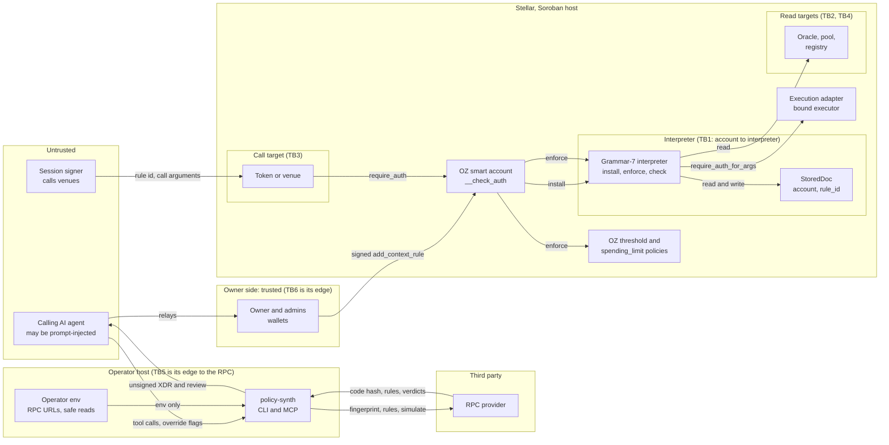

# OZ Policy Builder: STRIDE threat model, grammar 7

**Rerun:** 18 October 2026, on the final tree of `feat/grammar-v7` at `46e4c6a5` (after #20, seats and NEAR signer v2, and #21, the `contracts/` layout with the spike and every `prime-session` removed), plus the four commits of the pull request that carries this file. Sessions are seat-only on every chain from that date.
**First run:** 15 and 16 October 2026 on `9ff281a`, validated, kept below as "The model of 15 and 16 October" with its findings, priorities and reproducers. Its status table at 2.0.0 is replaced by the item-by-item status in this file.
**Grammar 6:** the grammar-6 model, still in production on mainnet, is [stride-threat-model.md](stride-threat-model.md).
**Networks:** Stellar testnet, Solana devnet, NEAR testnet and a local anvil fork of Base Sepolia, each with throwaway keys made for this run. Mainnet was read only.
**Live rows:** [g7-stride-2026-10-18.log](g7-stride-2026-10-18.log) lists every on-chain check with its transaction id.

## Summary

The rerun covered every component in the final tree. Every artifact rebuilt here equals its pin, and every deployed copy read here equals its build (NEAR v1 by its on-chain code hash, since `cargo-near` is absent on this machine). 1,417 checks on chains passed and none failed: 153 on Stellar testnet, 80 through the execution contracts on testnet, 129 on Solana devnet, 88 on NEAR testnet, 622 on a local fork of Base Sepolia (58 Foundry tests and 564 matrix rows) and 345 on a local Solana validator loading the deployed gate bytes.

This pull request closes two open items in the toolchain, test first: P0-2 (the account signs exactly the call that was built) and the first half of P1-7 (a recording is bound to the hash asked for). It also ports two records from `main`: the protocol-29 drift baseline and the mainnet upload of adapter `3dd675c0`.

New in this run, by severity:

| Severity | Count | Items |
| --- | --- | --- |
| High | 1 | G7S-1 |
| Medium | 1 | G7S-3 |
| Low | 6 | G7S-2, G7S-4, G7S-7, G7S-8, G7S-9 (fixed here), G7S-10 |
| Info | 3 | G7S-5, G7S-6, G7S-11 |

Open from earlier reviews and still at High: P0-3's owner-side decoder (E10-T.1), P0-4 override echo (E4), and C2 (`remove_signer` bricks an interpreter rule, an octopos fix in progress). Mainnet grammar-7 installs stay blocked on every open P0.

Decisions for Tuan are in "Decisions needed" at the end of the rerun sections. None of the fixes in this pull request changes a contract or a pinned hash.

## Scope of the rerun

| Component | Build | Deployed copy checked | Verification in this run |
| --- | --- | --- | --- |
| Stellar `policy-interpreter`, grammar 7 | `69cad1d5` (`build-wasm.sh`) | testnet `CDZV4AG4…` runs `69cad1d5`, live to ledger 8,229,508, limits as recorded | 397 tests and 18 in release; testnet rows X1 to X26, B5 to B7, G1 to G41 |
| Stellar `custody-gate` | `b01024f3` | code entry on testnet and mainnet | 3 tests; testnet `verify-execution-*` 80 of 80 |
| Stellar `execution-adapter` | `3dd675c0` | code entry on testnet and mainnet (uploaded 11 October 2026) | 45 tests; same 80 testnet rows |
| Stellar `test-blend-pool` | `7ba261ed` | none: testnet test double | code read |
| Stellar `prime-seat` | `393f0e5d` | testnet code entry; every seat deployed in this run reads back that hash | 21 tests; testnet setup, probe, a3, neg, bounded, g7 parts |
| EVM `PrimeSeat` | runtime `3b4402d5`, creation `4d355864` | octopos pins (template `bf34aaa2`) | 51 tests; 7 real-Safe tests and 564 matrix rows on a fork with real Safe 1.4.1, 1.5.0 and Zodiac Roles |
| Solana `prime-seat` | localnet `4428191f`, devnet `a389f4a1` | devnet `7ygNrK…` dumps to `a389f4a1`, authority none | 36 tests; devnet matrix 129 of 129 |
| Solana `custody-gate` | `a5d19edb` | devnet `6ieR7W…` dumps to `a5d19edb`, authority none | 43 app-check tests; 345 of 345 on a local validator with the mainnet feature set, mainnet Squads and Token-2022, loading the same bytes |
| NEAR `prime-near-signer` v1 | `c27904a3` | `signer.prime-spike-muwguc60.testnet` code hash equals the build | 5 live rows (v1 signs; v1 and v2 keys differ) |
| NEAR `prime-near-signer-v2` and vectors | `4b98d6d3`; vectors regenerate byte for byte | `seats.prime-spike-muwguc60.testnet` code hash equals the build | 4 tests (12 accepted, 42 refused); 88 of 88 live rows with the real MPC |
| `policy-synth`, CLI, MCP server | 2.0.1 at this head | npm `next` is 2.0.0 | 1,687 tests, isolated 1,665 / 6 / 16, two fixes, live builds against testnet |
| Scripts that deploy or sign | `scripts/*.ts` | | code read; `deploy-prime-mainnet.ts` run with no network: refuses on the interpreter hash before any secret or call |
| CI and supply chain | `.github/workflows/ci.yml`, `upstream-drift.yml` | | read; drift check run live |

Solana `prime-session` left the tree in #21. Its devnet program `6JyReewx…` stays deployed, final (dump `c8836361`, authority none) and still used by octopos `main`'s Solana app until that app drops the move-only session. It is out of this model's code scope.

## Method of the rerun

1. **Gate:** CONTRIBUTING.md order, TypeScript on Bun 1.3.14. Every step passed on `46e4c6a5`; the TypeScript steps passed again on this pull request's head. `git status` stayed clean after the contract tests. The NEAR v1 job needs `cargo-near`, absent on this machine; its deployed code hash equals the pinned build.
2. **Per component and trust boundary:** each STRIDE category, with the entry point, the control at file and line, and how the control was checked: a test that ran, the code, or a live run.
3. **Live runs:** new throwaway keys for every chain. Stellar from friendbot. Solana from the agents' devnet wallet `9AHQV6Wu…`, which spent 0.160 SOL. NEAR through the agents' relayer account (allowed by `near-int/funding/README.md`), one `flock` on `prime-refine/near.lock` per call. EVM on a local anvil fork of Base Sepolia.
4. **Prior items:** every row of the first run, every item of its status table and every finding of the reviews that fed this run (`review-opb20`, `review-opb21`, `g7-seats`, `near-review-contracts`, `proofs`) has a status below.
5. **Callers read:** octopos `main` at `bb040c0a`, read only: the relayer's NEAR calls, the Stellar seat removal plan, the Solana seat removal, the adapter pins and the mainnet build guard.

## Assets, actors and trust boundaries added for the final tree

The first run's tables below still hold for the interpreter and the toolchain. The final tree adds these.

| ID | Asset | Where it lives |
| --- | --- | --- |
| A8 | A seat's grants and session keys | Stellar seat temporary storage; EVM `sessions`; Solana grant signature checked per call, End marker per key |
| A9 | The NEAR signer code, root of every NEAR-routed owner key | `seats.prime-spike-muwguc60.testnet` (v2), `signer.prime-spike-muwguc60.testnet` (v1) |
| A10 | Custody's funds behind a gate | Stellar: the SAC allowance to the gate; Solana: the token account the gate PDA owns |
| A11 | A Safe and its Zodiac Roles rules | Base Sepolia |
| A12 | Build provenance | `contracts/build-hashes.json`, `deployments/*.json`, octopos pins |

| Actor | Trust | What it controls |
| --- | --- | --- |
| NEAR-routed owner (wallet on another chain) | Trusted for its seat | Signs readable grant and End texts through v2 |
| Session key | Untrusted after its grant | Votes and moves as the seat until the grant ends |
| Holder of a NEAR signer account key | Fully trusted (G7S-1) | Can deploy other code on the signer account |
| octopos relayer (Cloudflare Worker) | Semi-trusted | Pays NEAR calls, sponsors Stellar and Solana steps, holds the relayer account key |
| Custody and its trustee | Trusted for their funds | Gate creation, cap, release, rebind, cancel |
| CI runner and the third-party actions and installers | Semi-trusted | Every artifact built in CI |

- **TB7, NEAR signer to MPC:** the MPC derives a key from the caller account and the path. Whoever controls the signer account's code controls every key derived under it.
- **TB8, seat to account digest (Stellar):** the seat trusts that the account's `__check_auth` digest is `sha256(payload ‖ XDR(rule ids))`, the format of OZ account `91a2cd56`.
- **TB9, adapter to venues:** a batch may name only addresses on the gate's list.
- **TB10, gate to token program (Solana):** the gate signs as owner or as the cap delegate only.
- **TB11, CI to artifacts:** a build is trusted through its hash parity with the record.

## Status of every earlier item

"Fixed here" means a commit in this pull request; "Mitigated" means a control exists and a residual remains.

### The priority list of the first run

| Item | Status on 2026-10-18 | Evidence |
| --- | --- | --- |
| P0-1 mainnet pin and deploy pipeline | Open | `packages/policy-synth/src/config.ts:44` `mainnet: null`; `INTERPRETER_WASM` (`config.ts:51`) holds testnet builds only; no grammar-7 mainnet deploy script. `scripts/deploy-prime-mainnet.ts` deploys grammar 6 and refuses this tree on the interpreter hash, before reading a secret or calling a network (run with networking off) |
| P0-2 auth-tree binding | Fixed here (`bc0d20d`) | `install.ts:212-226` refuses unless the simulated `rootInvocation` is the built call with no sub-invocation. Tests: a forged sub-invocation, another call, and the same function with another argument are refused (`install.test.ts`, three cases). Live: real testnet simulations of an install with the interpreter alone, with `simple_threshold` and with `spending_limit`, and a revoke, all pass the check (`synth/live-p02.log`) |
| P0-3, first half: authority header | Done | unchanged since 2.0.0: `card.ts:361` `authority()` |
| P0-3, second half: owner-side decoder | Open, High | no XDR-to-review decoder in `packages/*/src` |
| P0-4 override echo and operator gating | Open, High | refusals still name the flag (`install.ts:336`, `394`, `399`, `478`, `483`); no `overrides` field; no environment switch on mainnet |
| P0-5 contract signer vetting | Open | `tools.ts:77` `anyAddress`, used for `signers` and `admins` (`tools.ts:524`) |
| P0-6 read safety | Lint done; two parts open | `install.ts:443` refuses `READ_UNSAFE` unless `POLICY_BUILDER_ALLOW_SPOT_READS=1`. The `gt(read, 0)` guard under `scaled` and a snapshot mark on read verdicts are still to build |
| P1-7 RPC answer binding | First half fixed here (`6185846`) | `record.ts:125-136` hashes the returned envelope under the network passphrase and refuses another hash (fee bumps answer to the outer and inner hash). Tests: 4 new cases. Live: two testnet transactions record, and the same envelope offered for another hash is refused (`synth/live-p17.log`). Second half open: `spec.ts` caches specs by wasm hash without hashing the fetched bytes |
| P1-8 tool output as data | Open | `envelope.ts:41-43` `messageOf` passes RPC text through, cut at 512 characters |
| P1-9 custody code provenance | Half done | seats: reproducible builds pinned in `contracts/build-hashes.json` with CI parity on every seat. OZ account `91a2cd56`: `deployments/oz-accounts.json` still records no source commit or build command |
| P1-10 threshold and `anyOne` | Done | unchanged; on chain re-confirmed by G3, G4 (seat alone and native alone refused `#3202` under `simple_threshold` 2) and G5 (both pass) |
| P1-11 default expiry | Open | `install.ts:433` defaults `validUntil` to `null`; the header says "never expires" |
| P2-12 spending-limit guard | Done | `install.ts:449-459` |
| P2-13 HTTP transport | Open | no token; the Host and Origin guard holds on loopback only (`http.ts:57-73`); with `allowExternalHost` both go |
| P2-14 DoS hygiene | Open | timeouts on the limits read and name reads only |
| P2-15 housekeeping | Open | `evidence/bun-audit.log` here is dated 2026-08-27 (this run's `bun audit`: no vulnerabilities); `POLICY_CONTRACTS` (`config.ts:146`) is an address list |
| Role-label spoof (E5) | Done | unchanged since 2.0.0 |

### The findings of the first run

| ID | Status on 2026-10-18 | Evidence |
| --- | --- | --- |
| S1 | Open with P0-1 | as above |
| S2 squat `(victim, rule_id)` | Control holds | X5: a stranger's `install` for a fresh rule id fails on chain at the account's `__check_auth` (tx `39fbb1cb…`); `lib.rs:119` |
| E2-S.3 unauthenticated local HTTP | Open with P2-13 | the MCP suite serves `tools/list` to a plain local POST |
| E9-S.1 to S.3 | Open, Low | display only |
| T1 forged sub-invocation | Fixed here with P0-2 | |
| E10-T.1, N2 | Open, High, with P0-3 | |
| T4 read manipulation | Mitigated by the lint | `grammar7.rs` still shows a wrapper defeating a spot read, as the model expects |
| T5 zero read price | Open, Low, with P0-6 | |
| E4-T.2 | Open with P0-6 | |
| E11-T.1 | Fixed here with P1-7 | |
| E9-T.1 | Open with P1-7 | |
| E15-T.1 | Open with P1-8 | |
| E8-S.2, 3.6 T | Open with P1-9 | |
| N5 | Open with P0-1. CI now runs on pull requests into this branch (13 jobs green on #21) | |
| N6 | Open: `deployments/prime-mainnet.json` has no CI parity; this pull request adds the `3dd675c0` upload record (G7S-3) | |
| T3 rule scoped to another policy contract | Open, Low | `lib.rs:96-100` refuses Default, the account and the interpreter only; X11 refuses the interpreter scope `#218` live |
| E4-T.1 | Low, no change | |
| T2 re-install smuggles admins or a stale predicate | Control holds | X14 nonce replay `#202`, X15 changed admin set `#203`, both with the account and the admin signing |
| R1 no interpreter events | Open, Low | |
| E1-R.1 | Open with P0-4 | |
| E4-R.1, R2 | No change | |
| I1 to I3 | No change | RPC endpoints come from the operator's environment only (`chain.ts:34-42`); no tool input names a URL |
| D2 admins uninstall alone | Confirmed live, Low | X24: the admin alone uninstalls (tx `e5ed2362…`), then X25: every call through the rule is refused `#206`, and X26: OZ still lists the rule. `lib.rs:237-241` |
| D1 | Low, no change | |
| D3 archival | Low | `enforce` bumps the rule entry (`lib.rs:193`); the testnet instance lives to ledger 8,229,508; mainnet has no grammar-7 instance |
| D4 CPU | Low, no change | |
| E1-D.1 and the other DoS rows | Open with P2-14 | |
| N7 orphan entry after `remove_context_rule` | Confirmed live, Low | G27 removes a rule through rule 0 (tx `851b3f94…`); G28 reads the interpreter entry still present; G41 shows OZ never reuses the id |
| E4 overrides | Open, High, with P0-4 | |
| E5 | Done | |
| N1 per-call cap | Mitigated | the header states "no total limit" and P2-12's `spendingLimit` binds a total |
| N3 contract signers | Open with P0-5 | |
| E1 1-of-n | Done with P1-10 | |
| N4 | Open with P1-11 | |
| E3 confused deputy | Low, no change | |
| E2 `remove_policy` | Low, no change | |
| 3.4 E | Low, with P0-4 | |
| N8 | Done with P2-12 | |

### Findings of the reviews that fed this run

| ID | Source | Status on 2026-10-18 | Evidence |
| --- | --- | --- | --- |
| C1 `External` refused `#212`, Default and self scope `#218` | review-opb20 | Holds, Low | B5, B6 `#218`; B7 `#212`. Grammar 6 refused `External` and Default too; grammar 7 adds the account and the interpreter as refused scopes |
| C2 `remove_signer` leaves an interpreter rule refusing every remaining signer | review-opb20 | Open, High, octopos | G26 to G35 with octopos `main`'s `removalPlan` (`seat-stellar-owners.ts`, byte-equal to `bb040c0a`): after the plan's `remove_signer` step (tx `633bc3bd…`) the native plus seat 0 are refused `#204`. Holds for every interpreter version. The octopos fix is in progress (`web-rule-removal`) |
| C3 orphan entry | review-opb20 | Holds, Low | as N7 |
| C4 a seat as policy admin can never authorise | review-opb20 | Holds, Low | `require_master` (`lib.rs:328-333`) against the seat's `__check_auth` (`prime-seat/src/lib.rs:116-123`); policy-synth could refuse an admin running the seat wasm (with P0-5) |
| F1 `permissions: contents: read` | review-opb20 | Fixed in #21 | `ci.yml:8-9`, `upstream-drift.yml` |
| F2 CONTRIBUTING gate list | review-opb20 | Fixed in #21 | |
| F3 `names.test.ts` order | review-opb20 | Fixed in #21 | passes alone and in the full run |
| F4 MCP 1 MiB test on Bun 1.3.14 | review-opb20 | Fixed in #21 | passes on Bun 1.3.14 in both TypeScript runs |
| F5 `build-hashes.json` date | review-opb20 | Fixed in #21 | |
| F6 C2 and C3 hold for every version | review-opb20 | Docs | for the docs pass |
| L1 the 413 leaves the socket open on Bun 1.3.14 | review-opb21 | Open, Low | `http.ts:81-83` sends `connection: close`; the CHANGELOG line needs the wording the review gives |
| L2, L3, L5 | review-opb21 | Docs | for the docs pass |
| L4 silent `prime-session` to `prime-seat` edit in this file | review-opb21 | Fixed here | note under "Priorities" below |
| N1 `deploy-prime-mainnet.ts` on the kept list | review-opb21 | Updated here | it now pins adapter `3dd675c0` with `main`; it still refuses this tree on the grammar-6 interpreter hash |
| N2 grammar-6 guard skipped with `PRIME_WASM_DIR` | review-opb21 | Low, no change | |
| N3 grammar-6 model paths | review-opb21 | Docs | |
| N4 `package/` left by the OZ fetch | review-opb21 | Open, Low | the gate script here deletes it after copying |
| H1 a removed seat keeps acting in rules that list it | near-review-contracts | Mitigated in the apps; contract residual Low | Stellar: G26 to G34 run octopos `main`'s plan and the removed seat then acts nowhere (`#3000`, `#3016`). Solana: `manage-signers-dialog.tsx` rewrites rules that list a removed seat (code read, no live run here). The seats read nothing about the owner list on Stellar and Solana; EVM `exec` asks `isOwner` (fork tests `test_removedOwnerSeatCannotExecOnSafe141` and `150`) |
| H2 relayer EVM template | near-review-contracts | Fixed in octopos #169 | relayer pins `bf34aaa2` |
| M1 v2 outside CI | near-review-contracts | Fixed in #20 | `near-v2` job and pin |
| L1 Stellar End lasts about 180 days | near-review-contracts | Low, no change | an old grant cannot return: v2 signs starts at most 300 s ahead and windows of at most 7 days |
| R1 to R8 | near-review-contracts | R4 is G7S-1; the others hold as accepted for beta | R7 shown again by B8, B9 (tx `b7484bc7…`) |

## STRIDE per component, final tree

Each row names the threat, where it enters, the control with its file and line, and how this run checked the control. Rows that the first run already covers for the interpreter and the toolchain are in its tables below and in the status tables above.

### Stellar `prime-seat` (`contracts/stellar/prime-seat/src/lib.rs`)

| STRIDE | Threat | Entry point | Control | Verified |
| --- | --- | --- | --- | --- |
| S | A session key votes in rule 0 as `Delegated`, or acts in another rule as `External`, so one session passes rule 0 alone (the #13 layout) | `__check_auth`, `verify` | the seat reads the rule ids from the digest preimage: `verify` serves rule ids all 0 (`:96`), `__check_auth` serves rule ids all non-zero and only the pinned account's frame (`:119-123`) | probe P1-3, P1-4, P3-1 refused `#1`; P2-2 refused `#3003`; G13 refused |
| S | A key's signature made for one seat used under another | proofs | the key signs `sha256(seat id ‖ digest)` (`:46-51`) | N1 refused (`Crypto, InvalidInput`), control N1c passes |
| S | The seat used by a second account | `verify` | `key_data` must equal the stored account id (`:97`) | N2 refused `#3003` |
| T | A grant replayed after an End, or an older grant after a newer one | `grant` | an End stores 0 and blocks every later grant; a grant needs a later end than the stored one (`:72-77`) | N7, N8 refused |
| T | A grant that starts in the future or lasts over 7 days | `grant` | `start <= now <= end`, `end - start <= 604,800` (`:73`) | N5, N6 refused |
| R | Grants and Ends leave no event | `grant` | transaction history only | accepted for beta |
| I | Grants are public ledger entries | storage | inherent | |
| D | A temporary End expires after about 180 days | storage | old grants cannot return (v2's time rules) | near-review L1 |
| E | A session key compromised during its window | key | the window (at most 7 days) and the End by owner or key | G16 to G21, N4, N7 |
| E | The seat's signature also authorises contexts after the first in its own entry (G7S-5) | `__check_auth` (`:116`) | the key must sign the whole entry | code read; Info |

### Stellar policy interpreter, grammar 7, entry points called directly

| STRIDE | Threat | Entry point | Control | Verified |
| --- | --- | --- | --- | --- |
| S | A stranger installs or re-installs for someone else's account | `install` | `smart_account.require_auth()` (`lib.rs:119`) | X4, X5 fail on chain at the account's `__check_auth` (tx `cc3dd3d0…`, `39fbb1cb…`) |
| S | A stranger drives `enforce` to run reads or bump a rule's TTL | `enforce` | `smart_account.require_auth()` (`lib.rs:167`) | X6 fails on chain the same way (tx `32e44c35…`) |
| T | A signer set change rides on an old install | `enforce` | `signers_hash` compared on every call, `#204` (`lib.rs:181-182`) | G35 `#204` |
| T | A malformed install | `install` | hash `#208`, empty admins `#209`, interpreter as admin `#219`, interpreter scope `#218`, 17 operators `#217`, grammar 6 `#200` | X8 to X13 |
| T | A rule scoped to the account or Default | `install` | `lib.rs:96-100` | B5, B6 `#218` |
| E | Admins rotate themselves without the account, or the account without the admins | `rotate_master_signer_set`, `bind_executor` | both parties (`lib.rs:145-147`, `256-257`) | X16, X17, X20, X21 refused; X19 both signing (tx `efc2ec71…`); X22 operators unchanged after rotation |
| D | Admins alone uninstall, and the rule then denies everything (D2) | `uninstall` | admins only (`lib.rs:237-241`) | X24, X25, X26 |
| I | `check` used as a free caller of read targets | `check` | always fails, rolls back (`lib.rs:215-235`) | X7: `#0` for a permit, `#100` for a deny |

### EVM `PrimeSeat` (`contracts/evm/prime-seat/src/PrimeSeat.sol`)

| STRIDE | Threat | Entry point | Control | Verified |
| --- | --- | --- | --- | --- |
| S | Sessions vote alone on the Safe | `isValidSignature` | a live key's signature over `(seat, h)` plus a Safe owner's own signature over `h` (`:78-84`) | 58 rows "sessions alone refused" across Safe 1.4.1 and 1.5.0, 2-of-3 and 3-of-5, on the fork |
| S | The grant preimage passed off as a Safe signature | `isValidSignature` | the 1.4.1 form needs 66 bytes starting `0x1901` (`:87-90`) | 60 preimage rows: the 1.4.1 preimage and its 65- and 66-byte prefixes refused, the 0x1901 controls pass |
| T | `exec` aimed at the Safe, an enabled module, the seat, or as a delegatecall | `exec` | `:64-68` | rows "exec refusals" and `test_execRefusesModulesTheSafeEnabled` |
| T | A signed `exec` replayed, or held past a re-grant | `exec` | nonce and the session end in the digest (`:70`) | replay and held-back grant rows refused (28 exec refusal rows) |
| E | A seat removed as an owner keeps moving through Roles | `exec` | `isOwner(seat)` (`:65`) | `test_removedOwnerSeatCannotExecOnSafe141` and `150`; 48 owner-check rows in each matrix run |
| E | A signed `exec` waits until the end of its session (G7S-4) | `exec` | none per call | code read; Low |
| I | `isValidSignature` answers address 0 (off-chain reads) | view | the same checks apply | code read; Info |

### Solana `prime-seat` (`contracts/solana/prime-seat/src/lib.rs`)

| STRIDE | Threat | Entry point | Control | Verified on devnet |
| --- | --- | --- | --- | --- |
| S | A grant for another account, key or owner | `process` | the ed25519 instruction must carry the owner's signature over the grant hash of this settings, seat and key (`:57-59`, `:91-95`) | T6, T8a to T8d, M9 refused `0x7`; M8, M10 refused by the ed25519 program; M12 refused by Squads (`NotASigner`) |
| S | The ed25519 instruction index points elsewhere | `signed_by` | the header and length are fixed, and the key and message are read from the verified instruction (`:94-95`) | M6, M7, M11 refused |
| T | A session creates a transaction, so the content of a change would come from a session | `process` | allow-list of six vote calls and `executeTransactionSyncV2` with a policy payload of kind 0 to 2 (`:74-76`) | F4, F4b, F6a to F6d, P7, P8b, S0a, S1 refused `0x8`; F5a, F5b refused by Squads |
| T | A key reused after its End | marker | a call is refused when the marker account is owned by the program (`:56`) | R1.1 to R1.5, R3, R4, R5, R7 |
| D | A stranger pre-funds the marker to block an End | End | the End assigns the funded marker to the program, so funding it first changes nothing (`:61-68`) | R7a to R7c: the End still works |
| E | The key is the owner itself | `process` | `Custom(9)` (`:53`) | R8 refused `0x9` |
| E | A removed seat acts in a rule that lists it | policy use | app rewrites the rules on removal (octopos) | near-review H1 (validator); app code read |

### Solana `custody-gate` (`contracts/solana/custody-gate/src/lib.rs`)

| STRIDE | Threat | Entry point | Control | Verified on the local validator |
| --- | --- | --- | --- | --- |
| S | A caller other than the two lanes moves funds | `transfer` | the lane must sign and be the agent or owners vault (`:73-74`) | section T |
| S | A gate created against a Squads account with a settings authority | `create` | settings authority must be zero (`:46`) | G11 refused `0x5` |
| T | The agent pays outside the list, after the end time or past the cap | `transfer` | destination owner on the list, `now <= until`, delegate cap (`:75-87`) | sections T, E, A, B |
| T | The close-and-reopen bypass | `allow` | the source's close authority must be the gate or none (`:101`) | section X: X1 to X6 |
| E | One custody key raises the cap | `allow` | a raise needs the multisig threshold, a cut needs one signer (`:97`) | section A |
| E | Custody releases alone | `release` | the threshold (`:112`) | section R |
| D | A stranger pre-funds the gate address | `create` | transfer, allocate, assign (`:53-63`) | section G |
| T | Any one multisig member creates the gate at the expected seed with other parameters (G7S-7) | `create` | the app reads the gate back before the hand-over (`app-checks`, "gate read-back") | code read; Low |
| I | Slot counting over 11 slots where SPL counts `n` (G7S-6) | `votes` (`:140-146`) | unused slots of an initialised multisig are zero | code read; Info |

### Stellar `custody-gate` and `execution-adapter`

| STRIDE | Threat | Entry point | Control | Verified on testnet |
| --- | --- | --- | --- | --- |
| S | Another contract draws on custody's allowance | gate `pull` | caller auth and caller code hash (`custody-gate/src/lib.rs:74-80`) | "pull from a foreign gate listed on ours" refused |
| T | A batch pays an address the gate does not list | adapter `check`, `scan`, `scan_data` (`execution-adapter/src/lib.rs:289-434`) | every target, argument, nested value, auth entry and address-shaped bytes | address-rule: 14 refusals, 7 controls; 45 unit tests including the muxed cases |
| T | A batch drives the Prime's own `execute` | `check` | `PrimeTarget` (`:299-301`) | refused `#1` |
| T | A stored batch runs early, late or twice | `run` | window check and delete before run (`:256-262`) | `#6` before the wait, lapse after the window, run once |
| E | The run rule approves an immediate `execute` or a cancel | the Prime's run rule | the rule's predicate permits `run` only | "a stranger executes at once through the run rule" `#100` |
| E | The Prime rebinds the adapter to its own gate | `rebind` | the current gate's custody signs (`:168-175`) | "the Prime admin tries to rebind" refused; custody rebinds |
| E | Mainnet gates made before 11 October pin a muxed-passing adapter (G7S-3) | old adapter builds | octopos flags them (`EXECUTOR_PASSES_MUXED_WASM_HASHES`) | code read; Medium |

### NEAR signers (`contracts/near/prime-near-signer`, `prime-near-signer-v2`)

| STRIDE | Threat | Entry point | Control | Verified on NEAR testnet |
| --- | --- | --- | --- | --- |
| S | A caller gets a grant signed without the wallet | v2 `sign` | wallet signature over the rendered text, per scheme (`prime-near-signer-v2/src/lib.rs:138-163`, `:190-196`) | 16 signature negatives refused |
| T | A vote, a free payload or a non-canonical field signed | v2 `plan` | typed requests, `deny_unknown_fields`, votes refused by name (`:56`, `:123`) | 12 former vote shapes, 26 canonical-form negatives refused |
| T | A start far ahead, or a long window | v2 `plan` | `start <= now + 300`, `0 < end - start <= 604,800` (`:101-102`) | 4 time vectors; 17 boundary rows against the block time |
| S | v1 and v2 keys collide | MPC derivation | the predecessor differs | 5 rows; v1 signs an arbitrary payload for a wallet signature (tx `4iu99Lph…`) |
| E | The holder of a signer account key deploys other code (G7S-1) | NEAR account keys | none on chain | `view_access_key_list`: one FullAccess key on each signer account |
| E | v1 signs any payload the wallet approves (G7S-2) | v1 `sign` (`prime-near-signer/src/lib.rs:20-31`) | the wallet text shows the payload hex | live tx above; Low |

### `policy-synth`, CLI, MCP server

| STRIDE | Threat | Entry point | Control | Verified |
| --- | --- | --- | --- | --- |
| T | A lying RPC changes what the account signs | `buildSelfCall` | Fixed here: the tree must be the built call (`install.ts:212-226`) | 3 tests; 4 live builds |
| T | A lying RPC records another flow | `recordHash` | Fixed here: envelope hash check (`record.ts:125-136`) | 4 tests; live |
| S | A web page drives the HTTP tools | `http.ts` | loopback bind, Host and Origin guard (`http.ts:55-73`) | MCP suite, 16 of 16 |
| D | A large body | `http.ts` | 1 MiB limit, 413 (`http.ts:12`, `:81-83`) | MCP suite on Bun 1.3.14; review-opb21 L1 for the socket |
| I | Secrets in errors | `messageOf` | URL credentials stay out of errors (first run) | unchanged |
| E | The agent writes outside the out directory | `outFile` | bare name, `wx` flag (`tools.ts:585-609`) | unchanged; tests |
| I | Key handling | packages | the packages hold no key: they return unsigned XDR | grep: no secret key use in `packages/*/src` |

### Scripts and CI

| STRIDE | Threat | Entry point | Control | Verified |
| --- | --- | --- | --- | --- |
| T | A deploy script uploads an unreviewed build | `deploy-prime-mainnet.ts` | sha256 check of every artifact before a secret or a call | run with networking off: refuses on the interpreter hash |
| T | A grammar-6 deploy from grammar-7 source | `deploy-grammar6-testnet.ts:93` | `SELF_VERSION` guard (skipped with `PRIME_WASM_DIR`) | review-opb21 |
| I | A deploy secret on the command line (G7S-10) | `deploy-grammar6-testnet.ts:102` | `--secret` or `DEPLOY_SECRET` | code read; Low |
| T | A build that drifts from its pin | CI | hash parity on every contract (`ci.yml`) | all parity steps green locally |
| T | A third-party action or installer changes under a tag (G7S-8) | `ci.yml` | tags only; `curl \| sh` for Solana and cargo-near | code read; Low |
| E | A workflow token writes to the repository | workflows | `permissions: contents: read` in both; `pull_request`, never `pull_request_target` | code read |
| D | Upstream moves unseen | `upstream-drift.yml` | weekly check from `main` | run live: protocol 29 on both networks against a baseline of 28 here (G7S-9) |

## New findings

### G7S-1, High: both NEAR signer accounts hold a FullAccess key

- **What:** `seats.prime-spike-muwguc60.testnet` (v2) holds one FullAccess key (`ed25519:9hEsUKUV…`), kept in `~/.near-credentials` on the agents' VM. `signer.prime-spike-muwguc60.testnet` (v1) holds `ed25519:K7JPXNYz…`, the same key as the relayer account `prime-spike-muwguc60.testnet`, which the octopos relayer Worker uses to pay NEAR calls.
- **Impact:** the holder can deploy other code at either account and get MPC signatures under every key derived there, for any wallet path, with no wallet signature. For v2 that is every NEAR-routed seat owner on Stellar, Solana and EVM: grants for any session key, so votes beside a native signature on rule 0 and moves alone in rules that list the seat. Beta accepts this as R4 (Q10). For production it is a blocker.
- **Controls today:** none on chain. The relayer calls `seats.*` with no code-hash check (`apps/prime-relayer/src/near-sign-live.ts`); the client checks the MPC signature against the offline-derived key, which a redeployed contract still passes.
- **Fix:** after a last code-hash check, delete the key on `seats.prime-spike-muwguc60.testnet` (a `DeleteKey` signed by itself); the code becomes permanent and no hash changes. Retire or lock v1 the same way (G7S-2). A relayer check of the code hash before each call would detect a redeploy only for calls that go through the relayer; a direct caller bypasses it, so it adds detection without prevention.
- **Decision:** Tuan, before any account holds value. I removed no key.

### G7S-2, Low: NEAR signer v1 signs any payload its wallet approves, and stays deployed

v1 asks the MPC to sign `payload` for any wallet that signs the v1 text, and the text shows the payload only as hex. Live row: the MPC returned a signature for an arbitrary payload under the v1 key (tx `4iu99Lph…`). octopos `main` calls only `seats.*` (relayer `NEAR_SIGNER_ACCOUNT`, `apps/web/ui/octopos/near/request.ts:30`), and mainnet builds refuse the NEAR client (`apps/web/scripts/assert-mainnet-build.ts`). Keys derived under v1 are owners of spike-era testnet accounts only (round 9, EVM Safes on Base Sepolia). v1 is redundant in this tree: v2 serves every seat. Proposed: move `contracts/near/prime-near-signer` and its CI job out of the tree (it stays at a tag), and lock or delete the deployed account under G7S-1. Decision for Tuan; I changed nothing.

### G7S-3, Medium: mainnet gates made before 11 October 2026 pin an adapter build that passes a muxed recipient

The adapter `3dd675c0`, which refuses a muxed address and address XDR given as bytes, was uploaded to mainnet on 11 October 2026. This branch's `deployments/prime-mainnet.json` still listed only `68d012e7`; this pull request ports `main`'s record (`updates[0]`, upload tx `23c83e44…`). A gate pins its caller's code and has no setter, so a gate created on mainnet between 1 and 11 October names `68d012e7`, a build that lets a batch pay an account behind a muxed address the gate never listed. The exposure needs an agent rule that leaves a transfer recipient open (rules that pin every recipient with `eq` or `in` compare by XDR and stay safe) and funds the adapter can move. octopos marks such gates (`execution-adapter-v3.ts`, `EXECUTOR_PASSES_MUXED_WASM_HASHES`, `adapterBuildIsSuperseded`) and refuses to confirm them. Which mainnet gates pin `68d012e7` cannot be listed from public read-only tools: neither Soroban RPC nor Stellar Expert filters instances by wasm. The one mainnet adapter in the repository's records, `CATAOK5A…` from the September demo, runs `57bf132b`, an earlier design. Proposed: list mainnet gates with an indexer query over contract instances by wasm hash (`b01024f3`, `2788f05b`), read each gate's `caller_code`, and move each affected account to a new gate and adapter. Decision for Tuan: who runs the scan.

### G7S-4, Low: EVM `PrimeSeat.exec` has no per-call deadline

A signed `exec` stays valid until the session ends, the owner grants the key again, or another `exec` uses the nonce. Anyone holding it can submit it. A deadline in the digest would bind it to a time; that is a contract change, a new hash and new pins, so it waits for the next seat build.

### G7S-5, Info: the Stellar seat checks only the first context of its own entry

`__check_auth` reads `c.get(0)` (`prime-seat/src/lib.rs:116`). Further contexts in the same seat entry ride on the key's signature over the entry's payload. Reaching them needs the session key to sign that payload, so a holder of the key gains nothing it did not have.

### G7S-6, Info: the Solana gate counts all 11 multisig slots

`votes` counts every slot (`custody-gate/src/lib.rs:144`), where SPL Token counts the first `n`. For an initialised multisig the slots past `n` are zero, so both counts agree.

### G7S-7, Low: any one member of custody's multisig can create the gate at an expected seed

The gate address derives from the multisig, the settings and the seed, and the remaining parameters (lanes, recovery, end time, list) are free. The trustee could create a gate at the seed custody planned with other parameters; custody's create then fails. The app's read-back of the gate before the hand-over is the control (`app-checks`, "gate read-back"), and custody's funds move only after the hand-over.

### G7S-8, Low: CI trusts mutable tags and unverified installers

Actions are pinned by tag (`actions/checkout@v4`, `oven-sh/setup-bun@v2`, `Swatinem/rust-cache@v2`, `actions/cache@v4`, `foundry-rs/foundry-toolchain@v1`). Solana CLI and cargo-near install through `curl | sh` with no checksum, and `cargo install cargo-audit --version ^0.22` floats. The workflow token is read-only and the jobs hold no secret, and every contract artifact is held to its recorded hash, so a tampered tool can turn CI red or hide a test failure, while a changed artifact still fails parity. Proposed: pin actions by commit, download the two installers by version with a checksum, pin cargo-audit exactly.

### G7S-9, Low, fixed here: the drift baseline was protocol 28 while both networks run 29

The drift check failed live on this branch. `65f4e91` accepts 29 on the evidence of this run's testnet suites, as `main` did in `2d4098a`. The weekly schedule runs from `main`, which already carries 29.

### G7S-10, Low: `deploy-grammar6-testnet.ts` takes a secret on the command line

`--secret S` (`scripts/deploy-grammar6-testnet.ts:102`) puts a deployer secret in shell history and the process list. Testnet throwaway keys only. Proposed: read it from `DEPLOY_SECRET` alone, as `deploy-prime-mainnet.ts` does.

### G7S-11, Info: the MCP SDK differs from `main`

This branch pins `@modelcontextprotocol/sdk` 1.31.0 and `main` 1.32.1. 1.31.0 is the first release patched for GHSA-6qxp-vccf-f47h, `proxy-addr` is pinned at 2.0.8 on both, and `bun audit` reports nothing here. Aligning to 1.32.1 is optional.

## Proposed fixes for open Medium and High items

| Item | Fix | Where | Changes a pinned contract? |
| --- | --- | --- | --- |
| G7S-1 | delete the FullAccess key on the v2 account after a code-hash check; lock or retire v1 | NEAR accounts | no |
| C2 | plan `remove_context_rule` and `add_context_rule` without the owner for a rule with an interpreter policy, and say so in the dialog | octopos `seat-stellar-owners.ts` | no |
| P0-4 | echo every `allow*` as the first review line and as `overrides[]`; drop the hint from refusals; on mainnet honour `allow*` only with an operator switch | `policy-synth` | no |
| P0-3 second half | a `review_unsigned(xdr)` decoder the Prime app runs on the owner's side | `policy-synth`, octopos | no |
| P0-5, N3 | refuse a contract signer or admin unless its code is a pinned seat or OZ account build; refuse a seat as admin (C4) | `policy-synth` | no |
| G7S-3 | list affected mainnet gates; move each account to a new gate and adapter | ops, octopos | no |
| P0-1, N5, N6 | grammar-7 mainnet deploy script, record with CI parity, then the pin | `scripts`, `deployments`, `config.ts` | a new mainnet deployment, no change to testnet pins |
| P1-9 | record the OZ account's source commit and build, or reproduce `91a2cd56` | `deployments/oz-accounts.json` | no |

## Decisions needed

1. **G7S-1:** delete the FullAccess key on `seats.prime-spike-muwguc60.testnet` now, or before the first account with value; and whether v1's account is locked the same way.
2. **G7S-2:** take NEAR signer v1 and its CI job out of the tree (it stays at a tag).
3. **G7S-3:** who lists the mainnet gates that pin `68d012e7` and tells their owners.
4. **P0-4 and P0-3:** whether the toolchain drops the override hints and adds the owner-side decoder before the next release.
5. **Optional on-chain hardening at the next audited interpreter build:** account auth on `uninstall` when OZ calls it (D2, C3), events (R1), refusal of scopes on policy contracts (T3); and a deadline in the EVM seat's `exec` digest (G7S-4) at the next seat build.

## Evidence of the rerun

| What | Where | Result |
| --- | --- | --- |
| Live rows with transaction ids | [g7-stride-2026-10-18.log](g7-stride-2026-10-18.log) | every row passed |
| Stellar testnet accounts | `X` `CBGUC6FI…D2LK` (interpreter rows), `G` and the setup and probe accounts in the log | |
| Stellar execution contracts | Prime `CBK3NDXC…`, gate `CDKPBWAZ…`, adapter `CDKLFIJP…` (wait); Prime `CDGRJRAD…`, gate `CDNBNHL5…`, adapter `CDJS3PHB…` (address rule) | 45 and 35 checks |
| Solana devnet | seat program `7ygNrK…`, 129 rows, payer `9AHQV6Wu…` spent 0.160 SOL | 129 of 129 |
| Solana gate | local validator, gate bytes `a5d19edb`, the harness of the gate review run on the in-tree build and the in-tree `setup-checks.ts` | 345 of 345 |
| EVM | anvil fork of Base Sepolia, octopos `bb040c0a` onboarding code, real Safe 1.4.1, 1.5.0 and Zodiac Roles, stand-in NEAR owners | Foundry 58 of 58; matrix 380 and 184 |
| NEAR | real MPC, `seats.*` and `signer.*` | 88 of 88 |
| Gate logs, harnesses and keys (keys stay off-repo) | `/home/ubuntu/work/prime-refine/reports/g7-stride-evidence/` on the agents' VM | |

---

## The model of 15 and 16 October 2026

The sections below are the first run on `9ff281a`, as validated then. Their file and line references are to that tree; the status of each item on 18 October is in the tables above.

### Method of the first run

1. **Two STRIDE passes, per element:** one on chain (the interpreter's entry points, predicate evaluation, and its composition with the OZ smart account and OZ policies), one off chain (policy-synth, the CLI and the MCP server over stdio and HTTP).
2. **Validation:** an independent validator re-ran every reproducer, re-rated each finding from a Prime institution's point of view (what can a prompt-injected or compromised agent, or a lying RPC, get past the owner?), added eight threats both passes missed (N1 to N8) and merged the two priority lists. Its verdicts are the severities in this file.
3. **Signed tests:** 10 tests on the real OZ account wasm (`91a2cd56`) sign every authorisation step with a real `SorobanAuthorizationEntry` and use policy wasm fetched from testnet with matching hashes. All 10 pass.

**Correction to the earlier reproducers:** the on-chain reproducers P1 to P5 used mocks. P1 to P3 ran a stand-in account calling `enforce` directly, with mocking switched off at the step that matters. P4 and P5 drove the real account's `__check_auth` through `try_invoke_contract_check_auth`, with the delegated signers mocked. The final report describes them as fully signed, and that description is wrong. The 10 signed tests re-confirmed the three results that carry the most weight (read manipulation through a wrapper, 1-of-n on a rule with policies, `spending_limit` failing closed) with no mocks, and negative controls show the host enforcing the signatures (a forged operator signature fails, and so does a forged or absent oracle-admin signature).

**Severity:** likelihood times impact for an institution using Prime. **Confirmed:** reproduced in a test with authorisation enforced at the step that matters. **Theoretical:** reasoned from the code.

### Assets

| ID | Asset | Where it lives |
| --- | --- | --- |
| A1 | Funds and positions held by the smart account | OZ account, tokens, venues |
| A2 | Stored rule document (`StoredDoc`: predicate, executor, nonce, signer hash, master set) | interpreter storage, key `(account, rule_id)` |
| A3 | Install parameters: predicate bytes and hash, nonce, admins, optional cap and threshold | `add_context_rule` arguments built off chain |
| A4 | Signer sets: the rule's operators (pinned by `signers_hash`) and the master set (Policy Signer role) | OZ account storage and A2 |
| A5 | The unsigned XDR and its review text | tool response and `outFile`; the only things the wallet signs and the owner reads |
| A6 | Trust pins: `INTERPRETER`, `INTERPRETER_WASM`, `OZ_ACCOUNT_WASM`, `POLICY_CONTRACTS`, `SAFE_READS` | `packages/policy-synth/src/config.ts`, `deployments/*.json` |
| A7 | Availability of authorisation: the TTL of A2 and of the interpreter's instance and code | ledger state |

### Actors

| Actor | Trust | What it controls |
| --- | --- | --- |
| Account owner and admin signers (rule 0) | Fully trusted | Sign the install XDR after reading a review |
| Policy Signer (master set, `admins`) | Trusted to administer | Uninstall alone; with the account, re-install, rotate the set, bind an executor |
| Calling AI agent (MCP or CLI client) | Untrusted, may be prompt-injected | Tool inputs: `signers`, `admins`, expiry, caps, override flags, `interpreterAddress` on mainnet |
| Agent or session signer (a rule's signer) | Untrusted after install | Which rule it claims, the call arguments, what else runs in the transaction |
| Operator | Trusted for the host | The MCP server's environment: RPC URLs, `POLICY_BUILDER_OUT_DIR`, operator safe reads, `POLICY_BUILDER_ALLOW_SPOT_READS` |
| RPC provider | Semi-trusted: untrusted for integrity | Every chain read, simulation and reported code hash |
| Read targets (oracles, pools, registries) | Trusted by the rule author as far as their admins | Arbitrary code that runs inside `enforce` |
| OZ smart account and OZ policies (`simple_threshold`, `weighted_threshold`, `spending_limit`) | Trusted code, pinned by hash | Call `install` and `enforce`; compose policies as all-of |
| Execution adapter (bound executor) | Trusted Prime component | Authorises calls when a rule binds it |
| Prime app and its keep-alive job | External | Relays reviews to the owner; extends TTLs |
| Soroban host | Trusted | Auth framework, re-entry ban, rollback, budget |

### Trust boundaries

- **TB1, account to interpreter:** `install` and `enforce` arguments come from the calling account and are believed as given, bounded by the key `(account, rule_id)` and `account.require_auth()`.
- **TB2, interpreter to read targets:** external code runs inside `__check_auth`, with the interpreter as invoker.
- **TB3, authorised call to predicate:** every call argument is chosen by the signer.
- **TB4, ledger state to predicate:** `read` results and `now` are as trustworthy as whoever can move them.
- **TB5, builder to chain:** code hashes, rules and simulations come from an RPC; the owner approves text derived from them.
- **TB6, builder to owner:** the review text and the XDR reach the owner through the untrusted agent. The owner's only trusted input is the wallet's rendering of the XDR.

### Data flow

### Findings by STRIDE category

IDs are the final report's (S1, T1, ...), the off-chain pass's (E...), the on-chain pass's section numbers (3.x) or the validator's (N...). The fix column points at the priority list below.

#### Spoofing

| ID | Threat | Validated severity | Evidence | Fix |
| --- | --- | --- | --- | --- |
| S1 (E8-S.1, 3.6 S) | Mainnet has no pinned interpreter, so `interpreterAddress` is agent input. A lying RPC can report a trusted code hash for another contract, which then polices the rule | Medium | Theoretical; `config.ts:44` | P0-1 |
| S2 (3.1 S) | A signer squats `(victim, rule_id)` before the owner installs | Info | `install` always calls `smart_account.require_auth()` | None |
| E2-S.3 | Any local process can call the MCP HTTP tools: there is no authentication | Medium on a shared host, Low otherwise | Confirmed: an unauthenticated local POST gets 200 | P2-13 |
| E9-S.1 to S.3 | A contract's parameter names mislead, a fake token claims a known symbol, a short address is ground to look alike | Low | Theoretical | None |

#### Tampering

| ID | Threat | Validated severity | Evidence | Fix |
| --- | --- | --- | --- | --- |
| T1 (E5-T.1) | A lying RPC adds sub-invocations to the account's auth entry. The unsigned XDR carries the extra call and the review shows only `add_context_rule` | Medium, High before a mainnet pin | Confirmed: a forged `transfer` sub-invocation reaches the account's entry | P0-2 |
| E10-T.1, N2 | The agent relays the review and the XDR, and no tool or app decodes the XDR on the owner's side. Every review control reaches the owner through the agent | High (raised from Medium) | Theoretical; this is the seam the review controls depend on | P0-3 |
| T4 (3.3 T) | Same-transaction read manipulation: a wrapper contract moves a pool's value, has the account's authorisation checked, and moves it back. The interpreter cannot detect it, because Soroban exposes neither the call stack nor the transaction root to a contract | High, if any mainnet rule uses `read` | Confirmed with signed entries: a wrapper moves a reserve from 100 to 1,000 and a denied `act(80)` is permitted; a static cap of 60 binds it; an admin-set oracle cannot be moved by the operator | P0-6 |
| T5 (P3) | A read price of 0 zeroes a `scaled` floor | Low (lowered from Medium: reachable only through a hand-written `expr` or `encodedPredicate`) | Confirmed | P0-6 |
| E4-T.2 | A verdict on a predicate with a `read` is a snapshot of state at simulation time | Medium, merged into P0-6 | Theoretical | P0-6 |
| E11-T.1 | `recordHash` records whatever envelope the RPC returns for hash H without checking its hash | Medium | Confirmed: hash `aaaa…` recorded against an unrelated envelope | P1-7 |
| E9-T.1 | Specs are cached by wasm hash without hashing the fetched bytes | Low | Theoretical; display only | P1-7 |
| E15-T.1 | Indirect prompt injection: RPC error text and recorded string arguments reach the agent verbatim | Medium | Confirmed: an RPC error appears verbatim in 3 tool outputs | P1-8 |
| E8-S.2, 3.6 T | The OZ account build `91a2cd56`, the custody contract, does not reproduce from any known source | Medium (raised from Low) | `deployments/oz-accounts.json` records two failed reproductions | P1-9 |
| N5 | There is no grammar-7 mainnet deploy pipeline, and CI had never run on this branch | Medium (blocks P0-1) | `scripts/deploy-prime-mainnet.ts` deploys grammar 6 | P0-1 |
| N6 | `deployments/*.json` is held to source only on testnet; no CI parity covers a mainnet record | Medium (mainnet) | `ci.yml` | P1-9 |
| T3 (3.1 T) | A rule scoped to another policy contract exposes its admin calls; only the builder's address list refuses it | Low | `config.ts:146` | P2-15 |
| E4-T.1 | `install_policy` is not bound to an earlier `verify_policy` | Low (lowered from Medium): the install response carries its own review, built from the bytes it installs | Theoretical | None |
| T2 (3.1 T) | A re-install smuggles a new admin set or a stale predicate | Info | `signers_hash` re-checked, nonce must be prior plus one | None |

#### Repudiation

| ID | Threat | Validated severity | Evidence | Fix |
| --- | --- | --- | --- | --- |
| R1 (3.1 R) | The interpreter emits no events for install, uninstall, rotation or executor binding | Low | OZ emits its own policy events | Open question |
| E1-R.1 | No record of which override flags produced an XDR | Low, merged into P0-4 | Theoretical | P0-4 |
| E4-R.1 | `ok: true` without `complete: true` is read as proof | Low | The tool description warns | None |
| R2 (3.2 R) | Which rule and signer authorised a call shows only as a deny code in diagnostics | Info | | None |

#### Information disclosure

| ID | Threat | Validated severity | Evidence | Fix |
| --- | --- | --- | --- | --- |
| I1 (3.1 I) | A mandate (counterparties, caps, venues) is public ledger state | Info | Inherent | None |
| I2 (E4-I.1) | Every predicate under consideration is sent to the RPC in simulations | Low | Inherent to simulation | None |
| I3 (E2-I.1, E11-I.1) | The RPC hostname appears in transport errors | Low | Confirmed: query strings and basic-auth credentials stay out of errors; the hostname appears | None |

#### Denial of service

| ID | Threat | Validated severity | Evidence | Fix |
| --- | --- | --- | --- | --- |
| D2 (P2) | The master set uninstalls a rule without the account, and the rule then always denies. `admins` is agent input, defaulting to `sourceAccount` | Low | Confirmed | Open question |
| D1 (3.1 D) | A contract in the master set that never authorises bricks the rule's administration | Low | Theoretical | None |
| D3 (3.2 D) | An archived rule entry makes authorisation fail | Low on mainnet (lowered from Medium), and TTL upkeep must ship with the grammar-7 rollout | `enforce` bumps the rule entry; instance and code need extending by the keep-alive job | External actor |
| D4 (3.2 D) | CPU per call | Low | Worst case measured within budget (see "Configurable limits" below) | None |
| E1-D.1, E2-D.1, E3-D.1, E7-D.1, E11-D.1 | Deep inputs, concurrent HTTP calls, hostile rule counts, RPC calls with no timeout | Low | `deep.ts`: a 400 KB nested body errors in about 0.7 s and the server keeps serving | P2-14 |
| N7 | Revoke through `remove_context_rule` leaves the interpreter's document behind | Info | Theoretical; rent only | None |

#### Elevation of privilege

| ID | Threat | Validated severity | Evidence | Fix |
| --- | --- | --- | --- | --- |
| E4 (E5-E.1, E6-E.1) | The refusal text names the override flag (`allowOverlap`, `allowUnboundedAmount`, `allowOpenSlippage`, `allowAdminRule`), the agent sets it, and the success response does not say a refusal was overridden | High | Confirmed | P0-4 |
| E5 (E10-S.1) | The review showed only the predicate: an agent could name its own key as signer, leave expiry unset and pass an attacker address as `admins`, and the attacker address read as a role inside the predicate | High | Confirmed at `9ff281a`: the attacker recipient read «admin» in the review, and the governed signers appeared only as wire values | P0-3, role-label fix |
| N1 | A cap inside the predicate is per call. An agent can repeat the call and move the whole balance of the scoped token, while the review reads "must be at most 500" | High | Review output at `9ff281a` | P0-3, P2-12 |
| N3 | `signers` and `admins` accept any contract address. A signer contract whose `__check_auth` returns `Ok` lets anyone use the mandate | Medium-High | `tools.ts:77` | P0-5 |
| E1 (P4, 3.2 E) | A rule with any policy is satisfied by any ONE of its signers, and the review did not say so | Medium | Confirmed on the deployed account bytes; re-confirmed by the signed tests: `simple_threshold(2)` denies A alone `#3202` and permits A+B; weighted {A:2, B:1}, threshold 2 permits A and denies B `#3213` | P1-10 |
| N4 | `validUntilLedger` is optional and defaults to never, so an agent key stays authorised until someone revokes it | Medium | `install.ts:418` | P1-11 |
| E3 (P1) | The interpreter acts as a confused deputy through a read's side effects | Low: needs value or a role granted to the interpreter's address | Confirmed | Open question |
| E2 (P5) | `remove_policy` on an agent rule leaves an unconstrained signer | Low for Prime (lowered from Medium): needs rule-0 auth | Confirmed | Open question |
| 3.4 E | The agent names a looser rule it also holds | Low on chain; off chain the guard is the overridable `allowOverlap` | Theoretical | P0-4 |
| N8 | `spending_limit` denies every function except `transfer`, and the builder attached it to any predicate | Low (usability) | Confirmed: `approve` denied `#3223` while the interpreter permits it | P2-12 |

### Priorities

Items 5, 9 and 11 said `prime-session` in the model of 15 and 16 October. They were changed to `prime-seat` on 18 October 2026, when sessions became seat-only on every chain.

The numbering is the final report's. The validator's merged list numbers the same items differently and has one more P1, a keep-alive for grammar-7 rule entries; that job lives in the Prime app, so here it is the external actor in D3.

**P0, before any mainnet grammar-7 install:**

1. **P0-1, pin the mainnet interpreter through a reproducible pipeline:** a grammar-7 mainnet deploy script with an artifact hash check and a record, CI run on the branch so the parity gate passes, then `INTERPRETER.mainnet` set so any other address is refused.
2. **P0-2, bind the auth tree to the operation:** refuse unless the simulated `rootInvocation().function()` equals the built call and has no sub-invocations, and show the auth tree in the review.
3. **P0-3, put the authority grant in the review and render it on the owner's side:** first, an authority header (signers in full, who can act alone, admins and their powers, expiry, rolling total or "no total limit", interpreter); second, a `review_unsigned(xdr)` decoder that a wallet or the Prime app can run without the agent.
4. **P0-4, take overrides away from the agent:** echo every `allow*` used as the first review line and as `overrides[]`, drop the "set allowX" hint from refusals, and on mainnet honour `allow*` only when the operator sets an environment switch.
5. **P0-5, vet contract signers:** refuse a contract in `signers` or `admins` unless its live code hash is a pinned `prime-seat` or OZ account build, and show the hash in the header.
6. **P0-6, read safety, if any mainnet rule uses `read`:** refuse reads of targets and functions outside an operator-controlled safe list, mark movable reads in the review, refuse `scaled` over a read without `gt(read, 0)`, and mark read verdicts as snapshots. If no mainnet rule reads, this is P1.

**P1, soon:**

7. **P1-7, RPC answer binding:** check the envelope's hash in `recordHash`; hash fetched wasm before caching it.
8. **P1-8, treat tool output as data:** reduce non-simulation RPC errors to a code and status; mark recorded strings and rule names as untrusted in the tool descriptions.
9. **P1-9, provenance of custody code:** document the source build or reproduction of the OZ account and `prime-seat` builds in `deployments/*.json`, with CI parity for mainnet records.
10. **P1-10, 1-of-n and thresholds:** a threshold option that attaches OZ's `simple_threshold` or `weighted_threshold`, and refuse several signers without one unless `anyOne` is explicit.
11. **P1-11, default expiry for agent rules:** require `validUntilLedger` or a `prime-seat` signer for mainnet installs.

**P2, later:**

12. **P2-12, spending-limit usability:** guard `spendingLimit` against predicates that permit anything but `transfer`, and say in the review whether there is a rolling total.
13. **P2-13, HTTP transport:** an optional bearer token from the environment; refuse an out directory that is group- or world-writable.
14. **P2-14, DoS hygiene:** RPC timeouts, a cap on concurrent HTTP tool runs, a simulation budget per call.
15. **P2-15, housekeeping:** refresh `evidence/bun-audit.log`; refuse scopes by policy code hash in place of an address list.

### Configurable limits, shipped after the model

The interpreter the model ran against had its limits compiled in: `DECODE_LIMITS`, with at most 4 reads per predicate. On 2026-10-16, after the model, `9ff9b5f` made the limits a deploy-time `Limits` struct, and `5728d23` set the byte ceiling to 40 KiB. Each instance now fixes its own `max_reads` between 1 and 8 at deploy time and returns it from `limits()`. The testnet pin, `CDZV4AG4…` (wasm `69cad1d5`, built from `5728d23`), was deployed with 8. These changes are in 2.0.0.

What this changes in the model:

- **Read budget:** the final report's "reads capped at 4" (T4) now reads "at most `max_reads` distinct reads per predicate, up to 8, fixed per instance at deploy time". The binding cost is memory: the interpreter README ("Reads and the per-transaction context budget") measures 8 wasm reads at 12.7 MB for one context and 11.4 MB for each further one, so a transaction holds at most 2 such contexts inside the 80% margin, and 4 exceed the limit and fail closed with `Budget ExceededLimit`. CPU for 8 reads is about 7.7M (`evidence/worst-case-ceilings-2026-10-16.txt`: 7,735,068).
- **Severity:** T4 is unchanged. One movable read is enough for the wrapper attack, so a higher read count only widens the set of read targets whose admins a rule must trust. The safe-list lint applies to every read.
- **Evidence instance:** `evidence/oz-threshold-g7-live.log` ran on `CA5ICI2O…`, a grammar-7 testnet instance with compiled-in limits that the current pin supersedes. The threshold result depends on OZ's policies and is unaffected.

### What held up

- **Reproducible build:** at `9ff281a`, `./build-wasm.sh` gave `a975353d…`, the pinned testnet bytes at the time. The current pin `69cad1d5` is recorded as built from `5728d23` in `deployments/grammar7-testnet.json`.
- **Host and Origin guard on the HTTP transport:** a 12-case matrix (200 ×4, 403 ×7, 415 ×1) blocks DNS rebinding and cross-site requests.
- **Scope refusal:** the interpreter refuses a rule scoped to Default, to itself or to the account, checked on the real OZ account bytes.
- **`check` always panics:** reads inside `check` roll back, and no state survives.
- **Immutability:** the interpreter has no upgrade entry point.
- **Worst case without reads:** 48.1M CPU of 400M for the largest single rule at `9ff281a`.
- **`outFile`:** a bare-name regex and `O_CREAT | O_EXCL` stop traversal, overwrites and symlink follows.
- **Secrets in errors:** query strings and basic-auth credentials stay out of errors.
- **Signer set pinned:** every `enforce` compares the stored signer hash with the live set and denies `204` on a change.
- **`spending_limit` fails closed:** OZ v0.7.2 `spending_limit.rs:292` panics `NotAllowed` for anything but a well-formed `transfer`. In the signed test C1 (cap 500 per 100 ledgers), `transfer 500` is permitted, a further `transfer 1` in the same period is denied `#3221`, `approve` is denied `#3223` while the interpreter permits it, and `transfer 500` is permitted again after 101 ledgers.
- **Threshold beside the interpreter:** OZ runs every policy's `enforce` on every permit, so a threshold binds (signed tests B1, B2; live log above).

### Rejected and downgraded claims

- **3.4-E2, "`spending_limit` counts only `transfer`, so `approve` and venue calls escape the cap":** rejected. The on-chain author read `spending_limit.rs:242` and missed `:292`, which panics for every other context. The residual is N8 (Low, usability), closed by P2-12.
- **E4-T.1, install not bound to verify:** lowered from Medium to Low, because the install response carries its own review built from the bytes it installs.
- **3.2 D, archival:** lowered from Medium to Low on mainnet, with TTL upkeep required for the grammar-7 rollout.
- **P3, a zero read price zeroes a `scaled` floor:** lowered from Medium to Low; the intent layer never builds it.
- **P5, `remove_policy` widens an agent rule:** lowered from Medium to Low for Prime; it needs rule-0 auth.
- **E10-T.1, the agent relays the review:** raised from Medium to High.
- **E8-S.2 and 3.6 T, the OZ account build does not reproduce:** raised to Medium for `91a2cd56`, the custody contract.

Corrections to the final report, found while checking it against the code:

- P1 to P5 used mocks (see Method); the report calls them fully signed.
- Its C1 summary says the cap "denies transfer 5000". That figure comes from the validator's separate test (`transfer 500` and `5000` against a cap of 500). C1 itself denies a second transfer of 1 within the period.
- It says the authority header shows a contract signer's code hash. The header shows the address only.
- It describes the spending-limit check as a warning added under P0-3. It shipped as a refusal, under P2-12 (`c8aea8b`).

### Open questions

- **Multi-seat co-signing:** when a 2-of-3 rule 0 has to authorise the install, how does the Prime co-sign flow re-wrap `buildSelfCall`'s single-signer auth, and does the owner-side review still bind what the seats sign? For such a rule the simulation fails today, which is fail-closed.
- **Wallet rendering:** how Freighter or a custodian renders `add_context_rule` arguments and auth entries decides how much of P0-3 the tools must carry.
- **Mainnet reads:** whether any mainnet grammar-7 rule will use `read` decides whether P0-6's open parts are P0 or P1.
- **1-of-n on chain:** the interpreter is immutable, so before a mainnet grammar-7 deploy it has to be decided whether `enforce` should require every rule signer, or whether the threshold option (P1-10) and the header's wording stay the control.
- **Optional on-chain hardening:** account auth on `uninstall` (D2, E2), events from `install`, `uninstall`, `rotate_master_signer_set` and `bind_executor` (R1), and an on-chain refusal of scopes on other policy contracts (T3). Each needs a re-audit, so the question is whether to bundle them into the audited mainnet build.
- **Interpreter addresses:** monitor them for value or roles granted to them (E3).

### Reproducers

| What | Where | Result |
| --- | --- | --- |
| Threshold beside the interpreter, live on testnet | `evidence/oz-threshold-g7-live.log`, from `packages/policy-synth/scripts/live-threshold.ts` (`WEIGHTED=1` for the weighted run) | 2-of-2: A alone denied `#3202`, A+B permitted. Weighted {A:2, B:1}, threshold 2: B alone denied `#3213`, A permitted |
| Read budget at the ceiling | `evidence/worst-case-ceilings-2026-10-16.txt`, from `tests/worst_case.rs` on wasm `69cad1d5` | 8 wasm reads in one context: 7,735,068 CPU, 12.7 MB memory |
| Read manipulation through a wrapper (repo version) | `contracts/stellar/policy-interpreter/tests/grammar7.rs` | A wrapper defeats a spot read |
| On-chain P1 to P5 | Kept off-repo: `tests/stride_poc.rs` written against `9ff281a` | 5 of 5 pass (mocked, see Method) |
| Off-chain | Kept off-repo: `zz_stride.test.ts` (forged sub-invocation, unbound `recordHash`), `http.ts` (12-case Host and Origin matrix), `inject.ts`, `leak.ts`, `ssrf.ts`, `deep.ts` | 2 of 2 tests pass; each script reproduces |
| `spending_limit` denies non-transfer | Kept off-repo: the validator's test on OZ account `91a2cd56` with the testnet `spending_limit` bytes `9ce30ea1` | Without the cap, `transfer 500`, `transfer 5000` and `approve` pass; with a cap of 500, only `transfer 500` passes |
| 10 fully signed tests | Kept off-repo: `stride_checks.rs` with the OZ account, threshold and `spending_limit` wasm fixtures | 10 of 10 pass: A1 to A6 read manipulation, B1 and B2 thresholds, C1 spending limit, and OZ v0.7.2's caps of 5 policies and 15 signers per rule |

The off-repo files were written for the 15 to 16 October run against `9ff281a` and were not committed.
