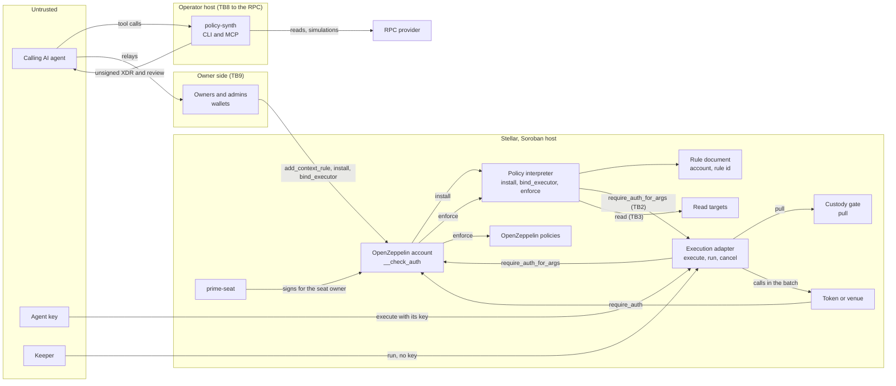

# STRIDE threat model

**Date:** 20 October 2026.
**Tree:** this repository's Stellar contracts and packages, with the build hashes in `contracts/build-hashes.json`: policy interpreter `810f53f1…`, custody gate `b01024f3…`, execution adapter `4985cd12…`, `prime-seat` `393f0e5d…`. Each was rebuilt with its `build-wasm.sh` for this run and equals its pin.
**Network:** Stellar testnet only, with throwaway keys made for each run and funded by friendbot.
**Live rows:** [executor-binding-testnet.log](executor-binding-testnet.log) for the keyless rules and the executor binding; the `execution-*-testnet.log` files for the gate and the adapter; [oz-threshold-live.log](oz-threshold-live.log) for thresholds beside the interpreter. The index is [README.md](README.md).

Every threat has one ID, by STRIDE category: `S-`, `T-`, `R-`, `I-`, `D-`, `E-`. The tables give the control at file and line in this tree, how it was checked, and a status:

| Status | Meaning |
|---|---|
| Holds | the control exists and the check in the Verified column passed in this run or in the test suites at this tree |
| Open | a gap with the severity given; section 8 lists every open item |
| Accepted | a residual we keep on purpose, with the reason in section 9 |
| By design | the behaviour is the feature; the docs state it |

## 1. Scope

**In scope:**

| Component | Path | Build |
|---|---|---|
| Policy interpreter | `contracts/stellar/policy-interpreter/src` | `810f53f1…` |
| Execution adapter, with a gate and with none | `contracts/stellar/execution-adapter/src/lib.rs` | `4985cd12…` |
| Custody gate | `contracts/stellar/custody-gate/src/lib.rs` | `b01024f3…` |
| `prime-seat` | `contracts/stellar/prime-seat/src/lib.rs` | `393f0e5d…` |
| Off-chain synthesiser, CLI, MCP server | `packages/policy-synth`, `packages/policy-builder-cli`, `packages/policy-builder-mcp` | this tree |
| Scripts and CI | `scripts/`, `.github/workflows/` | this tree |

**Out of scope, with the trust we place in each:**

- **OpenZeppelin smart account and policies:** `__check_auth`, rule selection, signer semantics and the `simple_threshold`, `weighted_threshold` and `spending_limit` policies work as documented. Two account builds matter here. The keyless rules are verified against an OpenZeppelin 0.8.0 account, built from upstream commit `8e25220` (wasm `8286422f…`, a fixture in `policy-interpreter/tests/fixtures/`), because they rely on two of its checks: `DelegatedSignerIsContextContract` (3017) and `NoSignersAndPolicies` (3004). The Prime accounts on testnet run `91a2cd56…`, a 0.7.2-line build (`deployments/oz-accounts.json`).
- **Soroban host:** `require_auth`, `require_auth_for_args`, `authorize_as_current_contract`, the refusal to re-enter a contract already on the stack, rollback on a panic, budgets and state archival. The executor binding relies on one host property in particular: an authorisation context that names the adapter as the called contract exists only because the adapter's own code asked the account (E-02).
- **`test-blend-pool`:** a test double with Blend's authorisation shape and no reserve accounting, testnet only.
- **RPC providers and wallets:** an RPC answers truthfully about the chain, except where a row below defends against one that lies; a wallet signs only what it shows.
- **The seat's key custodian:** the seat owner is an ed25519 key whose holder signs a raw grant hash. In the reference integration that holder is a NEAR-routed MPC signer, outside this tree (E-25).
- **The Prime app:** a separate repository that builds transactions and refuses dangerous rule shapes before a wallet signs. The contracts never rely on it.

## 2. Assets

| ID | Asset | Where it lives |
|---|---|---|
| A1 | Funds and positions held by the Prime account | the OpenZeppelin account, tokens, venues |
| A2 | A rule's stored document: predicate, executor binding, nonce, signer hash, admin set, recorded scope | interpreter persistent storage, key `(account, rule id)` |
| A3 | The unsigned XDR and its review text | tool output; the only things the owner reads and the wallet signs |
| A4 | Custody's allowance to its gate | the token's allowance from custody to the gate |
| A5 | A stored batch and its wait | adapter persistent storage, by batch number |
| A6 | The adapter's binding: Prime, gate, `min_wait`, run window | adapter instance storage; the address commits to the last three |
| A7 | A seat's session grants | `prime-seat` temporary storage |
| A8 | Trust pins: interpreter address and hash, account and policy builds, safe reads | `packages/policy-synth/src/config.ts`, `deployments/*.json`, `contracts/build-hashes.json` |
| A9 | Availability: the time to live of A2, A5, A6 and the contract instances and code | ledger state |

## 3. Actors

| Actor | Trust | What it controls |
|---|---|---|
| Prime owners (the signers of rule 0) | Fully trusted | Anything the account may do: add and remove rules and signers, install and bind policies, create adapters, store and cancel batches |
| Policy admins (a document's master set) | Trusted to administer | With the account: install again, rotate the set, bind an executor. Alone: `uninstall` |
| Agent key (a rule's signer) | Untrusted after install | The rule it cites, the call arguments, what else runs in the transaction |
| Keeper | Untrusted | Any account. Submits a keyless `run` of a ready stored batch, choosing only when inside the run window |
| Custody and its trustee | Trusted for their own funds | The gate's list and caller, the allowance, `rebind`, `cancel` |
| Calling AI agent (MCP or CLI client) | Untrusted, may be prompt-injected | Tool inputs: signers, admins, expiry, caps, override flags, the interpreter address where none is pinned |
| Operator of the MCP server | Trusted for the host | RPC URLs, output directory, safe reads, the switches that allow overrides and spot reads |
| RPC provider | Untrusted for integrity | Every read, simulation and reported code hash |
| Read targets (oracles, pools, registries) | Trusted by the rule author as far as their admins | Code that runs inside `enforce` |
| Seat key custodian | Trusted for its seat | Signs grant and End texts for the seat owner |
| CI runner, third-party actions and installers | Semi-trusted | Every artifact CI builds |

## 4. Trust boundaries

- **TB1, account to interpreter:** `install`, `enforce` and `uninstall` arguments come from the calling account. `install` believes the rule it is handed; `enforce` gets the rule from the account's own storage.
- **TB2, interpreter to executor:** for a bound rule, the adapter's authorisation of the exact account and context, or, for the adapter's own `run` under a rule scoped to it, the host's guarantee that only the adapter's code produced that context.
- **TB3, interpreter to read targets:** external code runs inside `__check_auth`, with the interpreter as invoker.
- **TB4, authorised call to predicate:** every call argument is the signer's choice.
- **TB5, adapter to venues:** with a gate, a batch may name only addresses on the gate's list; with none, only the Prime's rules bound it.
- **TB6, gate to its caller:** the gate pays only its one caller, only while that caller runs the pinned build.
- **TB7, seat to account digest:** the seat reads the rule ids out of the account's digest preimage `sha256(payload ‖ XDR(rule ids))`, the form of the 0.7.2-line account.
- **TB8, builder to chain:** code hashes, rules and simulations come from an RPC.
- **TB9, builder to owner:** the review text and the XDR reach the owner through the untrusted agent; the owner's trusted input is the wallet's rendering, or `review_unsigned` run on the owner's side.
- **TB10, CI to artifacts:** a build is trusted through its hash parity with the record.

## 5. Data flow

**The keyless run path:** a keeper calls `adapter.run(id)`. The adapter asks the account for `(id)`. The account's entry cites the run rule (scoped to the adapter, no signer, the interpreter its one policy, bound to that adapter) and carries an empty signer map. `enforce` accepts no authenticated signer for that rule because it lists none, has one policy and is bound; it takes the adapter's own `run` context as the adapter's request; the predicate `call_fn == run` permits it. A venue in the batch then asks the account, and its context is checked under the venue rule, where the binding requires the adapter's grant.

## 6. Threats per component

### 6.1 Policy interpreter, entry points and evaluation

Lines are in `contracts/stellar/policy-interpreter/src/lib.rs`.

| ID | STRIDE | Threat | Control | Verified | Status |
|---|---|---|---|---|---|
| S-01 | S | A stranger installs a document for another account's rule id first, so the owner can never install or uninstall there | `smart_account.require_auth()` on every install, the first included (`:125`); a re-install needs the stored admins and the same admin set (`:127-135`) and the next nonce (`:136-137`) | `tests/install_enforce.rs` (`f2_first_install_requires_smart_account_authorization`), `tests/role_separation.rs` | Holds |
| S-02 | S | A stranger drives `enforce` to run a predicate's reads or extend a rule's lifetime | `smart_account.require_auth()` (`:191`) | `tests/enforce_state.rs` (`enforce_requires_the_smart_accounts_authorization`) | Holds |
| S-03 | S | A call with no authenticated signer passes a rule meant for a key | an empty signer set passes only a keyless rule: it lists no signer, the interpreter is its only policy, and an executor is bound (`:204-209`, 210) | testnet rows b6, n6, n7 (210); `oz08` X5, X14 | Holds |
| T-01 | T | A re-install or an install misstates the rule's scope, so the run-pin check sees another contract | `install` records the scope it was given; `enforce` checks the scope OpenZeppelin passes from its own storage (`:215-220`) | testnet row n5b: the misstated install succeeds, then `execute` and `run` under the rule are refused 221 | Holds |
| T-02 | T | The rule's signers change after install and the old document keeps permitting | sha256 of the rule's signer set, stored at install, compared on every call (`:233-234`, 204) | `oz08` X9 (`remove_signer` on a keyed bound rule, 204) | Holds |
| T-03 | T | A malformed or over-broad install | a predicate format version the instance does not run 200 (`:58`), byte cap 207 (`:63-64`), hash 208 (`:71-72`), decode 201, signer sets (empty 209, `External` 212, the interpreter itself 219, over 16 217), scope `Default`, the account or the interpreter 218 (`:102-106`), a predicate with no selector 216 (`:113`) | unit tests and `tests/install_enforce.rs` | Holds |
| T-04 | T | A rule scoped to another policy contract (an OpenZeppelin threshold policy) hands its signers that contract's admin calls | on chain only `Default`, the account and the interpreter are refused; `policy-synth` refuses the known policy addresses (`POLICY_CONTRACTS` in `config.ts`) | code read | Open, Low |
| T-05 | T | A wrapper contract moves a read target's value inside the same transaction, has the account's authorisation checked, and moves it back | the interpreter cannot see the call stack; `policy-synth` refuses a read outside the operator's safe list (`READ_UNSAFE`) unless the operator allows spot reads | `tests/reads_and_clock.rs` shows a wrapper defeating a spot read | Open, High where a rule uses `read` (section 8) |
| E-01 | E | A bound rule answers a call the executor never approved | every context under a bound rule needs `executor.require_auth_for_args((account, context))` (`:229-231`) | testnet rows b1 to b4, n2, n8a, n8d (binding); `oz08` X1, X2 | Holds |
| E-02 | E | The executor's own request is taken as its approval for more than `run` | the exemption covers one case: the rule is scoped to the executor and the context is the executor's `run` (`:221-228`). `execute` and `cancel` still need a grant, and a batch cannot carry a grant for its own `execute`. The host produces a context naming the adapter only when the adapter's code asked (trust assumption) | testnet rows n1 (keyless `run` permits), b1 to b4 (`execute`, `cancel` refused at the binding) | Holds |
| E-03 | E | A rule scoped to its executor leaves `run` open, so the executor's grant-free request answers any of its functions | the predicate must pin `call_fn == run` on every path (`pins_call_fn`, `dsl.rs:514-526`): at `bind_executor` against the recorded scope (`:166-171`), at a re-install under a kept binding (`:139-144`) and in `enforce` against the account's own rule (`:219-220`), 221 | testnet rows n4, n5, n8c, n5b, n5c (221); `tests/keyless.rs` | Holds |
| E-04 | E | The owners take the interpreter off a keyless rule with `remove_policy`, leaving a rule with no signer and no predicate | the account refuses a rule with no signer and no policy (3004); the interpreter refuses a keyless rule with a second policy (210), so every keyless rule it permits has one | testnet row n3 (3004); `oz08` n3, X6 | Holds |
| E-05 | E | A rule whose signer is the adapter (`Delegated(adapter)`) answers anyone while the adapter is the one asking: during its own `execute`, `run` or `cancel` | on the 0.8.0 account, a delegated signer that is a contract called in the operation is refused (3017) at first use; the keyless rule lists no signer. On the 0.7.2-line account the shape still works; `policy-synth` refuses it for an adapter with no gate in any rule, and for a gated adapter in a rule scoped to itself unless the predicate pins `run` (`install.ts:597-600`) | testnet rows c1, c1b (3017); `oz08` X6 | Holds on 0.8.0; Open, Low on the 0.7.2-line account |
| E-06 | E | A rule bound to an adapter with no gate passes the binding | that adapter hands out no grant (`Uncheckable`, adapter `lib.rs:479-482`) and stores no batch (`NoWait`, `:246`), so `run` finds nothing (`NotScheduled`, `:286`) before it asks the Prime; every context under the rule fails the binding | testnet rows n8a to n8e | Holds |
| E-07 | E | A rule's admins rotate themselves without the account, or bind an executor alone | rotation needs the account and the stored admins (`:304-305`); `bind_executor` needs the account and the admins (`:163-165`) | `tests/role_separation.rs`, `tests/keyless.rs` | Holds |
| E-08 | E | The admins alone detach a rule's binding: `uninstall` deletes the document with its executor, and the next install stores none | `uninstall` needs only the admins (`:285-289`). A keyless rule then refuses every call (206 with no document, 210 once one is installed again). A keyed bound rule runs without the adapter's check once the owners install again, which needs the account | `tests/keyless.rs` (uninstall then install, 210) | Open, Low |
| E-09 | E | The account alone takes the interpreter off a keyed rule: OpenZeppelin's `remove_policy` goes on when the policy's `uninstall` fails | needs rule 0's quorum; on a keyless rule the account refuses the removal (E-04) | `oz08` n3 (a keyed rule may drop its policy) | Open, Low |
| E-10 | E | The interpreter acts as a confused deputy through a read's side effects | needs value or a role granted to the interpreter's address | code read | Open, Low |
| E-11 | E | Any one signer of a policed rule acts alone, because OpenZeppelin leaves the signer count to the policies | `policy-synth` attaches `simple_threshold` or `weighted_threshold` and refuses several signers without one unless `anyOne` is set and echoed | [oz-threshold-live.log](oz-threshold-live.log): under `simple_threshold(2)` A alone is refused 3202, A and B together permitted; a weighted threshold that one signer meets alone is refused by `install_policy` before any transaction | Holds |
| E-12 | E | A per-call cap is repeated until the scoped balance is gone | the review says "no total limit"; `policy-synth` attaches OpenZeppelin `spending_limit` for a total and refuses it on predicates that permit more than `transfer` | `policy-synth` tests | Holds |
| R-01 | R | `install`, `uninstall`, rotation and `bind_executor` emit no event | OpenZeppelin emits its own policy events | code read | Open, Low |
| I-01 | I | `check` used as a free, unauthenticated caller of read targets | `check` always fails, so the host rolls back every effect (`:263-283`) | unit tests | Holds |
| I-02 | I | A mandate's counterparties, caps and venues are public ledger state | inherent | | Accepted |
| D-01 | D | The admins `uninstall` a rule, which then refuses every call (206) | the owners can remove the rule or install again | `tests/keyless.rs` | Open, Low |
| D-02 | D | A rule entry archives and authorisation fails | `enforce` extends the entry on every permit (`:240-241`); instance and code need extending by whoever runs the deployment | code read | Open, Low |
| D-03 | D | One call uses more CPU or memory than the network allows | deploy-time limits; `tests/worst_case.rs` keeps the largest rule at every ceiling at or under 80% of every network limit | [worst-case-ceilings.txt](worst-case-ceilings.txt) | Holds |
| D-04 | D | A document stays behind after `remove_context_rule` | rent only; OpenZeppelin never reuses a rule id | code read | Accepted, Info |
| D-05 | D | `remove_signer` on a policed rule leaves it refusing every remaining signer | fails safe (204); the rule is replaced, never edited in place | `oz08` X9 | By design, Low |
| D-06 | D | A seat set as a policy admin can never authorise, so the document's administration is stuck | `policy-synth` could refuse a seat as admin; with E-27 in section 8 | code read | Open, Low |
| D-07 | D | A rule scope OpenZeppelin 0.8.0 adds (`CreateContractExternalRef`) fails to decode | `install` fails, so the rule never installs; the interpreter denies every non-contract context anyway | code read | By design, Info |

### 6.2 Execution adapter

Lines are in `contracts/stellar/execution-adapter/src/lib.rs`. With a gate, the gate's list bounds every address a batch names; with none, the adapter checks no address and only the Prime's rules bound a batch.

| ID | STRIDE | Threat | Mode | Control | Verified | Status |
|---|---|---|---|---|---|---|
| S-04 | S | Someone creates a Prime's adapter at the address custody agreed, with a lower `min_wait` or a longer window | both | the address must derive from the Prime and the sha256 of a fixed domain string and `XDR((gate, min_wait, run_window))`, else `NotWhereAgreed` 8 (`:178-187`) | [execution-wait-testnet.log](execution-wait-testnet.log) | Holds |
| S-05 | S | A stranger, or another Prime, runs a batch through a Prime's adapter | both | `prime.require_auth_for_args((calls, grants, wait))` over the whole request (`:240-247`) | execution logs; adapter unit tests | Holds |
| T-06 | T | A batch names an address off the gate's list, in a target, an argument at any depth, raw bytes, a strkey or a grant | gated | `check`, `scan`, `scan_data`, `scan_entry` (`:322-488`), before any call runs and again at `run` | [execution-address-rule-testnet.log](execution-address-rule-testnet.log) | Holds |
| T-07 | T | A batch calls the Prime's own `execute` or admin functions | both | `PrimeTarget` 1 (`:335`) | address-rule and null-gate logs | Holds |
| T-08 | T | A batch re-enters the adapter to run or cancel another batch | both | the host refuses re-entry | execution logs | Holds |
| T-09 | T | The runner changes what runs, or runs it twice, early or late | gated | the batch is stored whole and `run` takes only its number; the entry is removed before any call; the window is checked (`:282-298`) | wait log | Holds |
| T-10 | T | The wait is shorter than the approver saw | gated | the wait is inside the Prime's approval; `min_wait` binds every caller, owners included; a rule can demand more with `call_arg(2) >= N` | wait log | Holds |
| E-13 | E | Grants or `executor_authorizations` carry the adapter's authority to unlisted contracts | both | gated: `scan_entry` checks every entry; no gate: refused (`Uncheckable` 3, `:479-482`) | address-rule and null-gate logs; testnet row n8e | Holds |
| E-14 | E | The binding moves without custody, an adapter with no gate gains one, or a gated one loses it | both | `rebind` needs the bound gate's custody, asks the successor for `custody()`, takes an address, and refuses with no gate (`NoGate` 9, `:211-217`) | wait, address-rule and null-gate logs | Holds |
| E-15 | E | Someone other than the Prime or the gate's custody cancels a stored batch | gated | `cancel` (`:307-315`) | wait log | Holds |
| E-16 | E | The owners bind an adapter to a gate of their own and give an agent a rule on it, so Prime-held funds move to the owners' list | gated | custody's funds stay behind custody's gate (S-06); the owners' own list bounds the rest. The owners need rule 0's quorum for the adapter and both rules | code read; the gate's caller pin | Open, Low |
| E-17 | E | An adapter with no gate checks no address | no gate | by design: every batch runs at once (`NoWait`), it cannot call the Prime, it hands out no grant, and an OpenZeppelin Prime checks each context against its own rules; anything sent to the adapter or approved to it can be moved by whoever the Prime's rules let call `execute` | [execution-null-gate-testnet.log](execution-null-gate-testnet.log) | By design, Low |
| E-18 | E | A stored batch outlives the authority that approved it: the agent's rule is removed, and the batch still runs | gated | `cancel` by the Prime or custody; removing the run rule pauses every stored batch; revoking the allowance; the window | wait log | Accepted, Medium |
| E-19 | E | The wait covers custody's allowance only; positions the Prime holds itself move under the owners' rules with no wait | gated | none in this stack: the adapter governs what passes through it | | Accepted |
| R-02 | R | Storing, running, cancelling and rebinding emit no event | both | the stored state is public; a watcher reads storage | | Accepted |
| R-03 | R | A signed bundle that failed runs later from the same entry | both | the nonce is spent by a successful run; the expiry ledger bounds the entry; an entry with source-account credentials holds only in that source's transaction | null-gate log | Holds; residual Low (section 9) |
| I-03 | I | Pending batches and their run time are public for the whole wait | gated | a swap carries a return floor fixed at approval | | Accepted |
| D-08 | D | A stored batch, the adapter or the gate archives before a run | both | `execute` and `run` extend the adapter's instance; a stored batch is extended until its window closes, capped at the network maximum; the gate's instance extends on nothing | adapter unit tests | Open, Low |
| D-09 | D | A ready batch goes unrun and lapses | gated | any account can run it; a lapsed batch moves nothing | wait log | Accepted |
| D-10 | D | The bound gate is archived or fails, so `cancel` and every batch fail with it | gated | removing the run rule through rule 0 stops every stored batch without touching the gate; anyone can restore the instance | code read | Accepted, Info |

### 6.3 Custody gate

Lines are in `contracts/stellar/custody-gate/src/lib.rs`.

| ID | STRIDE | Threat | Control | Verified | Status |
|---|---|---|---|---|---|
| S-06 | S | Another contract, or an adapter with no gate, draws on custody's allowance | `pull` needs the caller's authorisation and that the caller runs `caller_code` (`:74-77`) | address-rule log; null-gate log (a no-gate adapter's pull refused) | Holds |
| E-20 | E | Value leaves to an address custody did not list | `DestinationNotAllowed` 1 (`:78-80`) | address-rule log | Holds |
| T-11 | T | The list, the caller or the custody changes after funding | no admin, no setter, no upgrade | code read | Holds |
| T-12 | T | A token custody never approved is drawn | the allowance is per token | address-rule log | Holds |

### 6.4 `prime-seat`

Lines are in `contracts/stellar/prime-seat/src/lib.rs`.

| ID | STRIDE | Threat | Control | Verified | Status |
|---|---|---|---|---|---|
| S-07 | S | A session key votes in rule 0 as `Delegated`, or acts in another rule as `External`, so one session passes rule 0 alone | `verify` serves rule ids that are all 0 (`:96`); `__check_auth` serves only non-zero ids and only the account's own frame (`:116-123`) | `cargo test` (21) | Holds |
| S-08 | S | A key's signature made for one seat is used under another | the key signs `sha256(seat id ‖ digest)` (`:44-51`) | `cargo test` | Holds |
| S-09 | S | The seat is used by a second account | `key_data` must equal the stored account (`:97`) | `cargo test` | Holds |
| T-13 | T | A grant replayed after an End, or an older grant after a newer one | an End stores 0 and blocks every later grant; a grant needs a later end than the stored one (`:72-77`) | `cargo test` | Holds |
| T-14 | T | A grant that starts in the future or lasts over 7 days | `start <= now <= end`, `end - start <= 604,800` (`:73`) | `cargo test` | Holds |
| T-15 | T | The account's digest format changes under the seat | the seat reads rule ids out of `sha256(payload ‖ XDR(rule ids))`, the 0.7.2-line form; under the 0.8.0 digest every seat signature fails until new seats are deployed | code read | Open, Low (fails closed) |
| R-04 | R | Grants and Ends emit no event | transaction history | | Accepted |
| D-11 | D | A temporary End expires after about 180 days | an old grant cannot return: a grant starts no later than now and lasts at most 7 days | code read | Accepted, Low |
| E-21 | E | A session key is compromised during its window | the window, at most 7 days, and an End by the owner or the key | `cargo test` | Holds |
| E-22 | E | The seat checks only the first context of its own entry | the key must sign the whole entry's payload, so further contexts gain the key nothing it lacked | code read | Accepted, Info |
| E-23 | E | A seat removed from rule 0 keeps acting in other rules that list it | the seat reads nothing about the owner list; the Prime app rewrites rules that list a removed seat | code read | Open, Low |
| E-24 | E | A seat in a rule with no policy is unbounded, since the seat sees only its account's frame | installing such a rule takes a decision with a native signature; the Prime app refuses to build it | code read | Accepted, Low |
| E-25 | E | Whoever controls the reference custodian's signer account can sign as every seat owner derived under it | none on chain. The NEAR signer account `seats.prime-spike-muwguc60.testnet` holds one FullAccess key; its holder can deploy other code there and obtain MPC signatures for any derived key, so grants for any session key | read on NEAR testnet on 20 October 2026: one key `ed25519:9hEsUKUV…`, FullAccess, code `4b98d6d3…` | Open, High (testnet beta only; see section 8) |

### 6.5 `policy-synth`, CLI and MCP server

| ID | STRIDE | Threat | Control | Verified | Status |
|---|---|---|---|---|---|
| S-10 | S | On a network for which the package pins no interpreter, the interpreter address is agent input, and a lying RPC can report a trusted code hash for another contract | testnet has a pinned address (`INTERPRETER` in `config.ts`); on a network with none, the address must run a build whose code hash the package trusts, as the RPC reports it | code read | Open, Medium |
| S-11 | S | Any local process, or a web page, calls the MCP HTTP tools | loopback bind and a `Host` and `Origin` guard (`policy-builder-mcp/src/http.ts:55-73`); no authentication | MCP suite | Open, Medium on a shared host |
| S-12 | S | A contract's parameter names mislead, a fake token claims a known symbol, or an address is ground to look like another | names are display only; the review prints addresses in full | code read | Open, Low |
| T-16 | T | A lying RPC adds a sub-invocation to the account's authorisation, so the owner signs more than the review shows | the simulated root invocation must equal the built call with nothing under it (`install.ts:230-244`) | `install.test.ts` | Holds |
| T-17 | T | A lying RPC records another transaction under the hash asked for | the returned envelope is hashed under the network passphrase and compared (`record.ts`) | `record.test.ts` | Holds |
| T-18 | T | A lying RPC sets the signed authorisation expiry or the resource fee | expiry from the recording pass plus `POLICY_BUILDER_AUTH_LEDGERS` (at most 17,280), the two passes within 20 ledgers, a time bound from the builder's clock, a fee ceiling (`POLICY_BUILDER_MAX_RESOURCE_FEE`) | `install.test.ts`; `review_unsigned` checks the same bounds | Holds; residual Low (section 9) |
| T-19 | T | The agent relays the review and the XDR, so every review control reaches the owner through the agent | `review_unsigned` decodes an unsigned install or removal from its bytes with no RPC and lists its problems; it protects an owner only when the owner's side runs it | `review.test.ts` | Open, High until the owner-side surface runs it |
| T-20 | T | A contract spec is cached by wasm hash without hashing the fetched bytes | display only | code read | Open, Low |
| T-21 | T | RPC error text and recorded strings reach the agent verbatim (indirect prompt injection) | `messageOf` cuts at 512 characters (`envelope.ts:41-44`) | code read | Open, Medium |
| T-22 | T | `install_policy` is not bound to an earlier `verify_policy` | the install response carries its own review, built from the bytes it installs | code read | Accepted, Low |
| E-26 | E | The agent sets an override flag to waive a refusal | every flag used comes back in `overrides` and opens the review; outside testnet a flag is refused unless the operator sets `POLICY_BUILDER_ALLOW_OVERRIDES=1` (`install.ts:403-410`) | `install.test.ts`, `tools.test.ts` | Holds |
| E-27 | E | A contract signer or admin whose `__check_auth` answers anyone opens the mandate to anyone | `install_policy` reads each contract signer's instance and refuses an adapter with no gate, a gated adapter signing a rule scoped to itself that does not pin `run`, and a contract that is not deployed (`install.ts:597-604`); `review_unsigned` flags a contract signer unless `readContracts` reads it. Every other contract passes unvetted | `install.test.ts`, `review.test.ts`, `contracts.test.ts` | Open, Medium |
| E-28 | E | An agent rule never expires unless someone revokes it | `validUntilLedger` defaults to none (`install.ts:556`); the review header says "never expires" | code read | Open, Medium |
| E-29 | E | The review hides who gains authority (signers, admins, expiry, roles) | the authority header lists signers in full, who can act alone, admins, expiry and totals | `card.ts` tests | Holds |
| E-30 | E | The agent cites a looser rule it also holds | `authorityScan` reads every live rule; `allowOverlap` is echoed | `install.test.ts` | Holds |
| E-31 | E | `spending_limit` attached to a predicate that permits more than `transfer` | refused | `install.test.ts` | Holds |
| E-32 | E | The agent writes outside the output directory | a bare file name and an exclusive create (`tools.ts`) | `tools.test.ts` | Holds |
| R-05 | R | `ok: true` without `complete: true` is read as proof | the tool description warns | | Accepted, Low |
| I-04 | I | Secrets reach errors | URL credentials and query strings stay out of errors; the RPC hostname appears | tests | Holds; residual Low |
| I-05 | I | Every predicate under consideration is sent to the RPC in a simulation | inherent to simulation | | Accepted, Low |
| I-06 | I | Keys in the packages | the packages hold no key; they return unsigned XDR | code read | Holds |
| D-12 | D | Deep inputs, concurrent HTTP calls, slow RPCs | a 1 MiB body limit (413); timeouts on two reads only | MCP suite | Open, Low |

### 6.6 Scripts, CI and supply chain

| ID | STRIDE | Threat | Control | Verified | Status |
|---|---|---|---|---|---|
| T-23 | T | A build drifts from its pin | CI rebuilds every contract and compares it with `contracts/build-hashes.json` and `deployments/` (`check-build-hash.sh`) | the gate of this run | Holds |
| T-24 | T | A third-party action or tool changes under a tag | actions are pinned by tag; `cargo-audit` installs at `^0.22`; the workflow token is read-only and the jobs hold no secret, so a changed artifact still fails parity | code read | Open, Low |
| T-25 | T | The deploy script uploads an unreviewed build | `scripts/deploy-interpreter-testnet.ts` hashes the wasm and checks the code read back from chain; testnet only | code read | Holds |
| T-26 | T | The account code the Prime runs does not reproduce from a recorded source | `deployments/oz-accounts.json` records `91a2cd56…` with no source build; the 0.8.0 build `8286422f…` comes from an untagged upstream commit | code read | Open, Medium |
| T-27 | T | A vulnerable third-party package is shipped with the CLI or the MCP server | the lockfile holds `@modelcontextprotocol/sdk` 1.32.1, a direct dependency of the MCP server, and the root `overrides` hold `follow-redirects` at 1.16.1 or later under `@stellar/stellar-sdk` and `hono` at 4.13.11 or later under the MCP SDK (locked 4.13.13). Of the seven advisories `bun audit` reported against the earlier lock, the versions alone fix five: GHSA-22jm-h49p-29qw and GHSA-6prh-2h8m-c8cw in the MCP SDK, GHSA-q3jh-wrc6-jgq8 and GHSA-8r9p-f939-6h3c in `follow-redirects`, GHSA-5r4p-p66f-jhc7 in `hono`. GHSA-46jr-4wx8-v453 (one large `tools/call` exhausting the server's memory during validation) needs the new version and its opt-in `maxToolInputElements`, which the server sets to 10,000 (`policy-builder-mcp/src/server.ts:14-22`): an over-limit call is refused before validation with a short error. GHSA-rvq5-wwqv-78pq concerns bearer authentication (`expectedResource` on `requireBearerAuth`); the server has none (S-11), so it does not apply, and a bearer token added for S-11 must set `expectedResource`. `bun audit` matches by version range only, so the opt-in is checked by a test | [bun-audit.log](bun-audit.log): no vulnerability on the locked tree; `policy-builder-mcp/test/http.test.ts`: a 1 MiB call of 500,000 elements is refused with an answer under 1 KB | Holds |
| E-33 | E | A workflow writes to the repository | `permissions: contents: read` in both workflows; `pull_request` only | code read | Holds |
| D-13 | D | An upstream protocol change goes unseen | weekly drift check (`upstream-drift.yml`) | code read | Holds |

## 7. The executor binding on testnet

One run on 20 October 2026 against an OpenZeppelin 0.8.0 account (`8286422f…`), a fresh interpreter instance from `810f53f1…`, the custody gate `b01024f3…`, a gated adapter and an adapter with no gate from `4985cd12…`, and the `test-blend-pool` at `CCEBVDYM…`. Every key was a throwaway funded by friendbot. Each refusal was refused in simulation, then submitted anyway, and failed on chain with the error shown. "Binding" means the interpreter's `require_auth_for_args` for the adapter failed (`Error(Auth, InvalidAction)`). Full rows: [executor-binding-testnet.log](executor-binding-testnet.log).

| Case | What must hold | Rows | Result | Transaction |
|---|---|---|---|---|
| 1 | A keeper with no key runs a stored batch: the run rule and the venue rule list no signer and are bound, the account's entry carries an empty signer map | n1 | runs; pool +2,000,000 stroops | `91d26840b54c44cabbba391ed9d996a91d9320aceec3d630803c888a040d1c6a` |
| 2 | A caller with no key cannot `execute` | b1, b2, b3 under the run rule; b5 the venue rule; b6 the agent rule; b7 rule 0 | b1 to b3 binding; b5 and b7 3002; b6 210 | b1 `f21d99ae3a75798069b5bc01084c876419d85b83ea38d5fbea5b2328a4c711d2` |
| 3 | Any function other than `run` is refused under the run rule | b4 `cancel`; n2 the venue called directly | binding | b4 `cbd559ead2ecb37fad5f4b97dac99b1f12c8f69e76652b280f71ddae81cfa9f3`, n2 `1db8dd4811d3f8ea254bf8b48214d8b56e7e83a049b3d780ad344f6f54614e60` |
| 4 | A run rule signed by the adapter cannot be used | c1 the adapter as signer with no policy; c1b the adapter as signer with `call_fn == run` | 3017 | c1 `019dd3402a77c57c359ed022f47d5e480500769f3a1ce628d5e1d65764311a66`, c1b `0b574a7e86a037013d4674b05f8faa517133aade5f5402e4a50a8178ae12ae70` |
| 5 | `remove_policy` cannot strip the keyless run rule | n3 | 3004 | `f13870a590a0591c375d6a8905646d00de4d0e5da01170e02d8327d6ad2fab49` |
| 6 | A rule scoped to its executor must pin `run` | n4 `bind_executor`; n5 an install again under the binding; n8c `bind_executor` for the no-gate adapter; n5b and n5c `enforce` after an install that misstated the scope (accepted, tx `da6bf344…`); n4b the unbound rule | 221; n4b 210 | n4 `0b27f1d507101959f7c6e08a8b89485e13e6f35e871653ae9cc8dcb0a7df0ead`, n5 `17cfaba717a618c194dfa1194245c429cf60eb6a14299b8c01d9d7e72bbe80d7`, n5b `77f5c3b3fccb80136b71a6cc4816f432733222fc1b4e50961ffc0cdbc7974a73` |
| 7 | The venue rule works through the binding | n1 (in a keyless `run`), n9 (in the agent's own `execute`) | runs; pool +2,000,000 stroops each | n9 `c423b8bd5fd1380fb6a5932956e22002b0834b50932a75aeedf02bfee48f03dd` |
| 8 | An adapter with no gate satisfies no binding | n8a `execute` under a keyless rule bound to it; n8b `run`; n8d a token rule bound to it; n8e the same with a grant | n8a, n8d binding; n8b 5 `NotScheduled`; n8e 3 `Uncheckable`; balances unchanged | n8a `b7d784cfd6b3be28ab98f89def82bbd2cf074e6686089d39ddaeb6becb1b8752`, n8d `c24504725fec664931f010a38396c21b52acbdd5d93912bba33e1805de8ebf8e` |

Also in the run: n6, a keyless rule never bound, and n7, a bound rule that lists a signer cited without it, are refused 210. All 27 rows matched; the trustee gained nothing across the refused rows, and the Prime's balance held across n8a to n8e. The diagnostic events of every "binding" row show the interpreter raising "Unauthorized function call for address" for the adapter it is bound to.

## 8. Open items

| ID | Severity | Item | What would close it |
|---|---|---|---|
| E-25 | High | The reference custodian's NEAR signer account holds a FullAccess key | delete the key after a last code-hash check, or put it under a multisig, before any account holds value. Kept for the testnet beta: deleting it ends upgrades, and a new account would change every derived owner key and seat |
| T-05 | High where a rule uses `read` | Same-transaction read manipulation | refuse `scaled` over a read without `gt(read, 0)`, and mark read verdicts as snapshots in the review; the safe-list refusal is in place |
| T-19 | High until the owner side runs it | The review reaches the owner through the agent | the owner-side surface (wallet or app) runs `review_unsigned` with the account and its contract signers read |
| S-10 | Medium | No pinned interpreter outside testnet | a reproducible deploy with a record held to source in CI, then the pin |
| S-11 | Medium on a shared host | MCP HTTP has no authentication | an optional bearer token from the environment |
| T-21 | Medium | RPC text reaches the agent verbatim | reduce non-simulation errors to a code and a status; mark recorded strings as untrusted in tool descriptions |
| T-26 | Medium | Account code provenance | record the source commit and build of each account build, or pin a tagged 0.8.0 release |
| E-27 | Medium | Contract signers pass unvetted, beyond the three refused kinds | refuse a contract signer or admin unless its code is a pinned seat or account build; refuse a seat as admin (D-06) |
| E-28 | Medium | Agent rules default to no expiry | require `validUntilLedger` or a seat signer |
| S-12, T-04, T-15, T-20, T-24, D-01, D-02, D-06, D-08, D-12, E-05 (0.7.2-line account), E-08, E-09, E-10, E-16, E-23, R-01 | Low | as in the tables above | |

Three more open points concern the account builds and the deployment:

- **The keyless shape on the 0.7.2-line account:** verified on 0.8.0 only. Whether `91a2cd56…` accepts a rule with no signer and one policy still has to be checked before testnet Primes use keyless rules.
- **The testnet interpreter instance:** `CDZV4AG4…`, which the address-rule, wait and null-gate scripts and the `policy-synth` pin use, runs `69cad1d5…`, a build of this source before the keyless rules. A new instance from `810f53f1…` replaces it; interpreter instances have no upgrade path, so rules are installed again on the new one.
- **The 0.8.0 account release:** `8286422f…` is built from an untagged upstream commit. Signers, the seat and the tools need the 0.8.0 digest before Prime accounts move to it.

## 9. Residual and accepted risks

| ID | Residual | Why it stays |
|---|---|---|
| E-18 | A stored batch outlives the authority that approved it | re-checking the approving rule at run time would need the adapter to know which rule approved, and OpenZeppelin makes that selection. Revoking an agent is two steps: remove its rule and cancel what it stored, or pause first by removing the run rule |
| E-17 | An adapter with no gate checks no address | the feature: a Prime bundles its own calls atomically. Pin each recipient and bound each amount in the Prime's rules; send the adapter no funds and no allowance |
| E-19 | The wait covers custody's allowance only | keep positions in custody's name |
| R-02, R-04 | The adapter and the seat emit no events | kept small; a watcher reads storage and transaction history. Custody's protection depends on seeing a stored batch inside its wait |
| R-03 | A failed bundle with address credentials can be submitted again by anyone holding it until its expiry ledger | a short `signatureExpirationLedger` bounds it; an entry with source-account credentials holds only in its source's transaction |
| T-18 | An RPC that lies the same way in both passes still moves the expiry ledger | the time bound ends the transaction 1,800 s after the build whatever the ledger, and its entries cannot be lifted into another source's transaction |
| I-03 | Pending batches are public for the whole wait | inherent to an on-chain wait; floors fixed at approval bound what a market participant can take |
| D-09, D-10 | Liveness of a ready batch and of the bound gate | an unrun batch moves nothing; the Prime's fallback is to remove its run rule |
| E-02 | The `run` exemption rests on the host | if an auditor prefers an explicit grant, the adapter can grant its own `run` context; the interpreter's pinning checks stay as they are and the exemption becomes unused |

**What the on-chain layer guarantees:** the interpreter evaluates the stored predicate faithfully and fails closed; a keyless rule permits only while it is bound, lists no signer and has one policy; a bound rule permits only what its executor approved, and the executor's own request counts only for `run` under a rule pinned to `run`. A stored batch runs at most once, exactly as the Prime approved it, no earlier than its wait and no later than its window, and only while the Prime still has a run rule. Whether a policy is adequate for its owner is decided off chain.

## 10. Method and evidence

1. **Builds:** each crate's `build-wasm.sh`, compared with `contracts/build-hashes.json` (`check-build-hash.sh`) and `deployments/`.
2. **Tests:** `cargo fmt --check`, `clippy -D warnings` and `cargo test` on the four contract crates, `test-blend-pool` and the `oz08/` crate; `bun run check` and `bun test` on the packages. Logs: [contract-gate.log](contract-gate.log), [offchain-gate.log](offchain-gate.log).
3. **Per component:** each STRIDE category, with the entry point, the control at file and line, and how the control was checked.
4. **Testnet:** the executor-binding probe (section 7) and the three execution scripts in `scripts/`, each on fresh accounts and fresh instances with throwaway keys; `packages/policy-synth/scripts/live-threshold.ts` for thresholds.
5. **Reads:** the NEAR signer account's keys and code hash, read on NEAR testnet.

| What | Where | Result |
|---|---|---|
| Keyless rules and the executor binding | [executor-binding-testnet.log](executor-binding-testnet.log) | 27 of 27 rows as expected; every refusal also failed on chain |
| The adapter's wait and stored batches, with a gate | [execution-wait-testnet.log](execution-wait-testnet.log) | 45 of 45 |
| The adapter's address rule, with a gate | [execution-address-rule-testnet.log](execution-address-rule-testnet.log) | 35 of 35 |
| The adapter with no gate, for a G and an OpenZeppelin Prime | [execution-null-gate-testnet.log](execution-null-gate-testnet.log) | 69 of 69 |
| Thresholds beside the interpreter | [oz-threshold-live.log](oz-threshold-live.log) | 2-of-2 holds: one signer refused 3202, two permitted; a weighted threshold one signer meets alone is refused by the builder |
| Worst case per call | [worst-case-ceilings.txt](worst-case-ceilings.txt) | every shape at or under 80% of the testnet limits |
| Contract and package gates | [contract-gate.log](contract-gate.log), [offchain-gate.log](offchain-gate.log) | every step passed; cargo 514 tests, `bun test` 1,782 pass and 0 fail; the five builds equal their pins |
| Dependency audits | [cargo-audit.log](cargo-audit.log), [bun-audit.log](bun-audit.log) | `cargo audit`: no vulnerability, one unmaintained crate; `bun audit`: no vulnerability (T-27) |
